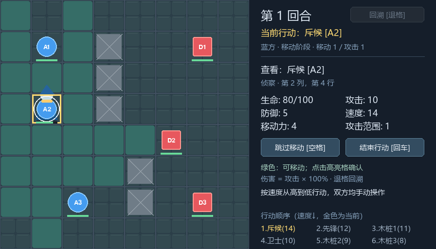
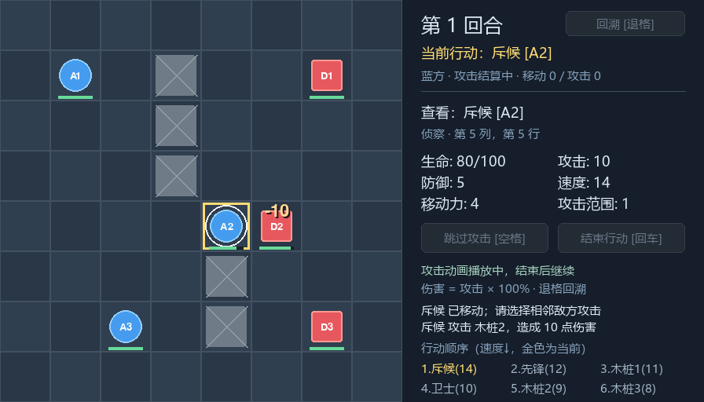
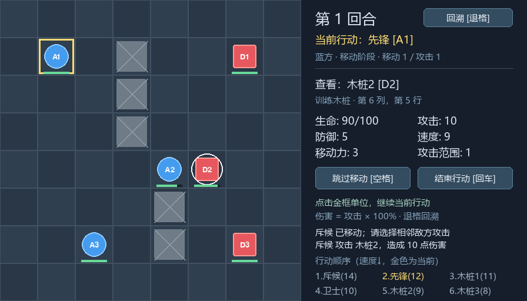
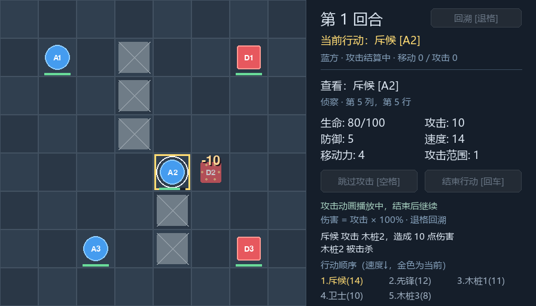
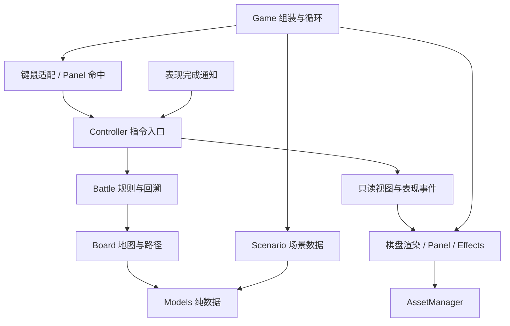

# 完整项目源码

本文件由 `python scripts/export_source.py` 生成。包含项目全部文本源码、配置和文档；不包含自身、二进制 PNG、截图、虚拟环境、缓存及压缩包。演示 PNG 可由 scripts/generate_demo_assets.py 重建。

## .gitattributes

```text
* text=auto eol=lf
*.png binary
*.zip binary
```

## .github/workflows/ci.yml

```yaml
name: Tests

on:
  push:
    branches: [main]
  pull_request:
  workflow_dispatch:

permissions:
  contents: read

jobs:
  regression:
    name: ${{ matrix.os }} / Python ${{ matrix.python }}
    runs-on: ${{ matrix.os }}
    timeout-minutes: 10
    strategy:
      fail-fast: false
      matrix:
        os: [ubuntu-24.04, windows-2022]
        python: ['3.9', '3.12']
    env:
      SDL_VIDEODRIVER: dummy
      SDL_AUDIODRIVER: dummy
      PYGAME_HIDE_SUPPORT_PROMPT: '1'
    steps:
      - uses: actions/checkout@v7
      - uses: actions/setup-python@v7
        with:
          python-version: ${{ matrix.python }}
          cache: pip
      - name: Verify core without site packages
        run: python -S -m unittest discover -s tests -p test_core.py -v
      - name: Verify controller without site packages
        run: python -S -m unittest discover -s tests -p test_controller.py -v
      - name: Verify snapshots and resolutions without site packages
        run: python -S -m unittest discover -s tests -p test_resolution.py -v
      - name: Verify content and manifest without site packages
        run: python -S -m unittest discover -s tests -p test_content.py -v
      - name: Install dependencies
        run: python -m pip install -r requirements.txt
      - name: Check source bundle
        run: python scripts/export_source.py --check
      - name: Run regression tests
        run: python -m unittest discover -s tests -v
```

## .gitignore

```text
.venv/
__pycache__/
*.py[cod]
artifacts/*
!artifacts/*.png
dist/
.delivery/
build/
.pytest_cache/
.coverage
htmlcov/
.env
.env.*
!.env.example
*.pem
*.key
```

## AGENTS.md

````markdown
# 项目维护与后续开发约定

## 先确认实际状态

- 最近发布版本是 v0.1.0，开发代码已完成 M1–M4：规则/表现分离、纯数据回溯与结算确认，以及 JSON 内容、资源缓存和图片/动画链路。M5 尚未实施；以 `TASKS.md` 区分现有能力和规划。
- 修改玩法、结构或资源入口前，阅读 [整体架构](docs/ARCHITECTURE.md)、[实施路线](docs/ROADMAP.md) 与 [功能开发规范](docs/FEATURE_DEVELOPMENT.md)。接入美术时同时遵守 [资源规范](docs/ASSET_GUIDE.md)。用户提供的原始报告是评审材料，当前开发决策以这些评审后文档为准。

## 开发边界

- 这是离线 Python/Pygame 战棋原型。保留几何绘制作为无素材时的默认回退，后续美术通过统一资源与渲染层接入；具体玩法按用户需求推进。
- 业务规则放在 `tactics/battle.py`，空间与路径规则放在 `tactics/board.py`。Board 显式接收 Scenario，不恢复像素坐标或绘图入口；坐标由 Geometry 转换，绘制由 BoardRenderer 读取 BoardView 完成。
- 应用操作统一经过 `Controller`，通过 `get_view_state()` 查询独立的 BattleView；不向 Game、Panel、Renderer、Effects 暴露活动 Unit/Board/Battle。Game 只做组装、输入适配、循环与清理；Panel 用 `hit_test(position)` 返回 UIAction，按钮矩形保持内部实现。
- `move_to/attack` 对当前行动者提交指令，与查看谁的属性无关；鼠标通过 `click_cell` 保留“先选回行动者再操作”的交互。不要让未来 AI 模拟像素点击，也不以重建 Game 内部字段作为测试夹具；用 Scenario 构建局面。
- 表现接口为 `play_attack(AttackPresentation)/update(elapsed)->tuple[ResolutionToken,...]/clear()`。Controller 只接受当前结算编号与表现代次的完成通知，不以全局 busy 状态推进回合；动画不修改规则。素材动画沿用此接口，循环待机由 Renderer 更新，不进入阻塞队列。
- 默认内容从 `content/units.json` 和 `content/scenarios/training_ground.json` 加载，禁止重新在 Python 写第二份默认数值。JSON 引用和结构错误必须启动时定位；Unit.definition_id 属于快照与视图，外观/图片路径不进入规则状态。
- AssetManager 在显示初始化后加载 `assets/manifest.json`；预载原图、帧列表和显示尺寸，绘制时只读缓存。图片按解析后的路径缓存、缩放按路径/尺寸缓存，缺失也缓存并按资源 ID 记录一次。路径不得逃逸资源根。
- 当前支持 PNG、显式帧列表、idle 循环及 attack/death 非循环，不假装支持图集切帧、音频或热重载。大精灵与死亡形体按脚底/稳定 ID 排序，全部标签、高亮和血条在形体之后绘制。`--geometry` 完全绕过资源加载；可选图片缺失使用几何回退，必需图片/清单错误不能静默忽略。
- AttackResult、UnitSnapshot、TurnSnapshot 均为独立不可变值；行动队列快照存 UID。回溯重建 Unit，跨回溯的旧实体引用不再有效，调用方按 UID 重新查询。新 Unit 字段必须同步快照与恢复，字段覆盖测试不得绕过。
- 结算编号在同一 Battle 中单调递增且不回溯；Controller 成功回溯或程序化 restart 时先提升表现代次并作废待确认，再清理表现、恢复/重建规则。失败回溯不改变代次或表现；新异步效果必须沿用匹配确认入口。
- 后续功能必须建立在可扩展边界上：先明确规则入口、数据归属、回溯策略、表现/资源接入和验收证据。前置能力缺失时先补齐最小必要部分，与需求一并交付；不能以架构未完成为由无限延后任务，也不为每个小改动制造额外批准流程。
- 新增规则代码不依赖 Pygame；渲染、UI、动画和未来 AI 不直接改战斗状态。UI/AI 共用合法性校验和指令入口，避免复制规则。
- 新增运行状态必须明确快照与恢复行为；新增资源、图片、字体、动画进度不得进入规则快照。对外视图和结算结果使用独立数据与稳定 ID，不向表现层泄露可变实体。
- 图片集中加载和缓存，不在每帧读盘；路径相对资源根解析。替换美术不能改变占格、移动、攻击或回溯语义。
- 抽象和模块必须有实际调用方。不提前创建空的插件、ECS、通用注册中心或未使用扩展层。结构性整改使用专用分支、分阶段验证与审查差异。

## 验证和维护

- 修改代码、测试或配置时，同步维护 `TASKS.md` 和 `CHANGELOG.md`；行为或操作变化同步到 `README.md`。
- 保留直接读取字体文件和字体扫描异常的回退逻辑，避免启动时再次因 Windows 字体注册表异常崩溃。
- 完成修改后运行 `python -m unittest discover -s tests -v`，并说明真实窗口与无窗口测试的验证边界。
- 修改规则、场景、几何或棋盘视图后，另运行 `python -S -m unittest discover -s tests -p test_core.py -v`，保证无第三方包时仍可运行。不要为兼容旧测试把 Pygame 加回核心。
- 修改协调、动作或完整视图后，另运行 `python -S -m unittest discover -s tests -p test_controller.py -v`。CI 在安装依赖前执行这两组检查。
- 修改快照、结算或动画交接后，另运行 `python -S -m unittest discover -s tests -p test_resolution.py -v`；CI 安装依赖前执行三组共 44 项检查。真实动画还需完整回归验证，纯测试不能代替实际完成通知与清理检查。
- 修改内容或清单后，另运行 `python -S -m unittest discover -s tests -p test_content.py -v`，CI 安装依赖前合计 57 项；原图/缩放缓存和实际资源链路由 `test_assets.py` 及真实窗口检查。Windows 无创建符号链接权限时该项可明确跳过，路径越界等其他检查仍须通过。
- 保留原有行为覆盖；接口迁移时可调整测试夹具，不为保留旧字段访问而保留架构漏洞。新增架构边界在相应阶段就加入检查，不推迟到最终验收。
- 使用 `python scripts/export_source.py` 更新 `SOURCE.md`，再用 `python scripts/export_source.py --check` 检查一致性。
- 不提交虚拟环境、缓存、安装器、凭据或 `dist/`、`.delivery/` 中的生成文件。`artifacts/*.png` 是随文档交付的运行截图。
````

## CHANGELOG.md

````markdown
# 更新记录

## 未发布

### M4 · 内容与资源接入

- 默认单位定义和训练场迁到 JSON，保留 default_scenario() 入口；严格验证格式、版本、重复 ID/键、定义引用、属性和出生局面，错误包含文件位置。
- Unit/UnitSnapshot/View 增加 definition_id，攻击结果补充双方定义 ID 和行动位置；用于关联外观，不改变移动、伤害、顺序或回溯算法。
- 新增纯 manifest 解析与 Pygame AssetManager；校验根目录边界、PNG 路径、尺寸、锚点、动画帧/状态引用。原图按路径、缩放按路径与尺寸缓存，可选失败缓存并报告一次，必需缺失启动时拒绝。
- 默认渲染实际接入项目脚本生成的地砖和 64×96 斥候 PNG，支持循环待机、非循环攻击/死亡、脚底锚点、按脚底排序及独立高亮/血条层。
- 素材动画沿用 M3 token 完成确认；等待当前阻塞任务，不等待循环待机。缺失帧按几何效果回退，回溯/重开清理旧形体及通知。
- 新增 --geometry、--scenario、--content-root、--assets 启动参数；默认路径不依赖工作目录。显式几何模式无需资源清单，错误配置清晰退出。
- 新增 13 项纯内容/清单与 16 项实际 PNG/渲染检查，共 123 项；本机 122 通过，1 项 Windows 符号链接权限跳过。57 项可在无第三方包环境执行（含该跳过项）。
- 路径断言比较规范化结果，兼容 Windows CI 临时目录的 8.3 短路径别名；根目录边界与符号链接逃逸校验保持启用。
- 无窗口与 Windows 实际窗口回归完成；几何模式 13 帧与 M3 一致，素材模式验证透明度、缩放、图层、攻击/死亡、复活及异地目录入口，新增 4 张截图。
- SOURCE 汇总纳入 content/assets 文本；演示 PNG 及来源/制作约定随源码交付。M5 扩展与发布演练仍未实施。

### M3 · 纯数据回溯与结算确认

- AttackResult 改为结算编号、行动/目标 UID、目标位置/阵营、完整伤害、前后生命及击杀等不可变值，不保留活动实体引用。
- 新增覆盖 Unit 全部字段的 UnitSnapshot；TurnSnapshot 只存单位值、UID 顺序槽位、轮数、阶段、结果与日志，回溯按 UID 重建运行单位。
- Battle 为合法攻击分配单调递增且不回溯的编号，finish_attack 必须匹配当前编号，重复或错误编号无效。
- AttackPresentation 携带 ResolutionToken（表现代次、结算编号）；Effects.update 返回完成通知，Controller 验证后交接，不再轮询全局 busy。
- 成功回溯及程序化 restart 先作废旧代次，再清除表现、恢复/重建状态；失败回溯不产生副作用。没有新增玩家重开按钮或快捷键。
- 保留原 75 项覆盖，新增 16 项纯数据/协议检查与 3 项真实动画通知检查，共 94 项通过；44 项无需第三方包并纳入 CI 安装依赖前步骤。
- Windows 13 个关键画面与 M2 逐像素一致；覆盖击杀形体消失、连续回溯复活、重开清理、结算中关闭和 5×4 注入场景。
- 保持 100% 攻击伤害、行动顺序、动画时长及上一行动回溯语义；磁盘存档、外部内容与美术资源尚未实施。

### M2 · 操作协调与完整界面视图

- 新增无 Pygame 的 Controller，统一选择、移动、按 UID 攻击、跳过、结束与回溯；返回成功/失败及原因，沿用 Battle 的唯一规则实现。
- 新增不可变 BattleView/UnitView，覆盖完整属性、棋盘范围、选中/行动者、队列、双语日志、结束状态和按钮可用状态。
- InfoPanel 只读取视图，通过 UIAction 命中接口返回意图；Game 缩减为组装、键鼠适配、更新/绘制调度与退出，不保留可变规则对象兼容字段。
- Controller 接管输入锁定与动画结束交接，Effects 只接收独立 AttackPresentation；击杀、动画时长、100% 攻击伤害与上一行动回溯语义保持不变。
- 迁移测试夹具为 Scenario，保留原 57 项覆盖，新增 18 项协调、只读数据、按钮边界与依赖检查，共 75 项通过；28 项可在 `python -S` 下运行并纳入 CI 安装依赖前步骤。
- Windows 实际窗口自动交互验证通过；13 个关键画面与 M1 逐像素一致，包含查看、英文界面、敌方行动、击杀、回溯和战斗结束。
- M3 内部结果/快照 ID 化与结算协议、M4 资源接入仍未实施。

### M1 · 规则与渲染职责分离

- 提取不可变 UnitSpawn/Scenario、默认场景和验证；Board 必须显式接收场景，每局创建独立单位状态。
- Board 不再依赖 Pygame、固定像素尺寸或默认阵容，仅管理逻辑地图、空间查询和 BFS。
- 新增纯数值 BoardGeometry，棋盘、特效、点击与侧栏使用同一套场景尺寸。
- 新增 BoardRenderer 与最小只读 BoardView；渲染器不接收活动 Unit/Board/Battle，不查询战斗合法性。
- 迁移原有 41 项测试入口而保留行为断言，新增 16 项场景、几何、依赖边界和渲染检查，共 57 项通过。
- 12 项核心检查可使用 `python -S` 在无第三方包的环境运行，并加入 CI 的依赖安装前步骤。
- 默认场景 8 个关键画面与重构前逐像素一致；Windows 实际窗口验证 5×4 场景、攻击、回溯和退出。
- M2 控制器/完整 UI 视图、M3 结算与快照迁移、M4 美术资源接入仍未实施。

### 2026-10-22 · 架构评审与整体规划

- 对照 v0.1.0 源码审阅用户的架构整改报告，记录采纳、调整与补充意见。
- 制定规则、应用协调、表现/资源分层及稳定 ID、只读视图、快照和动画完成契约。
- 增加分阶段路线、资源/动画制作与接入规范、后续功能开发要求，并更新 AGENTS 与 TASKS。
- 源码汇总脚本纳入 docs，保证规划文档与源码汇总一起交付。
- 本次没有实施 M1–M5 重构，也没有增加玩法、修改伤害或回溯语义。

## 0.1.0 - 2026-10-22

首次仓库交付，包含当前已实现的完整离线战棋原型。

- 8×8 棋盘、64 像素格子、蓝色友方、红色训练木桩和固定障碍。
- 单位生命、攻击、防御、速度、移动力；按速度排序行动，移动与攻击各一次。
- 四方向路径范围、障碍及单位阻挡、相邻敌方攻击、跳过阶段和结束行动。
- 当前/最大生命值与血条；伤害按攻击力 100% 结算，显示上浮淡出的伤害数字。
- 生命归零后播放几何击杀动画并消失，退出行动队列；一方全灭后结束战斗。
- 退格键及界面按钮回溯上一单位行动，可恢复被击杀单位并连续回溯。
- 修复 Pygame Windows 字体扫描出现非字符串注册表项时的启动异常。
- 41 项规则、交互、动画、回溯及字体回归检查；附实际 Windows 窗口截图。
- 提供 README、任务进度、源码汇总脚本和 Windows/Linux 自动测试配置；源码压缩包不包含虚拟环境和缓存。
````

## README.md

````markdown
# Chrono Tactics · 离线回溯战棋

仓库名称：`chrono-tactics-pygame`，最近发布版本：`0.1.0`；当前开发代码已完成 M1–M4（未发布）。

项目仓库：[zyb-sjtu/chrono-tactics-pygame](https://github.com/zyb-sjtu/chrono-tactics-pygame)。这是私有仓库，需要登录有权限的 GitHub 账号访问。

使用 Python 和 Pygame 绘制，运行时不访问网络，不需要另行下载美术。默认显示随项目提供的演示地砖与斥候 PNG，也可用 --geometry 回到几何模式。棋盘保持 8×8，每格 64×64，侧栏 384 像素，窗口 896×512。

## 整体规划与后续开发

已完成评审和 M1–M4：规则与表现分离、纯数据回溯、结算确认、JSON 内容/资源清单、PNG 缓存和实际素材动画。回溯按 UID 重建单位，重复或过期动画通知不会推进回合。当前是程序生成的演示美术，最终风格与 M5 扩展/发布验收尚未交付。

| 文档 | 内容 |
| --- | --- |
| [意见评审](docs/ARCHITECTURE_REVIEW.md) | 哪些建议采纳、哪些调整，以及源码证据和原报告遗漏 |
| [整体架构](docs/ARCHITECTURE.md) | 模块职责、依赖、指令与视图、快照、动画和扩展入口 |
| [实施路线](docs/ROADMAP.md) | M0–M5、前置能力、小批次提交与验收标准 |
| [美术资源规范](docs/ASSET_GUIDE.md) | 路径、清单、缓存、透明图片、锚点、图层和动画 |
| [功能开发规范](docs/FEATURE_DEVELOPMENT.md) | 新功能的数据归属、回溯方案、扩展边界与完成条件 |
| [M1 实施与验收](docs/M1_IMPLEMENTATION.md) | M1 模块接口、场景示例、57 项检查与 8 帧像素对照 |
| [M2 实施与验收](docs/M2_IMPLEMENTATION.md) | Controller 接口、完整视图、75 项检查与 13 帧像素对照 |
| [M3 实施与验收](docs/M3_IMPLEMENTATION.md) | 纯数据快照、结算与代次协议、94 项检查及 13 帧像素对照 |
| [M4 实施与验收](docs/M4_IMPLEMENTATION.md) | JSON 格式、资源替换、缓存、动画、123 项检查与实际窗口 |

下一任务是 **ARCH-05 / M5**。后续功能需要先具备对应的最小架构边界；新增状态必须能回溯，新增美术通过资源与渲染入口接入。约束同时写入 [AGENTS.md](AGENTS.md)，实现进度见 [TASKS.md](TASKS.md)。

## 运行

当前机器已经配置好独立环境，无需激活或重新安装：

```powershell
cd E:\gamedesign
.\.venv\Scripts\python.exe main.py
```

如果旧版窗口还开着，请先关闭，再执行以上命令。

切回旧几何画面（不加载资源清单/图片），或选择关卡和资源目录：

```powershell
.\.venv\Scripts\python.exe main.py --geometry
.\.venv\Scripts\python.exe main.py --scenario scenarios/training_ground.json --assets assets
```

默认内容/资源路径相对项目位置解析，与工作目录无关。--scenario 相对 content 根；显式传入 --content-root 或 --assets 时，目录相对当前工作目录或使用绝对路径。更换单位、地砖和动画只改 JSON/PNG，步骤见 [M4 记录](docs/M4_IMPLEMENTATION.md) 和 [资源来源](assets/README.md)。

在新机器安装（Python 3.9 或以上、可用的桌面环境）：

```powershell
git clone https://github.com/zyb-sjtu/chrono-tactics-pygame.git
cd chrono-tactics-pygame
py -m venv .venv
.\.venv\Scripts\python.exe -m pip install -r requirements.txt
.\.venv\Scripts\python.exe main.py
```

首次安装依赖需要联网，安装后游戏可完全离线运行。如果使用本机 Miniconda 创建新环境时提示 SSL 模块不可用，可仅在当前 PowerShell 会话中先运行以下命令再安装依赖；其他 Python 安装通常不需要：

```powershell
$env:PATH = 'D:\Miniconda3;D:\Miniconda3\Library\bin;' + $env:PATH
```

## 战斗规则

- 3 个蓝方与 3 个红色木桩均为单位，具有生命、攻击、防御、速度、移动力；默认斥候使用带帽蓝色演示精灵，其余为蓝圆/红方块几何回退。侧栏显示 `生命: 80/100`，棋盘显示血条。基础数值在 `content/units.json`，阵容/实例覆盖在 `content/scenarios/training_ground.json`，仍为演示占位值。
- 入场时将双方单位按速度从高到低排序，同速按入场顺序排列。每轮各行动一次，全部行动后进入下一轮，按相同顺序继续。
- 每次行动分为**一次移动 → 一次攻击**。可以跳过移动、跳过攻击，或直接结束行动；成功攻击后，动画播放完毕再交接给下一位。
- 移动和攻击均按上下左右四方向计算，不允许斜走或斜向攻击。
- 移动目的地可以是移动力步数内的任意可达空格，按实际通路步数计算。障碍、友方和敌方单位均不能穿过或重叠。即使没有用满步数，也消耗本次移动机会，不能分段多次移动。
- 攻击仅能锁定距离 1 格的敌方单位，不能攻击自己、同阵营、斜向或更远的单位。必须先完成或跳过移动，才能攻击。
- 伤害为**攻击属性的 100%**，当前防御属性不减伤。例如攻击 10 对生命 100/100 的目标造成 10 点伤害，生命变为 90/100。伤害跳字显示攻击结算值，持续约 0.9 秒并向上浮动淡出；过量伤害下生命最低为 0。
- 生命归零即被击杀：播放约 0.65 秒的闪烁、缩小、碎点扩散和淡出动画，然后在棋盘消失。被击杀单位不再阻挡路径、不能被选为目标，也不会再次行动。
- 攻击动画期间锁定移动、攻击、结束行动和回溯，窗口仍能正常关闭；动画使用逐帧更新时间，没有阻塞式等待。
- 一方全灭后显示胜方，停止继续行动，仍可回溯最后一次行动并恢复被击杀单位。
- **双方均由玩家手动操作，没有 AI。** 红色木桩同样参与回合，可手动移动和攻击；不操作时不会自行行动。

## 操作

| 操作 | 效果 |
| --- | --- |
| 左键点击任意单位 | 查看其属性；查看其他单位不会改变当前行动者 |
| 当前行动者被选中时，点击绿色格 | 移动一次，进入攻击阶段 |
| 攻击阶段点击相邻敌方 | 扣血、显示伤害跳字；动画结束后进入下一单位行动 |
| 空格 / 侧栏“跳过移动/攻击” | 跳过当前阶段 |
| 回车 / 侧栏“结束行动” | 放弃剩余操作，进入下一单位行动 |
| 退格 Backspace / 右上角“回溯” | 回到上一单位行动开始前，可以连续回溯 |
| 点击窗口关闭按钮 | 退出并释放资源 |

金色方框标记当前行动者，白色圆环标记正在查看的单位。查看其他单位后，点击金框单位可继续行动。非法目的地或无效点击不会消耗行动。灰色方块为固定障碍，红色范围为四方向相邻攻击范围，目标格有额外边框。

回溯按完整的“单位行动回合”处理：例如斥候行动完轮到先锋，按退格会回到斥候开始行动前。会恢复双方全部单位的位置、当前/最大生命与其他属性、行动顺序、轮数、日志和战斗结束状态；此前被击杀的单位也会恢复。若先锋已走了一步，这一步也一并撤回。首个单位的首个行动没有上一行动可回溯，此时按钮禁用；回溯后产生的新行动会替换原来的后续历史。历史仅保存在本次游戏进程中。

开局可直接体验：速度最高的斥候 A2 先行动，点击**第 5 列、第 5 行**的绿色格（内部坐标 `(4, 4)`），再点击右边木桩 D2，即可看到 `-10` 跳字。动画结束后轮到先锋 A1，点击木桩可看到生命 `90/100`。此时按退格，斥候的位置与木桩的生命都会恢复。显示坐标以左上角第 1 列、第 1 行开始，代码中的坐标从 0 开始。

## 项目目录与职责

```text
E:\gamedesign\
├── main.py                  # 入口
├── requirements.txt         # pygame==2.6.1
├── .gitignore
├── .gitattributes
├── AGENTS.md                # 后续维护约定
├── TASKS.md                 # 已完成功能与验证边界
├── CHANGELOG.md             # 版本记录
├── README.md
├── SOURCE.md                # 各文本文件完整代码汇总
├── .github/workflows/ci.yml  # Windows/Linux × Python 3.9/3.12
├── scripts/export_source.py # 源码汇总生成与一致性检查
├── docs/
│   ├── ARCHITECTURE_REVIEW.md # 对原整改报告的源码核对与评审
│   ├── ARCHITECTURE.md      # M1–M4 已实施，M5 待验收
│   ├── M1_IMPLEMENTATION.md # M1 接口与验证记录
│   ├── M2_IMPLEMENTATION.md # M2 指令、视图与验证记录
│   ├── M3_IMPLEMENTATION.md # M3 快照、结算确认与验证记录
│   ├── M4_IMPLEMENTATION.md # M4 内容、资源与验证记录
│   ├── ROADMAP.md           # 阶段、前置与验收
│   ├── ASSET_GUIDE.md       # 美术资源与动画规范
│   ├── FEATURE_DEVELOPMENT.md # 后续开发约束
│   └── references/architecture_proposal.md # 用户原始意见
├── tactics\
│   ├── __init__.py
│   ├── settings.py          # 格子像素、侧栏等表现默认值
│   ├── models.py            # 单位状态、纯数据单位快照和攻击结果
│   ├── scenario.py          # 不可变场景、验证、默认阵容
│   ├── content.py           # 纯 JSON 定义/场景加载
│   ├── data_files.py        # 纯 JSON 与安全相对路径工具
│   ├── asset_manifest.py    # 纯清单、帧/状态引用验证
│   ├── assets.py            # PNG/缩放缓存、锚点与帧列表
│   ├── board.py             # 纯逻辑地图、空间查询与 BFS
│   ├── geometry.py          # 不依赖 Pygame 的坐标转换
│   ├── actions.py           # UIAction 与操作结果
│   ├── controller.py        # 统一操作、选中 UID、代次与结算确认
│   ├── view_models.py       # 完整只读视图与独立表现数据
│   ├── board_renderer.py    # 只读视图驱动的棋盘绘制
│   ├── battle.py            # 规则、结算编号、纯数据快照与回溯
│   ├── effects.py           # 伤害/击杀动画、逐帧更新与完成通知
│   ├── panel.py             # 字体回退、只读侧栏与动作命中
│   └── game.py              # 鼠标/键盘事件、主循环、退出清理
├── tests\
│   ├── test_battle.py       # 11 项战斗规则检查，无需创建窗口
│   ├── test_game.py         # 11 项窗口交互、绘制与字体检查
│   ├── test_effects.py      # 10 项几何动画、通知、清理和交互检查
│   ├── test_assets.py       # 16 项 PNG、缓存、渲染和动画检查
│   ├── test_content.py      # 13 项无第三方包的内容/清单检查
│   ├── test_core.py         # 12 项无第三方包的 M1 核心检查
│   ├── test_controller.py   # 16 项无第三方包的协调与数据边界检查
│   ├── test_resolution.py   # 16 项无第三方包的快照和结算协议检查
│   ├── test_rendering.py    # 6 项只读视图、渲染、按钮和场景注入检查
│   └── test_rewind.py       # 12 项回溯、击杀及行动顺序检查
├── content/                 # units.json、scenarios/training_ground.json
├── assets/                  # manifest.json、README、tiles/units 下的 9 张 PNG
├── scripts/generate_demo_assets.py # 重建演示 PNG，不下载外部资源
├── artifacts\               # 实际运行截图，不是游戏资源
│   ├── m4_assets.png        # 当前默认地砖/斥候素材
│   ├── m4_attack.png        # 素材攻击与跳字
│   ├── m4_death.png         # 素材死亡帧
│   ├── m4_revived.png       # 回溯恢复素材单位
│   ├── initial.png          # 开局移动范围
│   ├── selected.png         # 移动后可攻击目标
│   ├── damage_popup.png     # 实际攻击 10 的跳字
│   ├── after_attack.png     # 木桩生命 90/100
│   ├── enemy_turn.png       # 红方手动回合
│   ├── rewind.png           # 回溯后恢复位置和血量
│   ├── defeat.png           # 击杀动画中间帧
│   ├── defeat_disappeared.png # 击杀动画后消失
│   ├── defeat_result.png    # 击杀后交接回合
│   ├── defeat_rewind.png    # 回溯恢复被击杀单位
│   └── m1_custom_scenario.png # M1 第二场景实际窗口
└── .venv\                   # 本机独立环境，生成内容
```

完整文本文件内容见 [SOURCE.md](SOURCE.md)。虚拟环境和缓存不提交，运行截图随文档保留。更新文本文件后执行：

```powershell
python scripts/export_source.py
python scripts/export_source.py --check
```

## 源码压缩包

可在 GitHub 仓库中通过 Code → Download ZIP 下载源码，也可在本地 Git 仓库生成：

```powershell
New-Item -ItemType Directory -Force dist
git archive --format=zip --prefix=chrono-tactics-pygame/ --output=dist/chrono-tactics-pygame-dev.zip HEAD
```

源码包包含运行代码、测试、文档、配置和截图，不包含 `.venv`、缓存或凭据；解压后按上面的新机器安装步骤创建环境。这是 Python 源码包，未构建独立 EXE。

## 验证记录

M4 共 **123 项测试**，本机 **122 通过、1 项跳过**（Windows 无创建符号链接权限；其他路径越界检查通过）。其中 **57 项无需第三方包**，含该跳过项。完整检查在 dummy 与 Windows 实际窗口完成；几何模式 13 帧与 M3 逐像素一致，素材模式验证了透明度、锚点、图层、缓存、攻击/死亡与回溯，并通过其他工作目录下的实际入口验证。详情见 [M4 记录](docs/M4_IMPLEMENTATION.md)。

```powershell
.\.venv\Scripts\python.exe -S -m unittest discover -s tests -p test_core.py -v
.\.venv\Scripts\python.exe -S -m unittest discover -s tests -p test_controller.py -v
.\.venv\Scripts\python.exe -S -m unittest discover -s tests -p test_resolution.py -v
.\.venv\Scripts\python.exe -S -m unittest discover -s tests -p test_content.py -v
.\.venv\Scripts\python.exe -m unittest discover -s tests -v
```

v0.1.0 基线记录：2026-10-22，本机 Python 3.9.1 / Pygame 2.6.1 / SDL 2.28.4 实测 **41 项检查全部通过，退出码 0**。覆盖速度和同速顺序、四方向范围、路径阻挡、移动次数、敌我与攻击距离限制、攻击 100% 结算及忽略防御、过量伤害归零、跳字生命周期、动画期间锁定操作及正常关闭、实际画面中击杀形体消失、死亡后的行动顺序、连续和跨轮回溯、回溯恢复已死单位与当前/最大生命、回溯战斗结束状态，以及原有窗口和字体回退。

另外通过 `main.py` 实际入口创建窗口，使用 `windows` 显示驱动向事件队列投递鼠标和键盘事件，验证了两条完整流程，均退出码 0：默认配置下“移动 → 攻击 10 → 跳字 → 查看 90/100 → 红方回合 → 连续回溯”；测试场景下“攻击生命 5 的目标 → 击杀动画 → 形体消失 → 下一回合 → 回溯复活”。击杀场景仅在验证进程中设置目标生命为 5，没有改动游戏默认初始数据。已保存截图并查看跳字、扣血、击杀动画、消失和复活的实际画面。这是自动投递事件验证，并非人工鼠标逐次操作；其他系统尚未实测。

保留字体问题修复：优先直接加载 Windows 字体文件，失败后再扫描系统字体；扫描抛出 TypeError、OSError、ValueError 或 pygame.error 时，回退到 Pygame 内置字体与英文界面。不修改系统字体或注册表。

自动测试配置位于 [.github/workflows/ci.yml](.github/workflows/ci.yml)，使用虚拟显示驱动执行回归检查；它不能替代实际窗口的显示效果检查。远程运行结果见仓库 Actions 页面。CI 使用的动作版本参照 [checkout](https://github.com/actions/checkout) 和 [setup-python](https://github.com/actions/setup-python) 官方用法。



以下为保留的几何模式画面：






````

## TASKS.md

````markdown
# 项目进度

最近发布版本：`0.1.0`。开发代码已完成 M1–M4（未发布）；已实现能力与后续规划分开记录。

## 已实现能力

| ID | 状态 | 内容 |
| --- | --- | --- |
| BOARD-01 | 已完成 | 默认 8×8 棋盘，每格 64×64；项目内生成演示图片，保留几何模式 |
| UNIT-01 | 已完成 | 双方各 3 个单位、固定障碍、点击查看属性 |
| TURN-01 | 已完成 | 速度排序、四方向移动、相邻攻击、手动操作双方、跳过与交接 |
| COMBAT-01 | 已完成 | 当前/最大生命与血条，攻击力 100% 伤害，伤害跳字 |
| COMBAT-02 | 已完成 | 击杀动画、消失、死亡单位退出队列、一方全灭结束战斗 |
| REWIND-01 | 已完成 | 回溯上一单位行动开始前、连续回溯、恢复死亡单位和战斗状态 |
| FIX-01 | 已完成 | Windows 系统字体扫描异常回退，保留英文降级界面 |
| QA-01 | 已完成 | 123 项测试，本机 122 通过、1 项符号链接权限跳过；57 项无需第三方包；几何模式 13 帧与 M3 一致，素材真实窗口实测 |
| ASSET-01 | 已完成 | JSON 单位/场景、清单验证、PNG 与缩放缓存、可选缺失回退、必需缺失拒绝、静态和循环/非循环素材接入 |
| DELIVERY-01 | 已完成 | 运行文档、源码汇总生成脚本、忽略规则和自动测试配置 |

CI 配置覆盖 Windows / Linux 与 Python 3.9 / 3.12。远程执行结果以 GitHub Actions 为准，配置存在不代表运行已通过。

路径检查比较解析后的规范路径，兼容 Windows CI 临时目录的 8.3 短路径别名；不通过跳过或放宽根目录边界来解决平台差异。

当前没有 AI、网络、存档或独立 EXE。数值仍为演示占位值，防御暂不参与伤害计算。

## 架构规划与实施状态

| ID | 阶段 | 状态 | 内容与验收重点 |
| --- | --- | --- | --- |
| ARCH-00 | M0 | 已完成 | 评审用户意见、整体架构、资源与功能开发规范、分阶段路线；后续约束写入 AGENTS |
| ARCH-01 | M1 | 已完成 | 场景注入、纯逻辑 Board、Geometry、BoardRenderer 与最小 BoardView；57 项检查及 8 帧一致性验收 |
| ARCH-02 | M2 | 已完成 | Controller 统一操作与动画交接、完整只读 View、UIAction 命中；Game/表现不持有可变战斗对象，75 项检查及 13 帧一致性验收 |
| ARCH-03 | M3 | 已完成 | ID 化 AttackResult、纯数据快照/UID 重建、结算编号与表现代次确认；拒绝重复/过期通知，94 项检查及 13 帧一致性验收 |
| ARCH-04 | M4 | 已完成 | 内容/资源清单、路径/引用验证、缓存和真实默认渲染链路；123 项测试、几何像素对照及素材窗口验收 |
| ARCH-05 | M5 | 未开始 | 场景与外观扩展演练、完整回归、真实窗口与跨平台验收 |

实现与验证见 [M1](docs/M1_IMPLEMENTATION.md)、[M2](docs/M2_IMPLEMENTATION.md)、[M3](docs/M3_IMPLEMENTATION.md) 和 [M4 实施记录](docs/M4_IMPLEMENTATION.md)。下一实施任务为 **ARCH-05 / M5**：正式扩展演练、开发模板与阶段发布验收。当前演示素材不是最终美术，尚无图集切帧、音频、热重载或磁盘存档。

阶段依赖、提交拆分和完成条件见 [ROADMAP](docs/ROADMAP.md)，技术边界见 [ARCHITECTURE](docs/ARCHITECTURE.md)。每个阶段同步增加所需边界测试，不等全部迁移后才测试。

后续技能、AI、美术、地图、存档等需求，须先明确扩展点与最小必要前置，按 [FEATURE_DEVELOPMENT](docs/FEATURE_DEVELOPMENT.md) 实施。此表不是新增玩法承诺。
````

## assets/README.md

````markdown
# 演示资源来源与替换

这 9 张 PNG 是 `scripts/generate_demo_assets.py` 使用 Pygame 几何图形生成的项目演示素材，没有下载或引用第三方美术。它们用于验证资源链路，不代表最终美术风格。资源无第三方素材许可要求；项目整体授权仍由仓库所有者决定，本文件不另设开源许可证。

| 文件 | 原始 / 基准显示尺寸 | 锚点 | 用途 |
| --- | --- | --- | --- |
| tiles/floor.png | 64×64 / 64×64 | (0.5, 0.5)，格子中心 | 地砖 |
| units/scout_idle_0/1.png | 64×96 / 64×96 | (0.5, 1)，格子脚底中心 | 2 帧、2 fps 循环待机 |
| units/scout_attack_0/1/2.png | 64×96 / 64×96 | (0.5, 1) | 3 帧、8 fps 非循环攻击 |
| units/scout_death_0/1/2.png | 64×96 / 64×96 | (0.5, 1) | 3 帧、5 fps 非循环死亡 |

重建演示 PNG（会覆盖上述指定文件，不改清单）：

```powershell
.\.venv\Scripts\python.exe scripts/generate_demo_assets.py
```

替换美术时修改 `manifest.json` 的文件、显示尺寸、pivot、帧列表及状态映射即可；不改单位 cell、移动力或战斗代码。文件相对本目录，使用正斜杠且不得逃逸资源根；图片当前限 PNG。角色与特效建议 RGBA，人物可以高于一个格子，点击仍按格子计算。

缓存 Surface 按只读方式共享，渲染代码不得原地 fill、set_alpha 或改像素；临时效果请使用独立副本或预生成的帧，避免一次播放污染其他单位的缓存图片。

当前定义对应四个 visual_id，只有斥候配置了图片与动画；其他 visual 的空对象明确表示几何回退。所有演示图片 optional=true，删除图片仍可用几何模式运行；清单格式错误、无效引用或必需图片不可用会在启动时报错。`--geometry` 完全跳过资源清单和图片加载。

新引入的外部素材须在此记录作者、原始链接、许可证/授权范围、原始与显示尺寸、锚点和修改记录。详见 [资源规范](../docs/ASSET_GUIDE.md) 与 [M4 实施记录](../docs/M4_IMPLEMENTATION.md)。
````

## assets/manifest.json

```text
{
  "schema_version": 1,
  "images": {
    "tile.floor": {"path":"tiles/floor.png","display_size":[64,64],"pivot":[0.5,0.5],"optional":true},
    "scout.idle.0": {"path":"units/scout_idle_0.png","display_size":[64,96],"pivot":[0.5,1.0],"optional":true},
    "scout.idle.1": {"path":"units/scout_idle_1.png","display_size":[64,96],"pivot":[0.5,1.0],"optional":true},
    "scout.attack.0": {"path":"units/scout_attack_0.png","display_size":[64,96],"pivot":[0.5,1.0],"optional":true},
    "scout.attack.1": {"path":"units/scout_attack_1.png","display_size":[64,96],"pivot":[0.5,1.0],"optional":true},
    "scout.attack.2": {"path":"units/scout_attack_2.png","display_size":[64,96],"pivot":[0.5,1.0],"optional":true},
    "scout.death.0": {"path":"units/scout_death_0.png","display_size":[64,96],"pivot":[0.5,1.0],"optional":true},
    "scout.death.1": {"path":"units/scout_death_1.png","display_size":[64,96],"pivot":[0.5,1.0],"optional":true},
    "scout.death.2": {"path":"units/scout_death_2.png","display_size":[64,96],"pivot":[0.5,1.0],"optional":true}
  },
  "animations": {
    "scout.idle": {"frames":["scout.idle.0","scout.idle.1"],"fps":2,"loop":true},
    "scout.attack": {"frames":["scout.attack.0","scout.attack.1","scout.attack.2"],"fps":8,"loop":false},
    "scout.death": {"frames":["scout.death.0","scout.death.1","scout.death.2"],"fps":5,"loop":false}
  },
  "visuals": {
    "unit.scout": {"idle":"scout.idle","attack":"scout.attack","death":"scout.death"},
    "unit.vanguard": {},
    "unit.guard": {},
    "unit.dummy": {}
  },
  "board": {"floor":"tile.floor"}
}
```

## content/scenarios/training_ground.json

```text
{
  "schema_version": 1,
  "id": "training_ground",
  "cols": 8,
  "rows": 8,
  "obstacles": [[3,1],[3,2],[3,3],[4,5],[4,6]],
  "spawns": [
    {"uid":"A1","definition_id":"vanguard","team":"ally","cell":[1,1]},
    {"uid":"A2","definition_id":"scout","team":"ally","cell":[1,3],"overrides":{"health":80}},
    {"uid":"A3","definition_id":"guard","team":"ally","cell":[2,6]},
    {"uid":"D1","definition_id":"dummy","team":"enemy","cell":[6,1],"overrides":{"name":"木桩1"}},
    {"uid":"D2","definition_id":"dummy","team":"enemy","cell":[5,4],"overrides":{"name":"木桩2","speed":9}},
    {"uid":"D3","definition_id":"dummy","team":"enemy","cell":[6,6],"overrides":{"name":"木桩3","speed":8}}
  ]
}
```

## content/units.json

```text
{
  "schema_version": 1,
  "units": [
    {"id":"vanguard","name":"先锋","role":"近卫","max_health":100,"attack":10,"defense":5,"speed":12,"movement":3,"visual_id":"unit.vanguard"},
    {"id":"scout","name":"斥候","role":"侦察","max_health":100,"attack":10,"defense":5,"speed":14,"movement":4,"visual_id":"unit.scout"},
    {"id":"guard","name":"卫士","role":"守备","max_health":120,"attack":10,"defense":5,"speed":10,"movement":2,"visual_id":"unit.guard"},
    {"id":"dummy","name":"木桩","role":"训练木桩","max_health":100,"attack":10,"defense":5,"speed":11,"movement":3,"visual_id":"unit.dummy"}
  ]
}
```

## docs/ARCHITECTURE.md

````markdown
# 整体架构与扩展边界

状态：M1–M4 已实施，M5 待验收。规则与 Controller 不依赖 Pygame；内容/清单用纯加载器验证，图片由资源层缓存，界面、动画和快照保持职责分离。进度见 [TASKS](../TASKS.md)，当前接口见 [M4 验收记录](M4_IMPLEMENTATION.md)，早期决策见 M1–M3 记录。

最简单的划分：规则决定“能做什么、结果是什么”；协调层决定“接收哪次操作、何时继续”；表现层负责“输入来自哪里、画面怎样显示”。替换图片不应影响伤害，增加技能不应要求改写主循环。

## 现状与目标

现状：`models` 存放运行 Unit、不可变 UnitSnapshot/AttackResult；`content` 读取单位定义与场景 JSON，`scenario` 验证局面；`Board` 管理逻辑地图；`Geometry` 转换坐标；`BoardRenderer`/`Panel` 读取只读视图。`Controller` 管理操作和结算确认，`Battle` 管理规则与纯数据回溯。`asset_manifest` 验证纯清单，`assets` 缓存 PNG/缩放和帧列表；Renderer 更新循环待机，Effects 播放阻塞动画并返回 token。`Game` 组装这些模块，不决定图片路径或玩法。

目标仍使用 Python/Pygame，先维持当前平铺模块结构。模块职责稳定后才考虑按包分组，避免为目录美观改动所有导入。

```text
tactics/
  models.py          运行单位、纯数据单位快照和攻击结果、坐标
  scenario.py        场景定义、验证、初始状态构建
  content.py         JSON 单位定义、生成引用与场景加载
  data_files.py      纯 JSON 校验、重复键拒绝、根目录内路径
  asset_manifest.py  纯资源清单与帧/状态引用验证
  board.py           地图状态、空间查询、路径规则
  battle.py          指令合法性、伤害、行动顺序、回溯
  controller.py      指令入口、选中状态、输入锁定、结算协调
  view_models.py     只读的界面快照与表现事件
  geometry.py        逻辑格与像素坐标转换
  board_renderer.py  地图、单位、血条、高亮、图层
  panel.py           属性面板、按钮绘制及命中动作
  effects.py         伤害跳字、受击/死亡等表现
  assets.py          PNG 原图/缩放缓存、锚点、帧列表与表现形体值
  game.py            初始化、组装、事件循环与退出
```

这些模块均有实际调用方。M4 在既有边界接入外部内容和资源，没有创建消息总线、通用插件注册中心或未使用扩展目录。

## 依赖方向



箭头表示调用或数据交付，规则不会反向读取画面。表现完成通知仅用于交接确认，不授权表现层扣血或改变回合。

| 区域 | 可以依赖 | 不应依赖 |
| --- | --- | --- |
| models / scenario / board / battle | 标准库与同层纯数据、规则 | Pygame、窗口、图片、文件播放时间、按钮布局 |
| controller / view_models | 规则、数据、一个很小的表现接口 | Pygame 事件、Surface、Rect、Font、渲染器实现 |
| geometry | 场景尺寸和布局参数、基础数值类型 | 战斗合法性、伤害和资源加载 |
| renderer / panel / effects / assets | Pygame、只读视图、资源与布局 | 改写 Unit/Battle、自己计算第二套移动或攻击规则 |
| game | 组装上述模块、适配操作系统输入 | 重复实现指令校验、伤害或回溯 |

M1–M4 的规则、协调、快照、数据加载和渲染/资源边界已有测试；核心、内容和纯清单可在无第三方包的环境运行。AssetManager 与真实图片/动画需要 Pygame 显示环境。

## 数据模型

### 定义与状态分开

| 数据 | 内容 | 生命周期 |
| --- | --- | --- |
| UnitDefinition | 定义 ID、名称、基础属性、外观 ID；后续可关联技能定义 | 场景加载时读取，战斗期间按只读数据使用 |
| UnitState | 实例 UID、定义 ID、阵营、格子、当前/最大生命和实际属性 | 由规则修改，进入回溯快照 |
| ScenarioDefinition | 场景 ID、逻辑尺寸、地形/障碍、生成位置、单位定义引用 | 加载并验证后构建 Board/Battle |
| BattleState | 轮数、行动槽位、阶段、存活状态、结果、规则新增状态 | 统一变更、统一回溯 |
| PresentationState | 选中 UID、镜头、按钮悬停、动画进度、渲染代次 | 应用/表现层管理，不进入规则快照 |

当前 UnitDefinition 包含定义 ID、基础属性及 visual_id，JSON 生成记录引用 definition_id 并可覆盖少量实例值。Unit/UnitSnapshot/View 保存 definition_id，表现层按定义映射到 visual_id，再从清单选择图片/动画。规则不查询文件或外观。暂不增加技能定义/装备等未使用注册类型。

UID 在同场战斗中唯一且不会因死亡或队列压缩而重新编号。资源 ID、定义 ID 和场景 ID 与文件名解耦。不要用中文名称、像素位置、数组下标或图片路径关联战斗对象。

场景验证至少覆盖坐标边界、重复 UID、出生格重叠、障碍冲突、定义缺失、生命上下限和有效阵营。空阵容、单方阵容和初始死亡单位应有明确的拒绝或结束策略；不能隐含依赖“队列第 0 个一定可行动”。

### 地图与屏幕分开

Board 使用场景中的行列数，位置一律为从 0 开始的 `(列, 行)`。Geometry 接收原点、格子像素大小和行列数，返回数值坐标/边界，Pygame Rect 在表现层构造。

默认仍是 8×8、64 像素格子。使尺寸可注入不等于本次增加自由缩放、镜头或地图编辑功能。精灵可比格子大，不能因此改变移动距离、阻挡和鼠标落格规则。

## 指令、结果与只读视图

Controller 接收逻辑操作，如选中 UID、`move_to(cell)`、`attack(target_id)`、跳过、结束行动、回溯。鼠标像素和键盘码先在输入适配处转为这些操作；Panel 对外提供 `hit_test(position) -> UIAction | None`，不公开按钮矩形供主循环逐个判断。

规则层保留唯一的校验与结算实现。操作结果应明确成功/失败及原因，非法指令不消耗机会、不改变状态，也不创建攻击动画。后续 AI 同样调用该入口，不能直接修改单位坐标和生命。

视图建议至少包含以下纯数据，具体类型按迁移阶段落地：

```text
BattleView
  revision / presentation_generation
  board: rows, cols, terrain, obstacles
  units: tuple[UnitView(uid, cell, team, hp, max_hp, stats, visual_id)]
  active_uid, selected_uid, phase, round_number, winner
  move_cells, attack_cells, target_cells: frozenset[Cell]
  order_uids, log_entries, can_undo, input_locked

AttackResolved
  resolution_id, actor_uid, target_uid, target_cell
  damage, previous_hp, current_hp, killed
```

DTO 不保留可变 Unit/Battle 引用；嵌套集合也使用只读形式或独立副本。`frozen` 数据类中的可变对象不会自动变为只读。Renderer 只显示计算好的可达格与目标格，不调用 Battle 查询合法性。

实际接口：`get_view_state()` 返回 BattleView，其中 `board` 是 BoardView，`units` 是完整阵容的 UnitView 元组，`active/selected` 是独立 UnitView，`order` 仅包含存活单位。日志使用双语元组，按钮提供可用状态，另有 input_locked、presentation_generation 和可空 pending_resolution。M4 在单位显示值中保留 definition_id；visual_id 由 Game 装配的定义映射交给 AssetManager，不让 Controller 读取美术清单。

Controller 的 `select/move_to/attack/click_cell/handle_action/undo` 返回 ActionResult，包含 `accepted` 与失败 `reason`，支持布尔判断。显式移动/攻击提交给当前行动者，不依赖查看对象；鼠标 `click_cell` 额外保留“查看行动者时才尝试移动/攻击”的交互策略。二者最终调用同一 Battle 校验。UIAction 仅包括跳过阶段、结束行动、回溯。

初期不用全局消息总线。普通函数调用、返回值和一个有明确消费位置的事件列表即可。日志最终可从结构化结果格式化，避免规则到处拼接界面文字；第一轮迁移保留现有双语显示行为。

## 动画与结算协议

保持现有语义：合法攻击立即计算生命和击杀，进入 resolving；表现层根据结果绘制跳字与死亡形体；协调层收到有效完成通知后调用规则交接一次。

Game 在启动时将表现适配器交给 Controller。M3 接口为 `play_attack(AttackPresentation)/update(elapsed)->tuple[ResolutionToken,...]/clear()`：播放结果、逐帧更新并返回完成通知、清除旧表现。规则不导入适配器，协调层不导入 Pygame。未传适配器时使用 NullPresentation，攻击仍先进入 resolving，再在下一次 update 返回通知并交接。

AttackResult 包含结算编号、双方 UID、目标位置/阵营、伤害/生命变化及击杀标记，M4 补充双方 definition_id 和 actor_cell，供表现选择素材和位置。AttackPresentation 组合 token 与独立结果。Controller.update 消费通知并匹配确认，不以 Effects.busy 为交接条件；没有把显示帧或路径写入结果。

每次结算有编号，每次回溯/重开场景提升表现代次。只有当前代次、当前结算的完成通知有效，重复通知无效。动画播放不改变已结算的伤害；待机循环和环境特效不是阻塞任务，不参与行动交接的等待。

结算编号由 Battle 分配，合法攻击才消耗编号，同一 Battle 内单调递增且不回溯。代次由 Controller 管理，成功回溯及程序化 restart 先提升代次、清空待确认，再清理表现和恢复规则。restart 重建同一 Scenario 的战斗，允许结算编号从 1 开始，但旧代次通知不能命中新战斗。当前没有玩家重开菜单；一个表现适配器属于一个 Controller 生命周期。

死亡的规则状态与临时死亡形体分开：状态可已判定死亡，表现保留该位置的短暂形体，播放完成后销毁。回溯必须先使旧表现失效，再恢复规则状态并重建视图，不保留重复的死亡形体或伤害数字。

## 回溯与未来存档

当前内存快照为不可变 TurnSnapshot：完整 UnitSnapshot 元组、order_uids、index、round_number、phase、双语 log 元组和 winner。每个 UnitSnapshot 覆盖 Unit 的所有字段，不含活动实体、字典、字体或图片。回溯创建新 Unit，并按 UID 重建原入口顺序槽位；不因死亡压缩槽位，也不依赖快照前的对象身份。跨回溯的调用方必须按 UID 重新查询。

快照明确包含轮数、队列槽位、阶段、战斗结果、单位状态及日志所需数据。新增规则字段必须同时说明初始值、修改者、快照和恢复行为；将来引入随机规则时再将相应随机状态纳入快照。

历史仅在单位行动开始或战斗结束时记录，不支持恢复到 resolving 中途；待结算在这些边界必为 None。场景尺寸/障碍是当前不可变配置，不在每个行动快照重复保存。结算计数器、表现代次、待确认 token 属于不回溯的协议身份，不进入规则快照；以后引入可变地形或其他状态时再显式扩展快照。

图片缓存、动画帧、字体和显示时钟不得进入快照。选中状态在恢复后按现有规则重置到当前行动者。快照不是直接 pickle 整个对象图；如以后新增持久化，再基于已验证的纯数据格式增加 schema_version、内容版本和迁移策略。

## 内容和美术边界

当前 content/ 存放 schema_version=1 的单位定义和场景，assets/manifest.json 存放图片、显式帧列表、visual 状态和地砖/障碍映射。解析器拒绝未知字段、重复键/ID、无效引用及越出资源根的路径；AssetManager 在初始化显示后预载与转换 PNG，缓存失败和缩放。细则见 [资源规范](ASSET_GUIDE.md) 与 [M4 记录](M4_IMPLEMENTATION.md)。

默认路径已经使用地砖与斥候素材。SpriteBody 是只在表现层流转的当前帧形体值；Renderer 将单位、障碍和素材死亡形体排序后，再统一画标签、高亮和血条。Effects 继续画最上层伤害字及几何死亡回退。循环 idle 不进入结算队列，可选帧缺失则整段回退，--geometry 完全跳过资源清单。当前无图集、音频、自动重载或美术编辑器。

## 扩展入口

| 后续需求 | 主要扩展点 | 必须先具备的边界 |
| --- | --- | --- |
| 新地图/关卡 | 场景定义、地图加载与验证 | M1；外部数据文件依赖 M4 的内容验证 |
| 单位和地砖美术 | 资源清单、渲染器、图层 | M1–M4；不改战斗算法 |
| 动画、音效、镜头反馈 | 表现事件、资源、非阻塞播放器 | M2–M4；明确阻塞/非阻塞类别 |
| 技能、Buff、装备 | 规则定义、指令校验、结算结果、运行状态 | M1–M3；新增状态必须可回溯 |
| AI | 查询合法操作、提交同一指令入口 | M2–M3；不得依赖屏幕与模拟点击 |
| 存档/回放 | 纯数据快照、内容版本、序列化 | M3；明确版本和恢复策略 |
| 多窗口尺寸或不同显示比例 | Geometry、布局、渲染资源缩放 | M1；逻辑格子不跟随图片像素变化 |

这张表是开发入口，不是新增功能承诺。任何新需求先选择最小必要前置能力，再与需求一起交付，避免以“架构还没完成”为由无限延后。
````

## docs/ARCHITECTURE_REVIEW.md

````markdown
# 架构整改意见评审

状态：M0 历史评审，基线为 `ff67755` / `v0.1.0`。下文源码事实对应评审时的结构；后续 M1–M4 已实施，当前进度与验证见各阶段记录、[M4 实施记录](M4_IMPLEMENTATION.md) 和 TASKS。

评审材料：[用户提供的原报告](references/architecture_proposal.md)。本文将原报告中的建议与已经实现的能力分开记录。

## 结论

原报告的主要判断准确，适合作为渐进重构的起点。建议采纳“规则、应用协调、表现与资源分离”的方向，并补齐数据身份、回溯与动画协议、资源制作规范、功能开发准入和逐阶段验收。当前原型无需推翻，也不需要先建设通用游戏引擎。

M0 交付的是整体规划和后续开发约束，当时不包括运行代码重构。后续已完成 M1–M3 的边界与纯数据迁移，M4 的内容和图片/动画链路也已接入；M5 系统扩展与阶段发布仍待验收。

## 对照源码的判断

下列位置对应上述基线，后续迁移后以 [整体架构](ARCHITECTURE.md) 为准。

| 原意见 | 源码事实 | 评审决定 |
| --- | --- | --- |
| 棋盘逻辑与渲染混合 | `board.py` 导入 Pygame；`reachable_cells` 处理路径，`draw` 同时查询 Battle、绘制范围与单位 | 采纳，优先拆分；逻辑尺寸也应由场景提供，不能仅移动绘图函数 |
| 主循环承担业务协调 | `game.py` 处理按钮矩形、调用攻击、读取 `pending_attack`、创建特效、决定动画后交接 | 采纳，新增协调层；它仍复用 Battle，不复制第二套伤害和回合规则 |
| 场景与 Board 绑定 | `Board.__init__` 直接创建双方单位；障碍和阵容放在 `models.py` | 采纳，先用简单场景数据注入，再按实际需要增加 JSON 加载 |
| 缺少资源加载中心 | 当前没有图片加载与缓存模块，全部使用程序绘制 | 采纳；第一批图片必须实际接入渲染器，不能只新增无人调用的管理类 |
| UI 布局向外泄露 | Game 直接访问侧栏的三个按钮矩形 | 采纳，UI 返回动作标识，应用层不认识按钮坐标 |
| 增加只读视图 | panel 与 board.draw 都直接拿到可变 Battle/Unit 对象 | 采纳；只读需要包含完整的数据结构，`frozen=True` 包着 Unit 引用并不等于只读 |
| 保留现有回归检查 | 当前 41 项测试覆盖了路径、战斗、动画、回溯和字体 | 保留行为覆盖；迁移测试入口和夹具是允许的，不应为保留旧字段访问而保留架构漏洞 |
| 第四阶段完善测试文档 | 逐层拆分会改变接口、导入路径与测试夹具 | 调整为每个阶段同时增加边界测试和更新文档，最后再做整体验收 |

## 必须补充的设计

### 1. 稳定 ID、定义数据与运行状态

当前已经有 `uid`，但攻击结果和快照仍保存 Unit 对象引用。它们支持现有内存回溯，却不能直接当作存档或回放格式。后续需要区分单位实例 ID、单位定义 ID、场景 ID 和外观 ID；图片、名称或列表下标均不应成为规则关联键。

先定义纯数据契约，再迁移快照。不要为了将来可能需要的存档，现在就加入磁盘存档界面。

### 2. 回溯是所有新状态都必须遵守的约束

技能冷却、状态效果、召唤物、地形变化等一旦加入，必须说明回溯时如何恢复。资源缓存、选中高亮和动画进度属于表现状态，不能混入战斗快照；回溯后应重建视图并清除过期动画。

当前“回到上一单位行动开始前”的语义必须保留，包括撤销当前单位未完成的操作、恢复被击杀单位和战斗结束状态。

### 3. 动画完成通知不能直接决定战斗规则

原报告允许暂留 `resolving`，这一点合理。当前阶段继续保持“先扣血，再播放动画，最后交接行动”。协调层负责输入锁定和完成确认，动画只上报结束。

迁移时应使用结算编号与表现代次识别完成通知。过期或重复通知不能推进另一次行动。待机循环、装饰粒子等非阻塞表现不能让战斗永久停在结算阶段。

### 4. 资源接入需要规范和实际验收

除加载与缓存外，还需要明确素材尺寸、透明背景、脚底锚点、图层、动画帧、缺失回退、路径根目录和来源信息。否则“有 AssetManager”仍不能保证美术替换时不改规则代码。

应以“替换一名单位的外观和一块地砖，不修改 Battle/Board，仍能移动、攻击、死亡并回溯”为验收实例。当前几何图形继续作为默认回退，不要求立即引入正式美术。

### 5. 为后续功能建立明确入口

新地图、技能、AI、装备和存档各自依赖不同基础能力。不要每次新增功能都直接修改 Game 或给 Unit 随意挂字段。开发前先填写扩展点、状态归属、回溯策略、资源需求和测试证据，具体见 [功能开发规范](FEATURE_DEVELOPMENT.md)。

## 优先顺序

1. M1：拆开纯规则、场景、几何转换和棋盘渲染。
2. M2：统一指令入口、只读视图、UI 动作与协调流程。
3. M3：稳定结果数据、纯数据快照和动画完成协议。
4. M4：资源清单、缓存和第一条可验证的美术接入链路。
5. M5：扩展演练、跨平台回归、真实窗口检查与开发准入落实。

各阶段依赖、验收和拆分提交见 [实施路线](ROADMAP.md)。M0 的评审结论保留供迁移对照，M1 的实际实现与测试证据单独记录。

## 暂缓

不在架构整改中同时加入技能玩法、AI、存档界面、联网或更换引擎。不先引入 ECS、全局事件总线、插件加载器、通用依赖注入框架或完整编辑器。出现实际需求后，再根据扩展成本决定是否需要进一步抽象。
````

## docs/ASSET_GUIDE.md

````markdown
# 美术、动画与资源接入规范

状态：M4 已实施 PNG、显式帧列表、锚点、加载/缩放缓存及几何回退；真实配置见 [manifest](../assets/manifest.json)，运行与限制见 [M4 记录](M4_IMPLEMENTATION.md)。图集切帧、move/hit 素材状态、音频和热重载尚未支持。

目标是让美术可以在约定接口内替换，同时保持格子规则、单位属性和回溯不变。正式美术风格、画幅和角色设定留给后续需求，本文件不提前限定视觉风格。

## 资源与规则分开

当前目录与后续扩展位置：

```text
content/
  units.json             单位定义、基础属性、外观 ID
  scenarios/             地图尺寸、障碍与阵容
assets/
  manifest.json          外观 ID → 文件、帧、锚点
  tiles/
  units/
  # obstacles/ effects/ ui/ 按实际资源需求再创建
  README.md              资源来源与制作约定
```

目录在实际接入时创建，不用空目录冒充资源支持。`content/` 只表达规则；`assets/` 只表达表现。一个单位的图片替换不改变占格、阻挡、阵营、生命或伤害。

使用小写英文点分 ID，如 `unit.scout.idle`、`tile.floor`。实例 `A2` 引用单位定义，定义引用外观，外观再引用资源 ID，不把 `A2.png` 作为规则关联约定。

## 静态图片与锚点

第一轮支持 PNG，角色和特效使用 RGBA 透明背景。默认棋盘格仍为 64×64；素材原始分辨率可更高，统一由资源层生成显示尺寸，渲染器不在每帧重复缩放。

锚点是图片内的相对位置，不是单位逻辑位置。例如角色使用 `(0.5, 1.0)` 脚底中心，将该点对齐格子底部中心；地砖可使用中心锚点。画布留白与实际角色尺寸由美术规范记录，不通过改变单位 cell 补偿对齐。

角色可以高出格子，选中和点击仍按逻辑格子计算。血条、高亮和伤害字在专门图层绘制，不能被大精灵遮住。

当前 schema_version=1，完整根对象要求 images、animations、visuals、board。以下展示图片条目；其余字段与完整示例见实际 manifest 和 M4 记录：

```json
{
  "schema_version": 1,
  "images": {
    "tile.floor": {
      "path": "tiles/floor.png",
      "display_size": [64, 64],
      "pivot": [0.5, 0.5],
      "optional": true
    },
    "unit.scout.idle": {
      "path": "units/scout_idle.png",
      "display_size": [64, 96],
      "pivot": [0.5, 1.0],
      "optional": true
    }
  },
  "animations": {},
  "visuals": {},
  "board": {"floor":"tile.floor"}
}
```

路径相对资源根目录解析，与启动命令所在目录无关。解析后的文件不得越出资源根目录。业务代码不拼接 `E:\...` 等机器路径，也不散落图片文件名。

## 动画契约

当前角色外观支持 `idle / attack / death` 状态映射；idle 可是单图或循环动画，attack/death 必须是非循环动画。move/hit 待实际需求再扩展，不要求首批素材拥有全部状态。

当前动画条目为 frames（图片 ID 列表）、fps、loop；帧尺寸/锚点/缺失策略由所引用图片条目指定。有实际图集素材后再加入切帧，避免一次实现多套未使用格式。

- idle 可以循环，是非阻塞表现。
- attack、death 按一次播放处理，沿用结算编号与表现代次完成确认；未来 hit 应遵循同一约束。
- death 最后进入隐藏，不回到 idle。规则中已死亡的单位不得因动画循环重新出现。
- 攻击伤害仍在合法指令结算时计算。素材中的打击帧可对齐跳字和闪光，但不自行决定伤害或多扣一次生命。
- 攻击结算等待关联的阻塞表现完成；待机、环境装饰、可选镜头反馈不能无限延长回合。
- 缺失攻击/死亡帧时使用明确的几何效果回退，仍只发送一次有效完成通知。
- 回溯时终止旧代次的动画、伤害字和临时死亡形体，恢复后的活单位使用正常外观。

后续音效沿用表现事件入口，不通过音效长度决定伤害和回合；未实际接入前不增加音频依赖。

## 加载和缓存

AssetManager 集中解析清单、加载原图、生成缩放/切帧结果。初始化和图片格式转换发生在 Pygame 显示环境准备后，规则与场景解析不要求窗口存在。

原图按解析后的路径缓存（含失败），派生 Surface 按路径/目标尺寸缓存，Sprite 按资源 ID/目标尺寸保留各自 pivot，Clip 按动画 ID/比例缓存。重复请求不读盘或缩放，不同显示尺寸不会误复用；帧列表复用相同图片缓存。clear_cache/preload 是显式开发入口，不提供热重载菜单或文件监视。

几何 fallback 由 renderer/effects 提供，不能让资源管理器创建或修改 Unit/Battle。

| 异常 | 处理约定 |
| --- | --- |
| 可选图片缺失、无法解码 | 返回明确缺失信息，记录资源 ID/路径一次，使用约定几何回退 |
| 场景引用不存在的单位定义、清单结构错误、重复 ID | 初始化时报出位置与原因，不静默构造错误战斗 |
| 必需资源缺失 | 初始化时报出清晰错误，不在绘制到某帧才随机崩溃 |
| 中文系统字体不可用或扫描异常 | 保留现有系统字体优先与内置字体/英文回退，不因资源整改删除该修复 |

## 图层顺序

1. 地砖、地面装饰。
2. 移动/攻击范围与目标格提示。
3. 角色与障碍阴影。
4. 障碍、单位、临时死亡形体，按脚底高度和稳定 ID 排序。
5. 当前行动者/选中高亮、血条。
6. 战斗闪光、伤害文字等上层反馈。
7. 侧栏与其他 UI。

具体视觉风格可调整，但调整图层不能改变点击落格与战斗校验。资源说明记录作者、来源、许可信息、原始尺寸、显示尺寸和锚点，便于团队后续替换与发布。

## 首次接入验收

- 无图片文件时，当前几何模式仍可启动、移动、攻击、击杀、回溯和退出。
- 用一张测试地砖和一个测试单位图片接入实际 renderer，替换只涉及清单与资源。
- 同一文件通过多个资源 ID 请求也只加载一次；缩放和帧列表缓存分别命中。图集切帧不在当前验收范围。
- 从不同工作目录启动也能定位资源，缺失和损坏文件有可定位结果。
- 大于格子的精灵、透明边缘和脚底锚点显示正确；高亮、血条和跳字可读。
- 击杀后形体消失，回溯后单位恢复，旧动画完成回调不推进新行动。
- 自动化负责路径、缓存和状态；真实窗口另查透明度、缩放、图层和动画观感，不以单个像素哈希代替跨平台视觉检查。
````

## docs/FEATURE_DEVELOPMENT.md

````markdown
# 后续功能开发规范

本规范与 [AGENTS.md](../AGENTS.md) 一起约束后续开发。目标是让每次新增功能都继续积累可维护性，而不是让主循环和 Unit 对象不断堆叠特殊分支。

当前基础能力仍以 [TASKS.md](../TASKS.md) 的实现状态为准。遇到尚未就绪的边界，先补齐需求所需的最小前置并一并交付，不把规划中的模块当成现成 API，也不为形式要求所有阶段一次完成。

## 开始编码前

在任务或变更说明中写清下面的最小设计。普通小改动用几句话即可，不需要每次另写长文或额外询问用户确认。

```text
需求与玩家可见行为：
前置架构能力及当前状态：
规则入口与合法性校验：
新增数据、唯一归属及初始化：
回溯/死亡/战斗结束时怎样处理：
界面、资源、动画及缺失回退：
验证方法与文档更新：
```

同一数据应有一个权威修改入口：初始状态由场景构建；战斗状态由规则改变；选中和交接由协调层组织；图片与动画由表现层管理。

## 必须遵守的边界

1. 新玩法通过规则与 Controller 指令入口实现，Renderer、Panel、动画和未来 AI 不直接改生命、位置、回合或历史。
2. 不把 Surface、Rect、Font、图片路径、动画时钟写入规则模型和回溯快照。核心新增代码不得导入 Pygame。
3. UI 与 AI 共用合法性校验，非法操作不消耗行动，不创建副作用。不得为某一输入方式复制一套规则。
4. 新规则状态必须有初始值、修改者、死亡/移除行为和回溯恢复方案。恢复后形成同一逻辑局面，不能只恢复画面。
5. 交给 UI/动画的是独立只读数据或结果事件，不是活动实体引用。延迟完成通知需匹配当前结算与表现代次。
6. 新外观走资源清单与缓存，不在每帧加载图片，不通过精灵尺寸、颜色或透明度决定阻挡和攻击距离。
7. Game 保持生命周期和适配职责。仅换一张图片、增加一个技能或加入一个地图，不应持续增加主循环中的玩法分支。
8. 不建立无调用者的抽象、空的扩展目录、第二套战斗状态或过期兼容层。若引入新接口，应能指出当前调用方与验证例子。

现有耦合按 M1–M4 逐步迁移；不能以“旧代码已经这样”为由继续增加相同依赖。

## 典型功能怎样接入

| 功能 | 应做 | 应避免 |
| --- | --- | --- |
| 新角色 | 数据定义 + 实例 ID + 外观引用，验证属性和出生位置 | 在 Game 中按角色名字写特殊分支 |
| 新地图 | 新场景数据，通过同一个构建器初始化 | 复制一份 Board 类或改全局格子数来切场景 |
| 范围技能 | 规则层计算合法范围和目标，返回命中结果，UI 仅显示 | 用红色高亮格是否存在判断是否能造成伤害 |
| Buff/冷却 | 规则拥有持续时间、触发时机与快照字段 | 让动画计时器控制 Buff 剩余回合 |
| 召唤/复活 | 稳定实例 ID、队列规则、占格验证与完整快照 | 只向渲染列表追加图片，回溯时丢失单位 |
| AI | 查询纯数据状态、选择合法指令并提交 | 导入窗口、模拟鼠标、直接改坐标绕过移动次数 |
| 新美术 | 清单、锚点、图层和动画映射，保留 fallback | 在 Battle 中访问文件或保存帧对象 |
| 存档 | 版本化纯数据和恢复验证 | pickle 包含窗口、字体与可变对象引用的整个游戏 |

这是一张归属表，具体玩法必须由真实需求确定；本次不实施这些功能。

## 测试要求按修改内容选择

- **规则变化**：正常与非法操作、边界和敌我限制、状态无副作用、死亡及行动顺序。
- **新增状态**：行动前后和回溯后的逻辑状态对照；跨轮、死亡、战斗结束；涉及随机性时覆盖可重现状态。
- **协调变化**：动画锁定、重复/过期完成通知、取消旧表现、输入与 AI 使用同一入口。
- **资源变化**：缓存、尺寸、路径、缺失/损坏处理；真实窗口检查锚点、图层和透明背景。
- **规则边界迁移**：在不安装/禁止导入 Pygame 的独立进程测试核心；读 DTO 不能改动核心状态。

只为新增契约和真实风险增加测试，不为文件改名或普通文档调整堆叠镜像测试。旧 41 项检查的行为覆盖要保留；接口迁移时调整夹具，不把原测试的字段访问当成永久公开 API。

## 合并与发布前的完成条件

- [ ] 前置能力实际存在；新增模块有真实调用；依赖符合 [整体架构](ARCHITECTURE.md)。
- [ ] 玩家要求的行为已实现，非目标玩法未被顺带修改。
- [ ] 新状态和异步表现经过回溯、死亡和交接检查。
- [ ] 自动化验证通过；需要观察的真实窗口结果单独说明。
- [ ] TASKS 的完成/未开始状态、CHANGELOG 和 README 与实际一致。
- [ ] `python scripts/export_source.py` 及 `--check` 通过，相关文档链接有效。
- [ ] 不提交环境、缓存或凭据；资源与来源说明随交付维护。
- [ ] 结构性修改使用专用分支，分阶段审查差异；版本发布对应通过验证的提交。

CI 能自动检查的边界在相应迁移阶段加入，不宣称现在已有完整架构检查器。涉及不可逆接口或数据格式变化时，补一份简短决策记录，包含选择、取舍、迁移和回退办法；没有这类变化时不增加形式化流程。
````

## docs/M1_IMPLEMENTATION.md

````markdown
# M1 实施与验收记录

状态：代码和本机验收完成。评审前基线为 `b072548`；实施分支为 `refactor/m1-rule-render-separation`。远程结果以对应 PR / Actions 为准，任务状态见 [TASKS](../TASKS.md)。

本文件保留 M1 完成时的接口与验收记录。后续 Controller、完整视图与 UIAction 已在 M2 实施，快照与结算确认已在 M3 实施，当前调用方式见 [M2](M2_IMPLEMENTATION.md) 和 [M3 记录](M3_IMPLEMENTATION.md)；下文的“留给 M2/M3”属于当时阶段边界。

## 范围和结果

本阶段完成场景、逻辑地图、数值几何和棋盘绘制分离，没有增加玩法，没有改动 Battle 的伤害、行动顺序或回溯算法。默认 8×8、64 像素、6 名单位与 5 个障碍保持原样。

| 模块 | 实际职责 |
| --- | --- |
| models.py | 可变的 Unit 运行状态，不再决定默认阵容 |
| scenario.py | 不可变 UnitSpawn/Scenario、验证与默认场景；为每局创建新的 Unit |
| board.py | 从 Scenario 接收逻辑尺寸和状态，只提供空间查询、邻格与 BFS；无 Pygame、像素转换和绘制 |
| geometry.py | 纯数值 BoardGeometry，提供 cell_at、cell_rect、cell_center 与 bounds |
| view_models.py | 最小 BoardView/BoardUnitView 与只读棋盘投影，不含活动实体引用 |
| board_renderer.py | 只读取 BoardView 和 Geometry，绘制地格、范围、单位、高亮及血条 |
| game.py | 在组装处选择场景和 Geometry，调用 Renderer；旧输入/动画协调暂留到 M2 |
| panel.py / effects.py | 接收实际棋盘宽高或同一 Geometry，不再使用全局固定地图像素尺寸 |

## 关键决策

### 显式注入场景

`Board(scenario)` 不提供隐式默认场景，只有应用组装处的 `Game()` 使用 `default_scenario()`。测试和后续关卡都使用同一入口，不必修改 Board。

Scenario 将集合与坐标规范为不可变数据。复用场景创建多个 Board 时，单位状态相互独立；场景模板不会随移动、扣血或回溯被改变。

初始化拒绝越界、出生格重叠、障碍冲突、重复 UID、非法属性、空阵容、单方阵容或初始死亡单位。当前仅支持 ally/enemy；初始单位要求 `0 < health <= max_health`，防止进入不存在的首位行动者。这是新增场景 API 的初始化约定，不改变默认场景的玩法。

### 几何与规则独立

Board 的行列数来自场景；CELL_SIZE、侧栏宽度和最小窗口高度仅属于表现默认值。Geometry 返回数字元组，不返回 Pygame Rect。

默认窗口仍为 896×512。小于 8 行的注入场景保留至少 512 像素窗口高度，以保证现有侧栏完整；空余区域是背景，不计入逻辑地图。M1 不增加窗口缩放操作或地图选择菜单。

### 提前实现最小棋盘视图

M2 规划了完整 View，但 M1 若继续将 Battle 交给 Renderer，就没有完成绘制边界。因此本次仅提前实现棋盘所需的独立值：单位显示属性、障碍、选中/行动 UID、合法移动格、攻击展示格和目标格。

`build_board_view` 复用现有规则查询，不复制合法性算法；Renderer 不拿到可变 Unit/Board/Battle。完整 Panel 视图和 Controller 留给 M2，AttackResult / TurnSnapshot 的对象引用迁移留给 M3。

### 不保留旧的像素兼容接口

删除 Board.draw、Board.rect、Board.cell_at。原有测试中的像素操作迁移为 `game.geometry.cell_center(cell)` / `cell_at(pixel)`，没有为了兼容旧测试把 Pygame 放回核心。原 41 项测试的行为覆盖保留。

## 当前可用的场景扩展入口

下例使用的 API 已实现；无需额外数据加载库：

```python
from tactics.board import Board
from tactics.battle import Battle
from tactics.scenario import Scenario, UnitSpawn

scene = Scenario(
    "small", 5, 4,
    (
        UnitSpawn("blue", "Blue", "ally", "test", (0, 0),
                  speed=20, movement=4, attack=17),
        UnitSpawn("red", "Red", "enemy", "test", (3, 0),
                  health=50, speed=5),
    ),
    frozenset(((1, 0),)),
)
board = Board(scene)
battle = Battle(board)
assert battle.move((2, 0))  # 绕过障碍，实际移动 4 步。
assert battle.attack(board.enemies[0])
assert board.enemies[0].health == 33
battle.finish_attack()     # 纯规则调用方明确确认结算结束。
assert battle.undo()
assert board.enemies[0].health == 50
```

如需窗口，在安装 Pygame 后使用 `from tactics.game import Game; Game(scene).run()`。这不是 JSON 场景加载器，外部内容清单属于 M4。

## 自动化验证

```powershell
.\.venv\Scripts\python.exe -S -m unittest discover -s tests -p test_core.py -v
.\.venv\Scripts\python.exe -m unittest discover -s tests -v
.\.venv\Scripts\python.exe scripts\export_source.py --check
```

本机 Python 3.9.1 / Pygame 2.6.1：原 41 项行为检查加 16 项新增检查，共 **57 项通过**。其中 **12 项核心检查**在 `python -S` 下运行，禁用第三方包路径；独立子进程还明确拒绝导入 Pygame，实际跑通移动、扣血、交接和回溯。

新增覆盖场景不可变与局间隔离、默认数据不变、非法场景拒绝、不同尺寸场景、四方向真实路径、非零原点与不同格子尺寸、边界落格、只读视图、Renderer 不查询规则、图层裁剪恢复以及注入场景的窗口交互。

CI 在安装 requirements 之前执行上述 `-S` 核心检查，再安装 Pygame 执行完整回归。平台继续覆盖 Windows/Linux 与 Python 3.9/3.12。

## Windows 实际窗口与像素对照

使用 `windows` 显示驱动，在改动前、改动后以同一状态和固定动画时间保存画面，将每个画面的 RGBA 字节逐一比较：

| 画面 | 对照结果 |
| --- | --- |
| 默认开局与移动范围 | 逐像素一致 |
| 移动后攻击范围 | 逐像素一致 |
| 攻击后 0.2 秒的伤害跳字 | 逐像素一致 |
| 攻击后交接下一单位 | 逐像素一致 |
| 回溯到上一行动 | 逐像素一致 |
| 击杀后 0.2 秒的死亡动画 | 逐像素一致 |
| 死亡动画结束后消失 | 逐像素一致 |
| 回溯恢复被击杀单位 | 逐像素一致 |

另外在真实窗口跑通 5×4 场景的鼠标事件、攻击 17、生命 50→33、回溯恢复 50 和 QUIT 清理。查看了重构后的伤害、死亡画面和第二场景截图，布局正常。验证通过程序调用和投递事件完成，不是人工逐次点击。

像素对照是本次纯重构的迁移证据，不是以后更换美术必须维持原画面的永久约束；也不宣称不同操作系统的字体会产生相同像素。


## M1 完成时留给后续的内容

- M2：Controller、完整 UI 视图、UIAction 命中封装（现已完成，见 M2 记录）。
- M3：ID 化结算结果、纯数据快照和结算/表现代次协议（现已完成，见 M3 记录）。
- M4：外部 JSON 内容、AssetManager、图片/动画素材加载。
- M5：完整的后续扩展与资源交付演练。
````

## docs/M2_IMPLEMENTATION.md

````markdown
# M2 实施与验收记录

状态：代码与本机验收完成，2026-10-22。基线为 M1 合并提交 `431b403`，实施分支为 `refactor/m2-controller-view-separation`。远程执行结果以对应 PR / Actions 为准，任务状态见 [TASKS](../TASKS.md)。

本文件保留 M2 完成时的接口与验收记录。M3 已将内部结果/快照迁为纯数据，并以结算编号和代次确认替代 busy 轮询；当前协议及迁移方式见 [M3 记录](M3_IMPLEMENTATION.md)。下文“留给 M3”属于当时阶段边界。

## 范围与数据归属

本阶段只重整操作协调和表现边界，玩家操作、速度顺序、移动范围、100% 攻击伤害、击杀动画及回溯语义保持一致。没有增加技能、AI、存档、图片或新玩法。

| 模块 | M2 实际职责 |
| --- | --- |
| controller.py | 私有持有 Board/Battle、选中 UID；接收操作，协调动画锁定、完成交接和回溯清理 |
| actions.py | UIAction 动作标识；不可变 ActionResult，提供 accepted、失败 reason 和布尔判断 |
| view_models.py | 保留 BoardView，增加完整 UnitView/BattleView 和独立 AttackPresentation |
| panel.py | 只读 BattleView；内部维护按钮矩形，对外 hit_test 返回 UIAction |
| effects.py | 只读 AttackPresentation 的 UID、位置、阵营、伤害、击杀值，维护临时动画 |
| game.py | 场景与模块组装、键鼠到逻辑操作的转换、更新/绘制循环和退出清理 |
| board.py / battle.py | 沿用 M1 代码与唯一规则实现，本阶段没有修改 |

选中状态不进入规则快照；回溯或行动交接后重置到当前行动者。Game 不再提供 board/battle/selected 可变字段，也没有为旧测试保留兼容入口。

## 实际调用链

```text
鼠标像素 ── Geometry.cell_at ── Controller.click_cell
侧栏点击 ── Panel.hit_test ── UIAction ── Controller.handle_action
键盘按键 ── UIAction ────────────────── Controller.handle_action
                                              ↓
                                        Battle / Board
                                              ↓
                           BattleView / AttackPresentation（独立值）
                                              ↓
                              BoardRenderer / Panel / Effects
```

`Controller(scenario, presentation=None)` 显式接收已验证场景。后续 AI、脚本或测试可直接使用逻辑指令，不需要窗口、像素或模拟点击：

```python
from tactics.actions import UIAction
from tactics.controller import Controller
from tactics.scenario import default_scenario

controller = Controller(default_scenario())
assert controller.move_to((4, 4))
assert controller.attack("D2")
assert controller.get_view_state().input_locked
controller.update(0)  # 无窗口适配器在下一次更新完成表现交接
assert controller.get_view_state().active.uid == "A1"
assert controller.handle_action(UIAction.UNDO)
assert controller.get_view_state().active.cell == (1, 3)
```

`select(uid)` 只改变查看对象。显式 `move_to/attack` 始终对当前行动者发指令，合法性由 Battle 校验；鼠标 `click_cell` 保留“先选回当前行动者，再点格子移动/攻击”的原有交互。失败返回 ActionResult(False, reason)，不会消耗行动或创建动画。结束状态下仍能查看存活单位和回溯，已禁用的跳过/结束操作不改变查看对象。

## 只读视图与表现接口

BattleView 一次性构建同一局面的独立值，包含：

- board：尺寸、障碍、存活单位显示值、行动/选中 UID 及合法范围；继续供既有 Renderer 使用。
- units：完整阵容的 UnitView 元组，包含所有属性与位置，保留死亡单位以便查询结算与恢复。
- active/selected：独立 UnitView 或 None；order 仅包含存活单位。
- phase、round_number、winner、双语 log 元组，以及 can_undo/can_skip/can_end_turn/input_locked。

所有视图数据类均 frozen，嵌套集合使用 tuple/frozenset，坐标和日志复制成元组。旧视图不会随移动、扣血、交接或回溯改变；按 UID 比较身份，不要求对象引用相同。Panel 和 Renderer 不接收规则对象，也不自行计算合法范围。

Game 启动时将 CombatEffects 交给 Controller。小型表现接口只有 `play_attack(values)`、`update(elapsed)`、`busy` 和 `clear()`，通过普通对象注入，没有消息总线或空注册框架。Controller 将内部 AttackResult 转成只含值的 AttackPresentation；Effects 从此不再拿到活动 Unit。

合法攻击立即扣血，进入 resolving；所有操作入口在此阶段均被规则/协调层拒绝，QUIT 由 Game 独立处理。Controller.update 更新表现，busy 为假后调用 finish_attack 并选中新行动者；后续重复 update 不再次交接。回溯成功后清空表现并重置选中 UID，失败不清空表现。

未传表现对象时使用 NullPresentation，支持无窗口调用；攻击仍先进入 resolving，在下一次 update 完成。测试另注入可手动保持 busy 的适配器，验证任意长时间都不能越过未结束的表现。

## 迁移与后续开发

测试通过 Scenario/UnitSpawn 构造低血量、最终击杀和 800/1000 生命局面，不再任意改写 Game 内部 Board/Battle。旧 Game.board_click/undo 入口已删除，调用方改为 controller.click_cell/undo；旧 Panel 按钮 Rect 改为 hit_test。

M2 的 AttackPresentation 是当前规则到表现的边界转换。规则内部 AttackResult、TurnSnapshot 仍含实体引用；没有结算编号、表现代次或异步完成通知。下一阶段 M3 在此入口继续迁移内部结果与快照，加入重复/过期通知校验。当前只验证 busy 轮询的单次交接，不宣称已解决未来异步通知协议。

新增操作时先在 Controller 建入口，调用 Battle 的同一合法性校验；新增显示值在 View 构建处复制。新增按钮只改 Panel 布局与 UIAction 映射，不在 Game 中加入玩法分支。图片、字体与动画帧继续只属于表现层，资源清单和缓存留给 M4。

## 自动化验收

本机 Python 3.9.1 / Pygame 2.6.1 / SDL 2.28.4：**75 项检查通过，退出码 0**。原 57 项行为覆盖保留，新增 16 项控制器检查与 2 项侧栏边界检查。

```powershell
.\.venv\Scripts\python.exe -S -m unittest discover -s tests -p test_core.py -v
.\.venv\Scripts\python.exe -S -m unittest discover -s tests -p test_controller.py -v
.\.venv\Scripts\python.exe -m unittest discover -s tests -v
```

前两组共 **28 项**，无需第三方包或窗口。核心独立子进程禁止导入 Pygame，实际跑通 Controller 移动、攻击、锁定、交接和回溯；CI 在安装依赖前执行两组检查。新增覆盖深层不可变、旧视图独立、按 UID 操作、非法指令无副作用、全部入口锁定、重复更新单次交接、表现清理、最终击杀恢复、跨轮与双方操作、按钮半开区间及自定义棋盘宽度。导入检查约束 Game/表现模块不直接依赖可变规则对象。

完整 75 项分别通过 dummy 显示驱动和本机 Windows 实际窗口运行。CI 配置覆盖 Windows/Linux × Python 3.9/3.12，远程结果需以 Actions 实际结论为准。

## Windows 画面对照

改动前后使用 `windows` 显示驱动，以相同场景、输入和固定动画时间捕获 RGBA 字节。以下 **13 帧逐像素一致**：开局、查看其他单位、移动后、伤害跳字、下一单位、回溯、敌方回合、英文界面、击杀动画、击杀后消失、回溯复活、战斗结束、结束后回溯。

另外验证攻击结算时 QUIT 正常释放 display/font；5×4 注入场景继续通过真实窗口的点击、攻击 17、生命 50→33、回溯及绘制检查。查看了默认伤害画面，侧栏与禁用按钮布局正常。上述为自动事件和程序调用验证，并非人工逐次鼠标操作。像素基线保存在本机忽略目录 `.delivery/m2-before`、`.delivery/m2-after`，不作为游戏资源提交。

像素一致性只用于本次保行为重构验收，不限制将来更换美术，也不要求不同系统字体产生相同像素。
````

## docs/M3_IMPLEMENTATION.md

````markdown
# M3 实施与验收记录

状态：代码和本机验收完成，2026-10-22。基线为 M2 合并提交 `babeffd`，实施分支为 `refactor/m3-snapshot-resolution-contract`。远程执行结果以对应 PR / Actions 为准，任务状态见 [TASKS](../TASKS.md)。

本文件记录 M3 完成时的接口。后续 M4 已增加 definition_id 及真实资源加载，当前接入方式见 [M4 记录](M4_IMPLEMENTATION.md)；下文“尚未实现资源”属于 M3 当时的边界。

## 结果与范围

本阶段将规则结算和历史迁为独立不可变值，按 UID 恢复单位，并使动画交接匹配结算编号与表现代次。默认阵容、移动、速度顺序、100% 攻击伤害、击杀动画时长与“回到上一单位行动开始前”的语义保持一致，没有增加 AI、技能、磁盘存档或资源加载。

| 数据 / 模块 | 当前实现 |
| --- | --- |
| models.UnitSnapshot | frozen；包含 Unit 全部字段，用 capture/create_unit 在运行实体与独立值间转换 |
| models.AttackResult | frozen；结算编号、行动/目标 UID、目标位置/阵营、完整伤害、前后生命、击杀标记 |
| battle.TurnSnapshot | frozen；单位快照元组、order_uids、index、round_number、phase、双语 log 元组、winner |
| battle.Battle | 合法攻击分配单调编号；finish_attack 必须匹配当前编号；回溯按 UID 重建 Unit 和顺序槽位 |
| view_models.ResolutionToken | frozen；generation 与 resolution_id 的组合身份 |
| view_models.AttackPresentation | frozen；token + result，不含活动实体 |
| controller.Controller | 表现代次、当前待确认 token、验证完成通知、回溯/重开前使旧表现失效 |
| effects.CombatEffects | 更新跳字和死亡形体，阻塞效果全部完成后只返回一次 token；clear 取消待通知 |

Game、Panel、BoardRenderer、Board、Scenario、Geometry 没有增加 M3 玩法分支。Game 仍只调用 Controller.update，无需了解通知和快照细节。

## 快照、身份与恢复

历史在单位行动开始或战斗结束时记录。每个单位的 UID、名称、阵营、职业、坐标、当前/最大生命、攻击、防御、速度和移动力均保存为独立值；集合与坐标使用元组。队列保存原始速度排序的 UID 槽位，包含死亡单位，不因死亡压缩。

恢复时重新创建整份运行阵容，再按 order_uids 关联同一批新 Unit，恢复轮数、槽位、阶段、结果和日志，清空待结算。死亡状态仍由 health 决定，存活查询和路径/队列过滤沿用原规则。旧 Unit 对象不会被重新挂回战斗；外部跨回溯保存对象引用不再有效，应按 UID 查询。测试相应迁移了对象身份断言，原有行为断言保留。

新增 Unit 字段必须同步 UnitSnapshot。字段覆盖测试比较两个数据类的完整字段集合，避免悄悄漏存新属性。新增其他规则状态也必须显式扩展 TurnSnapshot，不能只恢复画面。

不进入快照的内容：

- 场景尺寸与障碍：当前为不可变配置；未来可变地形需要新增恢复字段。
- 结算计数器：属于协议身份，在同一个 Battle 中只增不减；回溯重打得到新编号。
- 表现代次、待确认 token、选中 UID：由 Controller 管理；恢复后选中当前行动者。
- 图片、字体、Surface、动画年龄和效果列表：只属于表现层。

当前历史不保存 resolving 中途，不提供任意时刻恢复 API；记录边界上的 pending_attack 必为 None。快照可通过 asdict 转为基本值并由 JSON 编码，是独立性检查；本阶段没有定义磁盘格式、版本迁移或加载接口。

## 结算与表现完成协议

```text
合法攻击 → Battle 立即扣血并生成 AttackResult(resolution_id, ...)
        → Controller 记录 ResolutionToken(当前代次, resolution_id)
        → Effects 播放 AttackPresentation(token, result)
        → Effects.update 返回已完成 token 的元组
        → Controller.complete_presentation 校验当前代次与当前 token
        → Battle.finish_attack(resolution_id) 再次匹配当前结算
        → 交接一次、清空待确认、选中新行动者
```

错误编号、错误代次、旧回合通知、重复通知或没有待确认时的通知都返回失败，保持当前局面不变。收到一批新旧混合通知时也只接受当前有效的一次。Controller 不再以全局 busy 为完成信号；无完成通知时即使 busy 为假也不交接，未来待机或环境动画持续 busy 也不能拖住已经完成的攻击。

表现适配器的新接口：

```python
play_attack(event: AttackPresentation)  # event.token / event.result
update(elapsed) -> tuple               # 本帧完成的 ResolutionToken；无完成时返回 ()
clear()                               # 取消旧形体、数字和尚未发出的通知
```

当前 CombatEffects 只包含本次攻击的阻塞效果：死亡约 0.65 秒结束，跳字约 0.9 秒结束，二者全部结束后返回一次 token。busy 保留供显示/测试查询，Controller 不读取它。未来接入待机/环境效果时应与阻塞攻击任务分开管理，不能加入攻击完成判定。

NullPresentation 保留无窗口行为：播放后排入一次完成 token，下一次 update 取出并清空。旧适配器如果只实现 busy 或 update 返回 None，必须迁移到此接口，不保留模糊的兼容路径。

## 回溯与重开先作废旧表现

成功回溯时先增加 generation、清空待确认，再调用 clear，最后恢复规则并重置选中。即使 clear 期间旧回调重入，或已在传输中的通知无法取消，旧 token 也已失效。不可回溯时不增加代次、不清理表现。

新增 `Controller.restart()` 是程序化生命周期入口，重建当前不可变 Scenario 的战斗并清理历史。它允许取消结算中的旧表现；新 Battle 编号从 1 开始，但代次已经增加，旧编号相同的通知不能命中新战斗。没有新增玩家快捷键、按钮或菜单。一个表现适配器属于一个 Controller 生命周期；不同 Controller 不共用在途回调。

### 接口取舍、迁移与回退

本次保留平铺模块和普通函数调用，不引入消息总线、ECS 或通用序列化框架。小型 token 返回接口足以支持当前逐帧动画；未来异步完成也走同一 `complete_presentation` 校验，不直接改回合。

迁移：原 AttackResult.actor/target 改为 UID 与值；原 AttackPresentation 平铺字段改为 token/result；原 finish_attack() 改为 finish_attack(resolution_id)；跨回溯对象引用改为按 UID 查找。旧 M2 示例中的 Controller 移动、按 UID 攻击、update、undo 调用仍有效。BattleView 新增 presentation_generation 与 pending_resolution；比较恢复后的逻辑局面时应单独看不回溯的代次。

这些是内部开发接口变更，没有已发布的外部数据格式需要迁移。需要回退整个阶段时可使用 M2 基线 `babeffd` 的完整代码与测试；不要局部恢复旧动画接口或把实体引用重新塞回新快照。

## 验收证据

本机 Python 3.9.1 / Pygame 2.6.1 / SDL 2.28.4：**94 项检查通过，退出码 0**。保留原 75 项覆盖，新增 16 项快照/协议检查与 3 项真实效果通知/清理检查。

```powershell
.\.venv\Scripts\python.exe -S -m unittest discover -s tests -p test_core.py -v
.\.venv\Scripts\python.exe -S -m unittest discover -s tests -p test_controller.py -v
.\.venv\Scripts\python.exe -S -m unittest discover -s tests -p test_resolution.py -v
.\.venv\Scripts\python.exe -m unittest discover -s tests -v
```

前三组共 **44 项**，在无第三方包环境通过；核心独立子进程明确禁止导入 Pygame。CI 在安装依赖前执行三组，再运行完整回归，矩阵继续为 Windows/Linux × Python 3.9/3.12；远程结果见对应 Actions。

新增检查覆盖：快照深层不可变、完整字段与基本值编码、运行实体变化不污染历史、按 UID 重建全部属性和规范槽位、死亡/跨轮恢复、零伤害/过量伤害与生命变化、编号不回溯、错误/重复/过期完成、回溯重打、结算中重开且编号相同、清理前作废及清理时旧回调、混合通知批次、实际跳字/死亡通知只发一次，以及连续击杀/回溯/重开无重复残留。

完整 94 项分别在 dummy 显示驱动与本机 Windows 实际窗口通过。固定场景、操作和动画时间捕获的 **13 帧与 M2 逐像素一致**：开局、查看、移动、跳字、交接、回溯、敌方回合、英文界面、击杀动画、消失、复活、战斗结束、结束后回溯。额外保留 5×4 场景的实际窗口交互及结算中 QUIT 释放 display/font。验证通过程序调用和自动事件完成，并非人工逐次操作。

像素基线保存在本机忽略目录 `.delivery/m3-before`、`.delivery/m3-after`。本阶段未变动绘图和布局，因此无需新增相同的游戏截图作为素材；后续换美术不受像素一致性约束。

下一阶段 M4 接入内容/资源清单、验证、图片/缩放缓存和真实素材链路；不将当前几何动画称为素材动画加载。
````

## docs/M4_IMPLEMENTATION.md

````markdown
# M4 实施与验收记录

状态：代码和本机验收完成，2026-10-22。基线为 M3 合并提交 `d827ba9`，实施分支 `feature/m4-content-assets`。远程结果以对应 PR / Actions 为准，进度见 [TASKS](../TASKS.md)。

## 结果与边界

默认启动现在实际加载 JSON 单位/场景、资源清单及项目内生成的 PNG，显示地砖和带帽斥候，支持循环待机、非循环攻击/死亡。其他单位与障碍继续使用几何回退；--geometry 完全不加载资源清单。当前没有图集切帧、move/hit 素材状态、音频、自动重载或美术编辑器。

移动、伤害、行动顺序、立即扣血、死亡退出占格/队列、上一行动回溯及 M3 token 确认不变。Unit/UnitSnapshot/View 增加 definition_id，AttackResult 补充双方定义 ID 和行动位置；这些是纯标识/坐标，不含图片路径或播放时钟。新增字段已经纳入快照完整性检查。

| 模块 | 实际职责 |
| --- | --- |
| data_files.py | UTF-8 JSON、重复键拒绝、严格字段/数值/版本检查、安全相对路径 |
| content.py | 不可变 UnitDefinition/GameContent；读取定义、生成记录和覆盖值，调用既有 Scenario 验证 |
| scenario.py | 保留 Python 场景接口；default_scenario() 读取同一默认 JSON，不维护第二份阵容/数值 |
| asset_manifest.py | 无 Pygame 的图片、显式帧列表、visual 状态和 board 引用验证 |
| assets.py | 显示初始化后加载/转换 PNG，缓存原图/缩放/Sprite/Clip，提供锚点与 SpriteBody 表现值 |
| board_renderer.py | 地砖、范围、按脚底排序的障碍/单位/临时素材形体，再统一绘制标签/高亮/血条；更新非阻塞待机 |
| effects.py | 播放攻击/死亡素材或几何回退，维护跳字，阻塞效果完成后返回一次 M3 token |
| game.py / main.py | 组装和启动参数；不硬编码资源文件名、定义 ID 或新玩法分支 |

## 内容格式与身份

`content/units.json` 根字段为 schema_version=1、units 数组；每项必须有 id、name、role、max_health、attack、defense、speed、movement、visual_id。定义 ID 唯一，数值为非负整数（max_health>0），布尔值不能充当整数。

`content/scenarios/*.json` 必须有 schema_version、id、cols、rows、obstacles 和 spawns。生成记录为：

```json
{"uid":"A2","definition_id":"scout","team":"ally","cell":[1,3],"overrides":{"health":80}}
```

overrides 可覆盖 name、health、max_health、attack、defense、speed、movement，不允许未知键。未提供 health 时使用本次 max_health；默认斥候通过实例覆盖保留 80/100。木桩共用 dummy 定义，通过实例名称和速度覆盖保持原阵容。未知定义、重复 UID、出生冲突、越界、非法生命/阵营仍在初始化拒绝。

定义与状态分开：每局复制定义数值创建新的运行 Unit，定义本身不可变，运行中不动态回读 JSON。保存 definition_id 可在回溯后关联同一外观；AssetManager 使用 Game 装配的“定义 ID → visual_id”映射，规则不读取资源清单。

Python 手写 Scenario 仍可构造完整属性，definition_id 默认为空；未绑定外观时使用几何。JSON 生成记录必须引用已存在定义；加载的每个定义都必须有已声明的 visual（空对象 {} 明确表示几何回退），不能用拼错外观 ID 静默隐藏问题。

## 清单与替换流程

`assets/manifest.json` 的 schema_version=1，根字段必须有 images、animations、visuals、board 四个对象。未知字段、重复 JSON 键/跨图片动画 ID、无效引用均拒绝。实际完整示例已随项目交付，不需要生成额外注册代码。

图片条目：path、display_size（两个正整数）、pivot（0–1 相对坐标）、optional（布尔值）。路径相对资源根，使用正斜杠，只支持 .png；绝对路径、Windows 盘符/UNC、反斜杠和解析后越界的路径拒绝，解析也检查符号链接逃逸。

动画条目：frames 是非空图片 ID 列表，fps 为有限正数，loop 为布尔值。visual 可有 idle、attack、death：idle 接单图或循环动画，attack/death 只能接非循环动画。board 可声明 floor、obstacle 图片。未声明的状态使用几何；没有静默接受未知引用。

替换地砖或斥候只需：

1. 将 PNG 放进资源根内，更新图片 path、基准显示尺寸及 pivot。
2. 在 images 中为每个动画帧声明图片，再修改 animations 的 frames/fps；角色通过 visuals 的状态映射选片段。
3. 单位定义保持 visual_id；如果新增一个外观，增加 visuals 条目后修改定义的 visual_id。
4. 重启游戏验证。资源不改变 cell、占格、路径、生命或伤害；没有每帧读文件或热更新菜单。

默认格子 64 像素，清单显示尺寸以此为基准，资源层按 Geometry 比例缩放。单位/障碍/死亡形体将 pivot 对齐格子底部中心，地砖对齐格子中心。斥候画幅 64×96，高出格子但不扩展点击区域；Renderer 按脚底行和稳定 ID 排序形体，最后统一绘制标签/高亮/血条。形体裁剪在棋盘边界，跳字及侧栏仍位于上层。

演示图片均由 [生成脚本](../scripts/generate_demo_assets.py) 绘制，无外部下载；来源、尺寸、锚点及授权说明见 [assets/README](../assets/README.md)。这些是接口验证素材，不是最终美术交付。

## 缓存与失败策略

- 原图以解析后的路径为键，包括缺失/解码失败；多个 ID 引用同一文件也只读取一次。
- 缩放 Surface 以路径和目标尺寸为键；Sprite 以资源 ID/尺寸为键保留不同 pivot；Clip 以动画 ID/比例为键复用帧缓存。
- 初始化显示后预载全部声明图片与片段；重复绘制、待机更新和攻击播放不读盘、不重复缩放。请求新尺寸时只生成一次派生图。
- 可选文件失败按 ID/路径记录一次，缓存 None 并使用几何。任意帧不可用时整个片段回退，避免残缺动画永久锁定结算。
- 必需图片（即使未在当前画面使用）在启动时校验，缺失/损坏立即报错。内容、格式和引用错误同样拒绝，CLI 以 Configuration error 和文件/字段原因退出；资源失败后的窗口会清理。
- clear_cache/preload 提供显式开发期清理/重建入口，不实现文件监视。开发者重载前应取消旧表现，正常使用直接重启进程。

没有 PNG 时保留合法 manifest 可走可选缺失回退；如果连资源清单也不需要，使用 --geometry。几何模式仍需要合法规则内容文件，不能把错误场景静默换成另一个关卡。系统字体扫描异常与英文/内置字体回退保持原样。

## 动画、交接与恢复

Renderer 单独推进循环待机，不影响 Controller/Battle。Effects 在合法攻击后解析 actor_definition_id 对应攻击片段和被击杀目标的 death 片段，画面位置来自独立结果坐标，保持立即扣血。

非循环片段和伤害跳字是本次结算的阻塞任务，全部完成后只发一次原 token。死亡片段结束即移除临时 SpriteBody，不切回 idle；规则中目标已不存在于存活 BoardView。可选素材缺失时使用原几何死亡形体与跳字，仍按 M3 确认。回溯/restart 清除图片形体、几何形体、跳字和尚未发出的通知，恢复单位重新显示正常 idle；晚到旧 token 仍由 Controller 拒绝。

默认攻击片段 3 帧/8 fps，死亡片段 3 帧/5 fps；默认跳字约 0.9 秒，因此默认交接时机仍由较长跳字控制。自定义非循环素材更长时会等待实际片段结束，测试已覆盖 1 秒死亡片段；循环待机绝不进入等待。

## 运行与验证

```powershell
.\.venv\Scripts\python.exe main.py
.\.venv\Scripts\python.exe main.py --geometry
.\.venv\Scripts\python.exe main.py --scenario scenarios/training_ground.json --assets assets
.\.venv\Scripts\python.exe scripts/generate_demo_assets.py
```

默认根路径相对项目文件，允许从其他工作目录启动。--scenario 相对所选 content 根；显式 --content-root/--assets 接受当前工作目录相对路径或绝对目录。需要从外部路径传入场景时先选对应 content 根，不绕过根目录内引用约束。

本机 Python 3.9.1 / Pygame 2.6.1 / SDL 2.28.4：123 项测试，122 通过，1 项因 Windows 无创建符号链接权限跳过，整体退出码 0。无窗口与 Windows 实际窗口两次完整回归均完成。新增 13 项纯内容/清单、16 项 PNG/缓存/渲染/动画检查，原 94 项覆盖保留；旧颜色断言明确在几何模式验证，素材另有真实链路检查。

四组 `python -S` 共 57 项（含上述跳过项），验证内容、清单、核心和协调不依赖 Pygame；独立子进程还禁止导入 Pygame，并从其他工作目录读取默认文件和跑通战斗/回溯。CI 在安装依赖前运行四组，随后安装依赖、检查 SOURCE 并运行完整回归；平台继续覆盖 Windows/Linux × Python 3.9/3.12，结果以 Actions 实际结论为准。

自动化覆盖多 ID 单次读盘、不同缩放缓存、负缓存/一次报告、显式重载、透明度与锚点、所有形体之后的血条、绘制裁剪、无素材像素回退、清单单独替换、规则结果一致、长死亡片段等待、恢复无残留、必需缺失/损坏/结构/引用错误等。符号链接项在支持的系统实际建链验证；Windows 跳过该项时，绝对路径、盘符、反斜杠和 .. 逃逸检查仍运行。

路径断言统一比较 resolve 后的规范路径，兼容 Windows CI 将 RUNNER~1 等 8.3 别名解析为长目录名的行为；生产路径验证仍检查解析后的根目录边界。

实际 Windows 额外检查默认素材、攻击、斥候死亡/消失、胜负、回溯复活与旧通知拒绝；main.py 的默认/几何两种入口从其他工作目录启动并在结算中 QUIT 正常释放。几何模式 13 帧与 M3 逐像素一致。检查了如下截图中的透明边缘、脚底位置、缩放、图层与侧栏；操作由程序调用和自动事件完成，并非人工逐次点击。


## 后续

M5 将正式交付第二场景和第二套外观、开发模板及阶段发布验收。当前临时测试数据和颜色替换证明 M4 链路可用，不提前把系统扩展演练或最终美术标记完成。
````

## docs/ROADMAP.md

````markdown
# 架构实施路线与验收

状态：M0–M4 已完成；M5 未开始。最近发布仍为 `v0.1.0`，M1–M4 属于未发布的开发变更；资源加载和演示素材已接入，磁盘存档未实现。

本路线以当前 41 项行为检查为迁移基线。测试数量可增加，导入和夹具可随接口迁移，关键行为不能丢失。每个阶段在专用分支完成小批次提交，先验证、再审查差异并合并；不在一次提交中同时迁移架构和改动玩法。

## 阶段计划

| 阶段 / 任务 ID | 前置 | 实际交付 | 验收证据 |
| --- | --- | --- | --- |
| M0 / ARCH-00 | v0.1.0 | 意见评审、整体架构、资源规范、开发约束、路线与状态记录 | 本次文档、源码汇总一致；原游戏回归通过 |
| M1 / ARCH-01（已完成） | M0 | Scenario 纯数据初始化；Board 去除 Pygame；Geometry、BoardRenderer 和最小 BoardView 实际接管旧绘制 | 57 项检查通过；12 项无第三方包；8 帧逐像素一致；5×4 场景实际窗口验收，详见 M1 实施记录 |
| M2 / ARCH-02（已完成） | M1 | Controller 操作入口、完整只读 View、UIAction 命中接口；Game 缩减为组装与循环 | 75 项检查通过，28 项无第三方包；13 帧与 M1 一致；完整交互与输入锁定通过，详见 M2 实施记录 |
| M3 / ARCH-03（已完成） | M2 | ID 化结算结果、纯数据快照/UID 重建、结算编号与表现代次；回溯清除旧表现 | 94 项检查通过，44 项无第三方包；错误/重复/过期通知无效；死亡及跨轮恢复一致；13 帧与 M2 一致，详见 M3 实施记录 |
| M4 / ARCH-04（已完成） | M3 | JSON 内容/资源清单、验证、图片/缩放缓存；默认地砖与斥候静态/动画素材链路、几何回退 | 123 项测试，本机 122 通过/1 项权限跳过；57 项无需第三方包；13 帧几何模式一致；替换、缓存、回退与素材窗口验收，详见 M4 记录 |
| M5 / ARCH-05 | M1–M4 | 扩展演练、开发模板、完整 CI 与真实窗口验收、阶段版本交付 | 新场景与第二套外观分别通过数据接入；现有流程、动画、击杀和回溯全部通过；发布文件和文档对应同一提交 |

M1–M4 可以继续细分为下列小提交，不以“文件已经创建”作为完成条件。

## 建议提交顺序

### M1：先隔离已存在的职责

1. 提取默认场景和 Scenario 验证，Board 从场景接收尺寸、单位和障碍。
2. 引入 Geometry 数值坐标转换，迁移旧坐标边界测试。
3. 将绘制原样迁到 BoardRenderer，保留血条、选中与范围显示。
4. 为规则导入边界增加检查，建立两个数据不同的测试场景。

这个阶段不引入图片、技能或新地图玩法。若临时保留兼容入口，应记录调用方和删除时点；不能通过让 Board 再次导入 Pygame 来维持旧测试写法。

### M2：再收拢操作流程

1. 将现有逻辑操作搬到 Controller，仍调用同一套 Battle 方法。
2. 引入包含单位、棋盘、范围、队列、日志与按钮可用状态的只读 View。
3. Renderer/Panel 改读 View；Panel 返回动作标识；输入适配负责键鼠转换。
4. Game 只保留初始化、输入转换、更新与绘制调度、退出清理。

测试夹具通过 Scenario 构建局面，不以任意改写 Game 内部字段作为长期测试接口。

### M3：让回溯与动画具备稳定契约

1. 攻击结果使用实例 ID、目标位置和生命变化等独立值。
2. 将内存快照迁为纯数据，覆盖现有全部回溯状态。
3. 加入结算编号、表现代次和完成确认；重复、过期确认无效。
4. 校验死亡形体消失与回溯恢复无重复残留，战斗结束后仍能回溯。

暂不增加磁盘存档，也不改变“攻击立即扣血、动画后交接”的行为。

### M4：接入内容与第一批资源

1. 用简单 JSON + 显式验证接入场景/单位定义与外观引用；先满足现有模型，不建设万能数据格式。
2. 实现 [资源规范](ASSET_GUIDE.md) 中的路径解析、清单和缓存。
3. 在渲染器中接入地砖和一名单位的图片替换，几何回退保持可用。
4. 接入非循环攻击/死亡动画和完成通知；待机循环不阻塞行动。
5. 使用可自生成的测试 PNG 验证加载缓存；无需先采购或制作正式美术。

资源模块必须被默认渲染路径实际使用，不能只通过孤立的加载单测。

### M5：验证扩展成本

1. 增加一个场景数据实例，证明不用修改 Board/Battle 即可改变阵容与障碍。
2. 用第二套外观清单切换相同逻辑单位，证明外观不影响移动、伤害和回溯。
3. 检查默认几何模式、图片模式、中文字体回退与真实窗口关闭。
4. 在 Windows/Linux × Python 3.9/3.12 执行完整回归，发布时记录真实结果。

演练是架构验收，不默认为用户增加技能、AI 或存档玩法。

## 每个阶段共同的完成条件

- 默认阵容、障碍、四方向路径、相邻攻击、速度及同速顺序、100% 攻击伤害保持一致。
- 生命显示、死亡不再阻挡、死亡队列跳过、结算锁定与窗口关闭保持一致。
- 回溯仍返回上一单位行动开始前，可连续恢复死亡、轮数和战斗结束状态。
- 新模块有真实调用方，没有第二套规则、未使用扩展框架或长期无主的兼容层。
- 相应边界测试在该阶段就加入，不集中推迟到 M5。
- 更新 TASKS、CHANGELOG、README 和 SOURCE；文档状态与代码实现一致。
- 自动化结果与真实窗口检查分别报告，失败未修复时不标记完成。

## 后续功能安排原则

| 用户未来提出的需求 | 最小必要前置 | 完成该需求时的附加验收 |
| --- | --- | --- |
| 只换角色/地图图片 | M1–M4 的资源渲染边界 | 同一场战斗数据在两套外观下结算一致 |
| 新技能、Buff、装备 | M1–M3 的状态、指令、结算与回溯 | 新增状态可恢复；非法使用不消耗行动 |
| AI 对手 | M2–M3 的指令和状态查询 | 不导入 Pygame、不模拟点击、不绕过合法性校验 |
| 更多关卡 | M1 的场景入口；文件配置需要 M4 | 配置错误可定位，不需要复制 Board 代码 |
| 存档与回放 | M3 的纯数据状态 | 明确版本、缺失定义及恢复校验策略 |

这不是要求每个小功能等待所有阶段结束。如果一个功能只依赖已稳定的边界，就直接实施；若需要缺失的边界，先补齐最小前置并与功能一并验证。用户明确改变规则时同步调整本计划，不额外制造逐项批准流程。

## 当前下一步

M1–M4 已完成规则/表现边界、纯数据回溯、结算确认和首条真实资源链路，见 [M4 实施与验收](M4_IMPLEMENTATION.md) 及各阶段记录。几何模式保持原画面，默认素材模式只改变表现。

下一个任务是 **ARCH-05 / M5**：用正式交付的第二场景与第二套外观完成扩展演练、补齐开发模板、核对几何/素材两种模式及完整 CI，再作阶段发布。M4 的临时测试场景和颜色替换检查不替代这项系统验收。
````

## docs/references/architecture_proposal.md

````markdown
# 原始架构整改意见（评审材料）

以下保留用户提供的意见原文内容，仅规范化行尾空白以便纳入仓库。原文中的要求和实施状态属于提案；当前采纳后的开发决策、实施状态分别见上级目录的 ARCHITECTURE_REVIEW.md、ARCHITECTURE.md、ROADMAP.md 及项目 TASKS.md。

---

# Chrono Tactics 战棋 Demo 项目架构整改报告

**项目名称：** Chrono Tactics · 离线回溯战棋
**项目仓库：** https://github.com/zyb-sjtu/chrono-tactics-pygame
**整改目标：** 建立职责清晰、模块解耦、便于后续功能扩展和自动化测试的项目架构。
**整改原则：** 保留现有功能、渐进式重构、控制抽象复杂度、以测试验证行为一致性。

## 一、整改背景与目标

当前项目已实现 8×8 网格棋盘、单位属性管理、四方向移动、攻击结算、速度排序、战斗特效及行动回溯等功能。现有代码按照 `board.py`、`battle.py`、`effects.py`、`game.py`、`models.py` 和 `panel.py` 等模块进行了初步拆分，并具有 41 项现有回归检查。

随着项目继续开发，预计将引入美术资源、角色动画、技能系统、AI 对手、多地图配置和存档等功能。现有结构虽然能够满足当前原型的运行需求，但部分模块仍然承担多种职责，模块之间也存在直接访问内部状态的情况。

本次整改不以增加文件数量或引入设计模式为目标，而是建立稳定的模块边界，使新增功能能够在较小的修改范围内完成，并尽量避免对既有战斗规则造成影响。

具体目标如下：

1. 分离游戏规则、应用流程和 Pygame 表现层。
2. 将地图配置与地图逻辑解耦，支持后续新增关卡。
3. 统一图片资源的加载、缓存和访问方式。
4. 明确玩家指令、战斗结果与动画流程之间的交互契约。
5. 保持现有功能及操作方式不变，完善回归测试和开发文档。

## 二、现有架构问题

### 2.1 地图逻辑与渲染职责混合

当前 `tactics/board.py` 同时承担单位与障碍物管理、BFS 移动范围计算、空间查询和地图绘制等职责。

绘制代码直接使用 Pygame 绘图接口，并且会读取战斗对象以判断当前移动范围、攻击范围和选中状态。

这导致地图状态管理、战术规则和视觉表现之间存在耦合。后续替换地砖、增加地图装饰或修改单位绘制方式时，容易反复修改同一模块。

**整改要求：** 将地图状态与寻路逻辑保留在 `board.py`，将格子到屏幕坐标的转换放入 `geometry.py`，将地图、单位、障碍物及高亮绘制迁移至 `board_renderer.py`。

### 2.2 主循环承担过多流程协调职责

当前 `tactics/game.py` 同时处理键鼠事件、按钮命中测试、战斗操作、特效触发和动画结束后的行动交接。

例如，主循环直接读取 `battle.pending_attack`，再将其传给 `effects.play_attack()`。这使主循环需要了解战斗模块的内部状态。

**整改要求：** 新增 `controller.py` 作为应用协调层，集中处理玩家操作、战斗调用、特效生命周期和行动交接。`game.py` 主要负责 Pygame 初始化、事件接收、帧更新和绘制调度。

### 2.3 场景配置与地图初始化绑定

当前 `Board` 初始化时直接创建双方单位并加载固定障碍物，初始场景定义与地图对象存在绑定。

如果后续新增不同地图、单位阵容或测试场景，就需要修改现有初始化逻辑。

**整改要求：** 新增 `scenario.py`，统一管理场景定义、初始单位、起始位置和障碍物配置。地图对象通过场景数据初始化，不再负责决定默认关卡内容。

### 2.4 美术资源管理尚未建立

目前单位、地砖、障碍物和击杀效果均使用程序绘制的几何图形，项目尚无统一的图片资源管理模块。

如果直接在各个绘制函数中加载图片，容易造成资源路径分散、重复读取、缩放逻辑不统一和资源缺失难以定位等问题。

**整改要求：** 新增 `assets.py`，统一负责资源路径解析、图片加载、缓存和缩放。游戏逻辑对象不保存 Pygame 图片对象，资源管理与战斗状态分离。

### 2.5 界面布局与事件处理耦合

当前 `game.py` 直接访问 `panel.undo_button`、`panel.skip_button` 等按钮矩形，主循环需要了解侧栏内部的布局细节。

**整改要求：** 由 `panel.py` 提供统一的按钮命中测试接口，返回明确的 UI 动作标识。主循环只处理动作结果，不依赖具体按钮的位置和尺寸。

## 三、目标架构设计

整改后采用三层结构，不引入复杂的插件系统或依赖注入框架。

### 3.1 游戏规则层

负责表达游戏状态和规则，不依赖 Pygame。

- `models.py`：单位、格子坐标等基础数据模型。
- `scenario.py`：场景定义和默认阵容。
- `board.py`：地图状态、障碍物、单位位置查询和 BFS 寻路。
- `battle.py`：攻击结算、行动顺序、回合推进、战斗结束和回溯。

该层不负责图片加载、按钮绘制或窗口事件处理。

### 3.2 应用协调层

负责接收操作、调用规则和协调战斗流程。

- `controller.py`：统一处理移动、攻击、跳过、结束行动和回溯等操作，协调攻击结果与动画完成后的行动交接。
- `view_models.py`：定义提供给表现层的只读视图数据，例如当前行动者、选中单位、可移动格、攻击范围和可攻击目标。

该层负责组织流程，但不直接绘制图形。

### 3.3 表现层与资源层

负责窗口、输入、绘制、动画和美术资源。

- `game.py`：Pygame 主循环、事件分发和生命周期管理。
- `geometry.py`：格子坐标与屏幕坐标转换。
- `board_renderer.py`：地砖、单位、障碍物、血条和战术高亮的绘制。
- `panel.py`：属性面板、按钮、日志和行动顺序展示。
- `effects.py`：伤害跳字、击杀动画及后续战斗特效。
- `assets.py`：图片资源加载、缓存和缩放。

建议目录如下：

```text
chrono-tactics-pygame/
├── main.py
├── assets/
│   ├── tiles/
│   ├── units/
│   ├── obstacles/
│   ├── effects/
│   └── ui/
├── tactics/
│   ├── models.py
│   ├── scenario.py
│   ├── settings.py
│   ├── board.py
│   ├── battle.py
│   ├── controller.py
│   ├── view_models.py
│   ├── geometry.py
│   ├── board_renderer.py
│   ├── assets.py
│   ├── effects.py
│   ├── panel.py
│   └── game.py
├── tests/
├── docs/
│   └── REFACTOR_REPORT.md
├── scripts/
├── README.md
├── TASKS.md
├── CHANGELOG.md
└── SOURCE.md
```

以上为目标结构，不要求一次性创建所有抽象或扩展模块。只有在职责已经明确、存在实际调用需求时才增加相应模块。

## 四、核心接口与数据契约

### 4.1 地图渲染接口

`Board` 提供地图数据、单位位置和寻路结果；`BoardRenderer` 接收地图数据与视图状态后完成绘制。

渲染器不直接调用 `Battle` 的规则方法，也不负责决定某个格子是否合法。

视图数据至少包含：

- 当前行动者和选中单位的 ID。
- 当前阶段。
- 可移动格集合。
- 攻击范围集合。
- 可攻击目标格集合。

### 4.2 控制器接口

控制器统一提供以下操作：

- `move_to(cell)`：请求移动。
- `attack(target_id)`：请求攻击。
- `skip_phase()`：跳过当前阶段。
- `end_turn()`：结束当前行动。
- `undo()`：回溯上一单位行动。
- `update(elapsed)`：推进非阻塞动画及必要的行动交接。
- `get_view_state()`：生成供表现层使用的状态数据。

上述方法为目标接口示意。实施时应尽量复用现有 `Battle` 方法，避免同时维护两套战斗规则。

### 4.3 战斗结果与动画解耦

攻击结算应产生明确的结果数据，包括攻击者、目标、伤害量和是否击杀等信息。

表现层根据结果播放动画；动画结束后由协调层推进下一次行动。

第一阶段允许保留现有 `resolving` 阶段和 `pending_attack` 机制，以确保行为一致。后续如确有必要，再逐步将战斗结果与表现层的动画时序进一步解耦。

### 4.4 资源管理接口

`AssetManager` 统一管理资源路径与缓存，并提供按资源 ID 获取图片的接口。

单位数据只保存稳定的单位 ID、阵营、职业、坐标和战斗属性。图片对象、动画帧、缩放结果及渲染偏移均由表现层维护。

资源缺失应产生明确错误或使用预先约定的占位资源，不得导致战斗规则和单位状态异常。

## 五、整改实施计划

### 第一阶段：职责拆分

1. 将初始阵容和障碍配置提取至 `scenario.py`。
2. 将 Pygame 绘制代码从 `board.py` 迁移至 `board_renderer.py`。
3. 将屏幕坐标转换提取至 `geometry.py`。
4. 保持 `Board` 的 BFS 寻路和空间查询行为不变。

**验收标准：** 初始单位位置、障碍物布局、移动范围、攻击范围、选中状态和血条显示与原版一致。

### 第二阶段：操作流程解耦

1. 新增 `controller.py`，统一接收玩家操作并调用战斗规则。
2. 新增 `view_models.py`，为表现层提供明确的状态数据。
3. 将按钮命中测试封装在 `panel.py`。
4. 减少 `game.py` 对战斗内部临时字段的直接访问。

**验收标准：** 移动、攻击、跳过、结束行动、击杀、回溯及窗口关闭行为保持一致；动画期间的操作锁定不被破坏。

### 第三阶段：资源管理基础建设

1. 新增 `assets.py`，建立统一的图片加载和缓存机制。
2. 建立 `assets/` 目录及资源命名规范。
3. 预留地砖、单位、障碍物、特效和 UI 图标的资源映射。
4. 暂时保留原有几何绘制作为无资源时的默认表现。

**验收标准：** 资源只加载一次，缺失资源可定位，当前无美术资源的版本仍能正常启动和运行。

### 第四阶段：测试与文档完善

1. 保留全部 41 项现有回归检查。
2. 新增场景配置、地图渲染数据、资源缓存和控制器操作测试。
3. 更新 `README.md`、`TASKS.md` 和 `CHANGELOG.md`。
4. 更新源码汇总脚本，确保 `SOURCE.md` 与实际代码一致。
5. 使用 GitHub Actions 执行回归测试，并单独检查真实窗口的显示效果。

**验收标准：** 所有自动化测试通过；原有交互流程保持一致；文档、源码汇总与项目目录同步。

## 六、验收与质量要求

整改完成后应满足以下要求：

| 检查项 | 验收要求 |
|---|---|
| 规则独立性 | `models.py`、`board.py`、`battle.py` 不依赖 Pygame |
| 渲染隔离 | `board_renderer.py` 不决定移动、攻击和回溯规则 |
| 场景扩展 | 可以通过独立场景配置初始化不同阵容或障碍布局 |
| 流程协调 | `game.py` 不直接承担完整的战斗业务流程 |
| 资源管理 | 图片集中加载和缓存，不在每帧重复读取文件 |
| 功能回归 | 原有 41 项测试继续通过 |
| 测试覆盖 | 新增架构接口与资源管理测试 |
| 文档一致性 | README、任务记录、更新日志和源码汇总同步更新 |

自动化测试通过并不等于真实窗口的视觉表现已通过验收。对于后续美术资源，还需检查透明背景、缩放、图层顺序、血条可读性、选中高亮和动画播放效果。

## 七、风险控制与暂缓事项

本次整改以最小行为变化为原则，不同时引入新玩法。

- 暂不增加 AI、技能系统、存档和联网功能。
- 暂不迁移至 Unity、Godot 或其他游戏引擎。
- 暂不建立复杂的抽象工厂、插件机制或全面的 `Protocol`/`ABC` 体系。
- 不将 Pygame 图片对象写入单位模型或战斗回溯快照。
- 不改变当前攻击伤害、行动顺序、寻路规则和回溯语义。
- 任何涉及行为变化的修改都必须增加相应测试，并在文档中明确记录。

建议在独立分支中完成整改，先通过自动化测试，再审查差异并合并，避免直接修改稳定版本。

## 八、整改结论

Chrono Tactics 当前已经具备可继续迭代的基础结构，没有必要推翻现有实现。下一阶段的重点是明确规则层、协调层和表现层的职责边界，提取地图渲染、场景配置和资源管理，并完善自动化验证。

整改完成后，新增地砖和角色美术应主要影响资源管理与渲染模块；新增地图应主要影响场景配置；新增技能和 AI 应主要扩展规则与协调模块，而不必持续修改主循环。

**最终目标是建立一套可持续扩展的战棋原型架构，而不是在当前规模下提前构建完整游戏引擎。**

**实施状态：** 本报告为整改方案。实际代码修改、自动化测试和合并均须在具备仓库写入权限的环境中完成并验证。
````

## main.py

```python
"""Run the offline tactics prototype."""

from tactics.game import Game
from tactics.data_files import DataError
import argparse


if __name__ == "__main__":
    parser = argparse.ArgumentParser(description=__doc__)
    parser.add_argument("--scenario", default="scenarios/training_ground.json",
                        help="JSON path relative to content root")
    parser.add_argument("--content-root", help="unit definitions and scenarios root")
    parser.add_argument("--assets", help="asset root containing manifest.json")
    parser.add_argument("--geometry", action="store_true", help="use geometry without loading asset files")
    args = parser.parse_args()
    try:
        Game(content_root=args.content_root, scenario_file=args.scenario,
             asset_root=args.assets, geometric=args.geometry).run()
    except DataError as error:
        parser.exit(2, "Configuration error: {}\n".format(error))
```

## requirements.txt

```text
pygame==2.6.1
```

## scripts/export_source.py

```python
"""Build or check the complete, deterministic SOURCE.md text-file bundle."""

import argparse
from pathlib import Path

ROOT = Path(__file__).resolve().parents[1]
OUTPUT = ROOT / "SOURCE.md"
SUFFIXES = {".py", ".md", ".txt", ".yml", ".yaml", ".toml", ".json"}


def source_files():
    files = {path for path in ROOT.iterdir()
             if path.is_file() and (path.suffix in SUFFIXES or path.name in (".gitignore", ".gitattributes"))
             and path != OUTPUT}
    for folder in ("tactics", "tests", "scripts", ".github", "docs", "content", "assets"):
        files.update(path for path in (ROOT / folder).rglob("*")
                     if path.is_file() and path.suffix in SUFFIXES)
    return sorted(files, key=lambda path: path.relative_to(ROOT).as_posix())


def render():
    parts = ["# 完整项目源码\n\n本文件由 `python scripts/export_source.py` 生成。包含项目全部文本源码、配置和文档；不包含自身、二进制 PNG、截图、虚拟环境、缓存及压缩包。演示 PNG 可由 scripts/generate_demo_assets.py 重建。\n"]
    for path in source_files():
        name = path.relative_to(ROOT).as_posix()
        language = {".py": "python", ".md": "markdown", ".yml": "yaml", ".yaml": "yaml"}.get(path.suffix, "text")
        fence = "````" if path.suffix == ".md" else "```"
        content = path.read_text(encoding="utf-8-sig").rstrip()
        parts.append("\n## {}\n\n{}{}\n{}\n{}\n".format(name, fence, language, content, fence))
    return "".join(parts)


def main():
    parser = argparse.ArgumentParser(description=__doc__)
    parser.add_argument("--check", action="store_true", help="Fail if SOURCE.md needs updating")
    args = parser.parse_args()
    expected = render()
    if args.check:
        if not OUTPUT.is_file() or OUTPUT.read_text(encoding="utf-8-sig") != expected:
            parser.exit(1, "SOURCE.md is stale. Run: python scripts/export_source.py\n")
        print("SOURCE.md is up to date ({} files).".format(len(source_files())))
    else:
        with OUTPUT.open("w", encoding="utf-8", newline="\n") as output:
            output.write(expected)
        print("SOURCE.md generated ({} files).".format(len(source_files())))


if __name__ == "__main__":
    main()
```

## scripts/generate_demo_assets.py

```python
"""Rebuild the named programmer-art PNGs; never fetch external artwork."""

import argparse
from pathlib import Path
import pygame

ROOT = Path(__file__).resolve().parents[1]


def generate(root):
    root = Path(root)
    (root / "tiles").mkdir(parents=True, exist_ok=True)
    (root / "units").mkdir(parents=True, exist_ok=True)
    tile = pygame.Surface((64, 64), pygame.SRCALPHA)
    tile.fill((43, 62, 72))
    for rect in ((2, 2, 29, 29), (33, 2, 29, 29), (2, 33, 29, 29), (33, 33, 29, 29)):
        pygame.draw.rect(tile, (51, 73, 80), rect, border_radius=3)
        pygame.draw.line(tile, (66, 89, 94), (rect[0]+3, rect[1]+2), (rect[0]+24, rect[1]+2))
    pygame.image.save(tile, str(root / "tiles/floor.png"))
    for state, count in (("idle", 2), ("attack", 3), ("death", 3)):
        for index in range(count):
            image = pygame.Surface((64, 96), pygame.SRCALPHA)
            body = pygame.Surface((64, 96), pygame.SRCALPHA)
            y = -index if state == "idle" else 0
            pygame.draw.ellipse(body, (8, 18, 24, 90), (10, 85, 44, 9))
            pygame.draw.polygon(body, (24, 82, 130), ((17, 50+y), (47, 50+y), (54, 86), (10, 86)))
            pygame.draw.circle(body, (69, 156, 239), (32, 64+y), 21)
            pygame.draw.circle(body, (146, 207, 255), (32, 64+y), 21, 2)
            pygame.draw.circle(body, (198, 222, 230), (32, 36+y), 13)
            pygame.draw.polygon(body, (38, 100, 157), ((17, 35+y), (32, 14+y), (49, 35+y)))
            pygame.draw.rect(body, (255, 204, 109), (21, 45+y, 23, 6), border_radius=2)
            if state == "attack":
                pygame.draw.arc(body, (255, 225, 144), (25-index*4, 28, 36, 49), -.9, 1.3, 3+index)
            if state == "death":
                size = (64-index*9, 96-index*14)
                body = pygame.transform.smoothscale(body, size)
                body.set_alpha(220-index*85)
                image.blit(body, ((64-size[0])//2, 96-size[1]))
            else:
                image.blit(body, (0, 0))
            pygame.image.save(image, str(root / "units" / ("scout_{}_{}.png".format(state, index))))
    print("Generated 9 demo PNGs in " + str(root.resolve()))


if __name__ == "__main__":
    parser = argparse.ArgumentParser(description=__doc__)
    parser.add_argument("--output", type=Path, default=ROOT / "assets")
    generate(parser.parse_args().output)
```

## tactics/__init__.py

```python
"""Offline tactics prototype with manually controlled battle turns."""
```

## tactics/actions.py

```python
"""Semantic UI actions; no keyboard codes or button geometry in the controller."""

from dataclasses import dataclass
from enum import Enum


class UIAction(Enum):
    SKIP_PHASE = "skip_phase"
    END_TURN = "end_turn"
    UNDO = "undo"


@dataclass(frozen=True)
class ActionResult:
    accepted: bool
    reason: str = ""

    def __bool__(self):
        return self.accepted
```

## tactics/asset_manifest.py

```python
"""Version-one manifest parsing and references, without Pygame or image I/O."""

from dataclasses import dataclass
from pathlib import Path
from typing import Tuple

from .data_files import DataError, fields, number, read_json, rooted_path, text, version


@dataclass(frozen=True)
class ImageSpec:
    asset_id: str
    path: Path
    display_size: Tuple[int, int]
    pivot: Tuple[float, float]
    optional: bool


@dataclass(frozen=True)
class AnimationSpec:
    asset_id: str
    frames: Tuple[str, ...]
    fps: float
    loop: bool


@dataclass(frozen=True)
class Manifest:
    images: Tuple[ImageSpec, ...]
    animations: Tuple[AnimationSpec, ...]
    visuals: Tuple[Tuple[str, Tuple[Tuple[str, str], ...]], ...]
    board: Tuple[Tuple[str, str], ...]


def load_manifest(root):
    root = Path(root)
    path = root / "manifest.json"
    label = str(path)
    data = read_json(path)
    fields(data, ("schema_version", "images", "animations", "visuals", "board"), (), label)
    version(data, label)
    for key in ("images", "animations", "visuals", "board"):
        if not isinstance(data[key], dict):
            raise DataError(label + "." + key + ": expected an object")
    images = []
    for asset_id, record in data["images"].items():
        where = label + " images." + text(asset_id, label)
        fields(record, ("path", "display_size", "pivot", "optional"), (), where)
        image_path = rooted_path(root, record["path"], where)
        if image_path.suffix.lower() != ".png":
            raise DataError(where + ": only PNG files are supported")
        size, pivot = record["display_size"], record["pivot"]
        if not isinstance(size, list) or len(size) != 2 or not isinstance(pivot, list) or len(pivot) != 2:
            raise DataError(where + ": display_size/pivot must be pairs")
        for value in size:
            number(value, where + ".display_size", minimum=1, integer=True)
        for value in pivot:
            if number(value, where + ".pivot") > 1:
                raise DataError(where + ": pivot must be between 0 and 1")
        if type(record["optional"]) is not bool:
            raise DataError(where + ": optional must be boolean")
        images.append(ImageSpec(asset_id, image_path, tuple(size), tuple(pivot), record["optional"]))
    animations = []
    for asset_id, record in data["animations"].items():
        where = label + " animations." + text(asset_id, label)
        if asset_id in data["images"]:
            raise DataError(where + ": id also used by an image")
        fields(record, ("frames", "fps", "loop"), (), where)
        if not isinstance(record["frames"], list) or not record["frames"]:
            raise DataError(where + ": frames must be a nonempty array")
        for frame in record["frames"]:
            if text(frame, where + ".frames") not in data["images"]:
                raise DataError(where + ": unknown frame " + frame)
        if number(record["fps"], where + ".fps") <= 0 or type(record["loop"]) is not bool:
            raise DataError(where + ": fps must be positive and loop boolean")
        animations.append(AnimationSpec(asset_id, tuple(record["frames"]), record["fps"], record["loop"]))
    by_animation = {item.asset_id: item for item in animations}
    visuals = []
    for visual_id, record in data["visuals"].items():
        where = label + " visuals." + text(visual_id, label)
        fields(record, (), ("idle", "attack", "death"), where)
        for state, asset_id in record.items():
            text(asset_id, where + "." + state)
            if state == "idle" and asset_id in data["images"]:
                continue
            clip = by_animation.get(asset_id)
            if clip is None or clip.loop != (state == "idle"):
                raise DataError(where + ": " + state + " needs a known " +
                                ("looping idle animation or image" if state == "idle" else "non-looping animation"))
        visuals.append((visual_id, tuple(record.items())))
    fields(data["board"], (), ("floor", "obstacle"), label + ".board")
    for state, asset_id in data["board"].items():
        if text(asset_id, label + ".board." + state) not in data["images"]:
            raise DataError(label + ".board: unknown image " + asset_id)
    return Manifest(tuple(images), tuple(animations), tuple(visuals), tuple(data["board"].items()))
```

## tactics/assets.py

```python
"""PNG loading, cached display sizes, pivots and explicit-frame clips."""

from dataclasses import dataclass
import logging

import pygame

from .asset_manifest import load_manifest
from .data_files import DataError, number


@dataclass(frozen=True)
class Sprite:
    surface: pygame.Surface
    pivot: tuple

    def blit(self, surface, anchor):
        width, height = self.surface.get_size()
        surface.blit(self.surface, (round(anchor[0] - width * self.pivot[0]),
                                    round(anchor[1] - height * self.pivot[1])))


@dataclass(frozen=True)
class Clip:
    frames: tuple
    fps: float
    loop: bool

    @property
    def duration(self):
        return len(self.frames) / self.fps

    def finished(self, age):
        return not self.loop and age >= self.duration

    def frame_at(self, age):
        index = int(max(0, age) * self.fps)
        return self.frames[index % len(self.frames) if self.loop else min(index, len(self.frames) - 1)]


@dataclass(frozen=True)
class SpriteBody:
    uid: str
    cell: tuple
    sprite: Sprite


class AssetManager:
    def __init__(self, root, definitions=()):
        self.manifest = load_manifest(root)
        self._images = {item.asset_id: item for item in self.manifest.images}
        self._animations = {item.asset_id: item for item in self.manifest.animations}
        self._visuals = {key: dict(states) for key, states in self.manifest.visuals}
        self._bindings = {item.definition_id: item.visual_id for item in definitions}
        for definition_id, visual_id in self._bindings.items():
            if visual_id not in self._visuals:
                raise DataError("{}: definition {}: unknown visual {}".format(root, definition_id, visual_id))
        self.clear_cache()
        # Validate all required files now, including unused entries.
        self.preload()

    @property
    def issues(self):
        return tuple(self._issues)

    def clear_cache(self):
        """Explicit development reload; no automatic filesystem checks per frame."""
        self._originals = {}
        self._scaled = {}
        self._sprites = {}
        self._clips = {}
        self._reported = set()
        self._issues = []

    def get_image(self, asset_id, scale=1):
        if number(scale, "image scale") <= 0:
            raise DataError("image scale must be positive")
        spec = self._images[asset_id]
        size = tuple(max(1, round(value * scale)) for value in spec.display_size)
        key = (asset_id, size)
        if key in self._sprites:
            return self._sprites[key]
        if spec.path not in self._originals:
            try:
                if pygame.display.get_surface() is None:
                    raise DataError("AssetManager requires an initialized display surface")
                self._originals[spec.path] = pygame.image.load(str(spec.path)).convert_alpha()
            except (OSError, ValueError, pygame.error) as error:
                if isinstance(error, DataError):
                    raise
                self._originals[spec.path] = str(error)
        original = self._originals[spec.path]
        if isinstance(original, str):
            message = "{} ({}): {}".format(asset_id, spec.path, original)
            if not spec.optional:
                raise DataError("required image unavailable: " + message)
            if asset_id not in self._reported:
                self._reported.add(asset_id)
                self._issues.append(message)
                logging.getLogger(__name__).warning("optional image unavailable: %s", message)
            self._sprites[key] = None
            return None
        image_key = (spec.path, size)
        if image_key not in self._scaled:
            self._scaled[image_key] = (original if size == original.get_size()
                                       else pygame.transform.smoothscale(original, size))
        sprite = Sprite(self._scaled[image_key], spec.pivot)
        self._sprites[key] = sprite
        return sprite

    def get_clip(self, asset_id, scale=1):
        if number(scale, "clip scale") <= 0:
            raise DataError("clip scale must be positive")
        key = (asset_id, scale)
        if key not in self._clips:
            spec = self._animations[asset_id]
            frames = tuple(self.get_image(frame, scale) for frame in spec.frames)
            self._clips[key] = Clip(frames, spec.fps, spec.loop) if all(frames) else None
        return self._clips[key]

    def visual(self, definition_id, state, scale=1):
        visual_id = self._bindings.get(definition_id)
        asset_id = self._visuals.get(visual_id, {}).get(state)
        if asset_id is None:
            return None
        if asset_id in self._images:
            image = self.get_image(asset_id, scale)
            return Clip((image,), 1, True) if image is not None else None
        return self.get_clip(asset_id, scale)

    def board_image(self, state, scale=1):
        asset_id = dict(self.manifest.board).get(state)
        return self.get_image(asset_id, scale) if asset_id else None

    def preload(self, scale=1):
        for asset_id in self._images:
            self.get_image(asset_id, scale)
        for asset_id in self._animations:
            self.get_clip(asset_id, scale)
```

## tactics/battle.py

```python
"""Speed order and one move / one adjacent attack per turn; no AI."""

from dataclasses import dataclass
from typing import Optional, Tuple

from .models import AttackResult, UnitSnapshot


@dataclass(frozen=True)
class TurnSnapshot:
    units: Tuple[UnitSnapshot, ...]
    order_uids: Tuple[str, ...]
    index: int
    round_number: int
    phase: str
    log: Tuple[Tuple[str, str], ...]
    winner: Optional[str]


class Battle:
    def __init__(self, board):
        self.board = board
        # Python's stable sort preserves entry order when speeds are equal.
        self.entry_order = tuple(sorted(board.units, key=lambda unit: -unit.speed))
        self.index = 0
        self.round_number = 1
        self.phase = "move"
        self.winner = None
        self.pending_attack = None
        # Protocol identity is monotonic for this battle, never rewound with gameplay.
        self._next_resolution_id = 1
        self.log = []
        self.notify("按速度从高到低行动，双方均手动操作", "Speed order; both teams are controlled manually.")
        self.history = [self._snapshot()]

    @property
    def order(self):
        return tuple(unit for unit in self.entry_order if unit.alive)

    @property
    def active_unit(self):
        return None if self.finished else self.entry_order[self.index]

    @property
    def finished(self):
        return self.winner is not None

    @property
    def can_undo(self):
        return self.phase != "resolving" and len(self.history) > 1

    def _snapshot(self):
        return TurnSnapshot(tuple(UnitSnapshot.capture(unit) for unit in self.board.units),
                            tuple(unit.uid for unit in self.entry_order), self.index, self.round_number,
                            self.phase, tuple(tuple(message) for message in self.log), self.winner)

    def undo(self):
        """Restore the previous unit turn's start, discarding this turn as well."""
        if not self.can_undo:
            return False
        self.history.pop()
        snapshot = self.history[-1]
        self.board.units = tuple(state.create_unit() for state in snapshot.units)
        by_uid = {unit.uid: unit for unit in self.board.units}
        self.entry_order = tuple(by_uid[uid] for uid in snapshot.order_uids)
        self.index = snapshot.index
        self.round_number = snapshot.round_number
        self.phase = snapshot.phase
        self.log = list(snapshot.log)
        self.winner = snapshot.winner
        self.pending_attack = None
        return True

    def notify(self, chinese, english):
        self.log.append((chinese, english))
        self.log = self.log[-2:]

    def movement_range(self):
        return self.board.reachable_cells(self.active_unit) if self.phase == "move" else set()

    def attack_targets(self):
        if self.phase != "attack":
            return ()
        actor = self.active_unit
        neighbors = self.board.neighbors(actor.cell)
        return tuple(unit for unit in self.board.living_units
                     if unit.team != actor.team and unit.cell in neighbors)

    def move(self, destination):
        if destination not in self.movement_range():
            return False
        actor = self.active_unit
        actor.cell = destination
        self.phase = "attack"
        self.notify("{} 已移动；请选择相邻敌方攻击".format(actor.name),
                    "{} moved. Choose an adjacent enemy.".format(actor.uid))
        return True

    def attack(self, target):
        if target not in self.attack_targets():
            return False
        actor = self.active_unit
        damage = max(0, actor.attack)
        previous_hp = target.health
        target.health = max(0, target.health - damage)
        self.pending_attack = AttackResult(
            self._next_resolution_id, actor.uid, target.uid, tuple(target.cell), target.team,
            damage, previous_hp, target.health, not target.alive,
            actor.definition_id, target.definition_id, tuple(actor.cell),
        )
        self._next_resolution_id += 1
        self.phase = "resolving"
        self.notify("{} 攻击 {}，造成 {} 点伤害".format(actor.name, target.name, damage),
                    "{} attacked {} for {} damage.".format(actor.uid, target.uid, damage))
        if not target.alive:
            self.notify("{} 被击杀".format(target.name), "{} was defeated.".format(target.uid))
        return True

    def finish_attack(self, resolution_id):
        """Only the currently pending resolution may hand off, once."""
        if (self.phase != "resolving" or self.pending_attack is None
                or self.pending_attack.resolution_id != resolution_id):
            return False
        self.pending_attack = None
        self._advance()
        return True

    def skip_phase(self):
        if self.phase == "move":
            self.phase = "attack"
            self.notify("{} 跳过移动；请选择相邻敌方".format(self.active_unit.name),
                        "{} skipped movement. Choose a target.".format(self.active_unit.uid))
        elif self.phase == "attack":
            self.end_turn()

    def end_turn(self):
        if self.phase not in ("move", "attack"):
            return False
        self.notify("{} 结束行动".format(self.active_unit.name),
                    "{} ended their turn.".format(self.active_unit.uid))
        self._advance()
        return True

    def _advance(self):
        teams = {unit.team for unit in self.board.living_units}
        if len(teams) <= 1:
            self.winner = next(iter(teams), "draw")
            self.phase = "finished"
            self.history.append(self._snapshot())
            return
        # Keep entry slots stable so deaths before/after the current slot cannot
        # shift the actor or cause an extra/skipped turn at the round boundary.
        for step in range(1, len(self.entry_order) + 1):
            absolute_index = self.index + step
            next_index = absolute_index % len(self.entry_order)
            if self.entry_order[next_index].alive:
                self.round_number += absolute_index // len(self.entry_order)
                self.index = next_index
                break
        self.phase = "move"
        self.history.append(self._snapshot())
```

## tactics/board.py

```python
"""Scenario-owned logical grid, spatial queries and blocked-path movement."""

from collections import deque

from .scenario import Scenario


class Board:
    def __init__(self, scenario: Scenario):
        self.scenario_id = scenario.scenario_id
        self.cols = scenario.cols
        self.rows = scenario.rows
        self.units = scenario.create_units()
        self.obstacles = scenario.obstacles

    @property
    def allies(self):
        return tuple(unit for unit in self.units if unit.team == "ally")

    @property
    def enemies(self):
        return tuple(unit for unit in self.units if unit.team == "enemy")

    def unit_at(self, cell):
        return next((unit for unit in self.living_units if unit.cell == cell), None)

    @property
    def living_units(self):
        # Keep the complete roster for undo; defeated units leave play immediately.
        return tuple(unit for unit in self.units if unit.alive)

    def neighbors(self, cell):
        col, row = cell
        return tuple((x, y) for x, y in ((col - 1, row), (col + 1, row),
                                        (col, row - 1), (col, row + 1))
                     if 0 <= x < self.cols and 0 <= y < self.rows)

    def reachable_cells(self, unit):
        """BFS counts real orthogonal steps; all occupied cells block paths."""
        blocked = set(self.obstacles) | {other.cell for other in self.living_units if other is not unit}
        distances = {unit.cell: 0}
        queue = deque([unit.cell])
        while queue:
            cell = queue.popleft()
            if distances[cell] >= unit.movement:
                continue
            for neighbor in self.neighbors(cell):
                if neighbor not in blocked and neighbor not in distances:
                    distances[neighbor] = distances[cell] + 1
                    queue.append(neighbor)
        return set(distances) - {unit.cell}
```

## tactics/board_renderer.py

```python
"""Draw detached board views, with no battle queries or state mutations."""

import pygame

from .geometry import BoardGeometry
from .view_models import BoardView


class BoardRenderer:
    def __init__(self, geometry: BoardGeometry, assets=None):
        self.geometry = geometry
        self.assets = assets
        self.elapsed = 0
        self.scale = geometry.cell_size / 64
        self.label_font = None

    def _size(self, value):
        return max(1, round(value * self.scale))

    def _rect(self, cell):
        return pygame.Rect(self.geometry.cell_rect(cell))

    def update(self, elapsed):
        self.elapsed += max(0, elapsed)

    def draw(self, surface, view: BoardView, bodies=()):
        if (view.cols, view.rows) != (self.geometry.cols, self.geometry.rows):
            raise ValueError("board view and geometry dimensions do not match")
        if self.label_font is None:
            self.label_font = pygame.font.Font(None, self._size(20))
        old_clip = surface.get_clip()
        surface.set_clip(old_clip.clip(pygame.Rect(self.geometry.bounds)))
        try:
            self._draw(surface, view, bodies)
        finally:
            surface.set_clip(old_clip)

    def _draw(self, surface, view, bodies):
        floor = self.assets.board_image("floor", self.scale) if self.assets else None
        for row in range(view.rows):
            for col in range(view.cols):
                color = (42, 55, 70) if (row + col) % 2 else (48, 63, 79)
                rect = self._rect((col, row))
                pygame.draw.rect(surface, color, rect)
                if floor is not None:
                    floor.blit(surface, rect.center)
                pygame.draw.rect(surface, (66, 81, 97), rect, self._size(1))

        for cells, color in ((view.move_cells, (54, 109, 103)), (view.attack_cells, (125, 65, 74))):
            for cell in cells:
                pygame.draw.rect(surface, color, self._rect(cell).inflate(-self._size(4), -self._size(4)),
                                 border_radius=self._size(4))
        for cell in view.target_cells:
            pygame.draw.rect(surface, (255, 161, 128),
                             self._rect(cell).inflate(-self._size(5), -self._size(5)), self._size(3))

        overrides = {body.uid: body for body in bodies}
        # Feet determine overlap; all overlays are drawn after every body.
        drawables = [(cell[1], "obstacle:{}:{}".format(*cell), "obstacle", cell) for cell in view.obstacles]
        drawables += [(unit.cell[1], unit.uid, "unit", unit) for unit in view.units
                      if unit.uid not in overrides]
        drawables += [(body.cell[1], body.uid, "sprite", body) for body in bodies]
        for _, _, kind, item in sorted(drawables, key=lambda item: item[:2]):
            if kind == "obstacle":
                self._draw_obstacle(surface, item)
            elif kind == "sprite":
                item.sprite.blit(surface, self._rect(item.cell).midbottom)
            else:
                self._draw_unit(surface, item)

        for unit in view.units:
            rect = self._rect(unit.cell)
            label = self.label_font.render(unit.uid, True, (255, 255, 255))
            surface.blit(label, label.get_rect(center=rect.center))
            self._draw_overlay(surface, view, unit, rect)

    def _draw_obstacle(self, surface, cell):
        sprite = self.assets.board_image("obstacle", self.scale) if self.assets else None
        if sprite is not None:
            sprite.blit(surface, self._rect(cell).midbottom)
            return
        block = self._rect(cell).inflate(-self._size(12), -self._size(12))
        pygame.draw.rect(surface, (111, 124, 135), block, border_radius=self._size(5))
        pygame.draw.line(surface, (146, 157, 166), block.topleft, block.bottomright, self._size(2))
        pygame.draw.line(surface, (146, 157, 166), block.topright, block.bottomleft, self._size(2))

    def _draw_unit(self, surface, unit):
        rect = self._rect(unit.cell)
        clip = self.assets.visual(unit.definition_id, "idle", self.scale) if self.assets else None
        if clip is not None:
            clip.frame_at(self.elapsed).blit(surface, rect.midbottom)
            return
        if unit.team == "ally":
            pygame.draw.circle(surface, (69, 156, 239), rect.center, self._size(21))
            pygame.draw.circle(surface, (146, 207, 255), rect.center, self._size(21), self._size(2))
        else:
            block = rect.inflate(-self._size(24), -self._size(24))
            pygame.draw.rect(surface, (231, 88, 94), block, border_radius=self._size(3))
            pygame.draw.rect(surface, (255, 153, 146), block, self._size(2), border_radius=self._size(3))

    def _draw_overlay(self, surface, view, unit, rect):
        if unit.uid == view.active_uid:
            pygame.draw.rect(surface, (255, 219, 116),
                             rect.inflate(-self._size(4), -self._size(4)), self._size(3))
        if unit.uid == view.selected_uid:
            pygame.draw.circle(surface, (246, 248, 252), rect.center, self._size(27), self._size(2))
        bar = pygame.Rect(rect.x + self._size(10), rect.y + self._size(58), self._size(44), self._size(4))
        pygame.draw.rect(surface, (26, 31, 39), bar)
        fill = bar.copy()
        fill.width = round(bar.width * min(1, unit.health / max(1, unit.max_health)))
        pygame.draw.rect(surface, (105, 218, 153), fill)
```

## tactics/content.py

```python
"""Validated JSON unit definitions and scenario construction; standard library only."""

from dataclasses import dataclass
from pathlib import Path
from typing import Tuple

from .data_files import DataError, PROJECT_ROOT, fields, number, read_json, rooted_path, text, version
from .scenario import Scenario, UnitSpawn

STATS = ("max_health", "attack", "defense", "speed", "movement")


@dataclass(frozen=True)
class UnitDefinition:
    definition_id: str
    name: str
    role: str
    max_health: int
    attack: int
    defense: int
    speed: int
    movement: int
    visual_id: str


@dataclass(frozen=True)
class GameContent:
    scenario: Scenario
    definitions: Tuple[UnitDefinition, ...]


def load_content(root=None, scenario_file="scenarios/training_ground.json"):
    root = PROJECT_ROOT / "content" if root is None else Path(root)
    unit_path = root / "units.json"
    data = read_json(unit_path)
    label = str(unit_path)
    fields(data, ("schema_version", "units"), (), label)
    version(data, label)
    if not isinstance(data["units"], list) or not data["units"]:
        raise DataError(label + ": units must be a nonempty array")
    definitions = {}
    for index, record in enumerate(data["units"]):
        where = "{} units[{}]".format(unit_path, index)
        fields(record, ("id", "name", "role", "visual_id") + STATS, (), where)
        for key in ("id", "name", "role", "visual_id"):
            text(record[key], where + "." + key)
        for key in STATS:
            number(record[key], where + "." + key, minimum=1 if key == "max_health" else 0, integer=True)
        if record["id"] in definitions:
            raise DataError(where + ": duplicate definition id " + record["id"])
        definitions[record["id"]] = UnitDefinition(record["id"], record["name"], record["role"],
                                                *(record[key] for key in STATS), record["visual_id"])
    path = rooted_path(root, scenario_file, "scenario_file")
    data = read_json(path)
    label = str(path)
    fields(data, ("schema_version", "id", "cols", "rows", "spawns", "obstacles"), (), label)
    version(data, label)
    if not isinstance(data["spawns"], list) or not isinstance(data["obstacles"], list):
        raise DataError(label + ": spawns and obstacles must be arrays")
    spawns = []
    for index, record in enumerate(data["spawns"]):
        where = "{} spawns[{}]".format(path, index)
        fields(record, ("uid", "definition_id", "team", "cell"), ("overrides",), where)
        definition_id = text(record["definition_id"], where + ".definition_id")
        if definition_id not in definitions:
            raise DataError(where + ": unknown definition " + definition_id)
        definition = definitions[definition_id]
        overrides = record.get("overrides", {})
        fields(overrides, (), ("name", "health") + STATS, where + ".overrides")
        values = {key: getattr(definition, key) for key in ("name", "role") + STATS}
        values["health"] = overrides.get("max_health", definition.max_health)
        values.update(overrides)
        try:
            spawns.append(UnitSpawn(record["uid"], team=record["team"], cell=record["cell"],
                                    definition_id=definition_id, **values))
        except (TypeError, ValueError) as error:
            raise DataError(where + ": " + str(error)) from error
    try:
        scenario = Scenario(data["id"], data["cols"], data["rows"], tuple(spawns), data["obstacles"])
    except (TypeError, ValueError) as error:
        raise DataError(label + ": " + str(error)) from error
    return GameContent(scenario, tuple(definitions.values()))
```

## tactics/controller.py

```python
"""Application operations and animation handoff, independent of Pygame.

The injected presentation provides play_attack(values), update(seconds) returning
completion tokens, and clear(). It never receives live entities. A no-op supports callers
without a window; a successful attack still resolves on the next update().
"""

from .actions import ActionResult, UIAction
from .battle import Battle
from .board import Board
from .scenario import Scenario
from .view_models import AttackPresentation, BattleView, ResolutionToken, build_battle_view


class NullPresentation:
    def __init__(self):
        self._completed = ()

    def play_attack(self, result):
        self._completed = (result.token,)

    def update(self, elapsed):
        completed, self._completed = self._completed, ()
        return completed

    def clear(self):
        self._completed = ()


class Controller:
    def __init__(self, scenario: Scenario, presentation=None):
        self._scenario = scenario
        self._board = Board(scenario)
        self._battle = Battle(self._board)
        self._presentation = NullPresentation() if presentation is None else presentation
        self._selected_uid = self._battle.active_unit.uid
        self._generation = 0
        self._pending_resolution = None

    def _unit(self, uid):
        return next((unit for unit in self._board.units if unit.uid == uid), None)

    def _select_active(self):
        actor = self._battle.active_unit
        self._selected_uid = actor.uid if actor is not None else None

    def get_view_state(self) -> BattleView:
        return build_battle_view(self._board, self._battle, self._unit(self._selected_uid),
                                 self._generation, self._pending_resolution)

    def select(self, uid: str) -> ActionResult:
        if self._battle.phase == "resolving":
            return ActionResult(False, "resolving")
        unit = self._unit(uid)
        if unit is None or not unit.alive:
            return ActionResult(False, "unknown_or_dead_unit")
        self._selected_uid = uid
        return ActionResult(True)

    def move_to(self, cell) -> ActionResult:
        """Move the active actor; legality remains exclusively in Battle."""
        if not self._battle.move(cell):
            return ActionResult(False, "illegal_move")
        self._select_active()
        return ActionResult(True)

    def attack(self, target_uid: str) -> ActionResult:
        target = self._unit(target_uid)
        if target is None or not self._battle.attack(target):
            return ActionResult(False, "illegal_target")
        result = self._battle.pending_attack
        self._select_active()
        self._pending_resolution = ResolutionToken(self._generation, result.resolution_id)
        self._presentation.play_attack(AttackPresentation(self._pending_resolution, result))
        return ActionResult(True)

    def click_cell(self, cell) -> ActionResult:
        """Inspect any living unit, or move/attack when inspecting the active actor."""
        if self._battle.phase == "resolving":
            return ActionResult(False, "resolving")
        if cell is None:
            return ActionResult(False, "outside_board")
        unit = self._board.unit_at(cell)
        actor = self._battle.active_unit
        if actor is not None and self._selected_uid == actor.uid:
            if self.move_to(cell):
                return ActionResult(True)
            if unit is not None and self.attack(unit.uid):
                return ActionResult(True)
        if unit is not None:
            return self.select(unit.uid)
        return ActionResult(False, "no_action")

    def handle_action(self, action: UIAction) -> ActionResult:
        if self._battle.phase == "resolving":
            return ActionResult(False, "resolving")
        if action is UIAction.UNDO:
            return self.undo()
        if action is UIAction.SKIP_PHASE and self._battle.phase in ("move", "attack"):
            self._battle.skip_phase()
        elif action is UIAction.END_TURN and self._battle.end_turn():
            pass
        else:
            return ActionResult(False, "unavailable_action")
        self._select_active()
        return ActionResult(True)

    def undo(self) -> ActionResult:
        if not self._battle.can_undo:
            return ActionResult(False, "undo_unavailable")
        self._invalidate_presentation()
        self._battle.undo()
        self._select_active()
        return ActionResult(True)

    def _invalidate_presentation(self):
        # Invalidate callbacks before clearing effects or rebuilding rule entities.
        self._generation += 1
        self._pending_resolution = None
        self._presentation.clear()

    def restart(self) -> ActionResult:
        """Programmatic lifecycle entry; no new keyboard command or menu."""
        self._invalidate_presentation()
        self._board = Board(self._scenario)
        self._battle = Battle(self._board)
        self._select_active()
        return ActionResult(True)

    def complete_presentation(self, token: ResolutionToken) -> ActionResult:
        if (self._pending_resolution is None or token != self._pending_resolution
                or token.generation != self._generation):
            return ActionResult(False, "stale_resolution")
        if not self._battle.finish_attack(token.resolution_id):
            return ActionResult(False, "stale_resolution")
        self._pending_resolution = None
        self._select_active()
        return ActionResult(True)

    def update(self, elapsed):
        for token in self._presentation.update(max(0, elapsed)):
            self.complete_presentation(token)
```

## tactics/data_files.py

```python
"""Small strict JSON helpers shared by content and asset-manifest loaders."""

import json
import math
from pathlib import Path, PureWindowsPath

PROJECT_ROOT = Path(__file__).resolve().parents[1]


class DataError(ValueError):
    pass


def read_json(path):
    path = Path(path)

    def unique(pairs):
        result = {}
        for key, value in pairs:
            if key in result:
                raise DataError("duplicate key: " + key)
            result[key] = value
        return result

    try:
        return json.loads(path.read_text(encoding="utf-8-sig"), object_pairs_hook=unique)
    except (OSError, ValueError) as error:
        raise DataError("{}: {}".format(path, error)) from error


def fields(value, required, optional, label):
    if not isinstance(value, dict):
        raise DataError(label + ": expected an object")
    missing = set(required) - value.keys()
    unknown = value.keys() - set(required) - set(optional)
    if missing or unknown:
        raise DataError("{}: missing {}, unknown {}".format(label, sorted(missing), sorted(unknown)))
    return value


def text(value, label):
    if not isinstance(value, str) or not value.strip():
        raise DataError(label + ": expected a nonempty string")
    return value


def number(value, label, minimum=0, integer=False):
    valid = type(value) is int if integer else type(value) in (int, float)
    if not valid or (type(value) is float and not math.isfinite(value)) or value < minimum:
        raise DataError(label + ": invalid number")
    return value


def version(data, label):
    if type(data["schema_version"]) is not int or data["schema_version"] != 1:
        raise DataError(label + ": schema_version must be 1")


def rooted_path(root, value, label):
    text(value, label)
    if "\\" in value or PureWindowsPath(value).drive or Path(value).is_absolute():
        raise DataError(label + ": expected a relative forward-slash path")
    root = Path(root).resolve()
    path = (root / value).resolve()
    if not path.is_relative_to(root):
        raise DataError(label + ": path escapes root: " + value)
    return path
```

## tactics/effects.py

```python
"""Non-blocking damage popups and geometric defeat animations."""

import math
from dataclasses import dataclass

import pygame

from .geometry import BoardGeometry
from .assets import Clip, SpriteBody
from .view_models import AttackPresentation

DAMAGE_DURATION = 0.9
DEATH_DURATION = 0.65


@dataclass
class DamageText:
    cell: tuple
    amount: int
    age: float = 0.0


@dataclass
class DeathEffect:
    cell: tuple
    team: str
    uid: str
    age: float = 0.0


@dataclass
class SpriteEffect:
    uid: str
    cell: tuple
    clip: Clip
    age: float = 0.0


class CombatEffects:
    def __init__(self, geometry: BoardGeometry, assets=None):
        self.geometry = geometry
        self.assets = assets
        self.sprites = []
        self.damage_texts = []
        self.deaths = []
        self._pending_token = None
        self.damage_font = pygame.font.Font(None, 32)
        self.label_font = pygame.font.Font(None, 20)

    @property
    def busy(self):
        return bool(self.damage_texts or self.deaths or self.sprites)

    def play_attack(self, event: AttackPresentation):
        self.clear()
        self._pending_token = event.token
        result = event.result
        scale = self.geometry.cell_size / 64
        attack = self.assets.visual(result.actor_definition_id, "attack", scale) if self.assets else None
        if attack is not None:
            self.sprites.append(SpriteEffect(result.actor_uid, result.actor_cell, attack))
        self.damage_texts.append(DamageText(result.target_cell, result.damage))
        if result.killed:
            death = self.assets.visual(result.target_definition_id, "death", scale) if self.assets else None
            if death is not None:
                self.sprites.append(SpriteEffect(result.target_uid, result.target_cell, death))
            else:
                self.deaths.append(DeathEffect(result.target_cell, result.target_team, result.target_uid))

    def clear(self):
        self.damage_texts.clear()
        self.deaths.clear()
        self.sprites.clear()
        self._pending_token = None

    def update(self, elapsed):
        for effect in self.damage_texts + self.deaths + self.sprites:
            effect.age += max(0, elapsed)
        self.damage_texts = [effect for effect in self.damage_texts if effect.age < DAMAGE_DURATION]
        self.deaths = [effect for effect in self.deaths if effect.age < DEATH_DURATION]
        self.sprites = [effect for effect in self.sprites if not effect.clip.finished(effect.age)]
        if self._pending_token is not None and not self.busy:
            token, self._pending_token = self._pending_token, None
            return (token,)
        return ()

    def body_views(self):
        return tuple(SpriteBody(effect.uid, effect.cell, effect.clip.frame_at(effect.age))
                     for effect in self.sprites)

    def draw(self, surface):
        old_clip = surface.get_clip()
        surface.set_clip(old_clip.clip(pygame.Rect(self.geometry.bounds)))
        cell_size = self.geometry.cell_size
        scale = cell_size / 64
        for effect in self.deaths:
            progress = effect.age / DEATH_DURATION
            layer = pygame.Surface((cell_size, cell_size), pygame.SRCALPHA)
            size = max(1, round(max(4, 42 * (1 - progress * 0.6)) * scale))
            color = (69, 156, 239) if effect.team == "ally" else (231, 88, 94)
            if int(effect.age * 20) % 2 == 0:
                color = (255, 224, 192)
            center = (cell_size // 2, cell_size // 2)
            if effect.team == "ally":
                pygame.draw.circle(layer, color, center, size // 2)
            else:
                rect = pygame.Rect(0, 0, size, size)
                rect.center = center
                pygame.draw.rect(layer, color, rect, border_radius=3)
            label = self.label_font.render(effect.uid, True, "white")
            layer.blit(label, label.get_rect(center=center))
            for index in range(6):
                angle = index * math.tau / 6
                radius = (8 + 23 * progress) * scale
                point = (round(center[0] + math.cos(angle) * radius),
                         round(center[1] + math.sin(angle) * radius))
                pygame.draw.circle(layer, (255, 192, 132), point, max(1, round(3 * (1 - progress) * scale)))
            layer.set_alpha(round(255 * (1 - progress)))
            surface.blit(layer, self.geometry.cell_rect(effect.cell)[:2])

        for effect in self.damage_texts:
            progress = effect.age / DAMAGE_DURATION
            text = "-{}".format(effect.amount)
            label = self.damage_font.render(text, True, (255, 217, 150))
            shadow = self.damage_font.render(text, True, (37, 21, 28))
            alpha = round(255 * min(1, (1 - progress) * 3))
            label.set_alpha(alpha)
            shadow.set_alpha(alpha)
            _, cell_y, _, _ = self.geometry.cell_rect(effect.cell)
            x = self.geometry.cell_center(effect.cell)[0]
            y = max(self.geometry.origin[1] + 5, cell_y + 8 - round(progress * 30))
            rect = label.get_rect(midtop=(x, y))
            surface.blit(shadow, rect.move(2, 2))
            surface.blit(label, rect)
        surface.set_clip(old_clip)
```

## tactics/game.py

```python
"""Window lifecycle, input dispatch, and the main render loop."""

import pygame

from .actions import UIAction
from .assets import AssetManager
from .board_renderer import BoardRenderer
from .controller import Controller
from .effects import CombatEffects
from .geometry import BoardGeometry
from .panel import InfoPanel
from .content import load_content
from .data_files import PROJECT_ROOT
from .settings import CELL_SIZE, FPS, MIN_WINDOW_HEIGHT, PANEL_WIDTH


class Game:
    def __init__(self, scenario=None, *, content_root=None, scenario_file="scenarios/training_ground.json",
                 asset_root=None, geometric=False):
        content = load_content(content_root, scenario_file)
        scenario = content.scenario if scenario is None else scenario
        self.geometry = BoardGeometry(scenario.cols, scenario.rows, CELL_SIZE)
        window_size = (self.geometry.width + PANEL_WIDTH, max(MIN_WINDOW_HEIGHT, self.geometry.height))
        # The prototype needs only display and fonts, so do not initialize audio.
        pygame.display.init()
        pygame.font.init()
        self.screen = pygame.display.set_mode(window_size)
        pygame.display.set_caption("Grid Tactics - Battle Prototype")
        self.clock = pygame.time.Clock()
        try:
            self.assets = None if geometric else AssetManager(
                PROJECT_ROOT / "assets" if asset_root is None else asset_root, content.definitions)
            if self.assets is not None:
                self.assets.preload(CELL_SIZE / 64)
        except Exception:
            pygame.quit()
            raise
        self.renderer = BoardRenderer(self.geometry, self.assets)
        self.panel = InfoPanel(self.geometry.width, window_size[1])
        self.effects = CombatEffects(self.geometry, self.assets)
        self.controller = Controller(scenario, self.effects)
        self.running = True

    def handle_event(self, event):
        if event.type == pygame.QUIT:
            self.running = False
        elif event.type == pygame.KEYDOWN:
            action = {pygame.K_BACKSPACE: UIAction.UNDO,
                      pygame.K_SPACE: UIAction.SKIP_PHASE,
                      pygame.K_RETURN: UIAction.END_TURN}.get(event.key)
            if action is not None:
                self.controller.handle_action(action)
        elif event.type == pygame.MOUSEBUTTONDOWN and event.button == 1:
            action = self.panel.hit_test(event.pos)
            if action is not None:
                self.controller.handle_action(action)
            else:
                self.controller.click_cell(self.geometry.cell_at(event.pos))

    def update(self, elapsed):
        self.renderer.update(elapsed)
        self.controller.update(elapsed)

    def draw(self):
        self.screen.fill((21, 30, 42))
        view = self.controller.get_view_state()
        self.renderer.draw(self.screen, view.board, self.effects.body_views())
        self.effects.draw(self.screen)
        self.panel.draw(self.screen, view)
        pygame.display.flip()

    def run(self):
        try:
            while self.running:
                elapsed = self.clock.tick(FPS) / 1000.0
                for event in pygame.event.get():
                    self.handle_event(event)
                if self.running:
                    self.update(elapsed)
                    self.draw()
        finally:
            pygame.quit()
```

## tactics/geometry.py

```python
"""Pure numeric conversion between logical grid cells and screen coordinates."""

from dataclasses import dataclass
from typing import Tuple

from .models import Cell


@dataclass(frozen=True)
class BoardGeometry:
    cols: int
    rows: int
    cell_size: int
    origin: Tuple[int, int] = (0, 0)

    def __post_init__(self):
        if any(type(value) is not int or value <= 0 for value in (self.cols, self.rows, self.cell_size)):
            raise ValueError("geometry dimensions and cell_size must be positive integers")
        if (not isinstance(self.origin, (tuple, list)) or len(self.origin) != 2
                or any(type(value) is not int for value in self.origin)):
            raise ValueError("origin must be a pair of integers")
        object.__setattr__(self, "origin", tuple(self.origin))

    @property
    def width(self):
        return self.cols * self.cell_size

    @property
    def height(self):
        return self.rows * self.cell_size

    @property
    def bounds(self):
        return (*self.origin, self.width, self.height)

    def cell_at(self, position):
        x, y = position[0] - self.origin[0], position[1] - self.origin[1]
        if 0 <= x < self.width and 0 <= y < self.height:
            return int(x // self.cell_size), int(y // self.cell_size)
        return None

    def cell_rect(self, cell: Cell):
        if (not isinstance(cell, (tuple, list)) or len(cell) != 2
                or any(type(value) is not int for value in cell)
                or not (0 <= cell[0] < self.cols and 0 <= cell[1] < self.rows)):
            raise ValueError("cell is outside the geometry: {}".format(cell))
        return (self.origin[0] + cell[0] * self.cell_size,
                self.origin[1] + cell[1] * self.cell_size, self.cell_size, self.cell_size)

    def cell_center(self, cell: Cell):
        x, y, width, height = self.cell_rect(cell)
        return x + width // 2, y + height // 2
```

## tactics/models.py

```python
"""Runtime units and immutable rule values; no scene or rendering data."""

from dataclasses import asdict, dataclass
from typing import Tuple

Cell = Tuple[int, int]


@dataclass(eq=False)
class Unit:
    uid: str
    name: str
    team: str
    role: str
    cell: Cell
    health: int = 100
    max_health: int = 100
    attack: int = 10
    defense: int = 5
    speed: int = 10
    movement: int = 3
    definition_id: str = ""

    @property
    def alive(self):
        return self.health > 0


@dataclass(frozen=True)
class UnitSnapshot:
    """Complete unit values; no reference to a running entity or presentation."""

    uid: str
    name: str
    team: str
    role: str
    cell: Cell
    health: int
    max_health: int
    attack: int
    defense: int
    speed: int
    movement: int
    definition_id: str

    @classmethod
    def capture(cls, unit):
        values = asdict(unit)
        values["cell"] = tuple(unit.cell)
        return cls(**values)

    def create_unit(self):
        return Unit(**asdict(self))


@dataclass(frozen=True)
class AttackResult:
    resolution_id: int
    actor_uid: str
    target_uid: str
    target_cell: Cell
    target_team: str
    damage: int
    previous_hp: int
    current_hp: int
    killed: bool
    actor_definition_id: str = ""
    target_definition_id: str = ""
    actor_cell: Cell = (0, 0)
```

## tactics/panel.py

```python
"""System-font text and the selected-unit sidebar; no asset files required."""

import os
from pathlib import Path

import pygame

from .settings import MIN_WINDOW_HEIGHT, PANEL_WIDTH
from .actions import UIAction
from .view_models import BattleView


def load_fonts():
    """Try known files before registry-based discovery; always retain a fallback."""
    font_dir = Path(os.environ.get("WINDIR", "C:/Windows")) / "Fonts"
    for filename in ("msyh.ttc", "simhei.ttf", "simsun.ttc"):
        path = font_dir / filename
        if path.is_file():
            try:
                return tuple(pygame.font.Font(str(path), size) for size in (25, 18, 15)), True
            except (OSError, ValueError, pygame.error):
                continue

    # Pygame 2.6.1 can raise TypeError for non-string Windows font entries.
    try:
        path = pygame.font.match_font("microsoftyahei,simhei,notosanscjksc,wenquanyizenhei,pingfangsc")
        if path:
            return tuple(pygame.font.Font(path, size) for size in (25, 18, 15)), True
    except (TypeError, OSError, ValueError, pygame.error):
        pass

    return tuple(pygame.font.Font(None, size) for size in (25, 18, 15)), False


class InfoPanel:
    def __init__(self, board_width=512, height=MIN_WINDOW_HEIGHT):
        self.board_width = board_width
        self.height = height
        fonts, self.chinese = load_fonts()
        self.title_font, self.font, self.small_font = fonts
        self._buttons = {
            UIAction.SKIP_PHASE: pygame.Rect(self.board_width + 24, 284, 162, 38),
            UIAction.END_TURN: pygame.Rect(self.board_width + 198, 284, 162, 38),
            UIAction.UNDO: pygame.Rect(self.board_width + 208, 14, 152, 32),
        }

    def hit_test(self, position):
        """Return intent only; the controller decides whether it is available."""
        return next((action for action, rect in self._buttons.items()
                     if rect.collidepoint(position)), None)

    def text(self, surface, value, y, color=(220, 230, 241), small=False, title=False, x=None, width=None):
        font = self.title_font if title else self.small_font if small else self.font
        x = self.board_width + 24 if x is None else x
        width = PANEL_WIDTH - 48 if width is None else width
        if font.size(value)[0] > width:
            while value and font.size(value + "...")[0] > width:
                value = value[:-1]
            value += "..."
        surface.blit(font.render(value, True, color), (x, y))

    def button(self, surface, rect, label, enabled=True):
        pygame.draw.rect(surface, (51, 76, 96) if enabled else (35, 43, 53), rect, border_radius=6)
        pygame.draw.rect(surface, (94, 131, 154) if enabled else (55, 64, 74), rect, 1, border_radius=6)
        text = self.small_font.render(label, True, (236, 241, 247) if enabled else (104, 117, 132))
        surface.blit(text, text.get_rect(center=rect.center))

    def draw(self, surface, view: BattleView):
        pygame.draw.rect(surface, (21, 30, 42), (self.board_width, 0, PANEL_WIDTH, self.height))
        cn = self.chinese
        selected = view.selected
        actor = view.active
        name = (actor.name if cn else actor.uid) if actor is not None else ""
        moving = view.phase == "move"
        self.text(surface, ("第 {} 回合" if cn else "ROUND {:02d}").format(view.round_number),
                  14, title=True, width=182)
        self.button(surface, self._buttons[UIAction.UNDO], "回溯 [退格]" if cn else "Undo [Backspace]", view.can_undo)
        if view.finished:
            winners = {"ally": ("蓝方获胜", "BLUE WINS"), "enemy": ("红方获胜", "RED WINS"),
                       "draw": ("平局", "DRAW")}
            self.text(surface, winners[view.winner][0 if cn else 1], 54, (255, 219, 116))
            status = "战斗结束 · 可以回溯最后一次行动" if cn else "Battle ended. Undo is available."
        else:
            self.text(surface, ("当前行动：{} [{}]" if cn else "Active: {} [{}]").format(name, actor.uid),
                      54, (255, 219, 116))
        if not view.finished and cn:
            phase = {"move": "移动阶段", "attack": "攻击阶段", "resolving": "攻击结算中"}[view.phase]
            team = "蓝方" if actor.team == "ally" else "红方"
            status = "{} · {} · 移动 {} / 攻击 {}".format(team, phase, int(moving), int(view.phase != "resolving"))
        elif not view.finished:
            status = "{} / {} / Move {} / Attack {}".format(actor.team.upper(), view.phase.upper(),
                                                           int(moving), int(view.phase != "resolving"))
        self.text(surface, status, 86, (132, 159, 185), small=True)
        pygame.draw.line(surface, (60, 77, 96), (self.board_width + 24, 116), (self.board_width + PANEL_WIDTH - 24, 116))
        if selected is None:
            self.text(surface, "点击单位查看属性" if cn else "Click a unit to inspect.", 134)
        else:
            name = selected.name if cn else selected.uid
            self.text(surface, ("查看：{} [{}]" if cn else "Inspect: {} [{}]").format(name, selected.uid), 130)
            role = selected.role if cn else selected.team.upper()
            label = "{} · 第 {} 列，第 {} 行" if cn else "{} / column {}, row {}"
            self.text(surface, label.format(role, selected.cell[0] + 1, selected.cell[1] + 1),
                      160, (132, 159, 185), small=True)
            stats = (("生命", "HP", "{}/{}".format(selected.health, selected.max_health)), ("攻击", "ATK", selected.attack),
                     ("防御", "DEF", selected.defense), ("速度", "SPD", selected.speed),
                     ("移动力", "MOVE", selected.movement), ("攻击范围", "RANGE", 1))
            for index, (chinese, english, value) in enumerate(stats):
                x = self.board_width + 24 + (index % 2) * 174
                self.text(surface, "{}: {}".format(chinese if cn else english, value),
                          192 + (index // 2) * 27, x=x, width=162)

        skip = ("跳过移动 [空格]" if moving else "跳过攻击 [空格]") if cn else (
            "Skip move [Space]" if moving else "Skip attack [Space]")
        self.button(surface, self._buttons[UIAction.SKIP_PHASE], skip, view.can_skip)
        self.button(surface, self._buttons[UIAction.END_TURN], "结束行动 [回车]" if cn else "End turn [Enter]", view.can_end_turn)
        if view.phase == "resolving":
            hint = "攻击动画播放中，结束后继续" if cn else "Resolving attack. Please wait."
        elif view.finished:
            hint = "战斗结束，可回溯上一单位行动" if cn else "Battle ended. Undo the previous turn."
        elif (selected.uid if selected else None) != (actor.uid if actor else None):
            hint = "点击金框单位，继续当前行动" if cn else "Click the gold-frame unit to act."
        elif moving:
            hint = "绿色：可移动；点击高亮格确认" if cn else "Green cells: click once to move."
        else:
            hint = "红色：攻击范围；点击敌方攻击" if cn else "Red range: click an enemy to attack."
        self.text(surface, hint, 334, (166, 207, 191), small=True)
        self.text(surface, "伤害 = 攻击 × 100% · 退格回溯" if cn else "Damage = ATK x 100% / Backspace undo",
                  357, (132, 159, 185), small=True)
        for index, message in enumerate(view.log):
            self.text(surface, message[0 if cn else 1], 385 + index * 21, small=True)

        self.text(surface, "行动顺序（速度↓，金色为当前）" if cn else "ORDER / SPD descending / gold = active",
                  433, (132, 159, 185), small=True)
        for index, unit in enumerate(view.order):
            name = unit.name if cn else unit.uid
            color = (255, 219, 116) if actor is not None and unit.uid == actor.uid else (161, 178, 196)
            label = "{}.{}({})".format(index + 1, name, unit.speed)
            self.text(surface, label, 459 + (index // 3) * 25, color, small=True,
                      x=self.board_width + 24 + (index % 3) * 114, width=108)
```

## tactics/scenario.py

```python
"""Immutable, validated scenario inputs and fresh runtime-unit construction."""

from dataclasses import asdict, dataclass
from typing import FrozenSet, Tuple

from .models import Cell, Unit


def _cell(value, label):
    if (not isinstance(value, (tuple, list)) or len(value) != 2
            or any(type(number) is not int for number in value)):
        raise ValueError("{} must be a pair of integer grid coordinates".format(label))
    return tuple(value)


@dataclass(frozen=True)
class UnitSpawn:
    uid: str
    name: str
    team: str
    role: str
    cell: Cell
    health: int = 100
    max_health: int = 100
    attack: int = 10
    defense: int = 5
    speed: int = 10
    movement: int = 3
    definition_id: str = ""

    def __post_init__(self):
        object.__setattr__(self, "cell", _cell(self.cell, "unit {} cell".format(self.uid)))


@dataclass(frozen=True)
class Scenario:
    scenario_id: str
    cols: int
    rows: int
    units: Tuple[UnitSpawn, ...]
    obstacles: FrozenSet[Cell] = frozenset()

    def __post_init__(self):
        if not isinstance(self.scenario_id, str) or not self.scenario_id.strip():
            raise ValueError("scenario_id must be a nonempty string")
        if any(type(value) is not int or value <= 0 for value in (self.cols, self.rows)):
            raise ValueError("scenario dimensions must be positive integers")
        object.__setattr__(self, "units", tuple(self.units))
        object.__setattr__(self, "obstacles", frozenset(_cell(cell, "obstacle") for cell in self.obstacles))
        for cell in self.obstacles:
            self._check_bounds(cell, "obstacle")
        occupied = set(self.obstacles)
        uids = set()
        teams = set()
        for spawn in self.units:
            if not isinstance(spawn, UnitSpawn):
                raise ValueError("scenario units must be immutable UnitSpawn values")
            if not isinstance(spawn.definition_id, str):
                raise ValueError("unit definition_id must be a string")
            for name in ("uid", "name", "role"):
                value = getattr(spawn, name)
                if not isinstance(value, str) or not value.strip():
                    raise ValueError("unit {} must be a nonempty string".format(name))
            if spawn.uid in uids:
                raise ValueError("duplicate unit uid: {}".format(spawn.uid))
            if spawn.team not in ("ally", "enemy"):
                raise ValueError("unit {} has an unknown team".format(spawn.uid))
            self._check_bounds(spawn.cell, spawn.uid)
            if spawn.cell in occupied:
                raise ValueError("unit {} overlaps an obstacle or another unit".format(spawn.uid))
            for name in ("health", "max_health", "attack", "defense", "speed", "movement"):
                value = getattr(spawn, name)
                if type(value) is not int or value < 0:
                    raise ValueError("unit {} {} must be a nonnegative integer".format(spawn.uid, name))
            if not 0 < spawn.health <= spawn.max_health:
                raise ValueError("unit {} must start alive with health <= max_health".format(spawn.uid))
            occupied.add(spawn.cell)
            uids.add(spawn.uid)
            teams.add(spawn.team)
        if teams != {"ally", "enemy"}:
            raise ValueError("a scenario must start with at least one living unit on each team")

    def _check_bounds(self, cell, label):
        if not (0 <= cell[0] < self.cols and 0 <= cell[1] < self.rows):
            raise ValueError("{} cell {} is outside the scenario".format(label, cell))

    def create_units(self):
        """Each battle owns its Unit instances; the reusable scenario stays unchanged."""
        return tuple(Unit(**asdict(spawn)) for spawn in self.units)


def default_scenario():
    # Local import keeps the public factory while content imports these data types.
    from .content import load_content
    return load_content().scenario
```

## tactics/settings.py

```python
"""Presentation defaults only; logical board dimensions come from the scenario."""

CELL_SIZE = 64
PANEL_WIDTH = 384
MIN_WINDOW_HEIGHT = 512
FPS = 60
```

## tactics/view_models.py

```python
"""Detached, immutable values shared by the application and presentation layers."""

from dataclasses import dataclass
from typing import FrozenSet, Optional, Tuple

from .models import AttackResult, Cell


@dataclass(frozen=True)
class BoardUnitView:
    uid: str
    team: str
    cell: Cell
    health: int
    max_health: int
    definition_id: str = ""


@dataclass(frozen=True)
class BoardView:
    cols: int
    rows: int
    obstacles: FrozenSet[Cell]
    units: Tuple[BoardUnitView, ...]
    active_uid: Optional[str]
    selected_uid: Optional[str]
    move_cells: FrozenSet[Cell]
    attack_cells: FrozenSet[Cell]
    target_cells: FrozenSet[Cell]


@dataclass(frozen=True)
class UnitView:
    uid: str
    name: str
    team: str
    role: str
    cell: Cell
    health: int
    max_health: int
    attack: int
    defense: int
    speed: int
    movement: int
    definition_id: str = ""

    @property
    def alive(self):
        return self.health > 0


@dataclass(frozen=True)
class BattleView:
    board: BoardView
    units: Tuple[UnitView, ...]
    active: Optional[UnitView]
    selected: Optional[UnitView]
    phase: str
    round_number: int
    winner: Optional[str]
    order: Tuple[UnitView, ...]
    log: Tuple[Tuple[str, str], ...]
    can_undo: bool
    can_skip: bool
    can_end_turn: bool
    input_locked: bool
    presentation_generation: int
    pending_resolution: Optional["ResolutionToken"]

    @property
    def finished(self):
        return self.winner is not None


@dataclass(frozen=True)
class ResolutionToken:
    """Identity of one blocking presentation in one controller generation."""

    generation: int
    resolution_id: int


@dataclass(frozen=True)
class AttackPresentation:
    token: ResolutionToken
    result: AttackResult


def build_board_view(board, battle, selected):
    """Project existing legal queries into values; never expose live Unit objects."""
    active = battle.active_unit
    move_cells = attack_cells = target_cells = frozenset()
    if active is not None and selected is active:
        if battle.phase == "move":
            move_cells = frozenset(battle.movement_range())
        elif battle.phase == "attack":
            attack_cells = frozenset(board.neighbors(active.cell)) - board.obstacles
            target_cells = frozenset(unit.cell for unit in battle.attack_targets())
    return BoardView(
        board.cols, board.rows, frozenset(board.obstacles),
        tuple(BoardUnitView(unit.uid, unit.team, tuple(unit.cell), unit.health, unit.max_health, unit.definition_id)
              for unit in board.living_units),
        active.uid if active is not None else None,
        selected.uid if selected is not None else None,
        move_cells, attack_cells, target_cells,
    )


def build_battle_view(board, battle, selected, presentation_generation, pending_resolution):
    """Build one consistent snapshot, including units that a later undo may revive."""
    units = tuple(UnitView(
        unit.uid, unit.name, unit.team, unit.role, tuple(unit.cell),
        unit.health, unit.max_health, unit.attack, unit.defense, unit.speed, unit.movement,
        unit.definition_id,
    ) for unit in board.units)
    by_uid = {unit.uid: unit for unit in units}
    actor = battle.active_unit
    can_act = battle.phase in ("move", "attack")
    return BattleView(
        build_board_view(board, battle, selected), units,
        by_uid[actor.uid] if actor is not None else None,
        by_uid[selected.uid] if selected is not None else None,
        battle.phase, battle.round_number, battle.winner,
        tuple(by_uid[unit.uid] for unit in battle.order),
        tuple(tuple(message) for message in battle.log),
        battle.can_undo, can_act, can_act, battle.phase == "resolving",
        presentation_generation, pending_resolution,
    )
```

## tests/test_assets.py

```python
"""Real PNG cache, fallback, layering and M3 animation handoff checks."""

from dataclasses import replace
import json
from pathlib import Path
import tempfile
import unittest
from unittest.mock import patch

import pygame

from tactics.assets import AssetManager
from tactics.content import load_content
from tactics.data_files import DataError
from tactics.game import Game
from tactics.scenario import Scenario, UnitSpawn, default_scenario


class AssetChecks(unittest.TestCase):
    def setUp(self):
        pygame.display.init()
        pygame.font.init()
        pygame.display.set_mode((128, 128))
        self.temp = tempfile.TemporaryDirectory()
        self.addCleanup(self.temp.cleanup)
        self.addCleanup(pygame.quit)
        self.root = Path(self.temp.name)
        for name, color in (("one", (0, 200, 210)), ("two", (205, 40, 180)), ("floor", (18, 34, 58))):
            image = pygame.Surface((8, 12), pygame.SRCALPHA)
            image.fill(color if name == "floor" else (0, 0, 0, 0))
            if name != "floor":pygame.draw.rect(image, color, (1, 2, 6, 10))
            pygame.image.save(image, str(self.root / (name + ".png")))
        self.data = {
            "schema_version":1,
            "images":{key:{"path":path, "display_size":size, "pivot":[.5, 1] if key != "floor" else [.5,.5],
                           "optional":True}
                      for key, path, size in (("idle0","one.png",[64,96]), ("idle1","two.png",[64,96]),
                                               ("floor","floor.png",[64,64]), ("alias","one.png",[64,96]))},
            "animations":{
                "idle":{"frames":["idle0","idle1"], "fps":2, "loop":True},
                "attack":{"frames":["idle0","idle1"], "fps":4, "loop":False},
                "death":{"frames":["idle1","idle0"], "fps":2, "loop":False}},
            "visuals":{"unit.scout":{"idle":"idle", "attack":"attack", "death":"death"},
                       "unit.vanguard":{}, "unit.guard":{}, "unit.dummy":{}},
            "board":{"floor":"floor"}}
        self.write()

    def write(self):
        (self.root / "manifest.json").write_text(json.dumps(self.data), encoding="utf-8")

    def manager(self):
        self.write()
        return AssetManager(self.root, load_content().definitions)

    def game(self, scenario=None, **kwargs):
        self.write()
        return Game(scenario, asset_root=self.root, **kwargs)

    def test_original_and_scaled_images_are_cached_across_aliases_and_sizes(self):
        with patch("tactics.assets.pygame.image.load", wraps=pygame.image.load) as load, \
             patch("tactics.assets.pygame.transform.smoothscale", wraps=pygame.transform.smoothscale) as scale:
            manager = self.manager()
            first = manager.get_image("idle0")
            self.assertIs(first.surface, manager.get_image("alias").surface)
            count = scale.call_count
            half = manager.get_image("idle0", .5)
            self.assertEqual(half.surface.get_size(), (32, 48))
            self.assertIs(half, manager.get_image("idle0", .5))
            self.assertEqual(scale.call_count, count + 1)
            self.assertEqual(sum(Path(call.args[0]).name == "one.png" for call in load.call_args_list), 1)

    def test_optional_missing_is_negative_cached_reported_once_and_reload_is_explicit(self):
        (self.root / "one.png").unlink()
        with self.assertLogs("tactics.assets", level="WARNING"):
            manager = self.manager()
        issues = manager.issues
        with patch("tactics.assets.pygame.image.load", side_effect=AssertionError("retried missing file")):
            self.assertIsNone(manager.get_image("idle0", .5))
            self.assertIsNone(manager.get_clip("attack"))
        self.assertEqual(manager.issues, issues)
        image = pygame.Surface((8, 12), pygame.SRCALPHA)
        pygame.image.save(image, str(self.root / "one.png"))
        self.assertIsNone(manager.get_image("idle0"))
        manager.clear_cache()
        manager.preload()
        self.assertIsNotNone(manager.get_image("idle0"))

    def test_corrupt_optional_image_falls_back_and_required_image_fails_at_startup(self):
        (self.root / "one.png").write_bytes(b"broken PNG")
        with self.assertLogs("tactics.assets", level="WARNING"):
            self.assertIsNone(self.manager().visual("scout", "idle"))
        self.data["images"]["idle0"]["optional"] = False
        self.write()
        with self.assertRaisesRegex(DataError, "required image unavailable.*idle0"):
            Game(asset_root=self.root)
        self.assertFalse(pygame.display.get_init())

    def test_unused_required_entry_is_validated_even_after_optional_alias_failed(self):
        self.data["images"]["optional"] = dict(self.data["images"]["idle0"], path="missing.png")
        self.data["images"]["required"] = dict(self.data["images"]["optional"], optional=False)
        with self.assertLogs("tactics.assets", level="WARNING"), \
             self.assertRaisesRegex(DataError, "required image unavailable.*required"):
            self.manager()

    def test_unknown_visual_binding_is_a_clear_initialization_error(self):
        content = load_content()
        definitions = (replace(content.definitions[0], visual_id="unknown"),)
        with self.assertRaisesRegex(DataError, "vanguard.*unknown visual"):
            AssetManager(self.root, definitions)

    def test_asset_loading_requires_initialized_display(self):
        pygame.quit()
        with self.assertRaisesRegex(DataError, "initialized display"):
            self.manager()

    def test_frame_selection_loop_and_completion_are_independent_of_global_busy(self):
        manager = self.manager()
        idle = manager.visual("scout", "idle")
        self.assertIs(idle.frame_at(0), idle.frame_at(1))
        self.assertIsNot(idle.frame_at(0), idle.frame_at(.5))
        self.assertFalse(idle.finished(1000))
        attack = manager.visual("scout", "attack")
        self.assertFalse(attack.finished(.49))
        self.assertTrue(attack.finished(.5))
        self.assertIs(attack.frame_at(100), attack.frames[-1])
        self.assertIsNone(manager.visual("unknown", "idle"))

    def test_pivot_transparency_and_requested_sizes_are_preserved(self):
        sprite = self.manager().get_image("idle0")
        surface = pygame.Surface((100, 120))
        surface.fill("white")
        sprite.blit(surface, (50, 110))
        self.assertEqual(tuple(surface.get_at((18, 14)))[:3], (255, 255, 255))
        self.assertEqual(tuple(surface.get_at((50, 80)))[:3], (0, 200, 210))
        self.assertEqual(sprite.surface.get_at((0, 0)).a, 0)
        for value in (True, 0, -1, float("nan")):
            with self.subTest(value=value), self.assertRaises(DataError):
                self.manager().get_clip("attack", value)

    def test_game_default_render_chain_uses_supplied_floor_and_unit_images(self):
        game = self.game()
        game.draw()
        self.assertEqual(tuple(game.screen.get_at((470, 470)))[:3], (18, 34, 58))
        self.assertEqual(tuple(game.screen.get_at((85, 185)))[:3], (0, 200, 210))
        self.assertEqual(game.geometry.cell_at((85, 185)), (1, 2))  # Tall art does not move the unit.
        self.assertEqual(game.controller.get_view_state().active.cell, (1, 3))

    def test_repeated_draws_and_idle_updates_do_not_load_scale_or_change_rule_state(self):
        game = self.game()
        before = game.controller.get_view_state()
        with patch("tactics.assets.pygame.image.load", side_effect=AssertionError("per-frame load")), \
             patch("tactics.assets.pygame.transform.smoothscale", side_effect=AssertionError("per-frame scale")):
            for _ in range(5):
                game.update(.5)
                game.draw()
            self.assertEqual(game.controller.get_view_state(), before)
            game.controller.move_to((4, 4))
            game.controller.attack("D2")
            self.assertEqual(tuple(body.uid for body in game.effects.body_views()), ("A2",))
            game.update(.1)
            game.draw()
            game.update(.81)
            self.assertEqual(game.controller.get_view_state().active.uid, "A1")

    def test_geometry_and_images_produce_identical_move_attack_and_undo_state(self):
        views = []
        for geometric in (True, False):
            game = self.game(geometric=geometric)
            game.controller.move_to((4, 4))
            game.controller.attack("D2")
            game.update(2)
            after = game.controller.get_view_state()
            game.controller.undo()
            views.append((after, game.controller.get_view_state()))
        self.assertEqual(*views)

    def test_sprite_death_waits_hides_and_undo_restores_without_old_callback(self):
        scenario = Scenario("death", 3, 3, (
            UnitSpawn("blue", "Blue", "ally", "test", (0, 1), speed=20, definition_id="vanguard"),
            UnitSpawn("red", "Red", "enemy", "test", (2, 1), health=5, definition_id="scout")))
        game = self.game(scenario)
        game.controller.move_to((1, 1))
        game.controller.attack("red")
        token = game.controller.get_view_state().pending_resolution
        self.assertEqual(tuple(body.uid for body in game.effects.body_views()), ("red",))
        game.update(.91)
        self.assertTrue(game.controller.get_view_state().input_locked)
        game.draw()
        game.update(.1)
        self.assertFalse(game.effects.body_views())
        self.assertEqual(game.controller.get_view_state().winner, "ally")
        self.assertFalse(game.controller.complete_presentation(token))
        game.draw()
        self.assertEqual(tuple(game.screen.get_at(game.geometry.cell_center((2, 1))))[:3], (18, 34, 58))
        game.controller.undo()
        self.assertFalse(game.effects.busy)
        self.assertFalse(game.controller.complete_presentation(token))
        self.assertEqual(len(game.controller.get_view_state().board.units), 2)
        game.draw()

    def test_missing_all_optional_pngs_matches_geometry_pixels_and_attack_fallback(self):
        for path in self.root.glob("*.png"):path.unlink()
        with self.assertLogs("tactics.assets", level="WARNING"):
            game = self.game()
        game.draw()
        image = pygame.image.tostring(game.screen, "RGBA")
        game.controller.move_to((4, 4))
        game.controller.attack("D2")
        self.assertFalse(game.effects.sprites)
        game.update(1)
        self.assertEqual(game.controller.get_view_state().active.uid, "A1")
        geometric = self.game(geometric=True)
        geometric.draw()
        self.assertEqual(image, pygame.image.tostring(geometric.screen, "RGBA"))
        scenario = Scenario("fallback_death", 3, 3, (
            UnitSpawn("blue", "Blue", "ally", "test", (2, 1), health=5, speed=5, definition_id="scout"),
            UnitSpawn("red", "Red", "enemy", "test", (0, 1), speed=20, definition_id="dummy")))
        with self.assertLogs("tactics.assets", level="WARNING"):
            death = self.game(scenario)
        death.controller.move_to((1, 1))
        death.controller.attack("blue")
        self.assertEqual(len(death.effects.deaths), 1)
        self.assertFalse(death.effects.sprites)
        death.update(1)
        self.assertEqual(death.controller.get_view_state().winner, "enemy")
        self.assertTrue(death.controller.undo())

    def test_manifest_only_replacement_changes_art_without_changing_rule_values(self):
        game = self.game()
        game.draw()
        pixel = tuple(game.screen.get_at((85, 185)))
        before = game.controller.get_view_state()
        self.data["visuals"]["unit.scout"]["idle"] = "idle1"
        replacement = self.game()
        replacement.draw()
        self.assertNotEqual(tuple(replacement.screen.get_at((85, 185))), pixel)
        self.assertEqual(replacement.controller.get_view_state(), before)

    def test_all_overlays_remain_above_tall_sprites_and_clip_is_restored(self):
        scenario = Scenario("layers", 3, 3, (
            UnitSpawn("blue", "Blue", "ally", "test", (1, 1), speed=20, definition_id="vanguard"),
            UnitSpawn("red", "Red", "enemy", "test", (1, 2), definition_id="scout")))
        game = self.game(scenario)
        game.draw()
        self.assertEqual(tuple(game.screen.get_at((76, 122)))[:3], (105, 218, 153))
        surface = pygame.Surface((250, 250))
        surface.fill("magenta")
        surface.set_clip((10, 10, 220, 220))
        before = surface.get_clip()
        game.renderer.draw(surface, game.controller.get_view_state().board)
        self.assertEqual(surface.get_clip(), before)
        self.assertEqual(tuple(surface.get_at((200, 200)))[:3], (255, 0, 255))

    def test_geometric_mode_does_not_need_manifest_or_image_directory(self):
        game = Game(asset_root=self.root / "absent", geometric=True)
        self.assertIsNone(game.assets)
        game.draw()


if __name__ == "__main__":
    unittest.main()
```

## tests/test_battle.py

```python
"""Rule checks without a window: speed order, paths, turn limits, damage."""

import unittest

from tactics.battle import Battle
from tactics.board import Board
from tactics.scenario import default_scenario


class BattleChecks(unittest.TestCase):
    def setUp(self):
        self.board = Board(default_scenario())
        self.battle = Battle(self.board)
        self.actor = self.battle.active_unit

    def test_speed_order_includes_both_teams(self):
        self.assertEqual([unit.uid for unit in self.battle.order],
                         ["A2", "A1", "D1", "A3", "D2", "D3"])
        self.assertEqual(self.battle.round_number, 1)
        self.assertEqual(self.battle.phase, "move")

    def test_tied_speed_preserves_entry_order(self):
        for unit in self.board.units:
            unit.speed = 10
        self.assertEqual(Battle(self.board).order, self.board.units)

    def test_movement_counts_real_path_around_wall(self):
        reachable = self.battle.movement_range()
        self.assertIn((4, 4), reachable)  # Four actual steps around the wall.
        self.assertNotIn((4, 3), reachable)  # Manhattan distance 3, real path 5.
        self.assertNotIn((3, 3), reachable)  # Obstacle.
        self.assertNotIn((1, 1), reachable)  # Ally.
        self.assertNotIn((5, 4), reachable)  # Enemy.
        self.assertNotIn(self.actor.cell, reachable)

    def test_open_board_range_is_orthogonal_and_bounded(self):
        self.board.units = (self.actor,)
        self.board.obstacles = frozenset()
        self.actor.cell = (3, 3)
        self.actor.movement = 2
        expected = {(x, y) for x in range(8) for y in range(8)
                    if 0 < abs(x - 3) + abs(y - 3) <= 2}
        self.assertEqual(self.board.reachable_cells(self.actor), expected)
        self.actor.cell = (0, 0)
        self.assertEqual(self.board.reachable_cells(self.actor),
                         {(1, 0), (0, 1), (2, 0), (1, 1), (0, 2)})

    def test_all_occupied_cells_block_paths(self):
        self.actor.cell = (0, 0)
        self.actor.movement = 10
        self.board.allies[0].cell = (1, 0)
        self.board.enemies[0].cell = (0, 1)
        self.board.obstacles = frozenset()
        self.assertEqual(self.battle.movement_range(), set())

    def test_zero_movement_still_allows_skipping_to_attack(self):
        self.actor.movement = 0
        self.assertEqual(self.battle.movement_range(), set())
        self.battle.skip_phase()
        self.assertEqual(self.battle.phase, "attack")
        self.assertIs(self.battle.active_unit, self.actor)

    def test_move_is_once_per_turn_and_rejects_illegal_destinations(self):
        start = self.actor.cell
        for cell in ((-1, 3), (8, 3), (7, 7), (3, 3), (1, 1), start, None):
            self.assertFalse(self.battle.move(cell))
            self.assertEqual(self.actor.cell, start)
            self.assertEqual(self.battle.phase, "move")
        self.assertTrue(self.battle.move((2, 3)))
        self.assertEqual(self.actor.cell, (2, 3))
        self.assertEqual(self.battle.phase, "attack")
        self.assertFalse(self.battle.move((2, 4)))
        self.assertEqual(self.actor.cell, (2, 3))

    def test_attacks_require_attack_phase_and_adjacent_enemy(self):
        target, diagonal, distant = self.board.enemies
        target.cell = (2, 3)
        diagonal.cell = (2, 4)
        friend = self.board.allies[0]
        friend.cell = (1, 2)
        self.assertFalse(self.battle.attack(target))
        self.battle.skip_phase()
        self.assertEqual(self.battle.attack_targets(), (target,))
        for invalid in (self.actor, friend, diagonal, distant, None):
            self.assertFalse(self.battle.attack(invalid))
            self.assertIs(self.battle.active_unit, self.actor)

    def test_damage_equals_attack_ignores_defense_and_hands_off_after_effects(self):
        target = self.board.enemies[1]
        health = target.health
        self.actor.attack = 37
        target.defense = 9999
        self.assertTrue(self.battle.move((4, 4)))
        self.assertIn(target, self.battle.attack_targets())
        self.assertTrue(self.battle.attack(target))
        self.assertEqual(target.health, health - 37)
        self.assertEqual(self.battle.log[-1][1], "A2 attacked D2 for 37 damage.")
        self.assertEqual(self.battle.phase, "resolving")
        self.assertIs(self.battle.active_unit, self.actor)
        self.assertEqual(self.battle.pending_attack.damage, 37)
        resolution_id = self.battle.pending_attack.resolution_id
        self.assertTrue(self.battle.finish_attack(resolution_id))
        self.assertIs(self.battle.active_unit, self.board.allies[0])
        self.assertEqual(self.battle.phase, "move")
        self.assertFalse(self.battle.attack(target))
        self.assertFalse(self.battle.finish_attack(resolution_id))

    def test_skips_and_round_reset(self):
        self.battle.skip_phase()
        self.assertIs(self.battle.active_unit, self.actor)
        self.battle.skip_phase()
        self.assertEqual(self.battle.index, 1)
        self.assertEqual(self.battle.phase, "move")
        for _ in range(5):
            self.battle.end_turn()
        self.assertEqual(self.battle.round_number, 2)
        self.assertIs(self.battle.active_unit, self.actor)
        self.assertEqual(self.battle.phase, "move")
        self.assertTrue(self.battle.move((2, 3)))

    def test_enemy_turn_can_move_and_attack_manually(self):
        self.battle.end_turn()
        self.battle.end_turn()
        enemy = self.battle.active_unit
        self.assertEqual(enemy.team, "enemy")
        target = self.board.allies[0]
        target.cell = (4, 1)
        self.assertTrue(self.battle.move((5, 1)))
        health = target.health
        self.assertTrue(self.battle.attack(target))
        self.assertEqual(target.health, health - enemy.attack)
        self.battle.finish_attack(self.battle.pending_attack.resolution_id)
        self.assertEqual(self.battle.index, 3)


if __name__ == "__main__":
    unittest.main()
```

## tests/test_content.py

```python
"""M4 file formats and portable paths, runnable before installing Pygame."""

from dataclasses import asdict, replace
import json
import os
from pathlib import Path
import subprocess
import sys
import tempfile
import unittest

from tactics.asset_manifest import load_manifest
from tactics.content import load_content
from tactics.data_files import DataError, PROJECT_ROOT, rooted_path
from tactics.scenario import default_scenario


class ContentChecks(unittest.TestCase):
    def setUp(self):
        self.temp = tempfile.TemporaryDirectory()
        self.addCleanup(self.temp.cleanup)
        self.root = Path(self.temp.name)
        (self.root / "scenarios").mkdir()
        self.units = json.loads((PROJECT_ROOT / "content/units.json").read_text(encoding="utf-8"))
        self.scene = json.loads((PROJECT_ROOT / "content/scenarios/training_ground.json").read_text(encoding="utf-8"))

    def write(self):
        (self.root / "units.json").write_text(json.dumps(self.units), encoding="utf-8")
        (self.root / "scenarios/training_ground.json").write_text(json.dumps(self.scene), encoding="utf-8")

    def test_default_json_preserves_scenario_and_definition_identity(self):
        content = load_content()
        self.assertEqual(content.scenario, default_scenario())
        self.assertEqual(tuple(unit.definition_id for unit in content.scenario.units),
                         ("vanguard", "scout", "guard", "dummy", "dummy", "dummy"))
        self.assertEqual(content.definitions[1].visual_id, "unit.scout")
        self.assertEqual(content.scenario.units[1].health, 80)
        self.assertEqual(content.scenario.units[-1].speed, 8)

    def test_alternate_scenario_uses_same_definitions_without_rule_changes(self):
        self.scene.update(id="small", cols=5, rows=4, obstacles=[[1, 0]], spawns=[
            {"uid":"blue", "definition_id":"scout", "team":"ally", "cell":[0,0]},
            {"uid":"red", "definition_id":"dummy", "team":"enemy", "cell":[3,0],
             "overrides":{"max_health":50, "attack":17}},
        ])
        self.write()
        content = load_content(self.root)
        self.assertEqual((content.scenario.cols, content.scenario.rows), (5, 4))
        self.assertEqual((content.scenario.units[-1].health, content.scenario.units[-1].max_health), (50, 50))
        from tactics.controller import Controller
        controller = Controller(content.scenario)
        self.assertTrue(controller.move_to((2, 0)))
        self.assertTrue(controller.attack("red"))
        controller.update(0)
        self.assertTrue(controller.undo())
        self.assertEqual(controller.get_view_state().active.definition_id, "scout")

    def test_unknown_definition_and_unknown_fields_are_located(self):
        for change, expected in (({"definition_id":"missing"}, "unknown definition"),
                                 ({"typo":1}, "unknown")):
            with self.subTest(change=change):
                record = dict(self.scene["spawns"][0])
                self.scene["spawns"][0].update(change)
                self.write()
                with self.assertRaisesRegex(DataError, expected):
                    load_content(self.root)
                self.scene["spawns"][0] = record

    def test_duplicate_definition_ids_and_json_keys_are_rejected(self):
        self.units["units"].append(self.units["units"][0])
        self.write()
        with self.assertRaisesRegex(DataError, "duplicate definition"):
            load_content(self.root)
        (self.root / "units.json").write_text('{"schema_version":1,"schema_version":1}', encoding="utf-8")
        with self.assertRaisesRegex(DataError, "units.json.*duplicate key"):
            load_content(self.root)

    def test_definition_numbers_and_versions_are_strict(self):
        for key, value in (("speed", True), ("movement", -1), ("attack", 1.5), ("max_health", 0),
                           ("defense", float("nan"))):
            with self.subTest(key=key):
                old = self.units["units"][0][key]
                self.units["units"][0][key] = value
                self.write()
                with self.assertRaises(DataError):load_content(self.root)
                self.units["units"][0][key] = old
        self.units["schema_version"] = True
        self.write()
        with self.assertRaisesRegex(DataError, "schema_version"):
            load_content(self.root)

    def test_invalid_spawn_configuration_is_rejected_by_existing_scenario_validator(self):
        for changes in ({"cell":[8, 0]}, {"cell":[3, 1]}, {"uid":"D1"},
                        {"team":"other"}, {"overrides":{"health":0}}, {"overrides":{"health":101}}):
            old = dict(self.scene["spawns"][0])
            self.scene["spawns"][0].update(changes)
            self.write()
            with self.subTest(changes=changes), self.assertRaises(DataError):
                load_content(self.root)
            self.scene["spawns"][0] = old

    def test_rooted_paths_reject_absolute_windows_and_traversal_inputs(self):
        for value in ("../outside.png", "/outside.png", "C:/outside.png", "C:outside.png",
                      "\\\\server\\file.png", "units\\file.png"):
            with self.subTest(value=value), self.assertRaises(DataError):
                rooted_path(self.root, value, "asset")
        self.assertEqual(rooted_path(self.root, "units/../ok.png", "asset"), (self.root / "ok.png").resolve())

    def test_symlink_escape_is_rejected_when_os_permits_symlinks(self):
        with tempfile.TemporaryDirectory() as outside:
            try:
                (self.root / "escape").symlink_to(outside, target_is_directory=True)
            except OSError:
                self.skipTest("OS does not permit creating symlinks")
            with self.assertRaisesRegex(DataError, "escapes root"):
                rooted_path(self.root, "escape/file.png", "asset")

    def test_missing_and_malformed_json_have_file_context(self):
        with self.assertRaisesRegex(DataError, "units.json"):
            load_content(self.root)
        (self.root / "units.json").write_text("{broken", encoding="utf-8")
        with self.assertRaisesRegex(DataError, "units.json"):
            load_content(self.root)

    def test_content_and_manifest_work_from_other_cwd_with_pygame_blocked(self):
        script = """
import importlib.abc,sys
class Block(importlib.abc.MetaPathFinder):
 def find_spec(self, fullname, path=None, target=None):
  if fullname == 'pygame' or fullname.startswith('pygame.'):
   raise AssertionError('Pygame import in data loader')
sys.meta_path.insert(0,Block())
from tactics.content import load_content
from tactics.asset_manifest import load_manifest
from tactics.data_files import PROJECT_ROOT
from tactics.controller import Controller
content=load_content()
manifest=load_manifest(PROJECT_ROOT/'assets')
controller=Controller(content.scenario)
assert controller.move_to((4,4)) and controller.attack('D2')
controller.update(0)
assert controller.undo()
assert controller.get_view_state().active.definition_id=='scout'
assert len(manifest.images)==9 and 'pygame' not in sys.modules
"""
        result = subprocess.run([sys.executable, "-S", "-c", script], cwd=self.root,
                                env={**os.environ, "PYTHONPATH":str(PROJECT_ROOT)},
                                capture_output=True, text=True, timeout=20)
        self.assertEqual(result.returncode, 0, result.stdout + result.stderr)


class ManifestChecks(unittest.TestCase):
    def setUp(self):
        self.temp = tempfile.TemporaryDirectory()
        self.addCleanup(self.temp.cleanup)
        self.root = Path(self.temp.name)
        self.data = json.loads((PROJECT_ROOT / "assets/manifest.json").read_text(encoding="utf-8"))

    def load(self):
        (self.root / "manifest.json").write_text(json.dumps(self.data), encoding="utf-8")
        return load_manifest(self.root)

    def test_dimensions_pivots_paths_and_boolean_fields_are_validated(self):
        for changes in ({"display_size":[0, 64]}, {"display_size":[True, 64]}, {"pivot":[1.1, 0]},
                        {"pivot":[float("nan"), 0]}, {"optional":"yes"}, {"path":"../x.png"},
                        {"path":"tile.jpg"}, {"typo":0}):
            old = dict(self.data["images"]["tile.floor"])
            self.data["images"]["tile.floor"].update(changes)
            with self.subTest(changes=changes), self.assertRaises(DataError):self.load()
            self.data["images"]["tile.floor"] = old

    def test_animation_references_rates_and_loop_policies_are_validated(self):
        for changes in ({"frames":[]}, {"frames":["unknown"]}, {"fps":0}, {"fps":float("inf")},
                        {"loop":True}, {"loop":1}):
            old = dict(self.data["animations"]["scout.attack"])
            self.data["animations"]["scout.attack"].update(changes)
            with self.subTest(changes=changes), self.assertRaises(DataError):self.load()
            self.data["animations"]["scout.attack"] = old

    def test_visual_board_and_duplicate_cross_kind_references_are_rejected(self):
        self.data["visuals"]["unit.scout"]["idle"] = "unknown"
        with self.assertRaises(DataError):self.load()
        self.data["visuals"]["unit.scout"] = {}
        self.data["board"]["floor"] = "unknown"
        with self.assertRaises(DataError):self.load()
        self.data["board"] = {}
        self.data["animations"]["tile.floor"] = self.data["animations"]["scout.attack"]
        with self.assertRaisesRegex(DataError, "also used"):
            self.load()


if __name__ == "__main__":
    unittest.main()
```

## tests/test_controller.py

```python
"""Application contracts; run with python -S, without Pygame or a display."""

from dataclasses import FrozenInstanceError, fields, is_dataclass, replace
import ast
from pathlib import Path
import unittest

from tactics.actions import UIAction
from tactics.controller import Controller
from tactics.scenario import default_scenario


class HeldPresentation:
    """Test-controlled completion: advancing time alone does not finish an attack."""

    def __init__(self):
        self.busy = False
        self.results = []
        self.elapsed = []
        self.clears = 0
        self.pending = None

    def play_attack(self, result):
        self.results.append(result)
        self.pending = result.token
        self.busy = True

    def update(self, elapsed):
        self.elapsed.append(elapsed)
        if not self.busy and self.pending is not None:
            token, self.pending = self.pending, None
            return (token,)
        return ()

    def clear(self):
        self.clears += 1
        self.busy = False
        self.pending = None


def changed_scenario(**changes):
    scenario = default_scenario()
    return replace(scenario, units=tuple(
        replace(unit, **changes.get(unit.uid, {})) for unit in scenario.units))


class ControllerChecks(unittest.TestCase):
    def setUp(self):
        self.presentation = HeldPresentation()
        self.controller = Controller(default_scenario(), self.presentation)

    @property
    def view(self):
        return self.controller.get_view_state()

    def unit(self, uid):
        return next(unit for unit in self.view.units if unit.uid == uid)

    def start_attack(self):
        self.assertTrue(self.controller.move_to((4, 4)))
        self.assertTrue(self.controller.attack("D2"))

    def finish(self):
        self.presentation.busy = False
        self.controller.update(0)

    def test_initial_view_contains_complete_stats_order_log_ranges_and_buttons(self):
        view = self.view
        self.assertEqual(view.active, view.selected)
        self.assertEqual((view.active.uid, view.active.health, view.active.max_health,
                          view.active.attack, view.active.defense, view.active.speed,
                          view.active.movement, view.active.role),
                         ("A2", 80, 100, 10, 5, 14, 4, "侦察"))
        self.assertEqual(tuple(unit.uid for unit in view.order), ("A2", "A1", "D1", "A3", "D2", "D3"))
        self.assertEqual(view.board.active_uid, view.active.uid)
        self.assertEqual(view.board.selected_uid, view.selected.uid)
        self.assertTrue(view.can_skip and view.can_end_turn and view.board.move_cells and view.log)
        self.assertFalse(view.can_undo or view.input_locked or view.finished)

    def test_full_view_has_only_deeply_immutable_values(self):
        def check(value):
            if is_dataclass(value):
                self.assertTrue(value.__dataclass_params__.frozen)
                for field in fields(value):
                    check(getattr(value, field.name))
            elif isinstance(value, (tuple, frozenset)):
                for child in value:
                    check(child)
            else:
                self.assertIs(type(value) in (str, int, bool, type(None)), True)
        check(self.view)
        with self.assertRaises(FrozenInstanceError):
            self.view.selected.health = 0
        with self.assertRaises(FrozenInstanceError):
            self.view.can_undo = True
        with self.assertRaises(AttributeError):
            self.view.board.move_cells.add((7, 7))

    def test_old_views_remain_detached_after_move_damage_handoff_and_undo(self):
        before = self.view
        self.start_attack()
        resolving = self.view
        self.finish()
        self.controller.undo()
        self.assertEqual(replace(self.view, presentation_generation=before.presentation_generation), before)
        self.assertEqual(before.active.cell, (1, 3))
        self.assertEqual(next(unit.health for unit in before.units if unit.uid == "D2"), 100)
        self.assertEqual(resolving.active.cell, (4, 4))
        self.assertEqual(next(unit.health for unit in resolving.units if unit.uid == "D2"), 90)
        self.assertTrue(resolving.input_locked)

    def test_click_inspection_hides_ranges_and_requires_reselecting_actor(self):
        self.assertTrue(self.controller.click_cell((1, 1)))
        self.assertEqual(self.view.selected.uid, "A1")
        self.assertEqual(self.view.active.uid, "A2")
        self.assertFalse(self.view.board.move_cells)
        before = self.view
        self.assertFalse(self.controller.click_cell((4, 4)))
        self.assertEqual(self.view, before)
        self.controller.click_cell((1, 3))
        self.controller.click_cell((4, 4))
        self.assertEqual((self.view.phase, self.view.active.cell), ("attack", (4, 4)))

    def test_invalid_clicks_and_selection_do_not_change_any_view_state(self):
        before = self.view
        for cell in (None, (-1, 0), (8, 0), (7, 7), (3, 1)):
            result = self.controller.click_cell(cell)
            self.assertFalse(result)
            self.assertTrue(result.reason)
            self.assertEqual(self.view, before)
        self.assertFalse(self.controller.select("missing"))
        self.assertEqual(self.view, before)
        self.assertFalse(self.presentation.results)

    def test_explicit_commands_act_on_active_actor_and_validate_once_in_rules(self):
        self.controller.select("D1")
        self.assertTrue(self.controller.move_to((4, 4)))
        self.assertEqual(self.view.selected.uid, "A2")
        before = self.view
        self.assertFalse(self.controller.move_to((4, 3)))
        self.assertEqual(self.view, before)
        self.assertTrue(self.controller.attack("D2"))
        self.assertEqual(self.unit("D2").health, 90)

    def test_illegal_attacks_return_failure_without_changing_state_or_playing_effects(self):
        self.assertFalse(self.controller.attack("D2"))  # Before moving/skipping.
        self.controller.move_to((4, 4))
        before = self.view
        for uid in ("missing", "A2", "A1", "D1"):
            result = self.controller.attack(uid)
            self.assertFalse(result)
            self.assertEqual(result.reason, "illegal_target")
            self.assertEqual(self.view, before)
        self.assertFalse(self.presentation.results)

    def test_all_application_inputs_are_locked_while_resolving(self):
        self.start_attack()
        before = self.view
        self.assertTrue(before.input_locked)
        self.assertFalse(before.can_skip or before.can_end_turn or before.can_undo)
        attempts = [lambda: self.controller.select("D1"),
                    lambda: self.controller.click_cell((6, 1)),
                    lambda: self.controller.move_to((4, 3)),
                    lambda: self.controller.attack("D2"), self.controller.undo]
        attempts += [lambda action=action: self.controller.handle_action(action) for action in UIAction]
        for attempt in attempts:
            self.assertFalse(attempt())
            self.assertEqual(self.view, before)
        self.assertEqual(len(self.presentation.results), 1)
        self.assertEqual(self.presentation.clears, 0)

    def test_completion_waits_for_presentation_and_hands_off_only_once(self):
        self.start_attack()
        self.controller.update(100)
        self.assertEqual(self.view.phase, "resolving")
        self.controller.update(-1)
        self.assertEqual(self.presentation.elapsed[-1], 0)
        self.finish()
        handoff = self.view
        self.assertEqual(handoff.active.uid, "A1")
        self.assertEqual(handoff.selected, handoff.active)
        self.assertFalse(handoff.input_locked)
        for _ in range(3):
            self.controller.update(1)
            self.assertEqual(self.view, handoff)

    def test_without_presentation_attack_completes_on_next_update(self):
        self.controller = Controller(default_scenario())
        self.start_attack()
        self.assertEqual(self.view.phase, "resolving")
        self.controller.update(0)
        self.assertEqual(self.view.active.uid, "A1")
        self.assertTrue(self.controller.undo())
        self.assertEqual(self.unit("D2").health, 100)

    def test_undo_clears_effects_restores_previous_turn_and_discards_partial_move(self):
        before = self.view
        self.assertFalse(self.controller.undo())
        self.assertEqual(self.presentation.clears, 0)
        self.start_attack()
        self.finish()
        self.controller.move_to((0, 1))
        self.assertTrue(self.controller.handle_action(UIAction.UNDO))
        self.assertEqual(replace(self.view, presentation_generation=before.presentation_generation), before)
        self.assertEqual(self.presentation.clears, 1)
        self.assertFalse(self.presentation.busy)
        self.assertFalse(self.controller.undo())

    def test_final_kill_waits_then_finishes_and_undo_revives_target(self):
        scenario = changed_scenario(D2={"health": 5})
        scenario = replace(scenario, units=tuple(unit for unit in scenario.units if unit.uid in ("A2", "D2")))
        self.controller = Controller(scenario, self.presentation)
        self.start_attack()
        self.assertFalse(self.view.finished)
        self.assertFalse(self.controller.select("D2"))
        self.assertNotIn("D2", tuple(unit.uid for unit in self.view.board.units))
        self.finish()
        self.assertEqual((self.view.phase, self.view.winner, self.view.active, self.view.selected),
                         ("finished", "ally", None, None))
        before = self.view
        self.assertFalse(self.controller.handle_action(UIAction.END_TURN))
        self.assertFalse(self.controller.handle_action(UIAction.SKIP_PHASE))
        self.assertEqual(self.view, before)
        self.assertTrue(self.controller.select("A2"))  # Inspection remains available.
        self.assertTrue(self.controller.undo())
        self.assertEqual((self.view.active.uid, self.unit("D2").health), ("A2", 5))
        self.assertEqual(len(self.view.board.units), 2)
        self.assertFalse(self.view.finished)

    def test_semantic_actions_work_for_both_teams_and_round_wrap(self):
        for uid in ("A2", "A1", "D1", "A3", "D2", "D3"):
            self.assertEqual(self.view.active.uid, uid)
            self.assertTrue(self.controller.handle_action(UIAction.SKIP_PHASE))
            self.assertEqual(self.view.phase, "attack")
            self.assertTrue(self.controller.handle_action(UIAction.SKIP_PHASE))
            self.assertEqual(self.view.selected, self.view.active)
        self.assertEqual((self.view.round_number, self.view.active.uid), (2, "A2"))
        self.assertTrue(self.controller.undo())
        self.assertEqual((self.view.round_number, self.view.active.uid), (1, "D3"))

    def test_zero_movement_and_invalid_action_do_not_need_presentation(self):
        self.controller = Controller(changed_scenario(A2={"movement": 0}), self.presentation)
        before = self.view
        self.assertFalse(before.board.move_cells)
        self.assertFalse(self.controller.handle_action("end_turn"))
        self.assertEqual(self.view, before)
        self.assertTrue(self.controller.handle_action(UIAction.SKIP_PHASE))
        self.assertEqual(self.view.phase, "attack")
        self.assertFalse(self.presentation.results)

    def test_effect_result_is_detached_and_read_only_even_after_undo(self):
        self.start_attack()
        result = self.presentation.results[0].result
        self.assertEqual((result.actor_uid, result.target_uid, result.target_cell,
                          result.target_team, result.damage, result.killed),
                         ("A2", "D2", (5, 4), "enemy", 10, False))
        self.assertFalse(hasattr(result, "target") or hasattr(result, "actor"))
        with self.assertRaises(FrozenInstanceError):
            result.damage = 0
        self.finish()
        self.controller.undo()
        self.assertEqual((result.target_cell, result.damage), ((5, 4), 10))

    def test_presentation_and_game_do_not_import_mutable_rule_objects(self):
        root = Path(__file__).resolve().parents[1] / "tactics"
        for name in ("game", "panel", "effects", "board_renderer"):
            tree = ast.parse((root / (name + ".py")).read_text(encoding="utf-8"))
            for node in ast.walk(tree):
                if isinstance(node, ast.ImportFrom):
                    self.assertNotIn(node.module, ("board", "battle", "models",
                                                  "tactics.board", "tactics.battle", "tactics.models"), name)
                elif isinstance(node, ast.Import):
                    for alias in node.names:
                        self.assertNotIn(alias.name, ("tactics.board", "tactics.battle", "tactics.models"), name)


if __name__ == "__main__":
    unittest.main()
```

## tests/test_core.py

```python
"""M1 contracts; runnable with python -S and no third-party packages installed."""

from dataclasses import FrozenInstanceError, replace
import os
from pathlib import Path
import subprocess
import sys
import unittest

from tactics.battle import Battle
from tactics.board import Board
from tactics.geometry import BoardGeometry
from tactics.scenario import Scenario, UnitSpawn, default_scenario


def alternate_scenario():
    return Scenario("detour", 5, 4, (
        UnitSpawn("blue", "Blue", "ally", "test", (0, 0), speed=20, movement=4, attack=17),
        UnitSpawn("red", "Red", "enemy", "test", (3, 0), health=50, speed=5),
    ), frozenset(((1, 0),)))


class ScenarioChecks(unittest.TestCase):
    def test_default_layout_and_stats_match_original(self):
        scenario = default_scenario()
        self.assertEqual((scenario.cols, scenario.rows), (8, 8))
        board = Board(scenario)
        self.assertEqual([(unit.uid, unit.cell, unit.health, unit.max_health, unit.speed, unit.movement)
                          for unit in board.units], [
            ("A1", (1, 1), 100, 100, 12, 3), ("A2", (1, 3), 80, 100, 14, 4),
            ("A3", (2, 6), 120, 120, 10, 2), ("D1", (6, 1), 100, 100, 11, 3),
            ("D2", (5, 4), 100, 100, 9, 3), ("D3", (6, 6), 100, 100, 8, 3),
        ])
        self.assertEqual(board.obstacles, {(3, 1), (3, 2), (3, 3), (4, 5), (4, 6)})
        self.assertTrue(all(unit.attack == 10 and unit.defense == 5 for unit in board.units))

    def test_reused_scenario_does_not_share_runtime_units(self):
        scenario = default_scenario()
        first, second = Board(scenario), Board(scenario)
        first.units[0].health = 1
        first.units[0].cell = (0, 0)
        self.assertEqual(second.units[0].health, 100)
        self.assertEqual(scenario.units[0].cell, (1, 1))
        self.assertIsNot(first.units[0], second.units[0])

    def test_immutable_configuration_normalizes_mutable_inputs(self):
        source = list(alternate_scenario().units)
        obstacles = [[1, 0]]
        scenario = Scenario("copied", 5, 4, source, obstacles)
        source.clear()
        obstacles[0][0] = 4
        self.assertEqual(len(scenario.units), 2)
        self.assertEqual(scenario.obstacles, {(1, 0)})
        with self.assertRaises(FrozenInstanceError):
            scenario.units[0].health = 1

    def test_alternate_board_runs_path_attack_handoff_and_undo(self):
        board = Board(alternate_scenario())
        battle = Battle(board)
        actor, target = board.units
        self.assertEqual(board.neighbors((4, 3)), ((3, 3), (4, 2)))
        self.assertIn((2, 0), battle.movement_range())
        self.assertNotIn((1, 0), battle.movement_range())
        self.assertNotIn((4, 0), battle.movement_range())
        self.assertTrue(battle.move((2, 0)))
        self.assertTrue(battle.attack(target))
        self.assertEqual(target.health, 33)
        battle.finish_attack(battle.pending_attack.resolution_id)
        self.assertIs(battle.active_unit, target)
        self.assertTrue(battle.undo())
        self.assertEqual(battle.active_unit.uid, actor.uid)
        self.assertIsNot(battle.active_unit, actor)
        self.assertEqual(battle.active_unit.cell, (0, 0))
        self.assertEqual(board.units[1].health, 50)

    def test_rejects_invalid_dimensions_empty_or_one_sided_scenarios(self):
        source = alternate_scenario()
        for changes in ({"cols": 0}, {"rows": -1}, {"cols": True}, {"rows": 3.5},
                        {"scenario_id": ""}, {"units": ()}, {"units": source.units[:1]}):
            with self.subTest(changes=changes), self.assertRaises(ValueError):
                replace(source, **changes)

    def test_rejects_bad_spawn_coordinates_collisions_and_duplicate_ids(self):
        source = alternate_scenario()
        for changes in ({"cell": (5, 0)}, {"cell": (-1, 0)}, {"cell": (1, 0)},
                        {"cell": (3, 0)}, {"cell": (True, 0)}, {"cell": (0.5, 0)}, {"uid": "red"}):
            with self.subTest(changes=changes), self.assertRaises(ValueError):
                replace(source, units=(replace(source.units[0], **changes), source.units[1]))
        for obstacles in ([(5, 0)], [(1,)], [(1, False)]):
            with self.subTest(obstacles=obstacles), self.assertRaises(ValueError):
                replace(source, obstacles=obstacles)

    def test_rejects_invalid_teams_attributes_and_initially_dead_units(self):
        source = alternate_scenario()
        for changes in ({"health": 0}, {"health": 101}, {"max_health": 0}, {"team": "unknown"},
                        {"attack": -1}, {"defense": -1}, {"speed": -1}, {"movement": -1},
                        {"movement": 1.5}, {"speed": True}, {"uid": ""}, {"role": ""}):
            with self.subTest(changes=changes), self.assertRaises(ValueError):
                replace(source, units=(replace(source.units[0], **changes), source.units[1]))


class GeometryChecks(unittest.TestCase):
    def test_nonzero_origin_and_odd_cell_size_roundtrip(self):
        geometry = BoardGeometry(5, 3, 31, (17, 29))
        self.assertEqual(geometry.bounds, (17, 29, 155, 93))
        self.assertEqual(geometry.cell_rect((1, 1)), (48, 60, 31, 31))
        for row in range(3):
            for col in range(5):
                self.assertEqual(geometry.cell_at(geometry.cell_center((col, row))), (col, row))

    def test_half_open_pixel_edges_and_sidebar(self):
        geometry = BoardGeometry(8, 8, 64)
        self.assertEqual(geometry.cell_at((0, 0)), (0, 0))
        self.assertEqual(geometry.cell_at((511, 511)), (7, 7))
        for pixel in ((512, 0), (0, 512), (-1, 0), (0, -1), (799, 511)):
            self.assertIsNone(geometry.cell_at(pixel))
        offset = BoardGeometry(2, 2, 32, (10, 20))
        self.assertIsNone(offset.cell_at((9, 20)))
        self.assertEqual(offset.cell_at((73, 83)), (1, 1))
        self.assertIsNone(offset.cell_at((74, 84)))

    def test_invalid_geometry_and_cells_are_rejected(self):
        for args in ((0, 8, 64), (8, -1, 64), (8, 8, 0), (True, 8, 64), (8, 8, 32.5)):
            with self.subTest(args=args), self.assertRaises(ValueError):
                BoardGeometry(*args)
        with self.assertRaises(ValueError):
            BoardGeometry(8, 8, 64, (0.5, 0))
        for cell in ((8, 0), (-1, 0), (0, 8), (False, 0), (0.5, 0)):
            with self.subTest(cell=cell), self.assertRaises(ValueError):
                BoardGeometry(8, 8, 64).cell_rect(cell)


class CoreBoundaryChecks(unittest.TestCase):
    def test_board_has_no_pixel_or_rendering_entrypoints(self):
        board = Board(default_scenario())
        for name in ("draw", "rect", "cell_at", "label_font"):
            self.assertFalse(hasattr(board, name), name)

    def test_full_rule_flow_without_site_packages_and_with_pygame_blocked(self):
        root = Path(__file__).resolve().parents[1]
        script = """
import importlib.abc
import importlib.util
from dataclasses import asdict
import json
import sys
assert importlib.util.find_spec('pygame') is None
class NoPygame(importlib.abc.MetaPathFinder):
    def find_spec(self, fullname, path=None, target=None):
        if fullname == 'pygame' or fullname.startswith('pygame.'):
            raise AssertionError('Core imported Pygame: ' + fullname)
sys.meta_path.insert(0, NoPygame())
from tactics.board import Board
from tactics.battle import Battle
from tactics.scenario import default_scenario
from tactics.geometry import BoardGeometry
from tactics.view_models import build_board_view
from tactics.controller import Controller
from tactics.actions import UIAction
board = Board(default_scenario())
battle = Battle(board)
assert battle.move((4, 4))
assert battle.attack(board.enemies[1])
assert board.enemies[1].health == 90
battle.finish_attack(battle.pending_attack.resolution_id)
assert battle.undo()
assert board.enemies[1].health == 100
assert build_board_view(board, battle, battle.active_unit).active_uid == 'A2'
assert BoardGeometry(8, 8, 64).cell_at((511, 511)) == (7, 7)
controller = Controller(default_scenario())
assert controller.move_to((4, 4))
assert controller.attack('D2')
assert controller.get_view_state().input_locked
token = controller.get_view_state().pending_resolution
assert not controller.complete_presentation(None)
controller.update(0)
assert controller.get_view_state().active.uid == 'A1'
assert not controller.complete_presentation(token)
assert controller.handle_action(UIAction.UNDO)
assert controller.get_view_state().active.cell == (1, 3)
assert controller.get_view_state().presentation_generation == 1
json.dumps(asdict(battle.history[0]))
assert 'pygame' not in sys.modules
print('core-without-pygame: OK')
"""
        result = subprocess.run([sys.executable, "-S", "-c", script], cwd=str(root),
                                env={**os.environ, "PYTHONPATH": str(root)},
                                capture_output=True, text=True, timeout=15)
        self.assertEqual(result.returncode, 0, result.stdout + result.stderr)
        self.assertIn("core-without-pygame: OK", result.stdout)


if __name__ == "__main__":
    unittest.main()
```

## tests/test_effects.py

```python
"""Actual window rendering, animation lifecycle, input lock and rewind controls."""

from dataclasses import replace
import unittest
from unittest.mock import patch

import pygame

from tactics.scenario import default_scenario
from tactics.game import Game


class CombatInteractionChecks(unittest.TestCase):
    def setUp(self):
        self.game = Game(geometric=True)

    @property
    def view(self):
        return self.game.controller.get_view_state()

    @property
    def actor(self):
        return next(unit for unit in self.view.units if unit.uid == "A2")

    @property
    def target(self):
        return next(unit for unit in self.view.units if unit.uid == "D2")

    def tearDown(self):
        pygame.quit()

    def click(self, position):
        self.game.handle_event(pygame.event.Event(pygame.MOUSEBUTTONDOWN, button=1, pos=position))

    def start_attack(self, lethal=False, final=False):
        if lethal:
            scenario = default_scenario()
            units = tuple(replace(unit, health=5) if unit.uid == "D2" else unit
                          for unit in scenario.units)
            if final:
                units = tuple(unit for unit in units if unit.uid in ("A2", "D2"))
            self.game = Game(replace(scenario, units=units), geometric=True)
        self.click(self.game.geometry.cell_center((4, 4)))
        self.click(self.game.geometry.cell_center(self.target.cell))

    def test_damage_popup_and_controls_are_locked_until_effect_finishes(self):
        self.start_attack()
        self.assertEqual(self.game.effects.damage_texts[0].amount, self.actor.attack)
        self.game.update(0.2)
        self.assertAlmostEqual(self.game.effects.damage_texts[0].age, 0.2)
        self.game.draw()
        for key in (pygame.K_RETURN, pygame.K_SPACE, pygame.K_BACKSPACE):
            self.game.handle_event(pygame.event.Event(pygame.KEYDOWN, key=key))
        for position in ((617, 303), (791, 303), (796, 30)):
            self.click(position)
        self.click(self.game.geometry.cell_center(self.target.cell))
        self.assertEqual(self.target.health, self.target.max_health - self.actor.attack)
        self.assertEqual(self.view.active, self.actor)
        self.assertEqual(self.view.phase, "resolving")
        self.game.update(1.0)
        self.assertFalse(self.game.effects.busy)
        self.assertEqual(self.view.phase, "move")
        self.assertEqual(self.view.active.uid, "A1")

    def test_defeated_body_animates_then_disappears_from_actual_surface(self):
        self.start_attack(lethal=True)
        self.assertEqual(len(self.game.effects.deaths), 1)
        self.assertFalse(self.target.alive)
        self.game.draw()
        center = self.game.geometry.cell_center(self.target.cell)
        background = (42, 55, 70)
        self.assertNotEqual(tuple(self.game.screen.get_at(center))[:3], background)
        self.game.update(0.4)
        self.assertEqual(len(self.game.effects.deaths), 1)
        self.game.draw()
        self.game.update(0.3)
        self.assertEqual(len(self.game.effects.deaths), 0)
        self.assertTrue(self.game.effects.busy)  # Floating damage text finishes later.
        self.game.draw()
        self.assertEqual(tuple(self.game.screen.get_at(center))[:3], background)
        self.game.update(0.3)
        self.assertFalse(self.game.effects.busy)

    def test_sidebar_undo_revives_target_and_clears_visual_state(self):
        self.start_attack(lethal=True)
        self.game.update(1.0)
        self.click((self.game.geometry.width + 284, 30))
        self.assertEqual(self.target.health, 5)
        self.assertIn(self.target.uid, tuple(unit.uid for unit in self.view.board.units))
        self.assertEqual(self.view.active, self.actor)
        self.assertEqual(self.view.selected, self.actor)
        self.assertEqual(self.actor.cell, (1, 3))
        self.assertFalse(self.game.effects.busy)
        self.game.draw()

    def test_backspace_rewinds_previous_turn_and_discards_partial_current_move(self):
        self.start_attack()
        self.game.update(1.0)
        self.click(self.game.geometry.cell_center((0, 1)))
        self.game.handle_event(pygame.event.Event(pygame.KEYDOWN, key=pygame.K_BACKSPACE))
        self.assertEqual(self.view.active.uid, "A2")
        self.assertEqual(self.target.health, self.target.max_health)
        self.assertEqual(next(unit.cell for unit in self.view.units if unit.uid == "A1"), (1, 1))
        self.assertEqual(self.view.phase, "move")

    def test_finished_battle_is_renderable_and_can_be_undone(self):
        self.start_attack(lethal=True, final=True)
        self.game.update(1.0)
        self.assertTrue(self.view.finished)
        self.game.draw()
        self.game.handle_event(pygame.event.Event(pygame.KEYDOWN, key=pygame.K_RETURN))
        self.assertTrue(self.view.finished)
        self.game.handle_event(pygame.event.Event(pygame.KEYDOWN, key=pygame.K_BACKSPACE))
        self.assertFalse(self.view.finished)
        self.assertTrue(self.target.alive)
        self.game.draw()

    def test_health_panel_shows_current_and_maximum(self):
        scenario = default_scenario()
        self.game = Game(replace(scenario, units=tuple(
            replace(unit, health=800, max_health=1000) if unit.uid == "A2" else unit
            for unit in scenario.units)), geometric=True)
        with patch.object(self.game.panel, "text", wraps=self.game.panel.text) as draw_text:
            self.game.draw()
        expected = "生命: 800/1000" if self.game.panel.chinese else "HP: 800/1000"
        self.assertTrue(any(call.args[1] == expected for call in draw_text.call_args_list))

    def test_close_event_still_works_during_attack_animation(self):
        self.start_attack(lethal=True)
        pygame.event.post(pygame.event.Event(pygame.QUIT))
        self.game.run()
        self.assertFalse(pygame.display.get_init())
        self.assertFalse(pygame.font.get_init())

    def test_real_effect_adapter_emits_matching_completion_only_once(self):
        self.start_attack()
        token = self.view.pending_resolution
        self.assertEqual(self.game.effects.update(0.2), ())
        self.assertEqual(self.game.effects.update(0.71), (token,))
        self.assertEqual(self.game.effects.update(10), ())
        self.assertEqual(self.view.phase, "resolving")  # Effects cannot mutate the battle.
        self.assertTrue(self.game.controller.complete_presentation(token))
        after = self.view
        self.assertFalse(self.game.controller.complete_presentation(token))
        self.assertEqual(self.view, after)

    def test_death_completion_waits_for_longer_damage_popup(self):
        self.start_attack(lethal=True)
        token = self.view.pending_resolution
        self.assertEqual(self.game.effects.update(0.7), ())
        self.assertFalse(self.game.effects.deaths)
        self.assertTrue(self.game.effects.damage_texts)
        self.assertEqual(self.view.phase, "resolving")
        self.assertEqual(self.game.effects.update(0.21), (token,))
        self.assertFalse(self.game.effects.busy)
        self.assertEqual(self.game.effects.update(1), ())

    def test_repeated_kill_undo_and_restart_leave_no_duplicate_visuals_or_notifications(self):
        self.start_attack(lethal=True)
        for _ in range(2):
            token = self.view.pending_resolution
            self.assertEqual((len(self.game.effects.deaths), len(self.game.effects.damage_texts)), (1, 1))
            self.game.update(1)
            self.assertTrue(self.game.controller.undo())
            self.assertFalse(self.game.effects.busy)
            self.assertEqual(self.game.effects.update(1), ())
            self.assertFalse(self.game.controller.complete_presentation(token))
            self.assertEqual(self.target.health, 5)
            self.click(self.game.geometry.cell_center((4, 4)))
            self.click(self.game.geometry.cell_center((5, 4)))
        old = self.view.pending_resolution
        self.game.controller.restart()
        self.assertFalse(self.game.effects.busy)
        self.assertEqual(self.game.effects.update(1), ())
        self.assertFalse(self.game.controller.complete_presentation(old))
        self.assertEqual((self.actor.cell, self.target.health), ((1, 3), 5))
        self.game.draw()


if __name__ == "__main__":
    unittest.main()
```

## tests/test_game.py

```python
"""Window input adapters and retained font regression checks."""

import os
import unittest
from pathlib import Path
from unittest.mock import patch

import pygame

from tactics.actions import UIAction
from tactics.game import Game
from tactics.panel import InfoPanel
from tactics.settings import CELL_SIZE


class GameChecks(unittest.TestCase):
    def setUp(self):
        self.game = Game()

    def tearDown(self):
        pygame.quit()

    @property
    def view(self):
        return self.game.controller.get_view_state()

    def unit(self, uid):
        return next(unit for unit in self.view.units if unit.uid == uid)

    def click(self, position, button=1):
        self.game.handle_event(pygame.event.Event(pygame.MOUSEBUTTONDOWN, pos=position, button=button))

    def test_layout_and_initial_scenario(self):
        for name in ("board", "battle", "selected"):
            self.assertFalse(hasattr(self.game, name), name)
        self.assertEqual(self.game.screen.get_size(), (896, 512))
        self.assertEqual(CELL_SIZE, 64)
        self.assertEqual((self.game.geometry.width, self.game.geometry.height), (512, 512))
        cells = [unit.cell for unit in self.view.units] + list(self.view.board.obstacles)
        self.assertEqual(sum(unit.team == "ally" for unit in self.view.units), 3)
        self.assertEqual(sum(unit.team == "enemy" for unit in self.view.units), 3)
        self.assertTrue(self.view.board.obstacles)
        self.assertEqual(len(cells), len(set(cells)))
        self.assertTrue(all(0 <= col < 8 and 0 <= row < 8 for col, row in cells))

    def test_inspect_each_unit_without_changing_turn(self):
        actor = self.view.active
        for unit in self.view.units:
            self.click(self.game.geometry.cell_center(unit.cell))
            self.assertEqual(self.view.selected, unit)
            self.assertEqual(self.view.active, actor)
            self.game.draw()

    def test_invalid_terrain_and_outside_clicks_do_not_consume_action(self):
        before = self.view
        positions = [(511, 511), (530, 20), (-1, 0), (0, 512)]
        positions += [self.game.geometry.cell_center(cell) for cell in self.view.board.obstacles]
        for position in positions:
            self.click(position)
            self.assertEqual(self.view, before)
        self.assertEqual(self.game.geometry.cell_at((511, 511)), (7, 7))

    def test_right_click_does_not_change_selection_or_scenario(self):
        before = self.view
        self.click(self.game.geometry.cell_center((4, 4)), button=3)
        self.assertEqual(self.view, before)

    def test_mouse_move_attack_and_turn_handoff(self):
        actor = self.view.active
        target = self.unit("D2")
        self.click(self.game.geometry.cell_center((4, 4)))
        self.assertEqual(self.view.active.cell, (4, 4))
        self.assertEqual(self.view.phase, "attack")
        self.game.draw()
        self.click(self.game.geometry.cell_center(target.cell))
        self.assertEqual(self.unit("D2").health, target.health - actor.attack)
        self.assertEqual(self.view.phase, "resolving")
        self.assertTrue(self.game.effects.busy)
        self.game.draw()
        self.game.update(1.0)
        self.assertEqual(self.view.selected, self.view.active)
        self.assertNotEqual(self.view.selected.uid, actor.uid)
        self.game.draw()

    def test_inspection_cannot_move_a_unit_out_of_turn(self):
        actor = self.view.active
        other = self.unit("A1")
        self.click(self.game.geometry.cell_center(other.cell))
        self.click(self.game.geometry.cell_center((4, 4)))
        self.assertEqual(self.view.active, actor)
        self.assertEqual(self.unit("A1"), other)
        self.click(self.game.geometry.cell_center(actor.cell))
        self.click(self.game.geometry.cell_center((4, 4)))
        self.assertEqual(self.view.active.cell, (4, 4))

    def test_keyboard_and_sidebar_skip_controls(self):
        self.game.handle_event(pygame.event.Event(pygame.KEYDOWN, key=pygame.K_SPACE))
        self.assertEqual(self.view.phase, "attack")
        self.game.handle_event(pygame.event.Event(pygame.KEYDOWN, key=pygame.K_RETURN))
        self.assertEqual(self.view.active.uid, "A1")
        # Exercise public input and semantic hit testing, without reading panel rectangles.
        skip = (self.game.geometry.width + 105, 303)
        end = (self.game.geometry.width + 279, 303)
        self.assertIs(self.game.panel.hit_test(skip), UIAction.SKIP_PHASE)
        self.assertIs(self.game.panel.hit_test(end), UIAction.END_TURN)
        self.click(skip)
        self.assertEqual(self.view.phase, "attack")
        self.click(end)
        self.assertEqual(self.view.active.uid, "D1")
        self.assertEqual(self.view.active.team, "enemy")
        self.assertEqual(self.view.selected, self.view.active)
        self.game.draw()

    def test_window_quit_event_exits_main_loop(self):
        pygame.event.post(pygame.event.Event(pygame.QUIT))
        self.game.run()
        self.assertFalse(self.game.running)
        self.assertFalse(pygame.display.get_init())
        self.assertFalse(pygame.font.get_init())


class FontChecks(unittest.TestCase):
    def setUp(self):
        pygame.font.init()

    def tearDown(self):
        pygame.quit()

    def test_known_windows_font_bypasses_registry_scan(self):
        font_dir = Path(os.environ.get("WINDIR", "C:/Windows")) / "Fonts"
        if not (font_dir / "msyh.ttc").is_file():
            self.skipTest("Microsoft YaHei is not installed on this machine")
        with patch("tactics.panel.pygame.font.match_font", side_effect=TypeError("non-string entry")) as scan:
            panel = InfoPanel()
        self.assertTrue(panel.chinese)
        scan.assert_not_called()

    def test_registry_errors_still_allow_window_render_and_quit(self):
        errors = (TypeError("non-string entry"), OSError("registry unavailable"),
                  ValueError("invalid font"), pygame.error("font discovery failed"))
        for error in errors:
            with self.subTest(error=type(error).__name__):
                with patch("tactics.panel.Path.is_file", return_value=False), \
                     patch("tactics.panel.pygame.font.match_font", side_effect=error):
                    game = Game()
                self.assertFalse(game.panel.chinese)
                game.draw()
                game.controller.select("A1")
                game.draw()
                pygame.event.post(pygame.event.Event(pygame.QUIT))
                game.run()
                self.assertFalse(pygame.display.get_init())

    def test_missing_chinese_font_uses_builtin_font(self):
        with patch("tactics.panel.Path.is_file", return_value=False), \
             patch("tactics.panel.pygame.font.match_font", return_value=None):
            panel = InfoPanel()
        self.assertFalse(panel.chinese)
        self.assertGreater(panel.font.render("No selection", True, "white").get_width(), 0)


if __name__ == "__main__":
    unittest.main()
```

## tests/test_rendering.py

```python
"""M1 renderer/view contracts, separate from the retained gameplay checks."""

from dataclasses import FrozenInstanceError, asdict, replace
import unittest
from unittest.mock import patch

import pygame

from tactics.actions import UIAction
from tactics.battle import Battle
from tactics.controller import Controller
from tactics.board import Board
from tactics.board_renderer import BoardRenderer
from tactics.game import Game
from tactics.geometry import BoardGeometry
from tactics.panel import InfoPanel
from tactics.scenario import Scenario, UnitSpawn, default_scenario
from tactics.view_models import build_board_view


class RenderBoundaryChecks(unittest.TestCase):
    def setUp(self):
        pygame.font.init()
        self.board = Board(default_scenario())
        self.battle = Battle(self.board)
        self.actor = self.battle.active_unit

    def tearDown(self):
        pygame.quit()

    def test_view_is_detached_and_deeply_read_only(self):
        view = build_board_view(self.board, self.battle, self.actor)
        unit_view = next(unit for unit in view.units if unit.uid == self.actor.uid)
        self.actor.health = 1
        self.actor.cell = (0, 0)
        self.assertEqual((unit_view.health, unit_view.cell), (80, (1, 3)))
        self.assertIsInstance(view.move_cells, frozenset)
        self.assertIsInstance(view.units, tuple)
        with self.assertRaises(FrozenInstanceError):
            unit_view.health = 0
        with self.assertRaises(FrozenInstanceError):
            view.active_uid = "D1"

    def test_ranges_follow_selection_phase_and_legal_queries(self):
        view = build_board_view(self.board, self.battle, self.actor)
        self.assertEqual(view.move_cells, self.battle.movement_range())
        self.assertFalse(view.attack_cells)
        hidden = build_board_view(self.board, self.battle, self.board.enemies[0])
        self.assertFalse(hidden.move_cells or hidden.attack_cells or hidden.target_cells)
        self.battle.move((4, 4))
        view = build_board_view(self.board, self.battle, self.actor)
        self.assertFalse(view.move_cells)
        self.assertEqual(view.attack_cells, {(4, 3), (3, 4), (5, 4)})
        self.assertEqual(view.target_cells, {(5, 4)})
        self.battle.attack(self.board.enemies[1])
        resolving = build_board_view(self.board, self.battle, self.actor)
        self.assertFalse(resolving.move_cells or resolving.attack_cells or resolving.target_cells)

    def test_renderer_needs_only_values_and_preserves_state_and_surface_clip(self):
        view = build_board_view(self.board, self.battle, self.actor)
        before = [asdict(unit) for unit in self.board.units]
        geometry = BoardGeometry(8, 8, 32, (11, 13))
        surface = pygame.Surface((300, 300))
        surface.fill("magenta")
        surface.set_clip((5, 5, 280, 280))
        clip = surface.get_clip()
        with patch.object(self.battle, "movement_range", side_effect=AssertionError("renderer queried rules")), \
             patch.object(self.battle, "attack_targets", side_effect=AssertionError("renderer queried targets")):
            BoardRenderer(geometry).draw(surface, view)
        self.assertEqual([asdict(unit) for unit in self.board.units], before)
        self.assertEqual(surface.get_clip(), clip)
        self.assertEqual(tuple(surface.get_at((10, 13)))[:3], (255, 0, 255))
        self.assertNotEqual(tuple(surface.get_at((11, 13)))[:3], (255, 0, 255))
        with self.assertRaises(ValueError):
            BoardRenderer(geometry).draw(surface, replace(view, cols=5))

    def test_injected_scenario_uses_its_dimensions_for_window_clicks_and_effects(self):
        scenario = Scenario("small", 5, 4, (
            UnitSpawn("blue", "Blue", "ally", "test", (0, 0), speed=20, movement=4, attack=17),
            UnitSpawn("red", "Red", "enemy", "test", (3, 0), health=50, speed=5),
        ), frozenset(((1, 0),)))
        game = Game(scenario)
        self.assertEqual(game.geometry.bounds, (0, 0, 320, 256))
        self.assertEqual(game.screen.get_size(), (704, 512))
        self.assertIs(game.panel.hit_test((344, 284)), UIAction.SKIP_PHASE)
        self.assertIs(game.effects.geometry, game.geometry)
        game.handle_event(pygame.event.Event(pygame.MOUSEBUTTONDOWN, button=1,
                                            pos=game.geometry.cell_center((2, 0))))
        self.assertEqual(game.controller.get_view_state().phase, "attack")
        game.handle_event(pygame.event.Event(pygame.MOUSEBUTTONDOWN, button=1,
                                            pos=game.geometry.cell_center((3, 0))))
        self.assertEqual(next(unit.health for unit in game.controller.get_view_state().units if unit.uid == "red"), 33)
        self.assertEqual(game.effects.damage_texts[0].cell, (3, 0))
        game.draw()
        game.update(1)
        game.controller.undo()
        self.assertEqual(next(unit.health for unit in game.controller.get_view_state().units if unit.uid == "red"), 50)
        game.draw()

    def test_panel_hit_test_returns_intent_with_half_open_bounds_at_custom_width(self):
        panel = InfoPanel(320)
        for position, expected in (
            ((344, 284), UIAction.SKIP_PHASE), ((505, 321), UIAction.SKIP_PHASE),
            ((518, 284), UIAction.END_TURN), ((679, 321), UIAction.END_TURN),
            ((528, 14), UIAction.UNDO), ((679, 45), UIAction.UNDO),
            ((343, 284), None), ((506, 303), None), ((344, 322), None),
            ((680, 30), None), ((528, 46), None), ((0, 0), None),
        ):
            with self.subTest(position=position):
                self.assertIs(panel.hit_test(position), expected)
        for name in ("undo_button", "skip_button", "end_button"):
            self.assertFalse(hasattr(panel, name), name)

    def test_panel_draws_saved_view_without_access_to_controller_or_rules(self):
        controller = Controller(default_scenario())
        saved = controller.get_view_state()
        controller.handle_action(UIAction.END_TURN)
        panel = InfoPanel()
        surface = pygame.Surface((896, 512))
        with patch.object(panel, "text", wraps=panel.text) as text:
            panel.draw(surface, saved)
        expected = "当前行动：斥候 [A2]" if panel.chinese else "Active: A2 [A2]"
        self.assertTrue(any(call.args[1] == expected for call in text.call_args_list))
        self.assertEqual(saved.active.uid, "A2")
        self.assertEqual(controller.get_view_state().active.uid, "A1")


if __name__ == "__main__":
    unittest.main()
```

## tests/test_resolution.py

```python
"""M3 snapshot and completion contracts, runnable with python -S."""

from dataclasses import FrozenInstanceError, asdict, fields, is_dataclass, replace
import json
import unittest

from tactics.actions import UIAction
from tactics.battle import Battle
from tactics.board import Board
from tactics.controller import Controller
from tactics.models import Unit, UnitSnapshot
from tactics.scenario import default_scenario
from tactics.view_models import ResolutionToken


def scenario_with(**changes):
    scenario = default_scenario()
    return replace(scenario, units=tuple(
        replace(unit, **changes.get(unit.uid, {})) for unit in scenario.units))


def assert_pure(test, value):
    if is_dataclass(value):
        test.assertTrue(value.__dataclass_params__.frozen)
        for field in fields(value):
            assert_pure(test, getattr(value, field.name))
    elif isinstance(value, tuple):
        for child in value:
            assert_pure(test, child)
    else:
        test.assertIn(type(value), (str, int, bool, type(None)))


class SnapshotAndResultChecks(unittest.TestCase):
    def setUp(self):
        self.board = Board(default_scenario())
        self.battle = Battle(self.board)

    def attack(self):
        self.assertTrue(self.battle.move((4, 4)))
        self.assertTrue(self.battle.attack(next(unit for unit in self.board.units if unit.uid == "D2")))
        return self.battle.pending_attack

    def test_snapshots_are_deeply_immutable_values_covering_every_unit_field(self):
        snapshot = self.battle.history[0]
        self.assertEqual({field.name for field in fields(UnitSnapshot)},
                         {field.name for field in fields(Unit)})
        assert_pure(self, snapshot)
        self.assertEqual(snapshot.order_uids, ("A2", "A1", "D1", "A3", "D2", "D3"))
        with self.assertRaises(FrozenInstanceError):
            snapshot.units[0].health = 0
        with self.assertRaises(FrozenInstanceError):
            snapshot.index = 2
        self.assertIsInstance(json.loads(json.dumps(asdict(snapshot)))["units"], list)
        self.assertFalse(hasattr(snapshot, "_next_resolution_id"))

    def test_saved_values_do_not_change_with_runtime_damage_attributes_or_logs(self):
        snapshot = self.battle.history[0]
        before = asdict(snapshot)
        self.attack()
        for unit in self.board.units:
            unit.health = 1
            unit.attack = 999
            unit.cell = (0, 0)
            unit.name = "Changed"
        self.battle.notify("changed", "changed")
        self.assertEqual(asdict(snapshot), before)

    def test_undo_recreates_all_attributes_and_canonical_slots_by_uid(self):
        self.board = Board(scenario_with(A2={"health": 800, "max_health": 1000, "attack": 300},
                                         D2={"health": 5}))
        self.battle = Battle(self.board)
        original_units = self.board.units
        before = self.battle.history[0]
        result = self.attack()
        self.battle.finish_attack(result.resolution_id)
        self.battle.move((0, 1))
        for unit in self.board.units:
            unit.name, unit.role, unit.defense = "Changed", "Other", 999
            unit.speed, unit.movement, unit.max_health, unit.health = 1, 0, 1, 1
        self.assertTrue(self.battle.undo())
        self.assertEqual(self.battle._snapshot(), before)
        for old, current in zip(original_units, self.board.units):
            self.assertIsNot(old, current)
        by_uid = {unit.uid: unit for unit in self.board.units}
        self.assertTrue(all(unit is by_uid[unit.uid] for unit in self.battle.entry_order))
        self.assertEqual((by_uid["D2"].health, by_uid["A2"].health, by_uid["A2"].max_health), (5, 800, 1000))
        self.battle.move((4, 4))
        self.assertFalse(self.battle.attack(original_units[4]))  # Stale object identity is not a target.
        self.assertTrue(self.battle.attack(by_uid["D2"]))

    def test_dead_state_and_round_are_restored_through_multiple_undos(self):
        self.board = Board(scenario_with(D2={"health": 5}))
        self.battle = Battle(self.board)
        result = self.attack()
        self.battle.finish_attack(result.resolution_id)
        after_kill = self.battle.history[-1]
        for _ in range(4):
            self.battle.end_turn()
        self.assertEqual((self.battle.round_number, self.battle.active_unit.uid), (2, "A2"))
        for _ in range(4):
            self.assertTrue(self.battle.undo())
        self.assertEqual(self.battle._snapshot(), after_kill)
        self.assertEqual(next(unit.health for unit in self.board.units if unit.uid == "D2"), 0)
        self.assertNotIn("D2", tuple(unit.uid for unit in self.battle.order))
        self.assertTrue(self.battle.undo())
        self.assertEqual(next(unit.health for unit in self.board.units if unit.uid == "D2"), 5)
        self.assertIn("D2", tuple(unit.uid for unit in self.battle.order))

    def test_rule_completion_requires_matching_id_and_ids_do_not_rewind(self):
        self.assertFalse(self.battle.attack(self.board.enemies[1]))
        first = self.attack()
        self.assertEqual(first.resolution_id, 1)
        before = self.battle._snapshot()
        self.assertFalse(self.battle.finish_attack(first.resolution_id + 1))
        self.assertEqual(self.battle._snapshot(), before)
        self.assertTrue(self.battle.finish_attack(first.resolution_id))
        self.assertFalse(self.battle.finish_attack(first.resolution_id))
        self.battle.undo()
        second = self.attack()
        self.assertGreater(second.resolution_id, first.resolution_id)
        self.assertFalse(self.battle.finish_attack(first.resolution_id))
        self.assertEqual(self.battle.phase, "resolving")
        self.assertTrue(self.battle.finish_attack(second.resolution_id))

    def test_attack_results_capture_ids_location_full_damage_and_hp_change(self):
        for attack, health, expected_hp, killed in ((10, 100, 90, False), (300, 7, 0, True), (0, 7, 7, False)):
            with self.subTest(attack=attack):
                self.board = Board(scenario_with(A2={"attack": attack}, D2={"health": health}))
                self.battle = Battle(self.board)
                result = self.attack()
                assert_pure(self, result)
                self.assertEqual((result.actor_uid, result.target_uid, result.target_team,
                                  result.target_cell, result.damage, result.previous_hp,
                                  result.current_hp, result.killed),
                                 ("A2", "D2", "enemy", (5, 4), attack, health, expected_hp, killed))
                with self.assertRaises(FrozenInstanceError):
                    result.current_hp = 100
                self.board.enemies[1].cell = (7, 7)
                self.board.enemies[1].health = 1
                self.assertEqual((result.target_cell, result.current_hp), ((5, 4), expected_hp))


class DelayedPresentation:
    """Can deliver in-flight notifications even after clear; controller must reject them."""

    def __init__(self):
        self.events = []
        self.completions = []
        self.clears = 0
        self.busy = False
        self.on_clear = None

    def play_attack(self, event):
        self.events.append(event)

    def update(self, elapsed):
        completed, self.completions = tuple(self.completions), []
        return completed

    def clear(self):
        self.clears += 1
        if self.on_clear is not None:
            self.on_clear()


class CompletionContractChecks(unittest.TestCase):
    def setUp(self):
        self.presentation = DelayedPresentation()
        self.controller = Controller(default_scenario(), self.presentation)

    @property
    def view(self):
        return self.controller.get_view_state()

    def attack(self):
        self.assertTrue(self.controller.move_to((4, 4)))
        self.assertTrue(self.controller.attack("D2"))
        return self.presentation.events[-1].token

    def test_matching_completion_is_accepted_only_once(self):
        token = self.attack()
        self.assertEqual(self.view.pending_resolution, token)
        assert_pure(self, self.presentation.events[-1])
        self.assertTrue(self.controller.complete_presentation(token))
        after = self.view
        self.assertEqual(after.active.uid, "A1")
        self.assertIsNone(after.pending_resolution)
        self.assertFalse(self.controller.complete_presentation(token))
        self.assertEqual(self.view, after)

    def test_wrong_generation_or_resolution_is_rejected_without_side_effects(self):
        token = self.attack()
        before = self.view
        for wrong in (replace(token, generation=token.generation + 1),
                      replace(token, resolution_id=token.resolution_id + 1), None):
            self.assertFalse(self.controller.complete_presentation(wrong))
            self.assertEqual(self.view, before)
        self.assertTrue(self.controller.complete_presentation(token))

    def test_busy_false_without_completion_cannot_handoff(self):
        self.attack()
        self.assertFalse(self.presentation.busy)
        before = self.view
        self.controller.update(10000)
        self.assertEqual(self.view, before)

    def test_background_busy_does_not_block_explicit_attack_completion(self):
        token = self.attack()
        self.presentation.busy = True  # Future ambient/idle animation may continue forever.
        self.presentation.completions.append(token)
        self.controller.update(0)
        self.assertEqual((self.view.active.uid, self.view.phase), ("A1", "move"))

    def test_undo_replay_rejects_old_completion_before_and_during_new_attack(self):
        old = self.attack()
        self.controller.complete_presentation(old)
        self.controller.undo()
        self.assertEqual(self.view.presentation_generation, old.generation + 1)
        self.assertFalse(self.controller.complete_presentation(old))
        current = self.attack()
        self.assertGreater(current.resolution_id, old.resolution_id)
        before = self.view
        self.assertFalse(self.controller.complete_presentation(old))
        self.assertEqual(self.view, before)
        self.assertTrue(self.controller.complete_presentation(current))

    def test_restart_during_attack_cancels_old_generation_even_when_ids_repeat(self):
        old = self.attack()
        self.assertTrue(self.controller.restart())
        self.assertEqual((self.view.presentation_generation, self.view.active.cell), (1, (1, 3)))
        self.assertEqual(next(unit.health for unit in self.view.units if unit.uid == "D2"), 100)
        self.assertFalse(self.view.can_undo)
        current = self.attack()
        self.assertEqual(old.resolution_id, current.resolution_id)
        self.assertNotEqual(old.generation, current.generation)
        self.assertFalse(self.controller.complete_presentation(old))
        self.assertEqual(self.view.pending_resolution, current)
        self.assertTrue(self.controller.complete_presentation(current))

    def test_generation_is_invalidated_before_clear_can_deliver_late_callback(self):
        old = self.attack()
        results = []

        def late_callback():
            self.assertEqual(self.view.presentation_generation, old.generation + 1)
            self.assertIsNone(self.view.pending_resolution)
            results.append(self.controller.complete_presentation(old))

        self.presentation.on_clear = late_callback
        self.controller.restart()  # Old token was valid and resolving immediately before clear.
        self.assertEqual(len(results), 1)
        self.assertFalse(results[0])
        self.assertEqual((self.view.active.uid, self.view.phase), ("A2", "move"))
        self.assertEqual(self.presentation.clears, 1)

    def test_failed_undo_does_not_advance_generation_or_clear_current_presentation(self):
        before = self.view
        self.assertFalse(self.controller.undo())
        self.assertEqual(self.view, before)
        self.controller.handle_action(UIAction.END_TURN)
        self.controller.undo()
        self.attack()
        before = self.view
        clears = self.presentation.clears
        self.assertFalse(self.controller.undo())
        self.assertEqual(self.view, before)
        self.assertEqual(self.presentation.clears, clears)

    def test_batch_of_late_duplicate_and_current_notifications_hands_off_once(self):
        old = self.attack()
        self.controller.complete_presentation(old)
        self.presentation.completions.append(old)
        self.controller.undo()  # In-flight notification survives adapter.clear().
        current = self.attack()
        self.presentation.completions += [current, current, old]
        self.controller.update(0)
        after = self.view
        self.assertEqual((after.active.uid, after.round_number), ("A1", 1))
        self.controller.update(1)
        self.assertEqual(self.view, after)

    def test_final_kill_completion_cannot_repeat_after_finish_or_undo(self):
        scenario = scenario_with(D2={"health": 5})
        scenario = replace(scenario, units=tuple(unit for unit in scenario.units if unit.uid in ("A2", "D2")))
        self.controller = Controller(scenario, self.presentation)
        token = self.attack()
        self.assertFalse(self.view.finished)
        self.controller.complete_presentation(token)
        self.assertEqual(self.view.winner, "ally")
        after = self.view
        self.assertFalse(self.controller.complete_presentation(token))
        self.assertEqual(self.view, after)
        self.controller.undo()
        self.assertFalse(self.controller.complete_presentation(token))
        self.assertEqual(next(unit.health for unit in self.view.units if unit.uid == "D2"), 5)


if __name__ == "__main__":
    unittest.main()
```

## tests/test_rewind.py

```python
"""Whole-turn rewind, defeated-unit restoration and stable initiative slots."""

from dataclasses import asdict
import unittest

from tactics.battle import Battle
from tactics.board import Board
from tactics.scenario import default_scenario


class RewindAndDefeatChecks(unittest.TestCase):
    def setUp(self):
        self.board = Board(default_scenario())
        self.battle = Battle(self.board)

    @property
    def actor(self):
        return next(unit for unit in self.board.units if unit.uid == "A2")

    @property
    def target(self):
        return next(unit for unit in self.board.units if unit.uid == "D2")

    def test_first_turn_has_no_previous_turn_even_after_moving(self):
        self.assertFalse(self.battle.can_undo)
        self.assertFalse(self.battle.undo())
        self.battle.move((4, 4))
        self.assertFalse(self.battle.undo())
        self.assertEqual(self.actor.cell, (4, 4))

    def test_undo_restores_full_previous_turn_and_discards_partial_current_turn(self):
        before = [asdict(unit) for unit in self.board.units]
        log = list(self.battle.log)
        self.battle.move((4, 4))
        self.battle.attack(self.target)
        self.battle.finish_attack(self.battle.pending_attack.resolution_id)
        self.assertTrue(self.battle.move((0, 1)))
        self.assertTrue(self.battle.undo())
        self.assertEqual([asdict(unit) for unit in self.board.units], before)
        self.assertIs(self.battle.active_unit, self.actor)
        self.assertEqual(self.battle.phase, "move")
        self.assertEqual(self.battle.log, log)
        self.assertIsNone(self.battle.pending_attack)
        self.assertFalse(self.battle.undo())

    def test_resolving_attack_locks_turn_changes_and_undo(self):
        self.battle.end_turn()
        self.board.enemies[0].cell = (2, 1)
        self.battle.skip_phase()
        self.battle.attack(self.board.enemies[0])
        self.assertGreater(len(self.battle.history), 1)
        self.assertFalse(self.battle.can_undo)
        self.assertFalse(self.battle.undo())
        self.assertFalse(self.battle.end_turn())
        self.battle.skip_phase()
        self.assertEqual(self.battle.index, 1)
        self.assertEqual(self.battle.phase, "resolving")

    def test_multiple_undos_cross_round_boundary(self):
        for _ in range(8):
            self.battle.end_turn()
        self.assertEqual((self.battle.round_number, self.battle.index), (2, 2))
        for expected in ((2, 1), (2, 0), (1, 5)):
            self.assertTrue(self.battle.undo())
            self.assertEqual((self.battle.round_number, self.battle.index), expected)

    def test_new_branch_discards_abandoned_future(self):
        self.battle.end_turn()
        self.battle.end_turn()
        self.battle.undo()
        self.assertTrue(self.battle.move((0, 1)))
        self.battle.end_turn()
        self.assertTrue(self.battle.undo())
        self.assertEqual(self.battle.active_unit.uid, "A1")
        self.assertEqual(self.battle.active_unit.cell, (1, 1))
        self.assertEqual(len(self.battle.history), 2)

    def test_defeated_units_leave_targets_collision_and_queue(self):
        self.target.health = 5
        self.battle.move((4, 4))
        self.assertTrue(self.battle.attack(self.target))
        self.assertEqual(self.target.health, 0)
        self.assertTrue(self.battle.pending_attack.killed)
        self.assertNotIn(self.target, self.battle.order)
        self.assertIsNone(self.board.unit_at(self.target.cell))
        self.assertIn(self.target.cell, self.board.reachable_cells(self.actor))
        self.assertIn(self.target, self.board.units)  # Roster is retained for undo.

    def test_overkill_clamps_health_and_preserves_full_damage_amount(self):
        self.target.health = 7
        self.actor.attack = 300
        self.battle.move((4, 4))
        self.battle.attack(self.target)
        self.assertEqual(self.target.health, 0)
        self.assertEqual(self.battle.pending_attack.damage, 300)
        self.assertFalse(self.battle.attack(self.target))

    def test_killing_earlier_slot_does_not_shift_next_actor(self):
        ally = self.board.allies[0]
        ally.cell = (5, 1)
        ally.health = 5
        self.battle.end_turn()
        self.battle.end_turn()
        self.assertEqual(self.battle.active_unit.uid, "D1")
        self.battle.skip_phase()
        self.battle.attack(ally)
        self.battle.finish_attack(self.battle.pending_attack.resolution_id)
        self.assertEqual(self.battle.active_unit.uid, "A3")

    def test_killing_next_actor_skips_the_dead_slot(self):
        enemy = self.board.enemies[0]
        enemy.cell = (2, 1)
        enemy.health = 5
        self.battle.end_turn()
        self.battle.skip_phase()
        self.battle.attack(enemy)
        self.battle.finish_attack(self.battle.pending_attack.resolution_id)
        self.assertEqual(self.battle.active_unit.uid, "A3")

    def test_round_wrap_can_skip_a_dead_first_slot(self):
        self.actor.cell = (6, 5)
        self.actor.health = 5
        for _ in range(5):
            self.battle.end_turn()
        self.assertEqual(self.battle.active_unit.uid, "D3")
        self.battle.skip_phase()
        self.battle.attack(self.actor)
        self.battle.finish_attack(self.battle.pending_attack.resolution_id)
        self.assertEqual(self.battle.active_unit.uid, "A1")
        self.assertEqual(self.battle.round_number, 2)

    def test_final_kill_finishes_after_effects_and_undo_revives_enemy(self):
        self.board.units = (self.actor, self.target)
        self.target.health = 5
        battle = Battle(self.board)
        battle.move((4, 4))
        battle.attack(self.target)
        self.assertFalse(battle.finished)
        battle.finish_attack(battle.pending_attack.resolution_id)
        self.assertEqual(battle.winner, "ally")
        self.assertIsNone(battle.active_unit)
        self.assertFalse(battle.end_turn())
        self.assertTrue(battle.undo())
        self.assertEqual(self.target.health, 5)
        self.assertIn(self.target, battle.order)
        self.assertIs(self.board.unit_at(self.target.cell), self.target)
        self.assertIsNone(battle.winner)
        self.assertEqual(battle.phase, "move")

    def test_undo_restores_killed_unit_and_allows_same_action_again(self):
        self.actor.attack = 300
        self.actor.max_health = 1000
        self.actor.health = 800
        battle = Battle(self.board)
        original_order = tuple(unit.uid for unit in battle.order)
        for _ in range(2):
            self.assertTrue(battle.move((4, 4)))
            self.assertTrue(battle.attack(self.target))
            battle.finish_attack(battle.pending_attack.resolution_id)
            self.assertFalse(self.target.alive)
            self.assertTrue(battle.undo())
            self.assertTrue(self.target.alive)
            self.assertEqual(self.target.health, self.target.max_health)
            self.assertEqual((self.actor.health, self.actor.max_health), (800, 1000))
            self.assertEqual(tuple(unit.uid for unit in battle.order), original_order)
            self.assertEqual(self.actor.cell, (1, 3))


if __name__ == "__main__":
    unittest.main()
```
