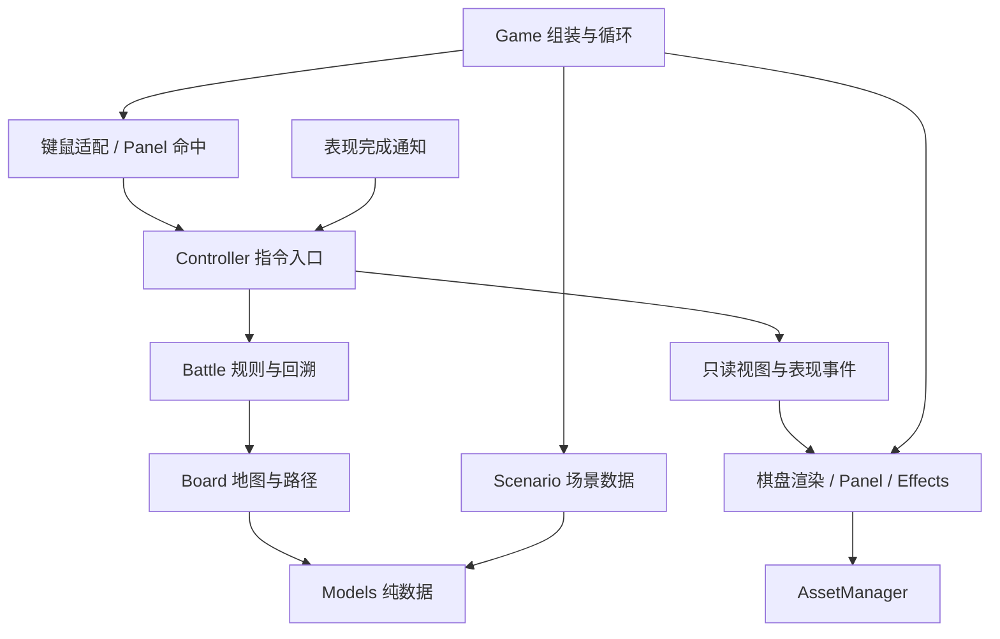

# 完整项目源码

本文件由 `python scripts/export_source.py` 生成。包含项目全部文本源码、配置和文档；不包含自身、截图、虚拟环境、缓存及压缩包。

## .gitattributes

```text
* text=auto eol=lf
*.png binary
*.zip binary
```

## .github/workflows/ci.yml

```yaml
name: Tests

on:
  push:
    branches: [main]
  pull_request:
  workflow_dispatch:

permissions:
  contents: read

jobs:
  regression:
    name: ${{ matrix.os }} / Python ${{ matrix.python }}
    runs-on: ${{ matrix.os }}
    timeout-minutes: 10
    strategy:
      fail-fast: false
      matrix:
        os: [ubuntu-24.04, windows-2022]
        python: ['3.9', '3.12']
    env:
      SDL_VIDEODRIVER: dummy
      SDL_AUDIODRIVER: dummy
      PYGAME_HIDE_SUPPORT_PROMPT: '1'
    steps:
      - uses: actions/checkout@v7
      - uses: actions/setup-python@v7
        with:
          python-version: ${{ matrix.python }}
          cache: pip
      - name: Install dependencies
        run: python -m pip install -r requirements.txt
      - name: Check source bundle
        run: python scripts/export_source.py --check
      - name: Run regression tests
        run: python -m unittest discover -s tests -v
```

## .gitignore

```text
.venv/
__pycache__/
*.py[cod]
artifacts/*
!artifacts/*.png
dist/
.delivery/
build/
.pytest_cache/
.coverage
htmlcov/
.env
.env.*
!.env.example
*.pem
*.key
```

## AGENTS.md

````markdown
# 项目维护与后续开发约定

## 先确认实际状态

- 当前运行版本是 v0.1.0。架构评审与规划已经落库，M1–M5 尚未实施；以 `TASKS.md` 区分现有能力和规划，不把文档中的示意接口当成已实现代码。
- 修改玩法、结构或资源入口前，阅读 [整体架构](docs/ARCHITECTURE.md)、[实施路线](docs/ROADMAP.md) 与 [功能开发规范](docs/FEATURE_DEVELOPMENT.md)。接入美术时同时遵守 [资源规范](docs/ASSET_GUIDE.md)。用户提供的原始报告是评审材料，当前开发决策以这些评审后文档为准。

## 开发边界

- 这是离线 Python/Pygame 战棋原型。保留几何绘制作为无素材时的默认回退，后续美术通过统一资源与渲染层接入；具体玩法按用户需求推进。
- 业务规则放在 `tactics/battle.py`，空间与路径规则放在 `tactics/board.py`；按 M1–M4 迁移规则、协调与表现职责，不继续向主循环堆叠玩法和特殊角色分支。
- 后续功能必须建立在可扩展边界上：先明确规则入口、数据归属、回溯策略、表现/资源接入和验收证据。前置能力缺失时先补齐最小必要部分，与需求一并交付；不能以架构未完成为由无限延后任务，也不为每个小改动制造额外批准流程。
- 新增规则代码不依赖 Pygame；渲染、UI、动画和未来 AI 不直接改战斗状态。UI/AI 共用合法性校验和指令入口，避免复制规则。
- 新增运行状态必须明确快照与恢复行为；新增资源、图片、字体、动画进度不得进入规则快照。对外视图和结算结果使用独立数据与稳定 ID，不向表现层泄露可变实体。
- 图片集中加载和缓存，不在每帧读盘；路径相对资源根解析。替换美术不能改变占格、移动、攻击或回溯语义。
- 抽象和模块必须有实际调用方。不提前创建空的插件、ECS、通用注册中心或未使用扩展层。结构性整改使用专用分支、分阶段验证与审查差异。

## 验证和维护

- 修改代码、测试或配置时，同步维护 `TASKS.md` 和 `CHANGELOG.md`；行为或操作变化同步到 `README.md`。
- 保留直接读取字体文件和字体扫描异常的回退逻辑，避免启动时再次因 Windows 字体注册表异常崩溃。
- 完成修改后运行 `python -m unittest discover -s tests -v`，并说明真实窗口与无窗口测试的验证边界。
- 保留原有行为覆盖；接口迁移时可调整测试夹具，不为保留旧字段访问而保留架构漏洞。新增架构边界在相应阶段就加入检查，不推迟到最终验收。
- 使用 `python scripts/export_source.py` 更新 `SOURCE.md`，再用 `python scripts/export_source.py --check` 检查一致性。
- 不提交虚拟环境、缓存、安装器、凭据或 `dist/`、`.delivery/` 中的生成文件。`artifacts/*.png` 是随文档交付的运行截图。
````

## CHANGELOG.md

````markdown
# 更新记录

## 未发布

### 2026-10-22 · 架构评审与整体规划

- 对照 v0.1.0 源码审阅用户的架构整改报告，记录采纳、调整与补充意见。
- 制定规则、应用协调、表现/资源分层及稳定 ID、只读视图、快照和动画完成契约。
- 增加分阶段路线、资源/动画制作与接入规范、后续功能开发要求，并更新 AGENTS 与 TASKS。
- 源码汇总脚本纳入 docs，保证规划文档与源码汇总一起交付。
- 本次没有实施 M1–M5 重构，也没有增加玩法、修改伤害或回溯语义。

## 0.1.0 - 2026-10-22

首次仓库交付，包含当前已实现的完整离线战棋原型。

- 8×8 棋盘、64 像素格子、蓝色友方、红色训练木桩和固定障碍。
- 单位生命、攻击、防御、速度、移动力；按速度排序行动，移动与攻击各一次。
- 四方向路径范围、障碍及单位阻挡、相邻敌方攻击、跳过阶段和结束行动。
- 当前/最大生命值与血条；伤害按攻击力 100% 结算，显示上浮淡出的伤害数字。
- 生命归零后播放几何击杀动画并消失，退出行动队列；一方全灭后结束战斗。
- 退格键及界面按钮回溯上一单位行动，可恢复被击杀单位并连续回溯。
- 修复 Pygame Windows 字体扫描出现非字符串注册表项时的启动异常。
- 41 项规则、交互、动画、回溯及字体回归检查；附实际 Windows 窗口截图。
- 提供 README、任务进度、源码汇总脚本和 Windows/Linux 自动测试配置；源码压缩包不包含虚拟环境和缓存。
````

## README.md

````markdown
# Chrono Tactics · 离线回溯战棋

仓库名称：`chrono-tactics-pygame`，当前版本：`0.1.0`。

项目仓库：[zyb-sjtu/chrono-tactics-pygame](https://github.com/zyb-sjtu/chrono-tactics-pygame)。这是私有仓库，需要登录有权限的 GitHub 账号访问。

使用 Python 和 Pygame 绘制，运行时不访问网络，不需要外部美术资源。棋盘保持 8×8，每格 64×64 像素；为展示属性和回合信息，侧栏扩为 384 像素，窗口为 896×512。

## 整体规划与后续开发

已对用户的架构整改意见进行源码核对，并建立后续开发约束。当前只完成评审与规划，运行架构仍为 v0.1.0；场景、控制器、只读视图和资源管理等拆分按下表文档逐步实施，不宣称已经具备。

| 文档 | 内容 |
| --- | --- |
| [意见评审](docs/ARCHITECTURE_REVIEW.md) | 哪些建议采纳、哪些调整，以及源码证据和原报告遗漏 |
| [整体架构](docs/ARCHITECTURE.md) | 模块职责、依赖、指令与视图、快照、动画和扩展入口 |
| [实施路线](docs/ROADMAP.md) | M0–M5、前置能力、小批次提交与验收标准 |
| [美术资源规范](docs/ASSET_GUIDE.md) | 路径、清单、缓存、透明图片、锚点、图层和动画 |
| [功能开发规范](docs/FEATURE_DEVELOPMENT.md) | 新功能的数据归属、回溯方案、扩展边界与完成条件 |

开发从 **ARCH-01 / M1** 开始。后续功能需要先具备对应的最小架构边界；新增状态必须能回溯，新增美术通过资源与渲染入口接入。约束同时写入 [AGENTS.md](AGENTS.md)，实现进度见 [TASKS.md](TASKS.md)。

## 运行

当前机器已经配置好独立环境，无需激活或重新安装：

```powershell
cd E:\gamedesign
.\.venv\Scripts\python.exe main.py
```

如果旧版窗口还开着，请先关闭，再执行以上命令。

在新机器安装（Python 3.9 或以上、可用的桌面环境）：

```powershell
git clone https://github.com/zyb-sjtu/chrono-tactics-pygame.git
cd chrono-tactics-pygame
py -m venv .venv
.\.venv\Scripts\python.exe -m pip install -r requirements.txt
.\.venv\Scripts\python.exe main.py
```

首次安装依赖需要联网，安装后游戏可完全离线运行。如果使用本机 Miniconda 创建新环境时提示 SSL 模块不可用，可仅在当前 PowerShell 会话中先运行以下命令再安装依赖；其他 Python 安装通常不需要：

```powershell
$env:PATH = 'D:\Miniconda3;D:\Miniconda3\Library\bin;' + $env:PATH
```

## 战斗规则

- 3 个蓝色圆形友方与 3 个红色方形木桩均为单位，具有当前生命、最大生命、攻击、防御、速度、移动力。侧栏显示 `生命: 80/100` 这样的当前值/上限格式，棋盘单位下方显示血条。数值在 `tactics/models.py` 中配置，暂为功能演示占位值。
- 入场时将双方单位按速度从高到低排序，同速按入场顺序排列。每轮各行动一次，全部行动后进入下一轮，按相同顺序继续。
- 每次行动分为**一次移动 → 一次攻击**。可以跳过移动、跳过攻击，或直接结束行动；成功攻击后，动画播放完毕再交接给下一位。
- 移动和攻击均按上下左右四方向计算，不允许斜走或斜向攻击。
- 移动目的地可以是移动力步数内的任意可达空格，按实际通路步数计算。障碍、友方和敌方单位均不能穿过或重叠。即使没有用满步数，也消耗本次移动机会，不能分段多次移动。
- 攻击仅能锁定距离 1 格的敌方单位，不能攻击自己、同阵营、斜向或更远的单位。必须先完成或跳过移动，才能攻击。
- 伤害为**攻击属性的 100%**，当前防御属性不减伤。例如攻击 10 对生命 100/100 的目标造成 10 点伤害，生命变为 90/100。伤害跳字显示攻击结算值，持续约 0.9 秒并向上浮动淡出；过量伤害下生命最低为 0。
- 生命归零即被击杀：播放约 0.65 秒的闪烁、缩小、碎点扩散和淡出动画，然后在棋盘消失。被击杀单位不再阻挡路径、不能被选为目标，也不会再次行动。
- 攻击动画期间锁定移动、攻击、结束行动和回溯，窗口仍能正常关闭；动画使用逐帧更新时间，没有阻塞式等待。
- 一方全灭后显示胜方，停止继续行动，仍可回溯最后一次行动并恢复被击杀单位。
- **双方均由玩家手动操作，没有 AI。** 红色木桩同样参与回合，可手动移动和攻击；不操作时不会自行行动。

## 操作

| 操作 | 效果 |
| --- | --- |
| 左键点击任意单位 | 查看其属性；查看其他单位不会改变当前行动者 |
| 当前行动者被选中时，点击绿色格 | 移动一次，进入攻击阶段 |
| 攻击阶段点击相邻敌方 | 扣血、显示伤害跳字；动画结束后进入下一单位行动 |
| 空格 / 侧栏“跳过移动/攻击” | 跳过当前阶段 |
| 回车 / 侧栏“结束行动” | 放弃剩余操作，进入下一单位行动 |
| 退格 Backspace / 右上角“回溯” | 回到上一单位行动开始前，可以连续回溯 |
| 点击窗口关闭按钮 | 退出并释放资源 |

金色方框标记当前行动者，白色圆环标记正在查看的单位。查看其他单位后，点击金框单位可继续行动。非法目的地或无效点击不会消耗行动。灰色方块为固定障碍，红色范围为四方向相邻攻击范围，目标格有额外边框。

回溯按完整的“单位行动回合”处理：例如斥候行动完轮到先锋，按退格会回到斥候开始行动前。会恢复双方全部单位的位置、当前/最大生命与其他属性、行动顺序、轮数、日志和战斗结束状态；此前被击杀的单位也会恢复。若先锋已走了一步，这一步也一并撤回。首个单位的首个行动没有上一行动可回溯，此时按钮禁用；回溯后产生的新行动会替换原来的后续历史。历史仅保存在本次游戏进程中。

开局可直接体验：速度最高的斥候 A2 先行动，点击**第 5 列、第 5 行**的绿色格（内部坐标 `(4, 4)`），再点击右边木桩 D2，即可看到 `-10` 跳字。动画结束后轮到先锋 A1，点击木桩可看到生命 `90/100`。此时按退格，斥候的位置与木桩的生命都会恢复。显示坐标以左上角第 1 列、第 1 行开始，代码中的坐标从 0 开始。

## 项目目录与职责

```text
E:\gamedesign\
├── main.py                  # 入口
├── requirements.txt         # pygame==2.6.1
├── .gitignore
├── .gitattributes
├── AGENTS.md                # 后续维护约定
├── TASKS.md                 # 已完成功能与验证边界
├── CHANGELOG.md             # 版本记录
├── README.md
├── SOURCE.md                # 各文本文件完整代码汇总
├── .github/workflows/ci.yml  # Windows/Linux × Python 3.9/3.12
├── scripts/export_source.py # 源码汇总生成与一致性检查
├── docs/
│   ├── ARCHITECTURE_REVIEW.md # 对原整改报告的源码核对与评审
│   ├── ARCHITECTURE.md      # 目标架构，尚未实施
│   ├── ROADMAP.md           # 阶段、前置与验收
│   ├── ASSET_GUIDE.md       # 美术资源与动画规范
│   ├── FEATURE_DEVELOPMENT.md # 后续开发约束
│   └── references/architecture_proposal.md # 用户原始意见
├── tactics\
│   ├── __init__.py
│   ├── settings.py          # 棋盘和窗口尺寸
│   ├── models.py            # 双方单位属性、初始位置、障碍
│   ├── board.py             # 格子几何、BFS 可达范围、绘制
│   ├── battle.py            # 伤害、击杀、速度队列、回合快照与回溯
│   ├── effects.py           # 伤害跳字、几何击杀动画、逐帧更新
│   ├── panel.py             # 字体回退、属性栏、按钮、日志和队列
│   └── game.py              # 鼠标/键盘事件、主循环、退出清理
├── tests\
│   ├── test_battle.py       # 11 项战斗规则检查，无需创建窗口
│   ├── test_game.py         # 11 项窗口交互、绘制与字体检查
│   ├── test_effects.py      # 7 项动画、按键、血量显示和退出检查
│   └── test_rewind.py       # 12 项回溯、击杀及行动顺序检查
├── artifacts\               # 实际运行截图，不是游戏资源
│   ├── initial.png          # 开局移动范围
│   ├── selected.png         # 移动后可攻击目标
│   ├── damage_popup.png     # 实际攻击 10 的跳字
│   ├── after_attack.png     # 木桩生命 90/100
│   ├── enemy_turn.png       # 红方手动回合
│   ├── rewind.png           # 回溯后恢复位置和血量
│   ├── defeat.png           # 击杀动画中间帧
│   ├── defeat_disappeared.png # 击杀动画后消失
│   ├── defeat_result.png    # 击杀后交接回合
│   └── defeat_rewind.png    # 回溯恢复被击杀单位
└── .venv\                   # 本机独立环境，生成内容
```

完整文本文件内容见 [SOURCE.md](SOURCE.md)。虚拟环境和缓存不提交，运行截图随文档保留。更新文本文件后执行：

```powershell
python scripts/export_source.py
python scripts/export_source.py --check
```

## 源码压缩包

可在 GitHub 仓库中通过 Code → Download ZIP 下载源码，也可在本地 Git 仓库生成：

```powershell
New-Item -ItemType Directory -Force dist
git archive --format=zip --prefix=chrono-tactics-pygame/ --output=dist/chrono-tactics-pygame-v0.1.0.zip HEAD
```

源码包包含运行代码、测试、文档、配置和截图，不包含 `.venv`、缓存或凭据；解压后按上面的新机器安装步骤创建环境。这是 Python 源码包，未构建独立 EXE。

## 验证记录

```powershell
.\.venv\Scripts\python.exe -m unittest discover -s tests -v
```

2026-10-22，本机 Python 3.9.1 / Pygame 2.6.1 / SDL 2.28.4 实测 **41 项检查全部通过，退出码 0**。覆盖速度和同速顺序、四方向范围、路径阻挡、移动次数、敌我与攻击距离限制、攻击 100% 结算及忽略防御、过量伤害归零、跳字生命周期、动画期间锁定操作及正常关闭、实际画面中击杀形体消失、死亡后的行动顺序、连续和跨轮回溯、回溯恢复已死单位与当前/最大生命、回溯战斗结束状态，以及原有窗口和字体回退。

另外通过 `main.py` 实际入口创建窗口，使用 `windows` 显示驱动向事件队列投递鼠标和键盘事件，验证了两条完整流程，均退出码 0：默认配置下“移动 → 攻击 10 → 跳字 → 查看 90/100 → 红方回合 → 连续回溯”；测试场景下“攻击生命 5 的目标 → 击杀动画 → 形体消失 → 下一回合 → 回溯复活”。击杀场景仅在验证进程中设置目标生命为 5，没有改动游戏默认初始数据。已保存截图并查看跳字、扣血、击杀动画、消失和复活的实际画面。这是自动投递事件验证，并非人工鼠标逐次操作；其他系统尚未实测。

保留字体问题修复：优先直接加载 Windows 字体文件，失败后再扫描系统字体；扫描抛出 TypeError、OSError、ValueError 或 pygame.error 时，回退到 Pygame 内置字体与英文界面。不修改系统字体或注册表。

自动测试配置位于 [.github/workflows/ci.yml](.github/workflows/ci.yml)，使用虚拟显示驱动执行回归检查；它不能替代实际窗口的显示效果检查。远程运行结果见仓库 Actions 页面。CI 使用的动作版本参照 [checkout](https://github.com/actions/checkout) 和 [setup-python](https://github.com/actions/setup-python) 官方用法。


````

## TASKS.md

````markdown
# 项目进度

当前运行版本：`0.1.0`。已实现能力与架构规划分开记录，不把方案或目标接口当成完成的代码。

## 已实现能力

| ID | 状态 | 内容 |
| --- | --- | --- |
| BOARD-01 | 已完成 | 8×8 棋盘，每格 64×64，无外部美术资源 |
| UNIT-01 | 已完成 | 双方各 3 个单位、固定障碍、点击查看属性 |
| TURN-01 | 已完成 | 速度排序、四方向移动、相邻攻击、手动操作双方、跳过与交接 |
| COMBAT-01 | 已完成 | 当前/最大生命与血条，攻击力 100% 伤害，伤害跳字 |
| COMBAT-02 | 已完成 | 击杀动画、消失、死亡单位退出队列、一方全灭结束战斗 |
| REWIND-01 | 已完成 | 回溯上一单位行动开始前、连续回溯、恢复死亡单位和战斗状态 |
| FIX-01 | 已完成 | Windows 系统字体扫描异常回退，保留英文降级界面 |
| QA-01 | 已完成 | 41 项回归检查、Windows 实际窗口流程验证与截图 |
| DELIVERY-01 | 已完成 | 运行文档、源码汇总生成脚本、忽略规则和自动测试配置 |

CI 配置覆盖 Windows / Linux 与 Python 3.9 / 3.12。远程执行结果以 GitHub Actions 为准，配置存在不代表运行已通过。

当前没有 AI、网络、存档或独立 EXE。数值仍为演示占位值，防御暂不参与伤害计算。

## 架构规划与实施状态

| ID | 阶段 | 状态 | 内容与验收重点 |
| --- | --- | --- | --- |
| ARCH-00 | M0 | 已完成 | 评审用户意见、整体架构、资源与功能开发规范、分阶段路线；后续约束写入 AGENTS |
| ARCH-01 | M1 | 未开始 | 场景注入、纯逻辑 Board、Geometry 与 BoardRenderer；保留原行为，规则不依赖 Pygame |
| ARCH-02 | M2 | 未开始 | Controller、只读 View、UIAction；输入适配与业务协调分开 |
| ARCH-03 | M3 | 未开始 | 稳定 ID 结果、纯数据快照、结算编号与表现代次，可靠回溯和完成确认 |
| ARCH-04 | M4 | 未开始 | 内容/资源清单与验证、加载缓存、图片/动画真实接入、无素材回退 |
| ARCH-05 | M5 | 未开始 | 场景与外观扩展演练、完整回归、真实窗口与跨平台验收 |

下一实施任务为 **ARCH-01**。阶段依赖、提交拆分和完成条件见 [ROADMAP](docs/ROADMAP.md)，技术边界见 [ARCHITECTURE](docs/ARCHITECTURE.md)。每个阶段同步增加所需边界测试，不等全部迁移后才测试。

后续技能、AI、美术、地图、存档等需求，须先明确扩展点与最小必要前置，按 [FEATURE_DEVELOPMENT](docs/FEATURE_DEVELOPMENT.md) 实施。此表不是新增玩法承诺。
````

## docs/ARCHITECTURE.md

````markdown
# 整体架构与扩展边界

状态：目标架构与开发决策。除现有 v0.1.0 功能外，本文描述的拆分尚未实施；进度以 [TASKS.md](../TASKS.md) 为准。

最简单的划分：规则决定“能做什么、结果是什么”；协调层决定“接收哪次操作、何时继续”；表现层负责“输入来自哪里、画面怎样显示”。替换图片不应影响伤害，增加技能不应要求改写主循环。

## 现状与目标

现状：`models` 存放属性和默认阵容；`Board` 管理地图并绘制；`Battle` 管理战斗与回溯；`Game` 同时协调输入、规则和动画；`panel/effects` 直接读取运行对象。

目标仍使用 Python/Pygame，先维持当前平铺模块结构。模块职责稳定后才考虑按包分组，避免为目录美观改动所有导入。

```text
tactics/
  models.py          纯数据：单位状态、定义引用、坐标
  scenario.py        场景定义、验证、初始状态构建
  board.py           地图状态、空间查询、路径规则
  battle.py          指令合法性、伤害、行动顺序、回溯
  controller.py      指令入口、选中状态、输入锁定、结算协调
  view_models.py     只读的界面快照与表现事件
  geometry.py        逻辑格与像素坐标转换
  board_renderer.py  地图、单位、血条、高亮、图层
  panel.py           属性面板、按钮绘制及命中动作
  effects.py         伤害跳字、受击/死亡等表现
  assets.py          资源清单、路径、图片和缩放缓存
  game.py            初始化、组装、事件循环与退出
```

这是规划目录，不要求提前创建空模块。

## 依赖方向



箭头表示调用或数据交付，规则不会反向读取画面。表现完成通知仅用于交接确认，不授权表现层扣血或改变回合。

| 区域 | 可以依赖 | 不应依赖 |
| --- | --- | --- |
| models / scenario / board / battle | 标准库与同层纯数据、规则 | Pygame、窗口、图片、文件播放时间、按钮布局 |
| controller / view_models | 规则、数据、一个很小的表现接口 | Pygame 事件、Surface、Rect、Font、渲染器实现 |
| geometry | 场景尺寸和布局参数、基础数值类型 | 战斗合法性、伤害和资源加载 |
| renderer / panel / effects / assets | Pygame、只读视图、资源与布局 | 改写 Unit/Battle、自己计算第二套移动或攻击规则 |
| game | 组装上述模块、适配操作系统输入 | 重复实现指令校验、伤害或回溯 |

这些是迁移后的边界。M1 起按迁移范围加入自动检查，不把当前尚未迁移的代码声称为符合要求。

## 数据模型

### 定义与状态分开

| 数据 | 内容 | 生命周期 |
| --- | --- | --- |
| UnitDefinition | 定义 ID、名称、基础属性、外观 ID；后续可关联技能定义 | 场景加载时读取，战斗期间按只读数据使用 |
| UnitState | 实例 UID、定义 ID、阵营、格子、当前/最大生命和实际属性 | 由规则修改，进入回溯快照 |
| ScenarioDefinition | 场景 ID、逻辑尺寸、地形/障碍、生成位置、单位定义引用 | 加载并验证后构建 Board/Battle |
| BattleState | 轮数、行动槽位、阶段、存活状态、结果、规则新增状态 | 统一变更、统一回溯 |
| PresentationState | 选中 UID、镜头、按钮悬停、动画进度、渲染代次 | 应用/表现层管理，不进入规则快照 |

先从现有 Unit 和场景数据平滑迁移，只有 M4 的外部配置接入确实需要时再增加定义加载器。不是马上建立所有类型的注册中心。

UID 在同场战斗中唯一且不会因死亡或队列压缩而重新编号。资源 ID、定义 ID 和场景 ID 与文件名解耦。不要用中文名称、像素位置、数组下标或图片路径关联战斗对象。

场景验证至少覆盖坐标边界、重复 UID、出生格重叠、障碍冲突、定义缺失、生命上下限和有效阵营。空阵容、单方阵容和初始死亡单位应有明确的拒绝或结束策略；不能隐含依赖“队列第 0 个一定可行动”。

### 地图与屏幕分开

Board 使用场景中的行列数，位置一律为从 0 开始的 `(列, 行)`。Geometry 接收原点、格子像素大小和行列数，返回数值坐标/边界，Pygame Rect 在表现层构造。

默认仍是 8×8、64 像素格子。使尺寸可注入不等于本次增加自由缩放、镜头或地图编辑功能。精灵可比格子大，不能因此改变移动距离、阻挡和鼠标落格规则。

## 指令、结果与只读视图

Controller 接收逻辑操作，如选中 UID、`move_to(cell)`、`attack(target_id)`、跳过、结束行动、回溯。鼠标像素和键盘码先在输入适配处转为这些操作；Panel 对外提供 `hit_test(position) -> UIAction | None`，不公开按钮矩形供主循环逐个判断。

规则层保留唯一的校验与结算实现。操作结果应明确成功/失败及原因，非法指令不消耗机会、不改变状态，也不创建攻击动画。后续 AI 同样调用该入口，不能直接修改单位坐标和生命。

视图建议至少包含以下纯数据，具体类型按迁移阶段落地：

```text
BattleView
  revision / presentation_generation
  board: rows, cols, terrain, obstacles
  units: tuple[UnitView(uid, cell, team, hp, max_hp, stats, visual_id)]
  active_uid, selected_uid, phase, round_number, winner
  move_cells, attack_cells, target_cells: frozenset[Cell]
  order_uids, log_entries, can_undo, input_locked

AttackResolved
  resolution_id, actor_uid, target_uid, target_cell
  damage, previous_hp, current_hp, killed
```

DTO 不保留可变 Unit/Battle 引用；嵌套集合也使用只读形式或独立副本。`frozen` 数据类中的可变对象不会自动变为只读。Renderer 只显示计算好的可达格与目标格，不调用 Battle 查询合法性。

初期不用全局消息总线。普通函数调用、返回值和一个有明确消费位置的事件列表即可。日志最终可从结构化结果格式化，避免规则到处拼接界面文字；第一轮迁移保留现有双语显示行为。

## 动画与结算协议

保持现有语义：合法攻击立即计算生命和击杀，进入 resolving；表现层根据结果绘制跳字与死亡形体；协调层收到有效完成通知后调用规则交接一次。

Game 在启动时将表现适配器交给 Controller。该接口只需要“播放结果、逐帧更新、报告完成、清除旧代次”几种操作；规则不导入适配器，协调层不导入 Pygame。纯逻辑测试使用立即完成的测试适配器，不依赖真实时间或窗口。

每次结算有编号，每次回溯/重开场景提升表现代次。只有当前代次、当前结算的完成通知有效，重复通知无效。动画播放不改变已结算的伤害；待机循环和环境特效不是阻塞任务，不参与行动交接的等待。

死亡的规则状态与临时死亡形体分开：状态可已判定死亡，表现保留该位置的短暂形体，播放完成后销毁。回溯必须先使旧表现失效，再恢复规则状态并重建视图，不保留重复的死亡形体或伤害数字。

## 回溯与未来存档

当前内存快照保存 Unit 引用和属性副本，运行上有效。M3 将其迁移为以 UID 关联的纯数据状态；保留入口顺序槽位，避免删除单位时造成行动序号偏移。

快照明确包含轮数、队列槽位、阶段、战斗结果、单位状态及日志所需数据。新增规则字段必须同时说明初始值、修改者、快照和恢复行为；将来引入随机规则时再将相应随机状态纳入快照。

图片缓存、动画帧、字体和显示时钟不得进入快照。选中状态在恢复后按现有规则重置到当前行动者。快照不是直接 pickle 整个对象图；如以后新增持久化，再基于已验证的纯数据格式增加 schema_version、内容版本和迁移策略。

## 内容和美术边界

后续 `content/` 存放规则定义、场景等结构化数据，`assets/` 存放图片/动画等表现数据。逻辑定义仅引用外观 ID，不能通过图片颜色、尺寸或透明区域决定规则。资源清单将 ID 映射到文件、帧和锚点，细则见 [美术与资源规范](ASSET_GUIDE.md)。

美术接入必须经过真实渲染链路；只新增目录、空 AssetManager 或每帧读取 PNG 都不算完成。无素材时继续使用现有几何表现，当前原型仍能独立运行。

## 扩展入口

| 后续需求 | 主要扩展点 | 必须先具备的边界 |
| --- | --- | --- |
| 新地图/关卡 | 场景定义、地图加载与验证 | M1；外部数据文件依赖 M4 的内容验证 |
| 单位和地砖美术 | 资源清单、渲染器、图层 | M1–M4；不改战斗算法 |
| 动画、音效、镜头反馈 | 表现事件、资源、非阻塞播放器 | M2–M4；明确阻塞/非阻塞类别 |
| 技能、Buff、装备 | 规则定义、指令校验、结算结果、运行状态 | M1–M3；新增状态必须可回溯 |
| AI | 查询合法操作、提交同一指令入口 | M2–M3；不得依赖屏幕与模拟点击 |
| 存档/回放 | 纯数据快照、内容版本、序列化 | M3；明确版本和恢复策略 |
| 多窗口尺寸或不同显示比例 | Geometry、布局、渲染资源缩放 | M1；逻辑格子不跟随图片像素变化 |

这张表是开发入口，不是新增功能承诺。任何新需求先选择最小必要前置能力，再与需求一起交付，避免以“架构还没完成”为由无限延后。
````

## docs/ARCHITECTURE_REVIEW.md

````markdown
# 架构整改意见评审

状态：评审与规划已完成，运行架构尚未整改。评审基线为 `ff67755` / `v0.1.0`。

评审材料：[用户提供的原报告](references/architecture_proposal.md)。本文将原报告中的建议与已经实现的能力分开记录。

## 结论

原报告的主要判断准确，适合作为渐进重构的起点。建议采纳“规则、应用协调、表现与资源分离”的方向，并补齐数据身份、回溯与动画协议、资源制作规范、功能开发准入和逐阶段验收。当前原型无需推翻，也不需要先建设通用游戏引擎。

本次交付的是项目整体规划和后续开发约束，不包括原报告列出的运行代码重构。`scenario.py`、`controller.py`、`assets.py` 等仍为规划模块，不应在任务记录中标记为已实现。

## 对照源码的判断

下列位置对应上述基线，后续迁移后以 [整体架构](ARCHITECTURE.md) 为准。

| 原意见 | 源码事实 | 评审决定 |
| --- | --- | --- |
| 棋盘逻辑与渲染混合 | `board.py` 导入 Pygame；`reachable_cells` 处理路径，`draw` 同时查询 Battle、绘制范围与单位 | 采纳，优先拆分；逻辑尺寸也应由场景提供，不能仅移动绘图函数 |
| 主循环承担业务协调 | `game.py` 处理按钮矩形、调用攻击、读取 `pending_attack`、创建特效、决定动画后交接 | 采纳，新增协调层；它仍复用 Battle，不复制第二套伤害和回合规则 |
| 场景与 Board 绑定 | `Board.__init__` 直接创建双方单位；障碍和阵容放在 `models.py` | 采纳，先用简单场景数据注入，再按实际需要增加 JSON 加载 |
| 缺少资源加载中心 | 当前没有图片加载与缓存模块，全部使用程序绘制 | 采纳；第一批图片必须实际接入渲染器，不能只新增无人调用的管理类 |
| UI 布局向外泄露 | Game 直接访问侧栏的三个按钮矩形 | 采纳，UI 返回动作标识，应用层不认识按钮坐标 |
| 增加只读视图 | panel 与 board.draw 都直接拿到可变 Battle/Unit 对象 | 采纳；只读需要包含完整的数据结构，`frozen=True` 包着 Unit 引用并不等于只读 |
| 保留现有回归检查 | 当前 41 项测试覆盖了路径、战斗、动画、回溯和字体 | 保留行为覆盖；迁移测试入口和夹具是允许的，不应为保留旧字段访问而保留架构漏洞 |
| 第四阶段完善测试文档 | 逐层拆分会改变接口、导入路径与测试夹具 | 调整为每个阶段同时增加边界测试和更新文档，最后再做整体验收 |

## 必须补充的设计

### 1. 稳定 ID、定义数据与运行状态

当前已经有 `uid`，但攻击结果和快照仍保存 Unit 对象引用。它们支持现有内存回溯，却不能直接当作存档或回放格式。后续需要区分单位实例 ID、单位定义 ID、场景 ID 和外观 ID；图片、名称或列表下标均不应成为规则关联键。

先定义纯数据契约，再迁移快照。不要为了将来可能需要的存档，现在就加入磁盘存档界面。

### 2. 回溯是所有新状态都必须遵守的约束

技能冷却、状态效果、召唤物、地形变化等一旦加入，必须说明回溯时如何恢复。资源缓存、选中高亮和动画进度属于表现状态，不能混入战斗快照；回溯后应重建视图并清除过期动画。

当前“回到上一单位行动开始前”的语义必须保留，包括撤销当前单位未完成的操作、恢复被击杀单位和战斗结束状态。

### 3. 动画完成通知不能直接决定战斗规则

原报告允许暂留 `resolving`，这一点合理。当前阶段继续保持“先扣血，再播放动画，最后交接行动”。协调层负责输入锁定和完成确认，动画只上报结束。

迁移时应使用结算编号与表现代次识别完成通知。过期或重复通知不能推进另一次行动。待机循环、装饰粒子等非阻塞表现不能让战斗永久停在结算阶段。

### 4. 资源接入需要规范和实际验收

除加载与缓存外，还需要明确素材尺寸、透明背景、脚底锚点、图层、动画帧、缺失回退、路径根目录和来源信息。否则“有 AssetManager”仍不能保证美术替换时不改规则代码。

应以“替换一名单位的外观和一块地砖，不修改 Battle/Board，仍能移动、攻击、死亡并回溯”为验收实例。当前几何图形继续作为默认回退，不要求立即引入正式美术。

### 5. 为后续功能建立明确入口

新地图、技能、AI、装备和存档各自依赖不同基础能力。不要每次新增功能都直接修改 Game 或给 Unit 随意挂字段。开发前先填写扩展点、状态归属、回溯策略、资源需求和测试证据，具体见 [功能开发规范](FEATURE_DEVELOPMENT.md)。

## 优先顺序

1. M1：拆开纯规则、场景、几何转换和棋盘渲染。
2. M2：统一指令入口、只读视图、UI 动作与协调流程。
3. M3：稳定结果数据、纯数据快照和动画完成协议。
4. M4：资源清单、缓存和第一条可验证的美术接入链路。
5. M5：扩展演练、跨平台回归、真实窗口检查与开发准入落实。

各阶段依赖、验收和拆分提交见 [实施路线](ROADMAP.md)。本次只完成 M0：评审、规划及开发约束落库。

## 暂缓

不在架构整改中同时加入技能玩法、AI、存档界面、联网或更换引擎。不先引入 ECS、全局事件总线、插件加载器、通用依赖注入框架或完整编辑器。出现实际需求后，再根据扩展成本决定是否需要进一步抽象。
````

## docs/ASSET_GUIDE.md

````markdown
# 美术、动画与资源接入规范

状态：待 M4 实施的资源契约。当前游戏仍使用几何绘制，没有 AssetManager 或下述清单加载器。

目标是让美术可以在约定接口内替换，同时保持格子规则、单位属性和回溯不变。正式美术风格、画幅和角色设定留给后续需求，本文件不提前限定视觉风格。

## 资源与规则分开

规划目录：

```text
content/
  units.json             单位定义、基础属性、外观 ID
  scenarios/             地图尺寸、障碍与阵容
assets/
  manifest.json          外观 ID → 文件、帧、锚点
  tiles/
  units/
  obstacles/
  effects/
  ui/
  README.md              资源来源与制作约定
```

目录在实际接入时创建，不用空目录冒充资源支持。`content/` 只表达规则；`assets/` 只表达表现。一个单位的图片替换不改变占格、阻挡、阵营、生命或伤害。

使用小写英文点分 ID，如 `unit.scout.idle`、`tile.floor`。实例 `A2` 引用单位定义，定义引用外观，外观再引用资源 ID，不把 `A2.png` 作为规则关联约定。

## 静态图片与锚点

第一轮支持 PNG，角色和特效使用 RGBA 透明背景。默认棋盘格仍为 64×64；素材原始分辨率可更高，统一由资源层生成显示尺寸，渲染器不在每帧重复缩放。

锚点是图片内的相对位置，不是单位逻辑位置。例如角色使用 `(0.5, 1.0)` 脚底中心，将该点对齐格子底部中心；地砖可使用中心锚点。画布留白与实际角色尺寸由美术规范记录，不通过改变单位 cell 补偿对齐。

角色可以高出格子，选中和点击仍按逻辑格子计算。血条、高亮和伤害字在专门图层绘制，不能被大精灵遮住。

清单示意如下，**并非当前已支持的文件格式**；M4 实施时先固定最小 schema 并加入验证：

```json
{
  "schema_version": 1,
  "images": {
    "tile.floor": {
      "path": "tiles/floor.png",
      "display_size": [64, 64],
      "pivot": [0.5, 0.5],
      "optional": true
    },
    "unit.scout.idle": {
      "path": "units/scout_idle.png",
      "display_size": [64, 96],
      "pivot": [0.5, 1.0],
      "optional": true
    }
  }
}
```

路径相对资源根目录解析，与启动命令所在目录无关。解析后的文件不得越出资源根目录。业务代码不拼接 `E:\...` 等机器路径，也不散落图片文件名。

## 动画契约

角色外观按 `idle / move / attack / hit / death` 状态映射；只为实际使用的状态提供资源，不要求首批素材拥有全部动画。

动画清单至少包含帧来源、每帧区域或文件、帧率、锚点、是否循环和缺失时回退。可先支持显式帧列表；有实际图集素材后再加入切帧，避免一次实现多套未使用格式。

- idle 可以循环，是非阻塞表现。
- attack、hit、death 按一次播放处理，按结算编号上报结束。
- death 最后进入隐藏，不回到 idle。规则中已死亡的单位不得因动画循环重新出现。
- 攻击伤害仍在合法指令结算时计算。素材中的打击帧可对齐跳字和闪光，但不自行决定伤害或多扣一次生命。
- 攻击结算等待关联的阻塞表现完成；待机、环境装饰、可选镜头反馈不能无限延长回合。
- 缺失攻击/死亡帧时使用明确的几何效果回退，仍只发送一次有效完成通知。
- 回溯时终止旧代次的动画、伤害字和临时死亡形体，恢复后的活单位使用正常外观。

后续音效沿用表现事件入口，不通过音效长度决定伤害和回合；未实际接入前不增加音频依赖。

## 加载和缓存

AssetManager 集中解析清单、加载原图、生成缩放/切帧结果。初始化和图片格式转换发生在 Pygame 显示环境准备后，规则与场景解析不要求窗口存在。

原图按资源 ID/路径缓存，派生图按资源 ID、目标尺寸、帧区域和必要的变换参数缓存。重复请求命中缓存，不重复读盘或缩放；不同显示尺寸不能误复用同一结果。切换场景或开发期重载时有明确清理入口，第一版不建设通用热重载系统。

几何 fallback 由 renderer/effects 提供，不能让资源管理器创建或修改 Unit/Battle。

| 异常 | 处理约定 |
| --- | --- |
| 可选图片缺失、无法解码 | 返回明确缺失信息，记录资源 ID/路径一次，使用约定几何回退 |
| 场景引用不存在的单位定义、清单结构错误、重复 ID | 初始化时报出位置与原因，不静默构造错误战斗 |
| 必需资源缺失 | 初始化时报出清晰错误，不在绘制到某帧才随机崩溃 |
| 中文系统字体不可用或扫描异常 | 保留现有系统字体优先与内置字体/英文回退，不因资源整改删除该修复 |

## 图层顺序

1. 地砖、地面装饰。
2. 移动/攻击范围与目标格提示。
3. 角色与障碍阴影。
4. 障碍、单位、临时死亡形体，按脚底高度和稳定 ID 排序。
5. 当前行动者/选中高亮、血条。
6. 战斗闪光、伤害文字等上层反馈。
7. 侧栏与其他 UI。

具体视觉风格可调整，但调整图层不能改变点击落格与战斗校验。资源说明记录作者、来源、许可信息、原始尺寸、显示尺寸和锚点，便于团队后续替换与发布。

## 首次接入验收

- 无图片文件时，当前几何模式仍可启动、移动、攻击、击杀、回溯和退出。
- 用一张测试地砖和一个测试单位图片接入实际 renderer，替换只涉及清单与资源。
- 同一资源多次请求只加载一次，缩放/切帧缓存分别命中。
- 从不同工作目录启动也能定位资源，缺失和损坏文件有可定位结果。
- 大于格子的精灵、透明边缘和脚底锚点显示正确；高亮、血条和跳字可读。
- 击杀后形体消失，回溯后单位恢复，旧动画完成回调不推进新行动。
- 自动化负责路径、缓存和状态；真实窗口另查透明度、缩放、图层和动画观感，不以单个像素哈希代替跨平台视觉检查。
````

## docs/FEATURE_DEVELOPMENT.md

````markdown
# 后续功能开发规范

本规范与 [AGENTS.md](../AGENTS.md) 一起约束后续开发。目标是让每次新增功能都继续积累可维护性，而不是让主循环和 Unit 对象不断堆叠特殊分支。

当前基础能力仍以 [TASKS.md](../TASKS.md) 的实现状态为准。遇到尚未就绪的边界，先补齐需求所需的最小前置并一并交付，不把规划中的模块当成现成 API，也不为形式要求所有阶段一次完成。

## 开始编码前

在任务或变更说明中写清下面的最小设计。普通小改动用几句话即可，不需要每次另写长文或额外询问用户确认。

```text
需求与玩家可见行为：
前置架构能力及当前状态：
规则入口与合法性校验：
新增数据、唯一归属及初始化：
回溯/死亡/战斗结束时怎样处理：
界面、资源、动画及缺失回退：
验证方法与文档更新：
```

同一数据应有一个权威修改入口：初始状态由场景构建；战斗状态由规则改变；选中和交接由协调层组织；图片与动画由表现层管理。

## 必须遵守的边界

1. 新玩法通过规则与 Controller 指令入口实现，Renderer、Panel、动画和未来 AI 不直接改生命、位置、回合或历史。
2. 不把 Surface、Rect、Font、图片路径、动画时钟写入规则模型和回溯快照。核心新增代码不得导入 Pygame。
3. UI 与 AI 共用合法性校验，非法操作不消耗行动，不创建副作用。不得为某一输入方式复制一套规则。
4. 新规则状态必须有初始值、修改者、死亡/移除行为和回溯恢复方案。恢复后形成同一逻辑局面，不能只恢复画面。
5. 交给 UI/动画的是独立只读数据或结果事件，不是活动实体引用。延迟完成通知需匹配当前结算与表现代次。
6. 新外观走资源清单与缓存，不在每帧加载图片，不通过精灵尺寸、颜色或透明度决定阻挡和攻击距离。
7. Game 保持生命周期和适配职责。仅换一张图片、增加一个技能或加入一个地图，不应持续增加主循环中的玩法分支。
8. 不建立无调用者的抽象、空的扩展目录、第二套战斗状态或过期兼容层。若引入新接口，应能指出当前调用方与验证例子。

现有耦合按 M1–M4 逐步迁移；不能以“旧代码已经这样”为由继续增加相同依赖。

## 典型功能怎样接入

| 功能 | 应做 | 应避免 |
| --- | --- | --- |
| 新角色 | 数据定义 + 实例 ID + 外观引用，验证属性和出生位置 | 在 Game 中按角色名字写特殊分支 |
| 新地图 | 新场景数据，通过同一个构建器初始化 | 复制一份 Board 类或改全局格子数来切场景 |
| 范围技能 | 规则层计算合法范围和目标，返回命中结果，UI 仅显示 | 用红色高亮格是否存在判断是否能造成伤害 |
| Buff/冷却 | 规则拥有持续时间、触发时机与快照字段 | 让动画计时器控制 Buff 剩余回合 |
| 召唤/复活 | 稳定实例 ID、队列规则、占格验证与完整快照 | 只向渲染列表追加图片，回溯时丢失单位 |
| AI | 查询纯数据状态、选择合法指令并提交 | 导入窗口、模拟鼠标、直接改坐标绕过移动次数 |
| 新美术 | 清单、锚点、图层和动画映射，保留 fallback | 在 Battle 中访问文件或保存帧对象 |
| 存档 | 版本化纯数据和恢复验证 | pickle 包含窗口、字体与可变对象引用的整个游戏 |

这是一张归属表，具体玩法必须由真实需求确定；本次不实施这些功能。

## 测试要求按修改内容选择

- **规则变化**：正常与非法操作、边界和敌我限制、状态无副作用、死亡及行动顺序。
- **新增状态**：行动前后和回溯后的逻辑状态对照；跨轮、死亡、战斗结束；涉及随机性时覆盖可重现状态。
- **协调变化**：动画锁定、重复/过期完成通知、取消旧表现、输入与 AI 使用同一入口。
- **资源变化**：缓存、尺寸、路径、缺失/损坏处理；真实窗口检查锚点、图层和透明背景。
- **规则边界迁移**：在不安装/禁止导入 Pygame 的独立进程测试核心；读 DTO 不能改动核心状态。

只为新增契约和真实风险增加测试，不为文件改名或普通文档调整堆叠镜像测试。旧 41 项检查的行为覆盖要保留；接口迁移时调整夹具，不把原测试的字段访问当成永久公开 API。

## 合并与发布前的完成条件

- [ ] 前置能力实际存在；新增模块有真实调用；依赖符合 [整体架构](ARCHITECTURE.md)。
- [ ] 玩家要求的行为已实现，非目标玩法未被顺带修改。
- [ ] 新状态和异步表现经过回溯、死亡和交接检查。
- [ ] 自动化验证通过；需要观察的真实窗口结果单独说明。
- [ ] TASKS 的完成/未开始状态、CHANGELOG 和 README 与实际一致。
- [ ] `python scripts/export_source.py` 及 `--check` 通过，相关文档链接有效。
- [ ] 不提交环境、缓存或凭据；资源与来源说明随交付维护。
- [ ] 结构性修改使用专用分支，分阶段审查差异；版本发布对应通过验证的提交。

CI 能自动检查的边界在相应迁移阶段加入，不宣称现在已有完整架构检查器。涉及不可逆接口或数据格式变化时，补一份简短决策记录，包含选择、取舍、迁移和回退办法；没有这类变化时不增加形式化流程。
````

## docs/ROADMAP.md

````markdown
# 架构实施路线与验收

状态：M0 已完成；M1–M5 未开始。运行版本仍为 `v0.1.0`，不会因完成规划就标记为“已经解耦”或“已经支持美术资源”。

本路线以当前 41 项行为检查为迁移基线。测试数量可增加，导入和夹具可随接口迁移，关键行为不能丢失。每个阶段在专用分支完成小批次提交，先验证、再审查差异并合并；不在一次提交中同时迁移架构和改动玩法。

## 阶段计划

| 阶段 / 任务 ID | 前置 | 实际交付 | 验收证据 |
| --- | --- | --- | --- |
| M0 / ARCH-00 | v0.1.0 | 意见评审、整体架构、资源规范、开发约束、路线与状态记录 | 本次文档、源码汇总一致；原游戏回归通过 |
| M1 / ARCH-01 | M0 | Scenario 纯数据初始化；Board 去除 Pygame；Geometry 与 BoardRenderer 实际接管旧绘制 | 核心在禁止导入 Pygame 的环境中可运行；默认场景不变；第二个测试场景可注入；几何边界测试与实际窗口对照 |
| M2 / ARCH-02 | M1 | Controller 操作入口、只读 View、UIAction 命中接口；Game 缩减为组装与循环 | UI/renderer 不再修改或拿到可变战斗对象；规则无重复实现；移动、攻击、选择、按钮、输入锁定和退出通过集成检查 |
| M3 / ARCH-03 | M2 | ID 化的结算结果、纯数据快照、结算编号与表现代次；回溯清除旧表现 | 伤害与回溯行为不变；死亡及跨轮恢复一致；重复/过期完成通知不能推进回合；快照不含 Surface、Font 或活动实体引用 |
| M4 / ARCH-04 | M3 | 外部内容/资源清单、验证、图片和缩放缓存；一条真实素材替换链路 | 替换单位和地砖只修改清单/素材；相同文件只加载一次；不同尺寸缓存正确；缺失可定位并按策略回退；场景/定义错误明确拒绝 |
| M5 / ARCH-05 | M1–M4 | 扩展演练、开发模板、完整 CI 与真实窗口验收、阶段版本交付 | 新场景与第二套外观分别通过数据接入；现有流程、动画、击杀和回溯全部通过；发布文件和文档对应同一提交 |

M1–M4 可以继续细分为下列小提交，不以“文件已经创建”作为完成条件。

## 建议提交顺序

### M1：先隔离已存在的职责

1. 提取默认场景和 Scenario 验证，Board 从场景接收尺寸、单位和障碍。
2. 引入 Geometry 数值坐标转换，迁移旧坐标边界测试。
3. 将绘制原样迁到 BoardRenderer，保留血条、选中与范围显示。
4. 为规则导入边界增加检查，建立两个数据不同的测试场景。

这个阶段不引入图片、技能或新地图玩法。若临时保留兼容入口，应记录调用方和删除时点；不能通过让 Board 再次导入 Pygame 来维持旧测试写法。

### M2：再收拢操作流程

1. 将现有逻辑操作搬到 Controller，仍调用同一套 Battle 方法。
2. 引入包含单位、棋盘、范围、队列、日志与按钮可用状态的只读 View。
3. Renderer/Panel 改读 View；Panel 返回动作标识；输入适配负责键鼠转换。
4. Game 只保留初始化、输入转换、更新与绘制调度、退出清理。

测试夹具通过 Scenario 构建局面，不以任意改写 Game 内部字段作为长期测试接口。

### M3：让回溯与动画具备稳定契约

1. 攻击结果使用实例 ID、目标位置和生命变化等独立值。
2. 将内存快照迁为纯数据，覆盖现有全部回溯状态。
3. 加入结算编号、表现代次和完成确认；重复、过期确认无效。
4. 校验死亡形体消失与回溯恢复无重复残留，战斗结束后仍能回溯。

暂不增加磁盘存档，也不改变“攻击立即扣血、动画后交接”的行为。

### M4：接入内容与第一批资源

1. 用简单 JSON + 显式验证接入场景/单位定义与外观引用；先满足现有模型，不建设万能数据格式。
2. 实现 [资源规范](ASSET_GUIDE.md) 中的路径解析、清单和缓存。
3. 在渲染器中接入地砖和一名单位的图片替换，几何回退保持可用。
4. 接入非循环攻击/死亡动画和完成通知；待机循环不阻塞行动。
5. 使用可自生成的测试 PNG 验证加载缓存；无需先采购或制作正式美术。

资源模块必须被默认渲染路径实际使用，不能只通过孤立的加载单测。

### M5：验证扩展成本

1. 增加一个场景数据实例，证明不用修改 Board/Battle 即可改变阵容与障碍。
2. 用第二套外观清单切换相同逻辑单位，证明外观不影响移动、伤害和回溯。
3. 检查默认几何模式、图片模式、中文字体回退与真实窗口关闭。
4. 在 Windows/Linux × Python 3.9/3.12 执行完整回归，发布时记录真实结果。

演练是架构验收，不默认为用户增加技能、AI 或存档玩法。

## 每个阶段共同的完成条件

- 默认阵容、障碍、四方向路径、相邻攻击、速度及同速顺序、100% 攻击伤害保持一致。
- 生命显示、死亡不再阻挡、死亡队列跳过、结算锁定与窗口关闭保持一致。
- 回溯仍返回上一单位行动开始前，可连续恢复死亡、轮数和战斗结束状态。
- 新模块有真实调用方，没有第二套规则、未使用扩展框架或长期无主的兼容层。
- 相应边界测试在该阶段就加入，不集中推迟到 M5。
- 更新 TASKS、CHANGELOG、README 和 SOURCE；文档状态与代码实现一致。
- 自动化结果与真实窗口检查分别报告，失败未修复时不标记完成。

## 后续功能安排原则

| 用户未来提出的需求 | 最小必要前置 | 完成该需求时的附加验收 |
| --- | --- | --- |
| 只换角色/地图图片 | M1–M4 的资源渲染边界 | 同一场战斗数据在两套外观下结算一致 |
| 新技能、Buff、装备 | M1–M3 的状态、指令、结算与回溯 | 新增状态可恢复；非法使用不消耗行动 |
| AI 对手 | M2–M3 的指令和状态查询 | 不导入 Pygame、不模拟点击、不绕过合法性校验 |
| 更多关卡 | M1 的场景入口；文件配置需要 M4 | 配置错误可定位，不需要复制 Board 代码 |
| 存档与回放 | M3 的纯数据状态 | 明确版本、缺失定义及恢复校验策略 |

这不是要求每个小功能等待所有阶段结束。如果一个功能只依赖已稳定的边界，就直接实施；若需要缺失的边界，先补齐最小前置并与功能一并验证。用户明确改变规则时同步调整本计划，不额外制造逐项批准流程。

## 当前下一步

首个实施任务是 **ARCH-01 / M1**。它的交付不是一个更长的文件列表，而是“原画面与玩法保持一致，Board 与 Battle 可以不安装 Pygame 独立运行”。
````

## docs/references/architecture_proposal.md

````markdown
# 原始架构整改意见（评审材料）

以下保留用户提供的意见原文内容，仅规范化行尾空白以便纳入仓库。原文中的要求和实施状态属于提案；当前采纳后的开发决策、实施状态分别见上级目录的 ARCHITECTURE_REVIEW.md、ARCHITECTURE.md、ROADMAP.md 及项目 TASKS.md。

---

# Chrono Tactics 战棋 Demo 项目架构整改报告

**项目名称：** Chrono Tactics · 离线回溯战棋
**项目仓库：** https://github.com/zyb-sjtu/chrono-tactics-pygame
**整改目标：** 建立职责清晰、模块解耦、便于后续功能扩展和自动化测试的项目架构。
**整改原则：** 保留现有功能、渐进式重构、控制抽象复杂度、以测试验证行为一致性。

## 一、整改背景与目标

当前项目已实现 8×8 网格棋盘、单位属性管理、四方向移动、攻击结算、速度排序、战斗特效及行动回溯等功能。现有代码按照 `board.py`、`battle.py`、`effects.py`、`game.py`、`models.py` 和 `panel.py` 等模块进行了初步拆分，并具有 41 项现有回归检查。

随着项目继续开发，预计将引入美术资源、角色动画、技能系统、AI 对手、多地图配置和存档等功能。现有结构虽然能够满足当前原型的运行需求，但部分模块仍然承担多种职责，模块之间也存在直接访问内部状态的情况。

本次整改不以增加文件数量或引入设计模式为目标，而是建立稳定的模块边界，使新增功能能够在较小的修改范围内完成，并尽量避免对既有战斗规则造成影响。

具体目标如下：

1. 分离游戏规则、应用流程和 Pygame 表现层。
2. 将地图配置与地图逻辑解耦，支持后续新增关卡。
3. 统一图片资源的加载、缓存和访问方式。
4. 明确玩家指令、战斗结果与动画流程之间的交互契约。
5. 保持现有功能及操作方式不变，完善回归测试和开发文档。

## 二、现有架构问题

### 2.1 地图逻辑与渲染职责混合

当前 `tactics/board.py` 同时承担单位与障碍物管理、BFS 移动范围计算、空间查询和地图绘制等职责。

绘制代码直接使用 Pygame 绘图接口，并且会读取战斗对象以判断当前移动范围、攻击范围和选中状态。

这导致地图状态管理、战术规则和视觉表现之间存在耦合。后续替换地砖、增加地图装饰或修改单位绘制方式时，容易反复修改同一模块。

**整改要求：** 将地图状态与寻路逻辑保留在 `board.py`，将格子到屏幕坐标的转换放入 `geometry.py`，将地图、单位、障碍物及高亮绘制迁移至 `board_renderer.py`。

### 2.2 主循环承担过多流程协调职责

当前 `tactics/game.py` 同时处理键鼠事件、按钮命中测试、战斗操作、特效触发和动画结束后的行动交接。

例如，主循环直接读取 `battle.pending_attack`，再将其传给 `effects.play_attack()`。这使主循环需要了解战斗模块的内部状态。

**整改要求：** 新增 `controller.py` 作为应用协调层，集中处理玩家操作、战斗调用、特效生命周期和行动交接。`game.py` 主要负责 Pygame 初始化、事件接收、帧更新和绘制调度。

### 2.3 场景配置与地图初始化绑定

当前 `Board` 初始化时直接创建双方单位并加载固定障碍物，初始场景定义与地图对象存在绑定。

如果后续新增不同地图、单位阵容或测试场景，就需要修改现有初始化逻辑。

**整改要求：** 新增 `scenario.py`，统一管理场景定义、初始单位、起始位置和障碍物配置。地图对象通过场景数据初始化，不再负责决定默认关卡内容。

### 2.4 美术资源管理尚未建立

目前单位、地砖、障碍物和击杀效果均使用程序绘制的几何图形，项目尚无统一的图片资源管理模块。

如果直接在各个绘制函数中加载图片，容易造成资源路径分散、重复读取、缩放逻辑不统一和资源缺失难以定位等问题。

**整改要求：** 新增 `assets.py`，统一负责资源路径解析、图片加载、缓存和缩放。游戏逻辑对象不保存 Pygame 图片对象，资源管理与战斗状态分离。

### 2.5 界面布局与事件处理耦合

当前 `game.py` 直接访问 `panel.undo_button`、`panel.skip_button` 等按钮矩形，主循环需要了解侧栏内部的布局细节。

**整改要求：** 由 `panel.py` 提供统一的按钮命中测试接口，返回明确的 UI 动作标识。主循环只处理动作结果，不依赖具体按钮的位置和尺寸。

## 三、目标架构设计

整改后采用三层结构，不引入复杂的插件系统或依赖注入框架。

### 3.1 游戏规则层

负责表达游戏状态和规则，不依赖 Pygame。

- `models.py`：单位、格子坐标等基础数据模型。
- `scenario.py`：场景定义和默认阵容。
- `board.py`：地图状态、障碍物、单位位置查询和 BFS 寻路。
- `battle.py`：攻击结算、行动顺序、回合推进、战斗结束和回溯。

该层不负责图片加载、按钮绘制或窗口事件处理。

### 3.2 应用协调层

负责接收操作、调用规则和协调战斗流程。

- `controller.py`：统一处理移动、攻击、跳过、结束行动和回溯等操作，协调攻击结果与动画完成后的行动交接。
- `view_models.py`：定义提供给表现层的只读视图数据，例如当前行动者、选中单位、可移动格、攻击范围和可攻击目标。

该层负责组织流程，但不直接绘制图形。

### 3.3 表现层与资源层

负责窗口、输入、绘制、动画和美术资源。

- `game.py`：Pygame 主循环、事件分发和生命周期管理。
- `geometry.py`：格子坐标与屏幕坐标转换。
- `board_renderer.py`：地砖、单位、障碍物、血条和战术高亮的绘制。
- `panel.py`：属性面板、按钮、日志和行动顺序展示。
- `effects.py`：伤害跳字、击杀动画及后续战斗特效。
- `assets.py`：图片资源加载、缓存和缩放。

建议目录如下：

```text
chrono-tactics-pygame/
├── main.py
├── assets/
│   ├── tiles/
│   ├── units/
│   ├── obstacles/
│   ├── effects/
│   └── ui/
├── tactics/
│   ├── models.py
│   ├── scenario.py
│   ├── settings.py
│   ├── board.py
│   ├── battle.py
│   ├── controller.py
│   ├── view_models.py
│   ├── geometry.py
│   ├── board_renderer.py
│   ├── assets.py
│   ├── effects.py
│   ├── panel.py
│   └── game.py
├── tests/
├── docs/
│   └── REFACTOR_REPORT.md
├── scripts/
├── README.md
├── TASKS.md
├── CHANGELOG.md
└── SOURCE.md
```

以上为目标结构，不要求一次性创建所有抽象或扩展模块。只有在职责已经明确、存在实际调用需求时才增加相应模块。

## 四、核心接口与数据契约

### 4.1 地图渲染接口

`Board` 提供地图数据、单位位置和寻路结果；`BoardRenderer` 接收地图数据与视图状态后完成绘制。

渲染器不直接调用 `Battle` 的规则方法，也不负责决定某个格子是否合法。

视图数据至少包含：

- 当前行动者和选中单位的 ID。
- 当前阶段。
- 可移动格集合。
- 攻击范围集合。
- 可攻击目标格集合。

### 4.2 控制器接口

控制器统一提供以下操作：

- `move_to(cell)`：请求移动。
- `attack(target_id)`：请求攻击。
- `skip_phase()`：跳过当前阶段。
- `end_turn()`：结束当前行动。
- `undo()`：回溯上一单位行动。
- `update(elapsed)`：推进非阻塞动画及必要的行动交接。
- `get_view_state()`：生成供表现层使用的状态数据。

上述方法为目标接口示意。实施时应尽量复用现有 `Battle` 方法，避免同时维护两套战斗规则。

### 4.3 战斗结果与动画解耦

攻击结算应产生明确的结果数据，包括攻击者、目标、伤害量和是否击杀等信息。

表现层根据结果播放动画；动画结束后由协调层推进下一次行动。

第一阶段允许保留现有 `resolving` 阶段和 `pending_attack` 机制，以确保行为一致。后续如确有必要，再逐步将战斗结果与表现层的动画时序进一步解耦。

### 4.4 资源管理接口

`AssetManager` 统一管理资源路径与缓存，并提供按资源 ID 获取图片的接口。

单位数据只保存稳定的单位 ID、阵营、职业、坐标和战斗属性。图片对象、动画帧、缩放结果及渲染偏移均由表现层维护。

资源缺失应产生明确错误或使用预先约定的占位资源，不得导致战斗规则和单位状态异常。

## 五、整改实施计划

### 第一阶段：职责拆分

1. 将初始阵容和障碍配置提取至 `scenario.py`。
2. 将 Pygame 绘制代码从 `board.py` 迁移至 `board_renderer.py`。
3. 将屏幕坐标转换提取至 `geometry.py`。
4. 保持 `Board` 的 BFS 寻路和空间查询行为不变。

**验收标准：** 初始单位位置、障碍物布局、移动范围、攻击范围、选中状态和血条显示与原版一致。

### 第二阶段：操作流程解耦

1. 新增 `controller.py`，统一接收玩家操作并调用战斗规则。
2. 新增 `view_models.py`，为表现层提供明确的状态数据。
3. 将按钮命中测试封装在 `panel.py`。
4. 减少 `game.py` 对战斗内部临时字段的直接访问。

**验收标准：** 移动、攻击、跳过、结束行动、击杀、回溯及窗口关闭行为保持一致；动画期间的操作锁定不被破坏。

### 第三阶段：资源管理基础建设

1. 新增 `assets.py`，建立统一的图片加载和缓存机制。
2. 建立 `assets/` 目录及资源命名规范。
3. 预留地砖、单位、障碍物、特效和 UI 图标的资源映射。
4. 暂时保留原有几何绘制作为无资源时的默认表现。

**验收标准：** 资源只加载一次，缺失资源可定位，当前无美术资源的版本仍能正常启动和运行。

### 第四阶段：测试与文档完善

1. 保留全部 41 项现有回归检查。
2. 新增场景配置、地图渲染数据、资源缓存和控制器操作测试。
3. 更新 `README.md`、`TASKS.md` 和 `CHANGELOG.md`。
4. 更新源码汇总脚本，确保 `SOURCE.md` 与实际代码一致。
5. 使用 GitHub Actions 执行回归测试，并单独检查真实窗口的显示效果。

**验收标准：** 所有自动化测试通过；原有交互流程保持一致；文档、源码汇总与项目目录同步。

## 六、验收与质量要求

整改完成后应满足以下要求：

| 检查项 | 验收要求 |
|---|---|
| 规则独立性 | `models.py`、`board.py`、`battle.py` 不依赖 Pygame |
| 渲染隔离 | `board_renderer.py` 不决定移动、攻击和回溯规则 |
| 场景扩展 | 可以通过独立场景配置初始化不同阵容或障碍布局 |
| 流程协调 | `game.py` 不直接承担完整的战斗业务流程 |
| 资源管理 | 图片集中加载和缓存，不在每帧重复读取文件 |
| 功能回归 | 原有 41 项测试继续通过 |
| 测试覆盖 | 新增架构接口与资源管理测试 |
| 文档一致性 | README、任务记录、更新日志和源码汇总同步更新 |

自动化测试通过并不等于真实窗口的视觉表现已通过验收。对于后续美术资源，还需检查透明背景、缩放、图层顺序、血条可读性、选中高亮和动画播放效果。

## 七、风险控制与暂缓事项

本次整改以最小行为变化为原则，不同时引入新玩法。

- 暂不增加 AI、技能系统、存档和联网功能。
- 暂不迁移至 Unity、Godot 或其他游戏引擎。
- 暂不建立复杂的抽象工厂、插件机制或全面的 `Protocol`/`ABC` 体系。
- 不将 Pygame 图片对象写入单位模型或战斗回溯快照。
- 不改变当前攻击伤害、行动顺序、寻路规则和回溯语义。
- 任何涉及行为变化的修改都必须增加相应测试，并在文档中明确记录。

建议在独立分支中完成整改，先通过自动化测试，再审查差异并合并，避免直接修改稳定版本。

## 八、整改结论

Chrono Tactics 当前已经具备可继续迭代的基础结构，没有必要推翻现有实现。下一阶段的重点是明确规则层、协调层和表现层的职责边界，提取地图渲染、场景配置和资源管理，并完善自动化验证。

整改完成后，新增地砖和角色美术应主要影响资源管理与渲染模块；新增地图应主要影响场景配置；新增技能和 AI 应主要扩展规则与协调模块，而不必持续修改主循环。

**最终目标是建立一套可持续扩展的战棋原型架构，而不是在当前规模下提前构建完整游戏引擎。**

**实施状态：** 本报告为整改方案。实际代码修改、自动化测试和合并均须在具备仓库写入权限的环境中完成并验证。
````

## main.py

```python
"""Run the offline tactics prototype."""

from tactics.game import Game


if __name__ == "__main__":
    Game().run()
```

## requirements.txt

```text
pygame==2.6.1
```

## scripts/export_source.py

```python
"""Build or check the complete, deterministic SOURCE.md text-file bundle."""

import argparse
from pathlib import Path

ROOT = Path(__file__).resolve().parents[1]
OUTPUT = ROOT / "SOURCE.md"
SUFFIXES = {".py", ".md", ".txt", ".yml", ".yaml", ".toml", ".json"}


def source_files():
    files = {path for path in ROOT.iterdir()
             if path.is_file() and (path.suffix in SUFFIXES or path.name in (".gitignore", ".gitattributes"))
             and path != OUTPUT}
    for folder in ("tactics", "tests", "scripts", ".github", "docs"):
        files.update(path for path in (ROOT / folder).rglob("*")
                     if path.is_file() and path.suffix in SUFFIXES)
    return sorted(files, key=lambda path: path.relative_to(ROOT).as_posix())


def render():
    parts = ["# 完整项目源码\n\n本文件由 `python scripts/export_source.py` 生成。包含项目全部文本源码、配置和文档；不包含自身、截图、虚拟环境、缓存及压缩包。\n"]
    for path in source_files():
        name = path.relative_to(ROOT).as_posix()
        language = {".py": "python", ".md": "markdown", ".yml": "yaml", ".yaml": "yaml"}.get(path.suffix, "text")
        fence = "````" if path.suffix == ".md" else "```"
        content = path.read_text(encoding="utf-8-sig").rstrip()
        parts.append("\n## {}\n\n{}{}\n{}\n{}\n".format(name, fence, language, content, fence))
    return "".join(parts)


def main():
    parser = argparse.ArgumentParser(description=__doc__)
    parser.add_argument("--check", action="store_true", help="Fail if SOURCE.md needs updating")
    args = parser.parse_args()
    expected = render()
    if args.check:
        if not OUTPUT.is_file() or OUTPUT.read_text(encoding="utf-8-sig") != expected:
            parser.exit(1, "SOURCE.md is stale. Run: python scripts/export_source.py\n")
        print("SOURCE.md is up to date ({} files).".format(len(source_files())))
    else:
        with OUTPUT.open("w", encoding="utf-8", newline="\n") as output:
            output.write(expected)
        print("SOURCE.md generated ({} files).".format(len(source_files())))


if __name__ == "__main__":
    main()
```

## tactics/__init__.py

```python
"""Offline tactics prototype with manually controlled battle turns."""
```

## tactics/battle.py

```python
"""Speed order and one move / one adjacent attack per turn; no AI."""

from dataclasses import asdict, dataclass
from typing import Optional

from .models import Unit


@dataclass(frozen=True)
class AttackResult:
    actor: Unit
    target: Unit
    damage: int
    killed: bool


@dataclass(frozen=True)
class TurnSnapshot:
    units: tuple
    order: tuple
    index: int
    round_number: int
    phase: str
    log: tuple
    winner: Optional[str]


class Battle:
    def __init__(self, board):
        self.board = board
        # Python's stable sort preserves entry order when speeds are equal.
        self.entry_order = tuple(sorted(board.units, key=lambda unit: -unit.speed))
        self.index = 0
        self.round_number = 1
        self.phase = "move"
        self.winner = None
        self.pending_attack = None
        self.log = []
        self.notify("按速度从高到低行动，双方均手动操作", "Speed order; both teams are controlled manually.")
        self.history = [self._snapshot()]

    @property
    def order(self):
        return tuple(unit for unit in self.entry_order if unit.alive)

    @property
    def active_unit(self):
        return None if self.finished else self.entry_order[self.index]

    @property
    def finished(self):
        return self.winner is not None

    @property
    def can_undo(self):
        return self.phase != "resolving" and len(self.history) > 1

    def _snapshot(self):
        return TurnSnapshot(tuple((unit, asdict(unit)) for unit in self.board.units),
                            self.entry_order, self.index, self.round_number,
                            self.phase, tuple(self.log), self.winner)

    def undo(self):
        """Restore the previous unit turn's start, discarding this turn as well."""
        if not self.can_undo:
            return False
        self.history.pop()
        snapshot = self.history[-1]
        self.board.units = tuple(unit for unit, _ in snapshot.units)
        for unit, values in snapshot.units:
            for name, value in values.items():
                setattr(unit, name, value)
        self.entry_order = snapshot.order
        self.index = snapshot.index
        self.round_number = snapshot.round_number
        self.phase = snapshot.phase
        self.log = list(snapshot.log)
        self.winner = snapshot.winner
        self.pending_attack = None
        return True

    def notify(self, chinese, english):
        self.log.append((chinese, english))
        self.log = self.log[-2:]

    def movement_range(self):
        return self.board.reachable_cells(self.active_unit) if self.phase == "move" else set()

    def attack_targets(self):
        if self.phase != "attack":
            return ()
        actor = self.active_unit
        neighbors = self.board.neighbors(actor.cell)
        return tuple(unit for unit in self.board.living_units
                     if unit.team != actor.team and unit.cell in neighbors)

    def move(self, destination):
        if destination not in self.movement_range():
            return False
        actor = self.active_unit
        actor.cell = destination
        self.phase = "attack"
        self.notify("{} 已移动；请选择相邻敌方攻击".format(actor.name),
                    "{} moved. Choose an adjacent enemy.".format(actor.uid))
        return True

    def attack(self, target):
        if target not in self.attack_targets():
            return False
        actor = self.active_unit
        damage = max(0, actor.attack)
        target.health = max(0, target.health - damage)
        self.pending_attack = AttackResult(actor, target, damage, not target.alive)
        self.phase = "resolving"
        self.notify("{} 攻击 {}，造成 {} 点伤害".format(actor.name, target.name, damage),
                    "{} attacked {} for {} damage.".format(actor.uid, target.uid, damage))
        if not target.alive:
            self.notify("{} 被击杀".format(target.name), "{} was defeated.".format(target.uid))
        return True

    def finish_attack(self):
        """Called once the presentation has finished its attack/death effects."""
        if self.phase != "resolving":
            return False
        self.pending_attack = None
        self._advance()
        return True

    def skip_phase(self):
        if self.phase == "move":
            self.phase = "attack"
            self.notify("{} 跳过移动；请选择相邻敌方".format(self.active_unit.name),
                        "{} skipped movement. Choose a target.".format(self.active_unit.uid))
        elif self.phase == "attack":
            self.end_turn()

    def end_turn(self):
        if self.phase not in ("move", "attack"):
            return False
        self.notify("{} 结束行动".format(self.active_unit.name),
                    "{} ended their turn.".format(self.active_unit.uid))
        self._advance()
        return True

    def _advance(self):
        teams = {unit.team for unit in self.board.living_units}
        if len(teams) <= 1:
            self.winner = next(iter(teams), "draw")
            self.phase = "finished"
            self.history.append(self._snapshot())
            return
        # Keep entry slots stable so deaths before/after the current slot cannot
        # shift the actor or cause an extra/skipped turn at the round boundary.
        for step in range(1, len(self.entry_order) + 1):
            absolute_index = self.index + step
            next_index = absolute_index % len(self.entry_order)
            if self.entry_order[next_index].alive:
                self.round_number += absolute_index // len(self.entry_order)
                self.index = next_index
                break
        self.phase = "move"
        self.history.append(self._snapshot())
```

## tactics/board.py

```python
"""Board geometry, blocked-path movement range, and rendering."""

from collections import deque

import pygame

from .models import OBSTACLES, create_allies, create_enemies
from .settings import BOARD_HEIGHT, BOARD_WIDTH, CELL_SIZE, COLS, ROWS


class Board:
    def __init__(self):
        self.allies = create_allies()
        self.enemies = create_enemies()
        self.units = self.allies + self.enemies
        self.obstacles = OBSTACLES
        self.label_font = None

    @staticmethod
    def cell_at(position):
        x, y = position
        if 0 <= x < BOARD_WIDTH and 0 <= y < BOARD_HEIGHT:
            return x // CELL_SIZE, y // CELL_SIZE
        return None

    def unit_at(self, cell):
        return next((unit for unit in self.living_units if unit.cell == cell), None)

    @property
    def living_units(self):
        # Keep the complete roster for undo; defeated units leave play immediately.
        return tuple(unit for unit in self.units if unit.alive)

    @staticmethod
    def neighbors(cell):
        col, row = cell
        return tuple((x, y) for x, y in ((col - 1, row), (col + 1, row),
                                        (col, row - 1), (col, row + 1))
                     if 0 <= x < COLS and 0 <= y < ROWS)

    def reachable_cells(self, unit):
        """BFS counts real orthogonal steps; all occupied cells block paths."""
        blocked = set(self.obstacles) | {other.cell for other in self.living_units if other is not unit}
        distances = {unit.cell: 0}
        queue = deque([unit.cell])
        while queue:
            cell = queue.popleft()
            if distances[cell] >= unit.movement:
                continue
            for neighbor in self.neighbors(cell):
                if neighbor not in blocked and neighbor not in distances:
                    distances[neighbor] = distances[cell] + 1
                    queue.append(neighbor)
        return set(distances) - {unit.cell}

    @staticmethod
    def rect(cell):
        col, row = cell
        return pygame.Rect(col * CELL_SIZE, row * CELL_SIZE, CELL_SIZE, CELL_SIZE)

    def draw(self, surface, selected, battle):
        if self.label_font is None:
            self.label_font = pygame.font.Font(None, 20)
        for row in range(ROWS):
            for col in range(COLS):
                color = (42, 55, 70) if (row + col) % 2 else (48, 63, 79)
                rect = self.rect((col, row))
                pygame.draw.rect(surface, color, rect)
                pygame.draw.rect(surface, (66, 81, 97), rect, 1)

        active = battle.active_unit
        if active is not None and selected is active and battle.phase in ("move", "attack"):
            cells = battle.movement_range() if battle.phase == "move" else self.neighbors(active.cell)
            color = (54, 109, 103) if battle.phase == "move" else (125, 65, 74)
            for cell in cells:
                if cell not in self.obstacles:
                    pygame.draw.rect(surface, color, self.rect(cell).inflate(-4, -4), border_radius=4)
            for target in battle.attack_targets():
                pygame.draw.rect(surface, (255, 161, 128), self.rect(target.cell).inflate(-5, -5), 3)

        for cell in self.obstacles:
            block = self.rect(cell).inflate(-12, -12)
            pygame.draw.rect(surface, (111, 124, 135), block, border_radius=5)
            pygame.draw.line(surface, (146, 157, 166), block.topleft, block.bottomright, 2)
            pygame.draw.line(surface, (146, 157, 166), block.topright, block.bottomleft, 2)

        for unit in self.living_units:
            rect = self.rect(unit.cell)
            if unit.team == "ally":
                pygame.draw.circle(surface, (69, 156, 239), rect.center, 21)
                pygame.draw.circle(surface, (146, 207, 255), rect.center, 21, 2)
            else:
                block = rect.inflate(-24, -24)
                pygame.draw.rect(surface, (231, 88, 94), block, border_radius=3)
                pygame.draw.rect(surface, (255, 153, 146), block, 2, border_radius=3)
            label = self.label_font.render(unit.uid, True, (255, 255, 255))
            surface.blit(label, label.get_rect(center=rect.center))
            if unit is active:
                pygame.draw.rect(surface, (255, 219, 116), rect.inflate(-4, -4), 3)
            if unit is selected:
                pygame.draw.circle(surface, (246, 248, 252), rect.center, 27, 2)
            bar = pygame.Rect(rect.x + 10, rect.y + 58, 44, 4)
            pygame.draw.rect(surface, (26, 31, 39), bar)
            fill = bar.copy()
            fill.width = round(bar.width * min(1, unit.health / max(1, unit.max_health)))
            pygame.draw.rect(surface, (105, 218, 153), fill)
```

## tactics/effects.py

```python
"""Non-blocking damage popups and geometric defeat animations."""

import math
from dataclasses import dataclass

import pygame

from .settings import BOARD_HEIGHT, BOARD_WIDTH, CELL_SIZE

DAMAGE_DURATION = 0.9
DEATH_DURATION = 0.65


@dataclass
class DamageText:
    cell: tuple
    amount: int
    age: float = 0.0


@dataclass
class DeathEffect:
    cell: tuple
    team: str
    uid: str
    age: float = 0.0


class CombatEffects:
    def __init__(self):
        self.damage_texts = []
        self.deaths = []
        self.damage_font = pygame.font.Font(None, 32)
        self.label_font = pygame.font.Font(None, 20)

    @property
    def busy(self):
        return bool(self.damage_texts or self.deaths)

    def play_attack(self, result):
        self.damage_texts.append(DamageText(result.target.cell, result.damage))
        if result.killed:
            self.deaths.append(DeathEffect(result.target.cell, result.target.team, result.target.uid))

    def clear(self):
        self.damage_texts.clear()
        self.deaths.clear()

    def update(self, elapsed):
        for effect in self.damage_texts + self.deaths:
            effect.age += max(0, elapsed)
        self.damage_texts = [effect for effect in self.damage_texts if effect.age < DAMAGE_DURATION]
        self.deaths = [effect for effect in self.deaths if effect.age < DEATH_DURATION]

    def draw(self, surface):
        old_clip = surface.get_clip()
        surface.set_clip((0, 0, BOARD_WIDTH, BOARD_HEIGHT))
        for effect in self.deaths:
            progress = effect.age / DEATH_DURATION
            layer = pygame.Surface((CELL_SIZE, CELL_SIZE), pygame.SRCALPHA)
            size = max(4, round(42 * (1 - progress * 0.6)))
            color = (69, 156, 239) if effect.team == "ally" else (231, 88, 94)
            if int(effect.age * 20) % 2 == 0:
                color = (255, 224, 192)
            center = (CELL_SIZE // 2, CELL_SIZE // 2)
            if effect.team == "ally":
                pygame.draw.circle(layer, color, center, size // 2)
            else:
                rect = pygame.Rect(0, 0, size, size)
                rect.center = center
                pygame.draw.rect(layer, color, rect, border_radius=3)
            label = self.label_font.render(effect.uid, True, "white")
            layer.blit(label, label.get_rect(center=center))
            for index in range(6):
                angle = index * math.tau / 6
                radius = 8 + 23 * progress
                point = (round(center[0] + math.cos(angle) * radius),
                         round(center[1] + math.sin(angle) * radius))
                pygame.draw.circle(layer, (255, 192, 132), point, max(1, round(3 * (1 - progress))))
            layer.set_alpha(round(255 * (1 - progress)))
            surface.blit(layer, (effect.cell[0] * CELL_SIZE, effect.cell[1] * CELL_SIZE))

        for effect in self.damage_texts:
            progress = effect.age / DAMAGE_DURATION
            text = "-{}".format(effect.amount)
            label = self.damage_font.render(text, True, (255, 217, 150))
            shadow = self.damage_font.render(text, True, (37, 21, 28))
            alpha = round(255 * min(1, (1 - progress) * 3))
            label.set_alpha(alpha)
            shadow.set_alpha(alpha)
            x = effect.cell[0] * CELL_SIZE + CELL_SIZE // 2
            y = max(5, effect.cell[1] * CELL_SIZE + 8 - round(progress * 30))
            rect = label.get_rect(midtop=(x, y))
            surface.blit(shadow, rect.move(2, 2))
            surface.blit(label, rect)
        surface.set_clip(old_clip)
```

## tactics/game.py

```python
"""Window lifecycle, input dispatch, and the main render loop."""

import pygame

from .board import Board
from .battle import Battle
from .effects import CombatEffects
from .panel import InfoPanel
from .settings import FPS, WINDOW_SIZE


class Game:
    def __init__(self):
        # The prototype needs only display and fonts, so do not initialize audio.
        pygame.display.init()
        pygame.font.init()
        self.screen = pygame.display.set_mode(WINDOW_SIZE)
        pygame.display.set_caption("Grid Tactics - Battle Prototype")
        self.clock = pygame.time.Clock()
        self.board = Board()
        self.battle = Battle(self.board)
        self.panel = InfoPanel()
        self.effects = CombatEffects()
        self.selected = self.battle.active_unit
        self.running = True

    def handle_event(self, event):
        if event.type == pygame.QUIT:
            self.running = False
        elif self.battle.phase == "resolving":
            return
        elif event.type == pygame.KEYDOWN:
            if event.key == pygame.K_BACKSPACE:
                self.undo()
            elif event.key == pygame.K_SPACE:
                self.battle.skip_phase()
                self.selected = self.battle.active_unit
            elif event.key == pygame.K_RETURN:
                self.battle.end_turn()
                self.selected = self.battle.active_unit
        elif event.type == pygame.MOUSEBUTTONDOWN and event.button == 1:
            if self.panel.undo_button.collidepoint(event.pos):
                self.undo()
            elif self.panel.skip_button.collidepoint(event.pos):
                self.battle.skip_phase()
                self.selected = self.battle.active_unit
            elif self.panel.end_button.collidepoint(event.pos):
                self.battle.end_turn()
                self.selected = self.battle.active_unit
            else:
                self.board_click(event.pos)

    def board_click(self, position):
        if self.battle.phase == "resolving":
            return
        cell = self.board.cell_at(position)
        if cell is None:
            return
        unit = self.board.unit_at(cell)
        if self.battle.active_unit is not None and self.selected is self.battle.active_unit:
            if self.battle.move(cell):
                return
            if unit is not None and self.battle.attack(unit):
                self.effects.play_attack(self.battle.pending_attack)
                return
        if unit is not None:
            self.selected = unit

    def undo(self):
        if not self.battle.undo():
            return False
        self.effects.clear()
        self.selected = self.battle.active_unit
        return True

    def update(self, elapsed):
        self.effects.update(elapsed)
        if self.battle.phase == "resolving" and not self.effects.busy:
            self.battle.finish_attack()
            self.selected = self.battle.active_unit

    def draw(self):
        self.board.draw(self.screen, self.selected, self.battle)
        self.effects.draw(self.screen)
        self.panel.draw(self.screen, self.selected, self.battle)
        pygame.display.flip()

    def run(self):
        try:
            while self.running:
                elapsed = self.clock.tick(FPS) / 1000.0
                for event in pygame.event.get():
                    self.handle_event(event)
                if self.running:
                    self.update(elapsed)
                    self.draw()
        finally:
            pygame.quit()
```

## tactics/models.py

```python
"""Unit attributes and the initial scenario. All numbers are placeholders."""

from dataclasses import dataclass
from typing import Tuple

Cell = Tuple[int, int]


@dataclass(eq=False)
class Unit:
    uid: str
    name: str
    team: str
    role: str
    cell: Cell
    health: int = 100
    max_health: int = 100
    attack: int = 10
    defense: int = 5
    speed: int = 10
    movement: int = 3

    @property
    def alive(self):
        return self.health > 0


def create_allies():
    return (
        Unit("A1", "先锋", "ally", "近卫", (1, 1), speed=12),
        Unit("A2", "斥候", "ally", "侦察", (1, 3), health=80, speed=14, movement=4),
        Unit("A3", "卫士", "ally", "守备", (2, 6), health=120, max_health=120, speed=10, movement=2),
    )


DUMMIES = ((6, 1), (5, 4), (6, 6))
OBSTACLES = frozenset(((3, 1), (3, 2), (3, 3), (4, 5), (4, 6)))


def create_enemies():
    return tuple(
        Unit("D{}".format(index), "木桩{}".format(index), "enemy", "训练木桩", cell, speed=speed)
        for index, (cell, speed) in enumerate(zip(DUMMIES, (11, 9, 8)), start=1)
    )
```

## tactics/panel.py

```python
"""System-font text and the selected-unit sidebar; no asset files required."""

import os
from pathlib import Path

import pygame

from .settings import BOARD_HEIGHT, BOARD_WIDTH, PANEL_WIDTH


def load_fonts():
    """Try known files before registry-based discovery; always retain a fallback."""
    font_dir = Path(os.environ.get("WINDIR", "C:/Windows")) / "Fonts"
    for filename in ("msyh.ttc", "simhei.ttf", "simsun.ttc"):
        path = font_dir / filename
        if path.is_file():
            try:
                return tuple(pygame.font.Font(str(path), size) for size in (25, 18, 15)), True
            except (OSError, ValueError, pygame.error):
                continue

    # Pygame 2.6.1 can raise TypeError for non-string Windows font entries.
    try:
        path = pygame.font.match_font("microsoftyahei,simhei,notosanscjksc,wenquanyizenhei,pingfangsc")
        if path:
            return tuple(pygame.font.Font(path, size) for size in (25, 18, 15)), True
    except (TypeError, OSError, ValueError, pygame.error):
        pass

    return tuple(pygame.font.Font(None, size) for size in (25, 18, 15)), False


class InfoPanel:
    def __init__(self):
        fonts, self.chinese = load_fonts()
        self.title_font, self.font, self.small_font = fonts
        self.skip_button = pygame.Rect(BOARD_WIDTH + 24, 284, 162, 38)
        self.end_button = pygame.Rect(BOARD_WIDTH + 198, 284, 162, 38)
        self.undo_button = pygame.Rect(BOARD_WIDTH + 208, 14, 152, 32)

    def text(self, surface, value, y, color=(220, 230, 241), small=False, title=False, x=None, width=None):
        font = self.title_font if title else self.small_font if small else self.font
        x = BOARD_WIDTH + 24 if x is None else x
        width = PANEL_WIDTH - 48 if width is None else width
        if font.size(value)[0] > width:
            while value and font.size(value + "...")[0] > width:
                value = value[:-1]
            value += "..."
        surface.blit(font.render(value, True, color), (x, y))

    def button(self, surface, rect, label, enabled=True):
        pygame.draw.rect(surface, (51, 76, 96) if enabled else (35, 43, 53), rect, border_radius=6)
        pygame.draw.rect(surface, (94, 131, 154) if enabled else (55, 64, 74), rect, 1, border_radius=6)
        text = self.small_font.render(label, True, (236, 241, 247) if enabled else (104, 117, 132))
        surface.blit(text, text.get_rect(center=rect.center))

    def draw(self, surface, selected, battle):
        pygame.draw.rect(surface, (21, 30, 42), (BOARD_WIDTH, 0, PANEL_WIDTH, BOARD_HEIGHT))
        cn = self.chinese
        actor = battle.active_unit
        name = (actor.name if cn else actor.uid) if actor is not None else ""
        moving = battle.phase == "move"
        self.text(surface, ("第 {} 回合" if cn else "ROUND {:02d}").format(battle.round_number),
                  14, title=True, width=182)
        self.button(surface, self.undo_button, "回溯 [退格]" if cn else "Undo [Backspace]", battle.can_undo)
        if battle.finished:
            winners = {"ally": ("蓝方获胜", "BLUE WINS"), "enemy": ("红方获胜", "RED WINS"),
                       "draw": ("平局", "DRAW")}
            self.text(surface, winners[battle.winner][0 if cn else 1], 54, (255, 219, 116))
            status = "战斗结束 · 可以回溯最后一次行动" if cn else "Battle ended. Undo is available."
        else:
            self.text(surface, ("当前行动：{} [{}]" if cn else "Active: {} [{}]").format(name, actor.uid),
                      54, (255, 219, 116))
        if not battle.finished and cn:
            phase = {"move": "移动阶段", "attack": "攻击阶段", "resolving": "攻击结算中"}[battle.phase]
            team = "蓝方" if actor.team == "ally" else "红方"
            status = "{} · {} · 移动 {} / 攻击 {}".format(team, phase, int(moving), int(battle.phase != "resolving"))
        elif not battle.finished:
            status = "{} / {} / Move {} / Attack {}".format(actor.team.upper(), battle.phase.upper(),
                                                           int(moving), int(battle.phase != "resolving"))
        self.text(surface, status, 86, (132, 159, 185), small=True)
        pygame.draw.line(surface, (60, 77, 96), (BOARD_WIDTH + 24, 116), (BOARD_WIDTH + PANEL_WIDTH - 24, 116))
        if selected is None:
            self.text(surface, "点击单位查看属性" if cn else "Click a unit to inspect.", 134)
        else:
            name = selected.name if cn else selected.uid
            self.text(surface, ("查看：{} [{}]" if cn else "Inspect: {} [{}]").format(name, selected.uid), 130)
            role = selected.role if cn else selected.team.upper()
            label = "{} · 第 {} 列，第 {} 行" if cn else "{} / column {}, row {}"
            self.text(surface, label.format(role, selected.cell[0] + 1, selected.cell[1] + 1),
                      160, (132, 159, 185), small=True)
            stats = (("生命", "HP", "{}/{}".format(selected.health, selected.max_health)), ("攻击", "ATK", selected.attack),
                     ("防御", "DEF", selected.defense), ("速度", "SPD", selected.speed),
                     ("移动力", "MOVE", selected.movement), ("攻击范围", "RANGE", 1))
            for index, (chinese, english, value) in enumerate(stats):
                x = BOARD_WIDTH + 24 + (index % 2) * 174
                self.text(surface, "{}: {}".format(chinese if cn else english, value),
                          192 + (index // 2) * 27, x=x, width=162)

        skip = ("跳过移动 [空格]" if moving else "跳过攻击 [空格]") if cn else (
            "Skip move [Space]" if moving else "Skip attack [Space]")
        enabled = battle.phase in ("move", "attack")
        self.button(surface, self.skip_button, skip, enabled)
        self.button(surface, self.end_button, "结束行动 [回车]" if cn else "End turn [Enter]", enabled)
        if battle.phase == "resolving":
            hint = "攻击动画播放中，结束后继续" if cn else "Resolving attack. Please wait."
        elif battle.finished:
            hint = "战斗结束，可回溯上一单位行动" if cn else "Battle ended. Undo the previous turn."
        elif selected is not actor:
            hint = "点击金框单位，继续当前行动" if cn else "Click the gold-frame unit to act."
        elif moving:
            hint = "绿色：可移动；点击高亮格确认" if cn else "Green cells: click once to move."
        else:
            hint = "红色：攻击范围；点击敌方攻击" if cn else "Red range: click an enemy to attack."
        self.text(surface, hint, 334, (166, 207, 191), small=True)
        self.text(surface, "伤害 = 攻击 × 100% · 退格回溯" if cn else "Damage = ATK x 100% / Backspace undo",
                  357, (132, 159, 185), small=True)
        for index, message in enumerate(battle.log):
            self.text(surface, message[0 if cn else 1], 385 + index * 21, small=True)

        self.text(surface, "行动顺序（速度↓，金色为当前）" if cn else "ORDER / SPD descending / gold = active",
                  433, (132, 159, 185), small=True)
        for index, unit in enumerate(battle.order):
            name = unit.name if cn else unit.uid
            color = (255, 219, 116) if unit is actor else (161, 178, 196)
            label = "{}.{}({})".format(index + 1, name, unit.speed)
            self.text(surface, label, 459 + (index // 3) * 25, color, small=True,
                      x=BOARD_WIDTH + 24 + (index % 3) * 114, width=108)
```

## tactics/settings.py

```python
"""Shared layout settings. Board coordinates are (column, row), zero based."""

COLS = 8
ROWS = 8
CELL_SIZE = 64
BOARD_WIDTH = COLS * CELL_SIZE
BOARD_HEIGHT = ROWS * CELL_SIZE
PANEL_WIDTH = 384
WINDOW_SIZE = (BOARD_WIDTH + PANEL_WIDTH, BOARD_HEIGHT)
FPS = 60
```

## tests/test_battle.py

```python
"""Rule checks without a window: speed order, paths, turn limits, damage."""

import unittest

from tactics.battle import Battle
from tactics.board import Board


class BattleChecks(unittest.TestCase):
    def setUp(self):
        self.board = Board()
        self.battle = Battle(self.board)
        self.actor = self.battle.active_unit

    def test_speed_order_includes_both_teams(self):
        self.assertEqual([unit.uid for unit in self.battle.order],
                         ["A2", "A1", "D1", "A3", "D2", "D3"])
        self.assertEqual(self.battle.round_number, 1)
        self.assertEqual(self.battle.phase, "move")

    def test_tied_speed_preserves_entry_order(self):
        for unit in self.board.units:
            unit.speed = 10
        self.assertEqual(Battle(self.board).order, self.board.units)

    def test_movement_counts_real_path_around_wall(self):
        reachable = self.battle.movement_range()
        self.assertIn((4, 4), reachable)  # Four actual steps around the wall.
        self.assertNotIn((4, 3), reachable)  # Manhattan distance 3, real path 5.
        self.assertNotIn((3, 3), reachable)  # Obstacle.
        self.assertNotIn((1, 1), reachable)  # Ally.
        self.assertNotIn((5, 4), reachable)  # Enemy.
        self.assertNotIn(self.actor.cell, reachable)

    def test_open_board_range_is_orthogonal_and_bounded(self):
        self.board.units = (self.actor,)
        self.board.obstacles = frozenset()
        self.actor.cell = (3, 3)
        self.actor.movement = 2
        expected = {(x, y) for x in range(8) for y in range(8)
                    if 0 < abs(x - 3) + abs(y - 3) <= 2}
        self.assertEqual(self.board.reachable_cells(self.actor), expected)
        self.actor.cell = (0, 0)
        self.assertEqual(self.board.reachable_cells(self.actor),
                         {(1, 0), (0, 1), (2, 0), (1, 1), (0, 2)})

    def test_all_occupied_cells_block_paths(self):
        self.actor.cell = (0, 0)
        self.actor.movement = 10
        self.board.allies[0].cell = (1, 0)
        self.board.enemies[0].cell = (0, 1)
        self.board.obstacles = frozenset()
        self.assertEqual(self.battle.movement_range(), set())

    def test_zero_movement_still_allows_skipping_to_attack(self):
        self.actor.movement = 0
        self.assertEqual(self.battle.movement_range(), set())
        self.battle.skip_phase()
        self.assertEqual(self.battle.phase, "attack")
        self.assertIs(self.battle.active_unit, self.actor)

    def test_move_is_once_per_turn_and_rejects_illegal_destinations(self):
        start = self.actor.cell
        for cell in ((-1, 3), (8, 3), (7, 7), (3, 3), (1, 1), start, None):
            self.assertFalse(self.battle.move(cell))
            self.assertEqual(self.actor.cell, start)
            self.assertEqual(self.battle.phase, "move")
        self.assertTrue(self.battle.move((2, 3)))
        self.assertEqual(self.actor.cell, (2, 3))
        self.assertEqual(self.battle.phase, "attack")
        self.assertFalse(self.battle.move((2, 4)))
        self.assertEqual(self.actor.cell, (2, 3))

    def test_attacks_require_attack_phase_and_adjacent_enemy(self):
        target, diagonal, distant = self.board.enemies
        target.cell = (2, 3)
        diagonal.cell = (2, 4)
        friend = self.board.allies[0]
        friend.cell = (1, 2)
        self.assertFalse(self.battle.attack(target))
        self.battle.skip_phase()
        self.assertEqual(self.battle.attack_targets(), (target,))
        for invalid in (self.actor, friend, diagonal, distant, None):
            self.assertFalse(self.battle.attack(invalid))
            self.assertIs(self.battle.active_unit, self.actor)

    def test_damage_equals_attack_ignores_defense_and_hands_off_after_effects(self):
        target = self.board.enemies[1]
        health = target.health
        self.actor.attack = 37
        target.defense = 9999
        self.assertTrue(self.battle.move((4, 4)))
        self.assertIn(target, self.battle.attack_targets())
        self.assertTrue(self.battle.attack(target))
        self.assertEqual(target.health, health - 37)
        self.assertEqual(self.battle.log[-1][1], "A2 attacked D2 for 37 damage.")
        self.assertEqual(self.battle.phase, "resolving")
        self.assertIs(self.battle.active_unit, self.actor)
        self.assertEqual(self.battle.pending_attack.damage, 37)
        self.assertTrue(self.battle.finish_attack())
        self.assertIs(self.battle.active_unit, self.board.allies[0])
        self.assertEqual(self.battle.phase, "move")
        self.assertFalse(self.battle.attack(target))
        self.assertFalse(self.battle.finish_attack())

    def test_skips_and_round_reset(self):
        self.battle.skip_phase()
        self.assertIs(self.battle.active_unit, self.actor)
        self.battle.skip_phase()
        self.assertEqual(self.battle.index, 1)
        self.assertEqual(self.battle.phase, "move")
        for _ in range(5):
            self.battle.end_turn()
        self.assertEqual(self.battle.round_number, 2)
        self.assertIs(self.battle.active_unit, self.actor)
        self.assertEqual(self.battle.phase, "move")
        self.assertTrue(self.battle.move((2, 3)))

    def test_enemy_turn_can_move_and_attack_manually(self):
        self.battle.end_turn()
        self.battle.end_turn()
        enemy = self.battle.active_unit
        self.assertEqual(enemy.team, "enemy")
        target = self.board.allies[0]
        target.cell = (4, 1)
        self.assertTrue(self.battle.move((5, 1)))
        health = target.health
        self.assertTrue(self.battle.attack(target))
        self.assertEqual(target.health, health - enemy.attack)
        self.battle.finish_attack()
        self.assertEqual(self.battle.index, 3)


if __name__ == "__main__":
    unittest.main()
```

## tests/test_effects.py

```python
"""Actual window rendering, animation lifecycle, input lock and rewind controls."""

import unittest
from unittest.mock import patch

import pygame

from tactics.battle import Battle
from tactics.game import Game


class CombatInteractionChecks(unittest.TestCase):
    def setUp(self):
        self.game = Game()
        self.actor = self.game.battle.active_unit
        self.target = self.game.board.enemies[1]

    def tearDown(self):
        pygame.quit()

    def click(self, position):
        self.game.handle_event(pygame.event.Event(pygame.MOUSEBUTTONDOWN, button=1, pos=position))

    def start_attack(self, lethal=False):
        if lethal:
            self.target.health = 5
            self.game.battle = Battle(self.game.board)
            self.game.selected = self.game.battle.active_unit
        self.click(self.game.board.rect((4, 4)).center)
        self.click(self.game.board.rect(self.target.cell).center)

    def test_damage_popup_and_controls_are_locked_until_effect_finishes(self):
        self.start_attack()
        self.assertEqual(self.game.effects.damage_texts[0].amount, self.actor.attack)
        self.game.update(0.2)
        self.assertAlmostEqual(self.game.effects.damage_texts[0].age, 0.2)
        self.game.draw()
        for key in (pygame.K_RETURN, pygame.K_SPACE, pygame.K_BACKSPACE):
            self.game.handle_event(pygame.event.Event(pygame.KEYDOWN, key=key))
        for rect in (self.game.panel.skip_button, self.game.panel.end_button, self.game.panel.undo_button):
            self.click(rect.center)
        self.click(self.game.board.rect(self.target.cell).center)
        self.assertEqual(self.target.health, self.target.max_health - self.actor.attack)
        self.assertIs(self.game.battle.active_unit, self.actor)
        self.assertEqual(self.game.battle.phase, "resolving")
        self.game.update(1.0)
        self.assertFalse(self.game.effects.busy)
        self.assertEqual(self.game.battle.phase, "move")
        self.assertEqual(self.game.battle.active_unit.uid, "A1")

    def test_defeated_body_animates_then_disappears_from_actual_surface(self):
        self.start_attack(lethal=True)
        self.assertEqual(len(self.game.effects.deaths), 1)
        self.assertFalse(self.target.alive)
        self.game.draw()
        center = self.game.board.rect(self.target.cell).center
        background = (42, 55, 70)
        self.assertNotEqual(tuple(self.game.screen.get_at(center))[:3], background)
        self.game.update(0.4)
        self.assertEqual(len(self.game.effects.deaths), 1)
        self.game.draw()
        self.game.update(0.3)
        self.assertEqual(len(self.game.effects.deaths), 0)
        self.assertTrue(self.game.effects.busy)  # Floating damage text finishes later.
        self.game.draw()
        self.assertEqual(tuple(self.game.screen.get_at(center))[:3], background)
        self.game.update(0.3)
        self.assertFalse(self.game.effects.busy)

    def test_sidebar_undo_revives_target_and_clears_visual_state(self):
        self.start_attack(lethal=True)
        self.game.update(1.0)
        self.click(self.game.panel.undo_button.center)
        self.assertEqual(self.target.health, 5)
        self.assertIs(self.game.board.unit_at(self.target.cell), self.target)
        self.assertIs(self.game.battle.active_unit, self.actor)
        self.assertIs(self.game.selected, self.actor)
        self.assertEqual(self.actor.cell, (1, 3))
        self.assertFalse(self.game.effects.busy)
        self.game.draw()

    def test_backspace_rewinds_previous_turn_and_discards_partial_current_move(self):
        self.start_attack()
        self.game.update(1.0)
        self.click(self.game.board.rect((0, 1)).center)
        self.game.handle_event(pygame.event.Event(pygame.KEYDOWN, key=pygame.K_BACKSPACE))
        self.assertEqual(self.game.battle.active_unit.uid, "A2")
        self.assertEqual(self.target.health, self.target.max_health)
        self.assertEqual(self.game.board.allies[0].cell, (1, 1))
        self.assertEqual(self.game.battle.phase, "move")

    def test_finished_battle_is_renderable_and_can_be_undone(self):
        self.game.board.units = (self.actor, self.target)
        self.start_attack(lethal=True)
        self.game.update(1.0)
        self.assertTrue(self.game.battle.finished)
        self.game.draw()
        self.game.handle_event(pygame.event.Event(pygame.KEYDOWN, key=pygame.K_RETURN))
        self.assertTrue(self.game.battle.finished)
        self.game.handle_event(pygame.event.Event(pygame.KEYDOWN, key=pygame.K_BACKSPACE))
        self.assertFalse(self.game.battle.finished)
        self.assertTrue(self.target.alive)
        self.game.draw()

    def test_health_panel_shows_current_and_maximum(self):
        self.actor.health = 800
        self.actor.max_health = 1000
        with patch.object(self.game.panel, "text", wraps=self.game.panel.text) as draw_text:
            self.game.draw()
        expected = "生命: 800/1000" if self.game.panel.chinese else "HP: 800/1000"
        self.assertTrue(any(call.args[1] == expected for call in draw_text.call_args_list))

    def test_close_event_still_works_during_attack_animation(self):
        self.start_attack(lethal=True)
        pygame.event.post(pygame.event.Event(pygame.QUIT))
        self.game.run()
        self.assertFalse(pygame.display.get_init())
        self.assertFalse(pygame.font.get_init())


if __name__ == "__main__":
    unittest.main()
```

## tests/test_game.py

```python
"""Run with: python -m unittest discover -s tests -v"""

import os
import unittest
from pathlib import Path
from unittest.mock import patch

import pygame

from tactics.game import Game
from tactics.panel import InfoPanel
from tactics.settings import BOARD_HEIGHT, BOARD_WIDTH, CELL_SIZE, WINDOW_SIZE


class GameChecks(unittest.TestCase):
    def setUp(self):
        self.game = Game()

    def tearDown(self):
        pygame.quit()

    def click(self, position, button=1):
        self.game.handle_event(pygame.event.Event(pygame.MOUSEBUTTONDOWN, pos=position, button=button))

    def test_layout_and_initial_scenario(self):
        self.assertEqual(WINDOW_SIZE, (896, 512))
        self.assertEqual(CELL_SIZE, 64)
        self.assertEqual((BOARD_WIDTH, BOARD_HEIGHT), (512, 512))
        cells = [unit.cell for unit in self.game.board.units] + list(self.game.board.obstacles)
        self.assertEqual(len(self.game.board.allies), 3)
        self.assertEqual(len(self.game.board.enemies), 3)
        self.assertTrue(self.game.board.obstacles)
        self.assertEqual(len(cells), len(set(cells)))
        self.assertTrue(all(0 <= col < 8 and 0 <= row < 8 for col, row in cells))

    def test_inspect_each_unit_without_changing_turn(self):
        actor = self.game.battle.active_unit
        for unit in self.game.board.units:
            self.click(self.game.board.rect(unit.cell).center)
            self.assertIs(self.game.selected, unit)
            self.assertIs(self.game.battle.active_unit, actor)
            self.game.draw()

    def test_invalid_terrain_and_outside_clicks_do_not_consume_action(self):
        actor = self.game.battle.active_unit
        start = actor.cell
        positions = [(511, 511), (530, 20), (-1, 0), (0, 512)]
        positions += [self.game.board.rect(cell).center for cell in self.game.board.obstacles]
        for position in positions:
            self.click(position)
            self.assertEqual(actor.cell, start)
            self.assertEqual(self.game.battle.phase, "move")
        self.assertEqual(self.game.board.cell_at((511, 511)), (7, 7))

    def test_right_click_does_not_change_selection_or_scenario(self):
        before = tuple(unit.cell for unit in self.game.board.units)
        selected = self.game.selected
        self.click(self.game.board.rect((4, 4)).center, button=3)
        self.assertIs(self.game.selected, selected)
        self.assertEqual(tuple(unit.cell for unit in self.game.board.units), before)

    def test_mouse_move_attack_and_turn_handoff(self):
        actor = self.game.battle.active_unit
        target = self.game.board.enemies[1]
        health = target.health
        self.click(self.game.board.rect((4, 4)).center)
        self.assertEqual(actor.cell, (4, 4))
        self.assertEqual(self.game.battle.phase, "attack")
        self.game.draw()
        self.click(self.game.board.rect(target.cell).center)
        self.assertEqual(target.health, health - actor.attack)
        self.assertEqual(self.game.battle.phase, "resolving")
        self.assertTrue(self.game.effects.busy)
        self.game.draw()
        self.game.update(1.0)
        self.assertIs(self.game.selected, self.game.battle.active_unit)
        self.assertIsNot(self.game.selected, actor)
        self.game.draw()

    def test_inspection_cannot_move_a_unit_out_of_turn(self):
        actor = self.game.battle.active_unit
        start = actor.cell
        other = self.game.board.allies[0]
        self.click(self.game.board.rect(other.cell).center)
        self.click(self.game.board.rect((4, 4)).center)
        self.assertEqual(actor.cell, start)
        self.assertEqual(other.cell, (1, 1))
        self.click(self.game.board.rect(actor.cell).center)
        self.click(self.game.board.rect((4, 4)).center)
        self.assertEqual(actor.cell, (4, 4))

    def test_keyboard_and_sidebar_skip_controls(self):
        self.game.handle_event(pygame.event.Event(pygame.KEYDOWN, key=pygame.K_SPACE))
        self.assertEqual(self.game.battle.phase, "attack")
        self.game.handle_event(pygame.event.Event(pygame.KEYDOWN, key=pygame.K_RETURN))
        self.assertEqual(self.game.battle.index, 1)
        self.click(self.game.panel.skip_button.center)
        self.assertEqual(self.game.battle.phase, "attack")
        self.click(self.game.panel.end_button.center)
        self.assertEqual(self.game.battle.index, 2)
        self.assertEqual(self.game.battle.active_unit.team, "enemy")
        self.assertIs(self.game.selected, self.game.battle.active_unit)
        self.game.draw()

    def test_window_quit_event_exits_main_loop(self):
        pygame.event.post(pygame.event.Event(pygame.QUIT))
        self.game.run()
        self.assertFalse(self.game.running)
        self.assertFalse(pygame.display.get_init())
        self.assertFalse(pygame.font.get_init())


class FontChecks(unittest.TestCase):
    def setUp(self):
        pygame.font.init()

    def tearDown(self):
        pygame.quit()

    def test_known_windows_font_bypasses_registry_scan(self):
        font_dir = Path(os.environ.get("WINDIR", "C:/Windows")) / "Fonts"
        if not (font_dir / "msyh.ttc").is_file():
            self.skipTest("Microsoft YaHei is not installed on this machine")
        with patch("tactics.panel.pygame.font.match_font", side_effect=TypeError("non-string entry")) as scan:
            panel = InfoPanel()
        self.assertTrue(panel.chinese)
        scan.assert_not_called()

    def test_registry_errors_still_allow_window_render_and_quit(self):
        errors = (TypeError("non-string entry"), OSError("registry unavailable"),
                  ValueError("invalid font"), pygame.error("font discovery failed"))
        for error in errors:
            with self.subTest(error=type(error).__name__):
                with patch("tactics.panel.Path.is_file", return_value=False), \
                     patch("tactics.panel.pygame.font.match_font", side_effect=error):
                    game = Game()
                self.assertFalse(game.panel.chinese)
                game.draw()
                game.selected = game.board.allies[0]
                game.draw()
                pygame.event.post(pygame.event.Event(pygame.QUIT))
                game.run()
                self.assertFalse(pygame.display.get_init())

    def test_missing_chinese_font_uses_builtin_font(self):
        with patch("tactics.panel.Path.is_file", return_value=False), \
             patch("tactics.panel.pygame.font.match_font", return_value=None):
            panel = InfoPanel()
        self.assertFalse(panel.chinese)
        self.assertGreater(panel.font.render("No selection", True, "white").get_width(), 0)


if __name__ == "__main__":
    unittest.main()
```

## tests/test_rewind.py

```python
"""Whole-turn rewind, defeated-unit restoration and stable initiative slots."""

from dataclasses import asdict
import unittest

from tactics.battle import Battle
from tactics.board import Board


class RewindAndDefeatChecks(unittest.TestCase):
    def setUp(self):
        self.board = Board()
        self.battle = Battle(self.board)
        self.actor = self.battle.active_unit
        self.target = self.board.enemies[1]

    def test_first_turn_has_no_previous_turn_even_after_moving(self):
        self.assertFalse(self.battle.can_undo)
        self.assertFalse(self.battle.undo())
        self.battle.move((4, 4))
        self.assertFalse(self.battle.undo())
        self.assertEqual(self.actor.cell, (4, 4))

    def test_undo_restores_full_previous_turn_and_discards_partial_current_turn(self):
        before = [asdict(unit) for unit in self.board.units]
        log = list(self.battle.log)
        self.battle.move((4, 4))
        self.battle.attack(self.target)
        self.battle.finish_attack()
        self.assertTrue(self.battle.move((0, 1)))
        self.assertTrue(self.battle.undo())
        self.assertEqual([asdict(unit) for unit in self.board.units], before)
        self.assertIs(self.battle.active_unit, self.actor)
        self.assertEqual(self.battle.phase, "move")
        self.assertEqual(self.battle.log, log)
        self.assertIsNone(self.battle.pending_attack)
        self.assertFalse(self.battle.undo())

    def test_resolving_attack_locks_turn_changes_and_undo(self):
        self.battle.end_turn()
        self.board.enemies[0].cell = (2, 1)
        self.battle.skip_phase()
        self.battle.attack(self.board.enemies[0])
        self.assertGreater(len(self.battle.history), 1)
        self.assertFalse(self.battle.can_undo)
        self.assertFalse(self.battle.undo())
        self.assertFalse(self.battle.end_turn())
        self.battle.skip_phase()
        self.assertEqual(self.battle.index, 1)
        self.assertEqual(self.battle.phase, "resolving")

    def test_multiple_undos_cross_round_boundary(self):
        for _ in range(8):
            self.battle.end_turn()
        self.assertEqual((self.battle.round_number, self.battle.index), (2, 2))
        for expected in ((2, 1), (2, 0), (1, 5)):
            self.assertTrue(self.battle.undo())
            self.assertEqual((self.battle.round_number, self.battle.index), expected)

    def test_new_branch_discards_abandoned_future(self):
        self.battle.end_turn()
        self.battle.end_turn()
        self.battle.undo()
        self.assertTrue(self.battle.move((0, 1)))
        self.battle.end_turn()
        self.assertTrue(self.battle.undo())
        self.assertEqual(self.battle.active_unit.uid, "A1")
        self.assertEqual(self.battle.active_unit.cell, (1, 1))
        self.assertEqual(len(self.battle.history), 2)

    def test_defeated_units_leave_targets_collision_and_queue(self):
        self.target.health = 5
        self.battle.move((4, 4))
        self.assertTrue(self.battle.attack(self.target))
        self.assertEqual(self.target.health, 0)
        self.assertTrue(self.battle.pending_attack.killed)
        self.assertNotIn(self.target, self.battle.order)
        self.assertIsNone(self.board.unit_at(self.target.cell))
        self.assertIn(self.target.cell, self.board.reachable_cells(self.actor))
        self.assertIn(self.target, self.board.units)  # Roster is retained for undo.

    def test_overkill_clamps_health_and_preserves_full_damage_amount(self):
        self.target.health = 7
        self.actor.attack = 300
        self.battle.move((4, 4))
        self.battle.attack(self.target)
        self.assertEqual(self.target.health, 0)
        self.assertEqual(self.battle.pending_attack.damage, 300)
        self.assertFalse(self.battle.attack(self.target))

    def test_killing_earlier_slot_does_not_shift_next_actor(self):
        ally = self.board.allies[0]
        ally.cell = (5, 1)
        ally.health = 5
        self.battle.end_turn()
        self.battle.end_turn()
        self.assertEqual(self.battle.active_unit.uid, "D1")
        self.battle.skip_phase()
        self.battle.attack(ally)
        self.battle.finish_attack()
        self.assertEqual(self.battle.active_unit.uid, "A3")

    def test_killing_next_actor_skips_the_dead_slot(self):
        enemy = self.board.enemies[0]
        enemy.cell = (2, 1)
        enemy.health = 5
        self.battle.end_turn()
        self.battle.skip_phase()
        self.battle.attack(enemy)
        self.battle.finish_attack()
        self.assertEqual(self.battle.active_unit.uid, "A3")

    def test_round_wrap_can_skip_a_dead_first_slot(self):
        self.actor.cell = (6, 5)
        self.actor.health = 5
        for _ in range(5):
            self.battle.end_turn()
        self.assertEqual(self.battle.active_unit.uid, "D3")
        self.battle.skip_phase()
        self.battle.attack(self.actor)
        self.battle.finish_attack()
        self.assertEqual(self.battle.active_unit.uid, "A1")
        self.assertEqual(self.battle.round_number, 2)

    def test_final_kill_finishes_after_effects_and_undo_revives_enemy(self):
        self.board.units = (self.actor, self.target)
        self.target.health = 5
        battle = Battle(self.board)
        battle.move((4, 4))
        battle.attack(self.target)
        self.assertFalse(battle.finished)
        battle.finish_attack()
        self.assertEqual(battle.winner, "ally")
        self.assertIsNone(battle.active_unit)
        self.assertFalse(battle.end_turn())
        self.assertTrue(battle.undo())
        self.assertEqual(self.target.health, 5)
        self.assertIn(self.target, battle.order)
        self.assertIs(self.board.unit_at(self.target.cell), self.target)
        self.assertIsNone(battle.winner)
        self.assertEqual(battle.phase, "move")

    def test_undo_restores_killed_unit_and_allows_same_action_again(self):
        self.actor.attack = 300
        self.actor.max_health = 1000
        self.actor.health = 800
        battle = Battle(self.board)
        original_order = battle.order
        for _ in range(2):
            self.assertTrue(battle.move((4, 4)))
            self.assertTrue(battle.attack(self.target))
            battle.finish_attack()
            self.assertFalse(self.target.alive)
            self.assertTrue(battle.undo())
            self.assertTrue(self.target.alive)
            self.assertEqual(self.target.health, self.target.max_health)
            self.assertEqual((self.actor.health, self.actor.max_health), (800, 1000))
            self.assertEqual(battle.order, original_order)
            self.assertEqual(self.actor.cell, (1, 3))


if __name__ == "__main__":
    unittest.main()
```
