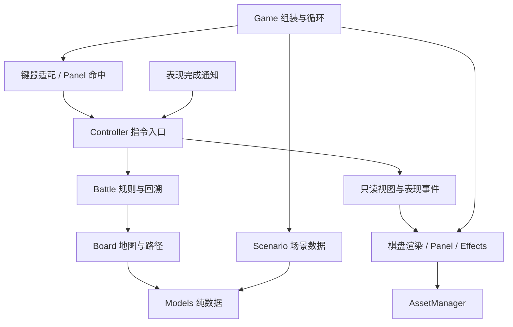

# 整体架构与扩展边界

状态：M1–M4 已实施，M5 待验收。规则与 Controller 不依赖 Pygame；内容/清单用纯加载器验证，图片由资源层缓存，界面、动画和快照保持职责分离。进度见 [TASKS](../TASKS.md)，当前接口见 [M4 验收记录](M4_IMPLEMENTATION.md)，早期决策见 M1–M3 记录。

最简单的划分：规则决定“能做什么、结果是什么”；协调层决定“接收哪次操作、何时继续”；表现层负责“输入来自哪里、画面怎样显示”。替换图片不应影响伤害，增加技能不应要求改写主循环。

## 现状与目标

现状：`models` 存放运行 Unit、不可变 UnitSnapshot/AttackResult；`content` 读取单位定义与场景 JSON，`scenario` 验证局面；`Board` 管理逻辑地图；`Geometry` 转换坐标；`BoardRenderer`/`Panel` 读取只读视图。`Controller` 管理操作和结算确认，`Battle` 管理规则与纯数据回溯。`asset_manifest` 验证纯清单，`assets` 缓存 PNG/缩放和帧列表；Renderer 更新循环待机，Effects 播放阻塞动画并返回 token。`Game` 组装这些模块，不决定图片路径或玩法。

目标仍使用 Python/Pygame，先维持当前平铺模块结构。模块职责稳定后才考虑按包分组，避免为目录美观改动所有导入。

```text
tactics/
  models.py          运行单位、纯数据单位快照和攻击结果、坐标
  scenario.py        场景定义、验证、初始状态构建
  content.py         JSON 单位定义、生成引用与场景加载
  data_files.py      纯 JSON 校验、重复键拒绝、根目录内路径
  asset_manifest.py  纯资源清单与帧/状态引用验证
  board.py           地图状态、空间查询、路径规则
  battle.py          指令合法性、伤害、行动顺序、回溯
  controller.py      指令入口、选中状态、输入锁定、结算协调
  view_models.py     只读的界面快照与表现事件
  geometry.py        逻辑格与像素坐标转换
  board_renderer.py  地图、单位、血条、高亮、图层
  panel.py           属性面板、按钮绘制及命中动作
  effects.py         伤害跳字、受击/死亡等表现
  assets.py          PNG 原图/缩放缓存、锚点、帧列表与表现形体值
  game.py            初始化、组装、事件循环与退出
```

这些模块均有实际调用方。M4 在既有边界接入外部内容和资源，没有创建消息总线、通用插件注册中心或未使用扩展目录。

## 依赖方向



箭头表示调用或数据交付，规则不会反向读取画面。表现完成通知仅用于交接确认，不授权表现层扣血或改变回合。

| 区域 | 可以依赖 | 不应依赖 |
| --- | --- | --- |
| models / scenario / board / battle | 标准库与同层纯数据、规则 | Pygame、窗口、图片、文件播放时间、按钮布局 |
| controller / view_models | 规则、数据、一个很小的表现接口 | Pygame 事件、Surface、Rect、Font、渲染器实现 |
| geometry | 场景尺寸和布局参数、基础数值类型 | 战斗合法性、伤害和资源加载 |
| renderer / panel / effects / assets | Pygame、只读视图、资源与布局 | 改写 Unit/Battle、自己计算第二套移动或攻击规则 |
| game | 组装上述模块、适配操作系统输入 | 重复实现指令校验、伤害或回溯 |

M1–M4 的规则、协调、快照、数据加载和渲染/资源边界已有测试；核心、内容和纯清单可在无第三方包的环境运行。AssetManager 与真实图片/动画需要 Pygame 显示环境。

## 数据模型

### 定义与状态分开

| 数据 | 内容 | 生命周期 |
| --- | --- | --- |
| UnitDefinition | 定义 ID、名称、基础属性、外观 ID；后续可关联技能定义 | 场景加载时读取，战斗期间按只读数据使用 |
| UnitState | 实例 UID、定义 ID、阵营、格子、当前/最大生命和实际属性 | 由规则修改，进入回溯快照 |
| ScenarioDefinition | 场景 ID、逻辑尺寸、地形/障碍、生成位置、单位定义引用 | 加载并验证后构建 Board/Battle |
| BattleState | 轮数、行动槽位、阶段、存活状态、结果、规则新增状态 | 统一变更、统一回溯 |
| PresentationState | 选中 UID、镜头、按钮悬停、动画进度、渲染代次 | 应用/表现层管理，不进入规则快照 |

当前 UnitDefinition 包含定义 ID、基础属性及 visual_id，JSON 生成记录引用 definition_id 并可覆盖少量实例值。Unit/UnitSnapshot/View 保存 definition_id，表现层按定义映射到 visual_id，再从清单选择图片/动画。规则不查询文件或外观。暂不增加技能定义/装备等未使用注册类型。

UID 在同场战斗中唯一且不会因死亡或队列压缩而重新编号。资源 ID、定义 ID 和场景 ID 与文件名解耦。不要用中文名称、像素位置、数组下标或图片路径关联战斗对象。

场景验证至少覆盖坐标边界、重复 UID、出生格重叠、障碍冲突、定义缺失、生命上下限和有效阵营。空阵容、单方阵容和初始死亡单位应有明确的拒绝或结束策略；不能隐含依赖“队列第 0 个一定可行动”。

### 地图与屏幕分开

Board 使用场景中的行列数，位置一律为从 0 开始的 `(列, 行)`。Geometry 接收原点、格子像素大小和行列数，返回数值坐标/边界，Pygame Rect 在表现层构造。

默认仍是 8×8、64 像素格子。使尺寸可注入不等于本次增加自由缩放、镜头或地图编辑功能。精灵可比格子大，不能因此改变移动距离、阻挡和鼠标落格规则。

## 指令、结果与只读视图

Controller 接收逻辑操作，如选中 UID、`move_to(cell)`、`attack(target_id)`、跳过、结束行动、回溯。鼠标像素和键盘码先在输入适配处转为这些操作；Panel 对外提供 `hit_test(position) -> UIAction | None`，不公开按钮矩形供主循环逐个判断。

规则层保留唯一的校验与结算实现。操作结果应明确成功/失败及原因，非法指令不消耗机会、不改变状态，也不创建攻击动画。后续 AI 同样调用该入口，不能直接修改单位坐标和生命。

视图建议至少包含以下纯数据，具体类型按迁移阶段落地：

```text
BattleView
  revision / presentation_generation
  board: rows, cols, terrain, obstacles
  units: tuple[UnitView(uid, cell, team, hp, max_hp, stats, visual_id)]
  active_uid, selected_uid, phase, round_number, winner
  move_cells, attack_cells, target_cells: frozenset[Cell]
  order_uids, log_entries, can_undo, input_locked

AttackResolved
  resolution_id, actor_uid, target_uid, target_cell
  damage, previous_hp, current_hp, killed
```

DTO 不保留可变 Unit/Battle 引用；嵌套集合也使用只读形式或独立副本。`frozen` 数据类中的可变对象不会自动变为只读。Renderer 只显示计算好的可达格与目标格，不调用 Battle 查询合法性。

实际接口：`get_view_state()` 返回 BattleView，其中 `board` 是 BoardView，`units` 是完整阵容的 UnitView 元组，`active/selected` 是独立 UnitView，`order` 仅包含存活单位。日志使用双语元组，按钮提供可用状态，另有 input_locked、presentation_generation 和可空 pending_resolution。M4 在单位显示值中保留 definition_id；visual_id 由 Game 装配的定义映射交给 AssetManager，不让 Controller 读取美术清单。

Controller 的 `select/move_to/attack/click_cell/handle_action/undo` 返回 ActionResult，包含 `accepted` 与失败 `reason`，支持布尔判断。显式移动/攻击提交给当前行动者，不依赖查看对象；鼠标 `click_cell` 额外保留“查看行动者时才尝试移动/攻击”的交互策略。二者最终调用同一 Battle 校验。UIAction 仅包括跳过阶段、结束行动、回溯。

初期不用全局消息总线。普通函数调用、返回值和一个有明确消费位置的事件列表即可。日志最终可从结构化结果格式化，避免规则到处拼接界面文字；第一轮迁移保留现有双语显示行为。

## 动画与结算协议

保持现有语义：合法攻击立即计算生命和击杀，进入 resolving；表现层根据结果绘制跳字与死亡形体；协调层收到有效完成通知后调用规则交接一次。

Game 在启动时将表现适配器交给 Controller。M3 接口为 `play_attack(AttackPresentation)/update(elapsed)->tuple[ResolutionToken,...]/clear()`：播放结果、逐帧更新并返回完成通知、清除旧表现。规则不导入适配器，协调层不导入 Pygame。未传适配器时使用 NullPresentation，攻击仍先进入 resolving，再在下一次 update 返回通知并交接。

AttackResult 包含结算编号、双方 UID、目标位置/阵营、伤害/生命变化及击杀标记，M4 补充双方 definition_id 和 actor_cell，供表现选择素材和位置。AttackPresentation 组合 token 与独立结果。Controller.update 消费通知并匹配确认，不以 Effects.busy 为交接条件；没有把显示帧或路径写入结果。

每次结算有编号，每次回溯/重开场景提升表现代次。只有当前代次、当前结算的完成通知有效，重复通知无效。动画播放不改变已结算的伤害；待机循环和环境特效不是阻塞任务，不参与行动交接的等待。

结算编号由 Battle 分配，合法攻击才消耗编号，同一 Battle 内单调递增且不回溯。代次由 Controller 管理，成功回溯及程序化 restart 先提升代次、清空待确认，再清理表现和恢复规则。restart 重建同一 Scenario 的战斗，允许结算编号从 1 开始，但旧代次通知不能命中新战斗。当前没有玩家重开菜单；一个表现适配器属于一个 Controller 生命周期。

死亡的规则状态与临时死亡形体分开：状态可已判定死亡，表现保留该位置的短暂形体，播放完成后销毁。回溯必须先使旧表现失效，再恢复规则状态并重建视图，不保留重复的死亡形体或伤害数字。

## 回溯与未来存档

当前内存快照为不可变 TurnSnapshot：完整 UnitSnapshot 元组、order_uids、index、round_number、phase、双语 log 元组和 winner。每个 UnitSnapshot 覆盖 Unit 的所有字段，不含活动实体、字典、字体或图片。回溯创建新 Unit，并按 UID 重建原入口顺序槽位；不因死亡压缩槽位，也不依赖快照前的对象身份。跨回溯的调用方必须按 UID 重新查询。

快照明确包含轮数、队列槽位、阶段、战斗结果、单位状态及日志所需数据。新增规则字段必须同时说明初始值、修改者、快照和恢复行为；将来引入随机规则时再将相应随机状态纳入快照。

历史仅在单位行动开始或战斗结束时记录，不支持恢复到 resolving 中途；待结算在这些边界必为 None。场景尺寸/障碍是当前不可变配置，不在每个行动快照重复保存。结算计数器、表现代次、待确认 token 属于不回溯的协议身份，不进入规则快照；以后引入可变地形或其他状态时再显式扩展快照。

图片缓存、动画帧、字体和显示时钟不得进入快照。选中状态在恢复后按现有规则重置到当前行动者。快照不是直接 pickle 整个对象图；如以后新增持久化，再基于已验证的纯数据格式增加 schema_version、内容版本和迁移策略。

## 内容和美术边界

当前 content/ 存放 schema_version=1 的单位定义和场景，assets/manifest.json 存放图片、显式帧列表、visual 状态和地砖/障碍映射。解析器拒绝未知字段、重复键/ID、无效引用及越出资源根的路径；AssetManager 在初始化显示后预载与转换 PNG，缓存失败和缩放。细则见 [资源规范](ASSET_GUIDE.md) 与 [M4 记录](M4_IMPLEMENTATION.md)。

默认路径已经使用地砖与斥候素材。SpriteBody 是只在表现层流转的当前帧形体值；Renderer 将单位、障碍和素材死亡形体排序后，再统一画标签、高亮和血条。Effects 继续画最上层伤害字及几何死亡回退。循环 idle 不进入结算队列，可选帧缺失则整段回退，--geometry 完全跳过资源清单。当前无图集、音频、自动重载或美术编辑器。

## 扩展入口

| 后续需求 | 主要扩展点 | 必须先具备的边界 |
| --- | --- | --- |
| 新地图/关卡 | 场景定义、地图加载与验证 | M1；外部数据文件依赖 M4 的内容验证 |
| 单位和地砖美术 | 资源清单、渲染器、图层 | M1–M4；不改战斗算法 |
| 动画、音效、镜头反馈 | 表现事件、资源、非阻塞播放器 | M2–M4；明确阻塞/非阻塞类别 |
| 技能、Buff、装备 | 规则定义、指令校验、结算结果、运行状态 | M1–M3；新增状态必须可回溯 |
| AI | 查询合法操作、提交同一指令入口 | M2–M3；不得依赖屏幕与模拟点击 |
| 存档/回放 | 纯数据快照、内容版本、序列化 | M3；明确版本和恢复策略 |
| 多窗口尺寸或不同显示比例 | Geometry、布局、渲染资源缩放 | M1；逻辑格子不跟随图片像素变化 |

这张表是开发入口，不是新增功能承诺。任何新需求先选择最小必要前置能力，再与需求一起交付，避免以“架构还没完成”为由无限延后。
