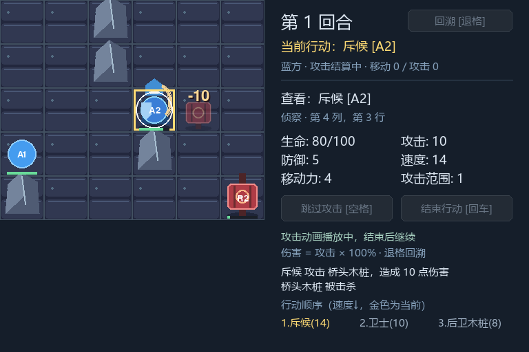

# M5 扩展演练：渡口与 dusk 外观

这次只添加数据、素材、工具、文档与验收测试。`main.py`、`tactics/*.py`、原单位定义和原场景不变；不复制 Board/Battle，不在 Game 按场景名分支。

## 第二场景

[river_crossing.json](../content/scenarios/river_crossing.json) 使用已有 schema_version=1：6×5，四处障碍，斥候/卫士与两只木桩，共用 [units.json](../content/units.json)。生命、速度和名字的实例覆盖使用既有 overrides。默认训练场仍为 8×8、双方各三人。

```powershell
.\.venv\Scripts\python.exe main.py --scenario scenarios/river_crossing.json
.\.venv\Scripts\python.exe main.py --scenario scenarios/river_crossing.json --geometry
.\.venv\Scripts\python.exe main.py --scenario scenarios/river_crossing.json --assets assets/skins/dusk
```

开局 A2 在 `(1,2)`，生命 80/100；移动到 `(3,2)`，攻击右侧 R1（生命 5），实际伤害 10。R1 动画后消失并跳过行动，轮到 A1。回车结束 A1、再回车结束 R2，进入第二轮 A2。移动到 `(5,3)` 攻击下方 R2（生命 10），蓝方胜利。此时连续四次退格，依次回到第二轮 A2、第一轮 R2、第一轮 A1、最初 A2，木桩复活、位置和血量恢复。内部坐标从 0 开始；侧栏坐标从 1 开始。

这是一条便于检查击杀和回溯的演练路线，数值不代表平衡设计；红方仍由玩家手动操作。

## 第二套外观

[dusk/manifest.json](../assets/skins/dusk/manifest.json) 自包含地砖、障碍、斥候和木桩的 17 张 PNG。切换资源根，不修改 definition_id 或 visual_id。未配置图片的卫士/先锋继续几何回退；缺少可选图片按既有规则回退。

同一 dusk 外观也可用于原训练场：

```powershell
.\.venv\Scripts\python.exe main.py --assets assets/skins/dusk
```

人物显示 64×96、脚底锚点 `(0.5,1)`，占格始终一格。斥候待机循环不阻塞；攻击与死亡仍经 M3 token 确认，不把图片或动画时钟写入规则快照。来源与重建见 [dusk 说明](../assets/skins/dusk/README.md)。

## 可以直接复用的流程

新增关卡时复制一个 JSON，保留已支持的字段，用现有定义与 overrides，运行纯内容检查和实际入口。新增美术时复制自包含资源根，修改 manifest 的图片、尺寸、pivot、帧与 visual 状态，检查加载和真实窗口，再比较相同指令的 BattleView。

需要新增玩法字段时，先填写 [功能模板](templates/FEATURE_TEMPLATE.md)，明确规则、初始化、回溯、只读结果与表现边界；不能仅在 JSON 增加解析器不认识的字段。现有解析器会拒绝未知字段。

## 自动验收

[test_milestone.py](../tests/test_milestone.py) 对两张地图 × 三种模式执行相同输入，比较每个观察点的完整不可变 BattleView，包含移动范围、单位属性、血量、队列、日志、阶段、轮数、胜负、代次与结算 token。另检查伤害字、死亡表现、输入锁定、表现清理、旧通知、字体扫描异常及其他工作目录下的真实 CLI 入口和 QUIT。

```powershell
.\.venv\Scripts\python.exe -m unittest discover -s tests -p test_milestone.py -v
```





