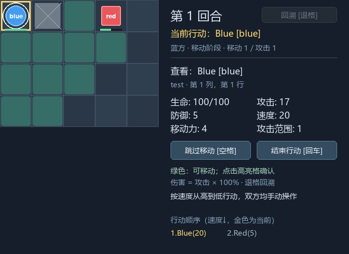

# M1 实施与验收记录

状态：代码和本机验收完成。评审前基线为 `b072548`；实施分支为 `refactor/m1-rule-render-separation`。远程结果以对应 PR / Actions 为准，任务状态见 [TASKS](../TASKS.md)。

## 范围和结果

本阶段完成场景、逻辑地图、数值几何和棋盘绘制分离，没有增加玩法，没有改动 Battle 的伤害、行动顺序或回溯算法。默认 8×8、64 像素、6 名单位与 5 个障碍保持原样。

| 模块 | 实际职责 |
| --- | --- |
| models.py | 可变的 Unit 运行状态，不再决定默认阵容 |
| scenario.py | 不可变 UnitSpawn/Scenario、验证与默认场景；为每局创建新的 Unit |
| board.py | 从 Scenario 接收逻辑尺寸和状态，只提供空间查询、邻格与 BFS；无 Pygame、像素转换和绘制 |
| geometry.py | 纯数值 BoardGeometry，提供 cell_at、cell_rect、cell_center 与 bounds |
| view_models.py | 最小 BoardView/BoardUnitView 与只读棋盘投影，不含活动实体引用 |
| board_renderer.py | 只读取 BoardView 和 Geometry，绘制地格、范围、单位、高亮及血条 |
| game.py | 在组装处选择场景和 Geometry，调用 Renderer；旧输入/动画协调暂留到 M2 |
| panel.py / effects.py | 接收实际棋盘宽高或同一 Geometry，不再使用全局固定地图像素尺寸 |

## 关键决策

### 显式注入场景

`Board(scenario)` 不提供隐式默认场景，只有应用组装处的 `Game()` 使用 `default_scenario()`。测试和后续关卡都使用同一入口，不必修改 Board。

Scenario 将集合与坐标规范为不可变数据。复用场景创建多个 Board 时，单位状态相互独立；场景模板不会随移动、扣血或回溯被改变。

初始化拒绝越界、出生格重叠、障碍冲突、重复 UID、非法属性、空阵容、单方阵容或初始死亡单位。当前仅支持 ally/enemy；初始单位要求 `0 < health <= max_health`，防止进入不存在的首位行动者。这是新增场景 API 的初始化约定，不改变默认场景的玩法。

### 几何与规则独立

Board 的行列数来自场景；CELL_SIZE、侧栏宽度和最小窗口高度仅属于表现默认值。Geometry 返回数字元组，不返回 Pygame Rect。

默认窗口仍为 896×512。小于 8 行的注入场景保留至少 512 像素窗口高度，以保证现有侧栏完整；空余区域是背景，不计入逻辑地图。M1 不增加窗口缩放操作或地图选择菜单。

### 提前实现最小棋盘视图

M2 规划了完整 View，但 M1 若继续将 Battle 交给 Renderer，就没有完成绘制边界。因此本次仅提前实现棋盘所需的独立值：单位显示属性、障碍、选中/行动 UID、合法移动格、攻击展示格和目标格。

`build_board_view` 复用现有规则查询，不复制合法性算法；Renderer 不拿到可变 Unit/Board/Battle。完整 Panel 视图和 Controller 留给 M2，AttackResult / TurnSnapshot 的对象引用迁移留给 M3。

### 不保留旧的像素兼容接口

删除 Board.draw、Board.rect、Board.cell_at。原有测试中的像素操作迁移为 `game.geometry.cell_center(cell)` / `cell_at(pixel)`，没有为了兼容旧测试把 Pygame 放回核心。原 41 项测试的行为覆盖保留。

## 当前可用的场景扩展入口

下例使用的 API 已实现；无需额外数据加载库：

```python
from tactics.board import Board
from tactics.battle import Battle
from tactics.scenario import Scenario, UnitSpawn

scene = Scenario(
    "small", 5, 4,
    (
        UnitSpawn("blue", "Blue", "ally", "test", (0, 0),
                  speed=20, movement=4, attack=17),
        UnitSpawn("red", "Red", "enemy", "test", (3, 0),
                  health=50, speed=5),
    ),
    frozenset(((1, 0),)),
)
board = Board(scene)
battle = Battle(board)
assert battle.move((2, 0))  # 绕过障碍，实际移动 4 步。
assert battle.attack(board.enemies[0])
assert board.enemies[0].health == 33
battle.finish_attack()     # 纯规则调用方明确确认结算结束。
assert battle.undo()
assert board.enemies[0].health == 50
```

如需窗口，在安装 Pygame 后使用 `from tactics.game import Game; Game(scene).run()`。这不是 JSON 场景加载器，外部内容清单属于 M4。

## 自动化验证

```powershell
.\.venv\Scripts\python.exe -S -m unittest discover -s tests -p test_core.py -v
.\.venv\Scripts\python.exe -m unittest discover -s tests -v
.\.venv\Scripts\python.exe scripts\export_source.py --check
```

本机 Python 3.9.1 / Pygame 2.6.1：原 41 项行为检查加 16 项新增检查，共 **57 项通过**。其中 **12 项核心检查**在 `python -S` 下运行，禁用第三方包路径；独立子进程还明确拒绝导入 Pygame，实际跑通移动、扣血、交接和回溯。

新增覆盖场景不可变与局间隔离、默认数据不变、非法场景拒绝、不同尺寸场景、四方向真实路径、非零原点与不同格子尺寸、边界落格、只读视图、Renderer 不查询规则、图层裁剪恢复以及注入场景的窗口交互。

CI 在安装 requirements 之前执行上述 `-S` 核心检查，再安装 Pygame 执行完整回归。平台继续覆盖 Windows/Linux 与 Python 3.9/3.12。

## Windows 实际窗口与像素对照

使用 `windows` 显示驱动，在改动前、改动后以同一状态和固定动画时间保存画面，将每个画面的 RGBA 字节逐一比较：

| 画面 | 对照结果 |
| --- | --- |
| 默认开局与移动范围 | 逐像素一致 |
| 移动后攻击范围 | 逐像素一致 |
| 攻击后 0.2 秒的伤害跳字 | 逐像素一致 |
| 攻击后交接下一单位 | 逐像素一致 |
| 回溯到上一行动 | 逐像素一致 |
| 击杀后 0.2 秒的死亡动画 | 逐像素一致 |
| 死亡动画结束后消失 | 逐像素一致 |
| 回溯恢复被击杀单位 | 逐像素一致 |

另外在真实窗口跑通 5×4 场景的鼠标事件、攻击 17、生命 50→33、回溯恢复 50 和 QUIT 清理。查看了重构后的伤害、死亡画面和第二场景截图，布局正常。验证通过程序调用和投递事件完成，不是人工逐次点击。

像素对照是本次纯重构的迁移证据，不是以后更换美术必须维持原画面的永久约束；也不宣称不同操作系统的字体会产生相同像素。



## 尚未实施

- M2：Controller、完整 UI 视图、UIAction 命中封装。
- M3：ID 化结算结果、纯数据快照和结算/表现代次协议。
- M4：外部 JSON 内容、AssetManager、图片/动画素材加载。
- M5：完整的后续扩展与资源交付演练。
