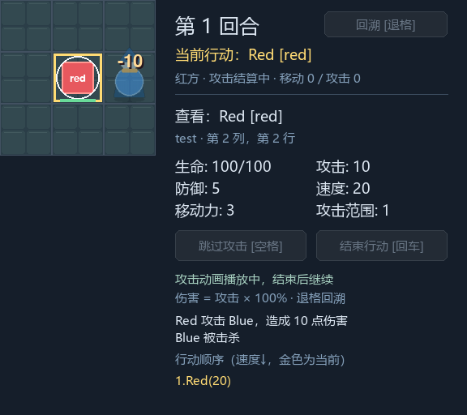

# M4 实施与验收记录

状态：代码和本机验收完成，2026-10-22。基线为 M3 合并提交 `d827ba9`，实施分支 `feature/m4-content-assets`。远程结果以对应 PR / Actions 为准，进度见 [TASKS](../TASKS.md)。

## 结果与边界

默认启动现在实际加载 JSON 单位/场景、资源清单及项目内生成的 PNG，显示地砖和带帽斥候，支持循环待机、非循环攻击/死亡。其他单位与障碍继续使用几何回退；--geometry 完全不加载资源清单。当前没有图集切帧、move/hit 素材状态、音频、自动重载或美术编辑器。

移动、伤害、行动顺序、立即扣血、死亡退出占格/队列、上一行动回溯及 M3 token 确认不变。Unit/UnitSnapshot/View 增加 definition_id，AttackResult 补充双方定义 ID 和行动位置；这些是纯标识/坐标，不含图片路径或播放时钟。新增字段已经纳入快照完整性检查。

| 模块 | 实际职责 |
| --- | --- |
| data_files.py | UTF-8 JSON、重复键拒绝、严格字段/数值/版本检查、安全相对路径 |
| content.py | 不可变 UnitDefinition/GameContent；读取定义、生成记录和覆盖值，调用既有 Scenario 验证 |
| scenario.py | 保留 Python 场景接口；default_scenario() 读取同一默认 JSON，不维护第二份阵容/数值 |
| asset_manifest.py | 无 Pygame 的图片、显式帧列表、visual 状态和 board 引用验证 |
| assets.py | 显示初始化后加载/转换 PNG，缓存原图/缩放/Sprite/Clip，提供锚点与 SpriteBody 表现值 |
| board_renderer.py | 地砖、范围、按脚底排序的障碍/单位/临时素材形体，再统一绘制标签/高亮/血条；更新非阻塞待机 |
| effects.py | 播放攻击/死亡素材或几何回退，维护跳字，阻塞效果完成后返回一次 M3 token |
| game.py / main.py | 组装和启动参数；不硬编码资源文件名、定义 ID 或新玩法分支 |

## 内容格式与身份

`content/units.json` 根字段为 schema_version=1、units 数组；每项必须有 id、name、role、max_health、attack、defense、speed、movement、visual_id。定义 ID 唯一，数值为非负整数（max_health>0），布尔值不能充当整数。

`content/scenarios/*.json` 必须有 schema_version、id、cols、rows、obstacles 和 spawns。生成记录为：

```json
{"uid":"A2","definition_id":"scout","team":"ally","cell":[1,3],"overrides":{"health":80}}
```

overrides 可覆盖 name、health、max_health、attack、defense、speed、movement，不允许未知键。未提供 health 时使用本次 max_health；默认斥候通过实例覆盖保留 80/100。木桩共用 dummy 定义，通过实例名称和速度覆盖保持原阵容。未知定义、重复 UID、出生冲突、越界、非法生命/阵营仍在初始化拒绝。

定义与状态分开：每局复制定义数值创建新的运行 Unit，定义本身不可变，运行中不动态回读 JSON。保存 definition_id 可在回溯后关联同一外观；AssetManager 使用 Game 装配的“定义 ID → visual_id”映射，规则不读取资源清单。

Python 手写 Scenario 仍可构造完整属性，definition_id 默认为空；未绑定外观时使用几何。JSON 生成记录必须引用已存在定义；加载的每个定义都必须有已声明的 visual（空对象 {} 明确表示几何回退），不能用拼错外观 ID 静默隐藏问题。

## 清单与替换流程

`assets/manifest.json` 的 schema_version=1，根字段必须有 images、animations、visuals、board 四个对象。未知字段、重复 JSON 键/跨图片动画 ID、无效引用均拒绝。实际完整示例已随项目交付，不需要生成额外注册代码。

图片条目：path、display_size（两个正整数）、pivot（0–1 相对坐标）、optional（布尔值）。路径相对资源根，使用正斜杠，只支持 .png；绝对路径、Windows 盘符/UNC、反斜杠和解析后越界的路径拒绝，解析也检查符号链接逃逸。

动画条目：frames 是非空图片 ID 列表，fps 为有限正数，loop 为布尔值。visual 可有 idle、attack、death：idle 接单图或循环动画，attack/death 只能接非循环动画。board 可声明 floor、obstacle 图片。未声明的状态使用几何；没有静默接受未知引用。

替换地砖或斥候只需：

1. 将 PNG 放进资源根内，更新图片 path、基准显示尺寸及 pivot。
2. 在 images 中为每个动画帧声明图片，再修改 animations 的 frames/fps；角色通过 visuals 的状态映射选片段。
3. 单位定义保持 visual_id；如果新增一个外观，增加 visuals 条目后修改定义的 visual_id。
4. 重启游戏验证。资源不改变 cell、占格、路径、生命或伤害；没有每帧读文件或热更新菜单。

默认格子 64 像素，清单显示尺寸以此为基准，资源层按 Geometry 比例缩放。单位/障碍/死亡形体将 pivot 对齐格子底部中心，地砖对齐格子中心。斥候画幅 64×96，高出格子但不扩展点击区域；Renderer 按脚底行和稳定 ID 排序形体，最后统一绘制标签/高亮/血条。形体裁剪在棋盘边界，跳字及侧栏仍位于上层。

演示图片均由 [生成脚本](../scripts/generate_demo_assets.py) 绘制，无外部下载；来源、尺寸、锚点及授权说明见 [assets/README](../assets/README.md)。这些是接口验证素材，不是最终美术交付。

## 缓存与失败策略

- 原图以解析后的路径为键，包括缺失/解码失败；多个 ID 引用同一文件也只读取一次。
- 缩放 Surface 以路径和目标尺寸为键；Sprite 以资源 ID/尺寸为键保留不同 pivot；Clip 以动画 ID/比例为键复用帧缓存。
- 初始化显示后预载全部声明图片与片段；重复绘制、待机更新和攻击播放不读盘、不重复缩放。请求新尺寸时只生成一次派生图。
- 可选文件失败按 ID/路径记录一次，缓存 None 并使用几何。任意帧不可用时整个片段回退，避免残缺动画永久锁定结算。
- 必需图片（即使未在当前画面使用）在启动时校验，缺失/损坏立即报错。内容、格式和引用错误同样拒绝，CLI 以 Configuration error 和文件/字段原因退出；资源失败后的窗口会清理。
- clear_cache/preload 提供显式开发期清理/重建入口，不实现文件监视。开发者重载前应取消旧表现，正常使用直接重启进程。

没有 PNG 时保留合法 manifest 可走可选缺失回退；如果连资源清单也不需要，使用 --geometry。几何模式仍需要合法规则内容文件，不能把错误场景静默换成另一个关卡。系统字体扫描异常与英文/内置字体回退保持原样。

## 动画、交接与恢复

Renderer 单独推进循环待机，不影响 Controller/Battle。Effects 在合法攻击后解析 actor_definition_id 对应攻击片段和被击杀目标的 death 片段，画面位置来自独立结果坐标，保持立即扣血。

非循环片段和伤害跳字是本次结算的阻塞任务，全部完成后只发一次原 token。死亡片段结束即移除临时 SpriteBody，不切回 idle；规则中目标已不存在于存活 BoardView。可选素材缺失时使用原几何死亡形体与跳字，仍按 M3 确认。回溯/restart 清除图片形体、几何形体、跳字和尚未发出的通知，恢复单位重新显示正常 idle；晚到旧 token 仍由 Controller 拒绝。

默认攻击片段 3 帧/8 fps，死亡片段 3 帧/5 fps；默认跳字约 0.9 秒，因此默认交接时机仍由较长跳字控制。自定义非循环素材更长时会等待实际片段结束，测试已覆盖 1 秒死亡片段；循环待机绝不进入等待。

## 运行与验证

```powershell
.\.venv\Scripts\python.exe main.py
.\.venv\Scripts\python.exe main.py --geometry
.\.venv\Scripts\python.exe main.py --scenario scenarios/training_ground.json --assets assets
.\.venv\Scripts\python.exe scripts/generate_demo_assets.py
```

默认根路径相对项目文件，允许从其他工作目录启动。--scenario 相对所选 content 根；显式 --content-root/--assets 接受当前工作目录相对路径或绝对目录。需要从外部路径传入场景时先选对应 content 根，不绕过根目录内引用约束。

本机 Python 3.9.1 / Pygame 2.6.1 / SDL 2.28.4：123 项测试，122 通过，1 项因 Windows 无创建符号链接权限跳过，整体退出码 0。无窗口与 Windows 实际窗口两次完整回归均完成。新增 13 项纯内容/清单、16 项 PNG/缓存/渲染/动画检查，原 94 项覆盖保留；旧颜色断言明确在几何模式验证，素材另有真实链路检查。

四组 `python -S` 共 57 项（含上述跳过项），验证内容、清单、核心和协调不依赖 Pygame；独立子进程还禁止导入 Pygame，并从其他工作目录读取默认文件和跑通战斗/回溯。CI 在安装依赖前运行四组，随后安装依赖、检查 SOURCE 并运行完整回归；平台继续覆盖 Windows/Linux × Python 3.9/3.12，结果以 Actions 实际结论为准。

自动化覆盖多 ID 单次读盘、不同缩放缓存、负缓存/一次报告、显式重载、透明度与锚点、所有形体之后的血条、绘制裁剪、无素材像素回退、清单单独替换、规则结果一致、长死亡片段等待、恢复无残留、必需缺失/损坏/结构/引用错误等。符号链接项在支持的系统实际建链验证；Windows 跳过该项时，绝对路径、盘符、反斜杠和 .. 逃逸检查仍运行。

实际 Windows 额外检查默认素材、攻击、斥候死亡/消失、胜负、回溯复活与旧通知拒绝；main.py 的默认/几何两种入口从其他工作目录启动并在结算中 QUIT 正常释放。几何模式 13 帧与 M3 逐像素一致。检查了如下截图中的透明边缘、脚底位置、缩放、图层与侧栏；操作由程序调用和自动事件完成，并非人工逐次点击。




## 后续

M5 将正式交付第二场景和第二套外观、开发模板及阶段发布验收。当前临时测试数据和颜色替换证明 M4 链路可用，不提前把系统扩展演练或最终美术标记完成。
