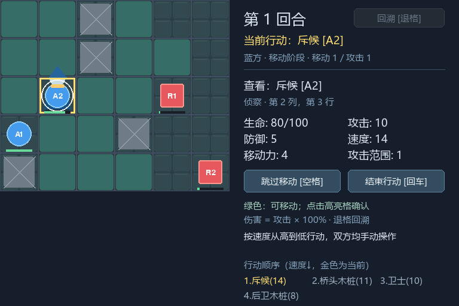
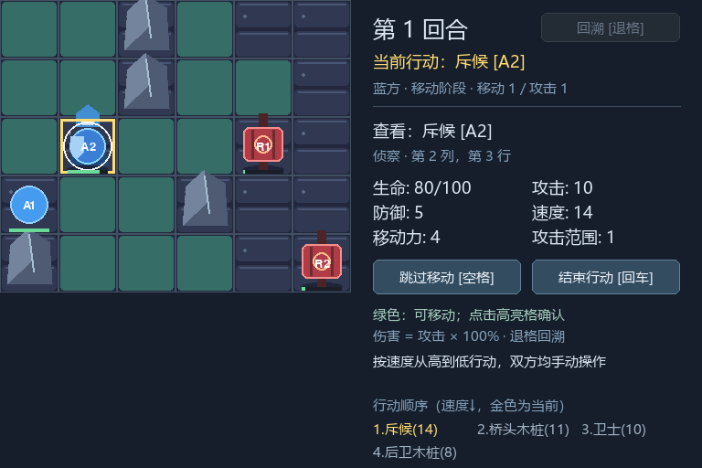

# M5 扩展、验收与阶段交付

M5 交付第二场景 `river_crossing`、第二套 `dusk` 外观、可复制功能模板，以及可重建/校验的 0.2.0 源码发布链路。具体演练步骤见 [EXTENSION_EXERCISE](EXTENSION_EXERCISE.md)，后续开发从 [模板](templates/FEATURE_TEMPLATE.md) 和 [规范](FEATURE_DEVELOPMENT.md) 开始。

## 扩展成本

- 场景仅增加一个 JSON：尺寸 6×5、四单位、四障碍，共用既有单位定义和实例覆盖字段。
- 外观仅增加独立 manifest 与 17 张项目脚本生成的 PNG；已有 9 张经典素材保留。
- `main.py`、`tactics/*.py`、`content/units.json` 和默认场景相对 M4 完全未改。没有新增规则分支、运行状态、快照字段、兼容层或未使用框架。
- 新增 6 项扩展集成与 4 项包完整性测试。打包/校验为离线 Python 标准库脚本；PNG 重建使用已有 Pygame。

## 本机实际验证

环境：Windows、Python 3.9.1、Pygame 2.6.1 / SDL 2.28.4。

| 验收 | 结果/边界 |
| --- | --- |
| 完整回归 | 133 项，本机 132 通过、1 项符号链接创建权限跳过；不放宽路径校验 |
| 无第三方包 | 既有四组 57 项（56 通过、同一权限项跳过）；发布完整性另 4 项可用 `-S` 执行 |
| 场景 × 外观 | 两场景 × geometry/classic/dusk，逐观察点比较完整 BattleView，一致 |
| 实际窗口 | windows SDL 驱动；六条操作链、击杀、跨轮、胜利、连续回溯、形体清理、QUIT 释放通过 |
| 字体与 CLI | 强制模拟字体扫描 TypeError，英文回退仍可绘制；其他工作目录实际 main.py 参数与关闭通过 |
| 截图检查 | 观察开局、死亡/跳字、连续回溯复活；锚点、透明度、图层与侧栏显示正常 |
| 发布包 | CI 构建提交树并检查解压后的 SOURCE/CLI/六项集成；最终包记录合并提交与 SHA256 |

实际窗口由事件与公开指令自动驱动，不是人工逐次点击。截图是实际绘制的 Surface；dummy 测试不能替代真实窗口检查。保留 M4 的几何 13 帧对照证据，本阶段没有改绘制或规则代码，不重复宣称新做了逐像素对照。

## CI 与版本对应

`.github/workflows/ci.yml` 覆盖 Windows 2022 / Ubuntu 24.04 × Python 3.9 / 3.12，依赖安装前跑四组纯检查，之后跑完整回归、SOURCE 校验、提交树打包和解压验收。平台字体或符号链接能力不同，跳过原因必须在日志中可见。

工作流在 PR、main 和 `v*` tag 触发。远程成功状态以该提交的 Actions 为准，文档存在不构成 CI 成功证据。最终发布以仓库 `v0.2.0` tag 和同名 Release 为准；包内 ZIP comment、SHA256 和 Release 说明标识实际提交。构建与验证命令见 [RELEASE](RELEASE.md)。

## 后续边界

M0–M5 架构规划已落实；后续按真实功能需求继续开发。技能/Buff 要同步规则、指令、快照和只读结果；AI 共用 Controller；新美术走清单、缓存与表现 token。当前仍无 AI、联网、存档、音频、图集切帧、热重载和独立 EXE，数值和美术是演示内容。

