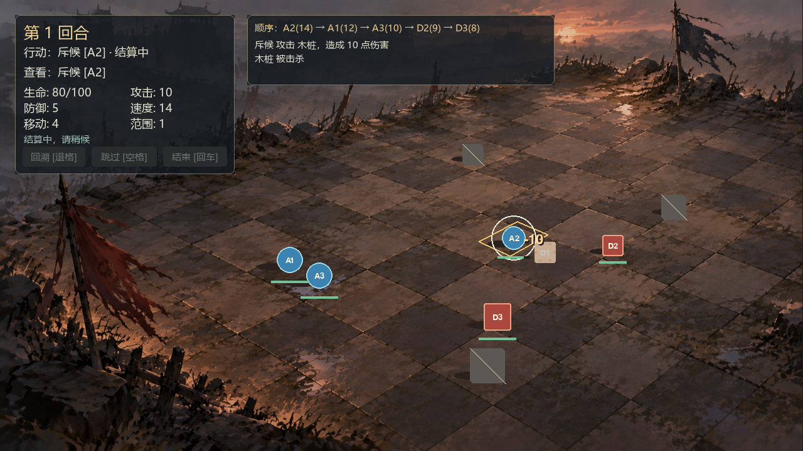
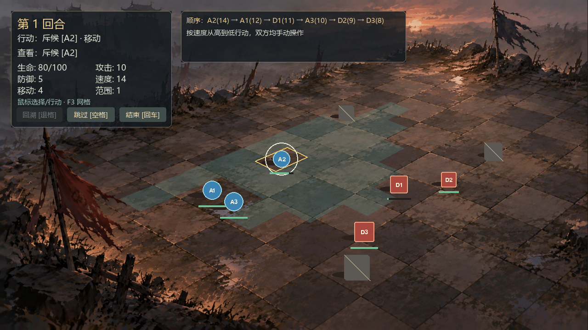

# 透视战场：实现与验收

本文保留首版透视功能的实现历史，包含旧四角、64格细分和152项基线，不能作为当前地图配置。用户补充允许不规则地图后，已完成28格校准、20点独立验证5.57/11.42px与165项回归；现状、真实截图和限制见 [逐砖校准报告](WAR_TORN_CALIBRATION.md)。

本功能基于已发布 v0.2.0，以独立透视模式接入用户背景。设计依据见 [用户设计稿](references/perspective_battlefield_design.md)；其中的示意零角点没有用于运行。本次只改变表现与输入映射，规则、Controller、Unit、ViewModel 和规则快照未修改。无 AI、技能、存档、网络或新依赖。

## 使用与参数约定

```powershell
cd E:\gamedesign
.\.venv\Scripts\python.exe main.py --presentation presentations/war_torn_8x8.json
.\.venv\Scripts\python.exe main.py --presentation presentations/war_torn_8x8.json --debug-grid
```

窗口固定 1280×720，不支持 resize 或镜头。F3 在正式画面和四角/网格/中心/编号之间切换；只改表现，不影响行动。鼠标、空格、回车、退格与旧版一致；HUD 标签/背景会消费点击，按钮只返回 UIAction，仍由 Controller 校验。默认角色是临时蓝圆/红方块，正式角色美术尚未提供。

`--presentation` 与 `--scenario`、`--assets`、`--content-root`、`--geometry` **互斥**，不采用隐含覆盖优先级；冲突清楚报错并退出 2。`--debug-grid` 需要 presentation。无 presentation 时原入口、几何模式、训练场和渡口/dusk 均保持原行为。默认路径和 presentation 路径相对项目根，与当前工作目录无关；显式资源/内容目录在旧模式仍按当前工作目录解析。

Python API 可用 `Game(scenario, presentation_file=...)` 注入独立 Scenario 夹具，尺寸必须匹配布局；CLI 不提供绕过互斥的参数。正式入口使用布局引用的 war_torn.json。

## 数据与职责

| 文件 | 实际职责 |
| --- | --- |
| `content/scenarios/war_torn.json` | 独立 8×8、双方各 3 人、3 个显式障碍；不修改旧两张地图 |
| `assets/skins/war_torn/manifest.json` | 必需完整背景、临时几何角色绑定；原图不改像素 |
| `presentations/war_torn_8x8.json` | 背景参考尺寸、四角、视口、HUD、调试开关；不含规则数值 |
| `tactics/presentation_layout.py` | 使用既有严格 JSON/路径工具；拒绝未知字段、版本、路径逃逸、零/退化角点、尺寸与 HUD 越界 |
| `tactics/perspective_geometry.py` | 纯 Python 单应矩阵/逆矩阵、contain 变换、缓存 64 格多边形/中心/脚底/尺度、半开反向命中 |
| `tactics/perspective_board_renderer.py` | 完整背景、透明四边形、阴影、屏幕脚底 Y/稳定 ID 排序、全部形体后的标记与血条 |
| `tactics/scene_hud.py` | 独立半透明状态/属性/按钮卡与队列/日志卡；复用已修复的字体加载 |
| `tactics/geometry.py` | 矩形模式补充脚底、尺度、表现形体矩形接口，原有矩形映射不变 |
| `tactics/effects.py` | 通过同一几何接口定位跳字/攻击/死亡，token/generation、锁定和清理流程不变 |
| `tactics/assets.py` / `asset_manifest.py` | 兼容新增 board.background；验证实际尺寸、缓存整图；只为单位/障碍预载离散深度尺寸 |
| `tactics/game.py` / `main.py` | 选择组装模式、CLI 互斥、HUD 点击消费和 F3；初始化失败释放显示资源 |

背景不是 64×64 地砖。contain 缩放率 `min(1280/1672,720/941)`，偏移居中；图片、投影、反向点击共用 BackgroundFit。没有每帧 IO、缩放或矩阵求解；F3 仅重建调试层。人物站立点为投影 `(col+0.5,row+0.82)`，位于格内近侧；深度尺寸量化到 1/8，范围 0.5–1.5，启动时预载有限组合。

PNG 以该站立点作脚底锚定；临时几何形体、标签和选中环围绕逻辑格中心绘制，点击形体中心仍命中同一格，避免斜向投影时点到邻格。几何死亡与跳字使用相同表现形体矩形，规则占格不变。

## 首版校准与实际试玩（历史）

原图真实为 1672×941，SHA256 与来源见 [资源记录](../assets/skins/war_torn/README.md)。下列旧四角以原图坐标保存，但只有目测选区，没有真实整砖计数与独立误差验收，当前已确认不是有效8×8整砖边界：

| 逻辑外角 | 原图坐标 |
| --- | --- |
| p00 / (0,0) | (1060,270) |
| p10 / (8,0) | (1530,452) |
| p11 / (8,8) | (892,898) |
| p01 / (0,8) | (340,568) |

列轴向画面右下，行轴向左下，不假定屏幕横纵轴就是棋盘轴。区域避开两杆主要军旗；左上属性卡与上方日志卡没有占用当前棋盘。石砖是绘画纹理，大小、裂缝和接缝并非严格的规则平面网格：当前 64 格是这个区域的均匀透视细分，**不能保证每条格线都恰好等于一块原画砖缝**。截图记录当前首版校准；最终美术级接缝与角点仍需人工认可，可编辑 JSON 后重启检查。未据此新增多点编辑器或逐行校准。

开局 A2 在 `(1,4)`；点击 `(4,3)` 移动，再点击 D1 `(5,3)`，造成 10 点伤害并击杀生命 5 的训练木桩。动画完成后退格，可恢复初始位置和木桩生命 5。其他木桩生命保持 100，数值仍是演示值。图片中的旗帜、碎石和裂缝不自动阻挡；只使用 JSON 的 `(0,1)`、`(7,6)`、`(6,0)` 三个障碍。

## 自动化与实际窗口结果

新增 7 项几何、5 项配置、7 项渲染/集成，共 19 项；保留全部 133 项旧检查，总计 **152 项**。本机 Windows Python 3.9.1 / Pygame 2.6.1 / SDL 2.28.4：dummy 与 windows 实际窗口分别执行，**151 通过，1 项符号链接创建权限跳过**。六组纯检查合计 69 项（68 通过、同一权限跳过），另 4 项包完整性检查可使用 `-S`。

```powershell
.\.venv\Scripts\python.exe -S -m unittest discover -s tests -p test_perspective_geometry.py -v
.\.venv\Scripts\python.exe -S -m unittest discover -s tests -p test_presentation_layout.py -v
.\.venv\Scripts\python.exe -m unittest discover -s tests -p test_perspective_rendering.py -v
.\.venv\Scripts\python.exe -m unittest discover -s tests -v
```

- 数学检查：四角、64 中心、内部点、相邻边、半开边界、留边、非有限输入、分母为零、退化/反序四角、contain 后反向命中。
- 配置/资源：旧清单兼容、背景 ID/必需标记、缺失/损坏/真实尺寸不匹配、严格字段/路径、互斥 CLI 与异地目录真实 main.py；失败后关闭显示资源。
- 战斗：同一 Scenario/操作在矩形与透视下逐点比较完整 BattleView，一致；覆盖查看远近单位、移动、攻击锁定、三次击杀、跨轮、胜利、连续回溯、复活及拒绝旧 token。快速全灭夹具仅将三只木桩生命设为 5，不改交付场景/单位定义。
- 资源表现：临时组合 dusk PNG 与背景，实际走 idle/attack/death、按屏幕脚底排序和回溯清理；在禁止 image.load/smoothscale 的绘制阶段仍能运行。背景/高亮保留原纹理。
- 旧画面：13 帧几何截图与 M4 留存基线逐像素一致，包含跳字、死亡、回溯、英文降级和结束状态；不是用删旧测试实现兼容。
- 真实窗口：windows 驱动保存并查看下列 4 张实际绘制画面；点击由事件自动投递，不是人工鼠标逐次试玩。字体扫描异常时 HUD 英文回退，结算中 QUIT 正常释放。
- CI：Windows/Linux × Python 3.9/3.12 增加两组依赖安装前检查；SOURCE 导出包含 presentations；交付包解压验证同时运行 M5 与透视集成。远程结果以当前 PR/Actions 为准。

## 首版待确认事项（历史，现状见逐砖校准报告）

角色仍为临时几何回退；当前角点是首版可交互校准，原画局部砖缝与严格单应网格存在偏差，需要最终美术确认。窗口暂不支持 resize、相机、音频、图集或编辑器；这些没有标记为已实现。新增规则状态仍须按功能模板补快照/恢复，本次没有改变玩法和防御计算。





