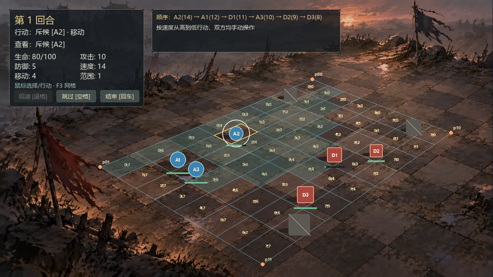
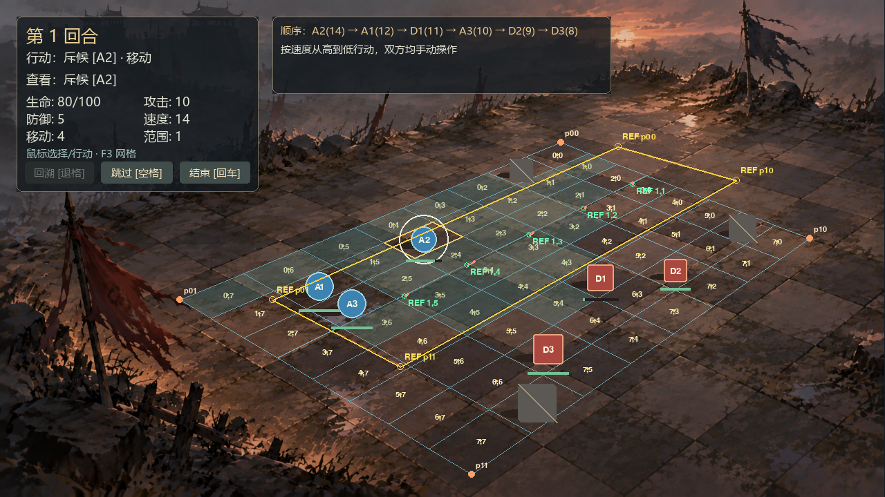

# War Torn 地砖对齐诊断：完整 8×8 尚未通过

本轮先核对实际砖缝、坐标变换和四角，不移动单位，不改渲染器或矩阵公式。**当前交付是诊断、局部单应性验证和标点工具；正式 8×8 逐砖对齐尚未完成，不能声称已修复。**

## 1. 真实窗口与坐标链

已用 `Game` 在 Windows 的 `windows` SDL 驱动实际启动窗口，投递 F3 并保存完整网格、中心点、行列编号和角点标签。截图来自实际运行 Surface，不是替代示意图。

| 项目 | 实际值 |
| --- | --- |
| 背景真实 PNG | 1672×941，SHA256 `f3ae6033599a5cc9047a8509c3d3f2269e3604513aa29cb0ec7e4db1051f5d2a` |
| 视口 | 1280×720 |
| contain 比例 | `720/941 = 0.7651434643995749` |
| 理论偏移 | `(0.34006376195532084, 0)` |
| 缓存背景 Surface | 1279×720，blit 整数位置 `(0,0)` |

背景、四角与输入都使用同一个 BackgroundFit。尺寸/位置取整产生不到 1 px 的边缘差异，无法解释切进石砖中央的整条网格；未将它夸大成主因。

原配置四角（原图坐标）仍为 `(1060,270)`、`(1530,452)`、`(892,898)`、`(340,568)`。其投影视口坐标依次为 `(811.392,206.589)`、`(1171.010,345.845)`、`(682.848,687.099)`、`(260.489,434.601)`。原公式将逻辑外边界 `(0,0)/(8,0)/(8,8)/(0,8)` 映射到这些点；矩阵与逆变换测试仍通过，没有发现行列互换或重复缩放。

## 2. 主因与单应性核验

上一版把目测选区直接均分为 8×8，没有先数真实石砖跨度，也没有内部交点误差记录。这是实质缺陷，不能仅归结为“绘画不规则，等最终美术确认”。沿可辨的两组接缝追踪，原选区约跨 4–5 列、6 行大石砖，原四角也未逐一落到同一整砖矩形的四个边界交点。

为核验现有单应性，先选取可逐点复查的 **2 列×6 行整砖带**。它不是新游戏棋盘，也不是用小区域冒充 8×8。四个拟合角点：

| 物理砖带外角 | 原图实测坐标 |
| --- | --- |
| (0,0) | (1169,278) |
| (2,0) | (1392,342) |
| (2,6) | (757,694) |
| (0,6) | (515,568) |

以下 **5 个内部点未参与四角拟合**。坐标为在原始 PNG 中人工读出的砖缝中心，不是将投影结果写回当观测；砖缝宽度、局部磨损和标点存在数个原图像素的不确定性。

| 区域 | 砖带交点 | 原图观测 | 1280×720 下误差 px |
| --- | --- | --- | --- |
| 远 | (1,1) | (1196,349) | 0.557 |
| 中 | (1,2) | (1103,395) | 3.458 |
| 中 | (1,3) | (1000,445) | 6.457 |
| 近 | (1,4) | (883,503) | 11.714 |
| 近 | (1,5) | (765,561) | 5.593 |

局部样带平均 **5.555742 px**，最大 **11.713753 px**。这组测量的点估值满足 6/12 px 阈值；**不代表完整 8×8 达标**，近区最大值也接近阈值，不能忽略人工标点误差。没有把拟合四角的零残差混入平均值。

原始观测见 [war_torn_observations.json](calibration/war_torn_observations.json)，完整可重算结果见 [war_torn_report.json](calibration/war_torn_report.json)。两者明确标为诊断数据，未接入正式 presentation。

## 3. 为什么没有直接升级 9×9 控制点

目前没有找到四角都位于可辨铺石区、且两轴各跨八块完整石砖的区域，因而没有可核查的完整 9×9 整砖对应关系。

局部四角模型的有限外推搜索，检查相对砖带的整数原点 col/row∈[-16,8]：13 个 8×8 候选四角在整张 PNG 内，但其上角原图 Y 约 0–109，落入城楼/天空而非所需砖面；没有候选满足宽松必要条件“所有角点 Y≥160”。这只是基于已观测砖带的外推诊断，**不是整图纹理穷尽证明或新的实测角点**。报告保留所有候选供复查，未将任何外推点发布为控制点。

因此当前证据先支持“选区/砖块计数错误”，不能跳到“正确四角下单应性仍不够，需要控制网格”。没有建立 `CalibratedGridGeometry`，没有用插值生成 81 点并冒充真实交点。正式 8×8 的平均/最大内部误差目前无有效完整对应可报告；验收字段 `requested_8x8_verified=false`，整体明确未通过。

## 4. 可复用标点与测量工具

测量/截图：

```powershell
.\.venv\Scripts\python.exe scripts/calibrate_board.py --report docs/calibration/war_torn_report.json --screenshot artifacts/calibration_observed.png
```

交互标点草稿：

```powershell
.\.venv\Scripts\python.exe scripts/calibrate_board.py --pick --cols 8 --rows 8
```

依次点 p00、p10、p11、p01，再按提示点内部交点（逐行）。左键标点；Backspace/Z 撤销；P 切预览；S 保存原图坐标草稿；Esc 退出。默认输出 `.delivery/war_torn_calibration_draft.json`，不改正式 JSON。用于四角单应性和内部测量，**不是已启用的 81 控制点模式**。可用 `--cols 2 --rows 6` 复核本次砖带。没有足够角点或内部样本的草稿不能测量；背景 SHA256、重复点、越界、退化角点都会校验。

## 5. 代码/配置范围和实际测试

新增测量工具、观测/报告、两张实际运行截图和 6 项纯测量检查；在现有渲染检查中增加交互标点的撤销/预览/保存验证。CI 安装依赖前增加纯校准检查。

- 新增：`scripts/calibrate_board.py`、`tests/test_calibration.py`、`docs/calibration/*.json`、`artifacts/calibration_before.png`、`artifacts/calibration_observed.png`、本文。
- 更新：`tests/test_perspective_rendering.py`、CI、README、TASKS、CHANGELOG、AGENTS、原透视记录与 SOURCE。
- **未改**：正式 `presentations/war_torn_8x8.json`、所有单位初始位置、任何几何/渲染运行模块、规则/寻路/伤害/快照/token。

完整套件 **159 项，本机 158 通过、1 项因符号链接创建权限跳过**。dummy 与 Windows 实际窗口分别执行；测量工具 UI 以事件验证，非人工逐次点击。七组核心/内容/透视/校准纯检查共 75 项，另 4 项包完整性可在 `-S` 执行。

```powershell
.\.venv\Scripts\python.exe -S -m unittest discover -s tests -p test_calibration.py -v
.\.venv\Scripts\python.exe -m unittest discover -s tests -v
```

## 6. 未完成项与下一步条件

1. 完整 8×8 整砖区未完成校准；阶段二完整目标、阶段四定位与最终逐砖验收不标为完成。
2. 若严格要求“一格一整砖”，需要指出原图中可核查的完整区域/交点，或提供含完整 8×8 铺石区的背景；现在不能靠改四角或新增控制网格补出画面中不可辨认的整砖。
3. 若允许“一块大石砖细分为多个逻辑格”，则可选可辨整砖区，并将整砖边界对应到逻辑格的固定整数倍；但这改变了逐砖验收含义，未获得确认前不擅自实施。
4. 得到真实完整对应后，先重测原单应性；只有正确四角下独立内部点仍不满足指标，才增加控制点网格，并接着统一脚底/特效/障碍和完整验收。




