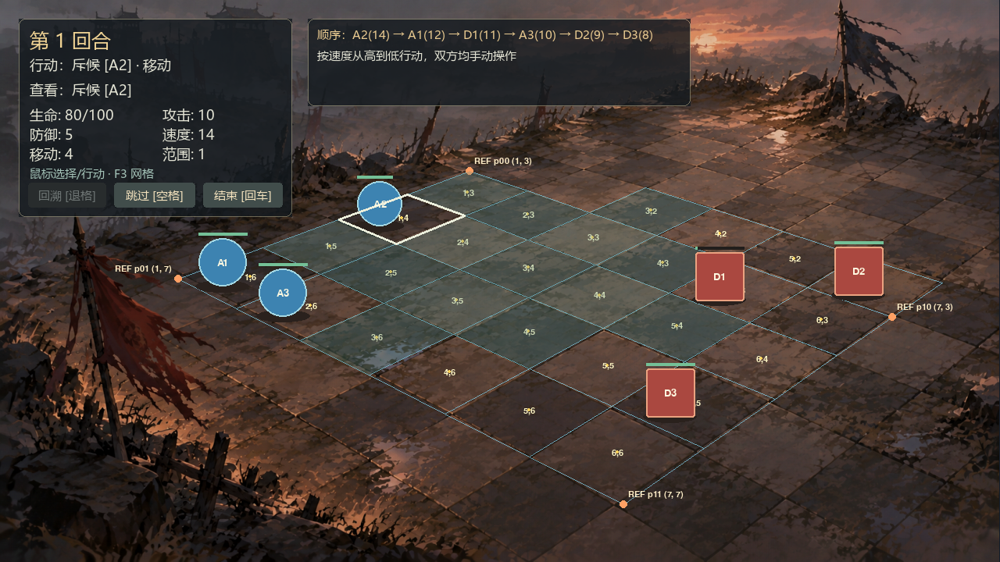
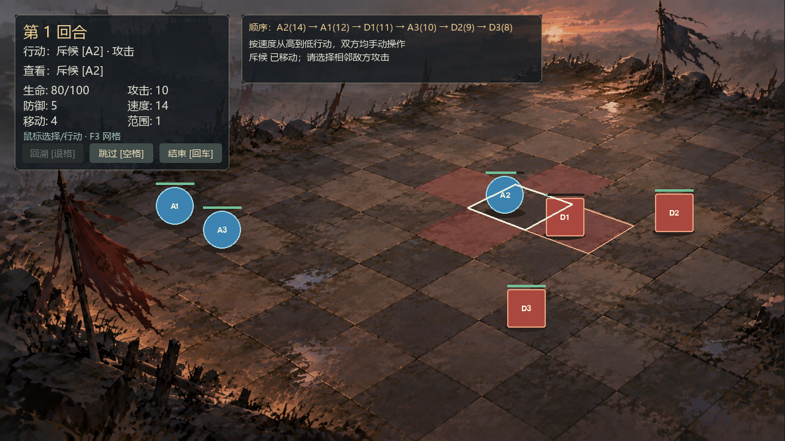
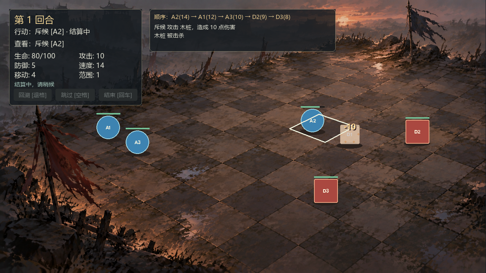
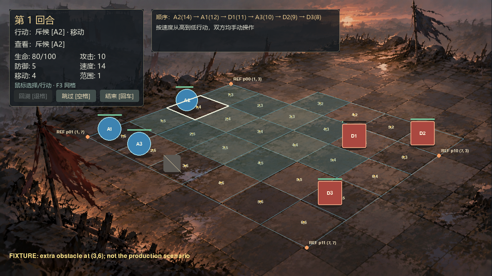

# War Torn：不规则逐砖地图与单应性校准

用户明确补充：**不要求完整 n×n 矩形区域，但每个小地块必须与图片对齐**。据此采用 28 块可辨认石砖组成的不规则地图，保留 8×8 逻辑包围盒及六个单位的初始坐标、定义和数值。没有把大石砖再等分，也没有挪动单位掩盖几何误差。

## 诊断与坐标链

旧配置将原图四点 `(1060,270)/(1530,452)/(892,898)/(340,568)` 之间的目测区域直接均分为 8×8；该区实际约跨 4–5 列、6 行大石砖，四角未对应同一整砖区域的外边界。主因是选区和砖块计数错误；没有发现矩阵行列颠倒或重复缩放，未重写运行时单应性公式。

| 项目 | 实际值 |
| --- | --- |
| 原始 PNG | 1672×941；文件内容未修改 |
| SHA256 | `f3ae6033599a5cc9047a8509c3d3f2269e3604513aa29cb0ec7e4db1051f5d2a` |
| 参考视口 | 1280×720 |
| contain 比例 | `720/941 = 0.7651434643995749` |
| 理论偏移 | `(0.34006376195532084, 0)` |
| 缓存背景 | 1279×720，整数 blit 位置 `(0,0)` |

背景、网格、脚底、特效和地面拾取共用 `BackgroundFit`。缓存尺寸/blit 取整差异不到 1 px，无法解释旧网格跨越砖块中央的错位。所有观测和配置角点均在原始 PNG 坐标系中，测量时才转到视口。

## 地图与四角标定

有效格为 row=2 的 col=3…6，以及 row=3…6 的 col=1…6，共 28 格。其余 36 格在场景 JSON 中显式不可通行，不画假石砖，也不作为可选地面。四方向逻辑邻接不变。

参考矩形的逻辑原点 `(1,3)`、跨度 `6×4`，仅用于建立同一个单应性，并非不规则地图外轮廓。row=2 的四块石砖在参照矩形外，但都属于已观测、验证的地图。F3 的 `REF p00/p10/p11/p01` 同时显示逻辑顶点编号。

先用参考矩形的四个真实交点精确标定，再测其余 36 点：平均 **13.605058 px**、最大 **27.442275 px**，未达标。四角正确后，局部非规则绘画和人工读点误差仍会使单次四点解不稳定。

接着先对**同一个单应性**做多点标定，未直接升级控制网格：40 个实测交点按奇偶分组，20 点仅用于离线最小二乘，另外 20 点只验证、不参与求解；四个参考外角全部属于验证组。运行时仍由原 `PerspectiveBoardGeometry` 计算投影/逆变换，不执行拟合，没有逐格形变。

| 参考顶点 | 原图人工观测 | 多点模型估计，原图坐标 |
| --- | --- | --- |
| p00 `(1,3)` | `(771,288)` | `(785.806252,286.443252)` |
| p10 `(7,3)` | `(1491,527)` | `(1493.022837,531.157249)` |
| p11 `(7,7)` | `(1029,845)` | `(1042.659639,844.366933)` |
| p01 `(1,7)` | `(308,458)` | `(298.787556,467.715916)` |

**配置四角是模型估计，不能当成人工精确点选值。** 它们估计真实边界交点的位置；观测、预测、误差分别保存，不将拟合值回填成实测。四个外角接受同样的非零误差验收，没有把拟合四角的零残差混入平均数。

## 实际误差

正式数据：[40 个原图交点](calibration/war_torn_map_observations.json)；可重算结果：[完整误差报告](calibration/war_torn_map_report.json)。以下均为 1280×720 下的欧氏距离。

| 样本 | 数量 | 平均 px | 最大 px |
| --- | --- | --- | --- |
| 独立验证，含地图边界 | 20 | **5.567316** | **11.419992** |
| 其中独立内部交点，四周都有有效格 | 9 | **3.855241** | **6.002102** |
| 远处独立验证 | 6 | 4.807837 | 11.391354 |
| 中部独立验证 | 7 | 3.475779 | 7.207970 |
| 近处独立验证，含外边界 | 7 | 8.309834 | 11.419992 |
| 标定点，另列，不能当独立验证 | 20 | 4.807673 | 10.442478 |
| 全部观测顶点 | 40 | 5.187494 | 11.419992 |

独立整体及内部交点达到均值≤6/最大≤12 px 的目标，因此**不实现 `CalibratedGridGeometry` 或 9×9 控制点模式**。近处边界仍有约 8–11 px 残差，未声称每个分区均值都≤6，或每个破损砖缝像素完全重合。人工读点估计有约 3–6 个原图像素不确定性；这是观测点估值，不是零误差或亚像素测量。

最初的 2×6 样带保留为历史证据：[旧观测](calibration/war_torn_observations.json)、[旧报告](calibration/war_torn_report.json)。其 5.56/11.71 px 仅属于当时局部粗标点；正式地图采用重新放大核对的数据，不混用统计。

## 运行与复核

```powershell
.\.venv\Scripts\python.exe main.py --presentation presentations/war_torn_8x8.json --debug-grid
.\.venv\Scripts\python.exe -S scripts/fit_board.py --check --report docs/calibration/war_torn_map_report.json
.\.venv\Scripts\python.exe scripts/fit_board.py --check --screenshot artifacts/calibration_validation.png
```

`fit_board.py` 默认只测量；`--check` 验证正式配置与标定、遮罩和原图尺寸一致。显式 `--write-presentation` 才重新生成四角。校验原图散列、所有地块顶点的真实观测、标定/验证分离、远中近覆盖、重复、越界和退化数据；阈值失败时非零退出。CI 和解压验收也运行检查。

已有交互读点工具：

```powershell
.\.venv\Scripts\python.exe scripts/calibrate_board.py --pick --cols 6 --rows 4
```

先标四角，再逐行标内部点；Backspace/Z 撤销，P 预览，S 保存草稿，Esc 退出。草稿不自动替换正式地图。此工具处理矩形参照区；尚无不规则地图鼠标绘制编辑器。不规则边界及样本角色在 JSON 编辑后运行 `fit_board.py`，不能用预测点补全不可辨认砖面。

## 定位与输入

- 单位、PNG 动画统一用脚底 `cell_anchor`；几何角色表现矩形以脚底为底边。标签、血条和伤害跳字由同一脚底/尺度派生。
- 选中框、移动/攻击范围和目标框使用投影四边形。地面共享边界按半开区间归属右/下一逻辑格；若该格为 void 则不命中，不向邻格吸附。
- 角色身体可能高于地面格，Game 先由 Renderer 按相同脚底/精灵透明像素检测可见形体，再逆投影地面；HUD 优先。Renderer 只读 BoardView，操作仍经 Controller。
- 独立障碍底部落在对应脚底；PNG 攻击/死亡及几何死亡形体一并按屏幕脚底 Y、稳定 UID 排序。伤害文字保留覆盖层。
- 原三个障碍坐标在有效区外，继续作为 void 阻挡，不在图外画岩石。障碍定位用同一 Scenario 增加 `(3,6)` 障碍的注入夹具验收，截图注明夹具；未将额外障碍写入正式场景。
- Battle、Board 寻路、伤害、行动顺序、快照和结算 token 的代码/语义未改；地图形状通过已有 Scenario 障碍数据约束移动。训练场、渡口、矩形/几何模式保留。

## 文件与验证

| 文件组 | 变更 |
| --- | --- |
| `tactics/perspective_geometry.py` | 原单应性增加参照矩形/有效格遮罩；脚底表现矩形 |
| `tactics/presentation_layout.py`、`game.py` | 可选配置、void/出生格校验、形体输入 |
| `tactics/perspective_board_renderer.py`、`effects.py` | 有效区绘制、四边形选中、脚底与死亡深度排序 |
| `presentations/war_torn_8x8.json`、`content/scenarios/war_torn.json` | 标定四角、参照区、28 格遮罩、36 格阻挡；单位数据不变 |
| `scripts/fit_board.py`、`docs/calibration/war_torn_map_*.json` | 可复算单应性、独立验证、配置一致性、实际游戏截图 |
| 四个校准/透视测试模块、CI、`scripts/verify_release.py` | 输入/边界/兼容/脚底检查、标定纳入交付检查 |
| README/TASKS/CHANGELOG/AGENTS/SOURCE | 维护与验收记录 |

完整套件 **165 项，本机 164 通过、1 项因 Windows 无符号链接权限跳过**。dummy 与 Windows 实际驱动分别运行；七组纯核心/内容/几何/配置/校准共 80 项可用 `-S`，另 4 项纯包完整性通过。覆盖 28 个地面中心、远中近形体、void、共享边、范围、三次击杀/胜利/连续回溯、拒绝旧 token 和矩形/透视完整 BattleView 一致性。

截图来自实际 Windows SDL 窗口的 Game Surface；F3、点击和退出以事件调用验证，不声称人工逐次点击。交点核对使用原始图片，截图没有用手绘棋盘替代。

## 限制与后续

仅 28 块已观测石砖开放，其他可见铺石仍是背景；文件名 8×8 表示逻辑包围盒。角色仍为几何回退。未新增控制网格、地图编辑器、resize、相机或玩法。扩图先补真实交点、独立验证和 void 数据；误差超目标后再评估控制网格，不靠移动单位或将预测值冒充观测消除报告误差。










